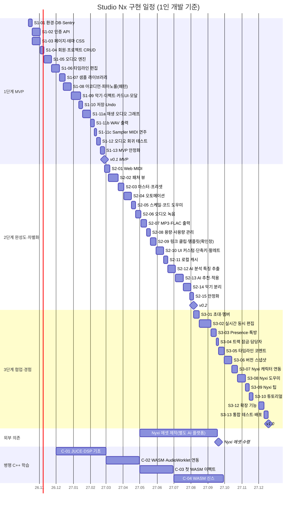

# Studio Nx — 구현 계획 (3단계 · 간트차트)

| 항목 | 내용 |
|---|---|
| 기준 문서 | [PRD 00~06](PRD/00_PRD_Overview.md), [DB.md](DB.md), 채택된 [AI 제안](Ai_feedback.md) |
| 작성일 | 2026-10-01 (AI 제안 채택 반영 개정) · 2026-10-03 Phase 1 진행 현황(§2.2) 추가 |
| 시작일(가정) | 2026-10-12 (월) |
| 일정 가정 | **1인 개발**, 주당 약 30시간, JS·백엔드 직접 구현 + 학습 시간 포함. 실제 진행 속도에 맞춰 매 단계 끝에 재조정 |

---

## 1. 단계 나누는 기준
PRD의 Phase는 **기능 묶음**이고, 이 문서의 단계는 **구현 순서**입니다.

1. **MVP 우선** — "혼자 곡을 만들고 WAV로 내보낼 수 있다"를 가장 먼저 완성합니다.
2. **나중에 바꾸기 어려운 데이터 구조는 1단계에서 확정** — MIDI 노트를 처음부터 **패턴**에 저장하고, 마스터를 **MASTER 트랙**으로 만들어 둡니다. UI(링크 복제·런처·오토메이션)는 뒤에 붙여도 DB 이전이 필요 없습니다.
3. **작곡에 꼭 필요한 기능과 차별화 기능은 2단계** — 오토메이션·녹음·스케일 도우미·템플릿·UI 커스터마이징, 그리고 AI 레퍼런스 분석·악기 분리.
4. **협업과 경험 요소는 3단계** — 실시간 협업(코멘트·스냅샷·잠금 포함), Nyxi 캐릭터·도우미·튜토리얼, 클립 런처.

| 단계 | 목표 | 기간(예상) | 마일스톤 |
|---|---|---|---|
| **1단계 — MVP** | 혼자 곡 만들기 → 저장 → WAV 출력 (+ 회귀 테스트 기반) | 2026-10-12 ~ 2027-02-25 (19.5주) | **v0.1 MVP** (2027-02-26) |
| **2단계 — 작곡 완성도 · 차별화** | 패처, MIDI 장치, 오토메이션, 스케일·코드, 녹음, MP3/FLAC, 용량 관리, 링크 클립·템플릿, UI 커스터마이징·커맨드 팔레트, 로컬 캐시, **AI 레퍼런스 분석**, **악기 분리** | 2027-02-26 ~ 2027-08-05 (23주) | **v0.2** (2027-08-06) |
| **3단계 — 협업 · 경험** | **실시간 협업 + 톡방 + 잠금·코멘트·스냅샷**, **Nyxi 캐릭터 연동·도우미·팁·튜토리얼**, 클립 런처, 확장 기능 | 2027-08-06 ~ 2027-12-18 (19주) | **v1.0** (2027-12-19) |

---

## 2. 1단계 — MVP
> 완료 조건: 회원가입 → 프로젝트 생성 → 샘플 드롭·피아노롤 입력 → 신스·이펙트(체인 뷰) → 저장/불러오기 → **WAV 출력**까지 한 사람이 끝까지 할 수 있고, 오디오 회귀 테스트가 돌아간다.

| ID | 작업 | 관련 PRD | 기간 | 중요도 |
|---|---|---|---|---|
| S1-01 | 개발 환경·폴더 구조, FastAPI 뼈대, MySQL `studionx` 생성, **Sentry 연동**(오류 + 기본 성능 지표) | 00 §5, §7 | 1주 | 최상 |
| S1-02 | Phase 1 테이블 + 인증 API (회원가입·로그인·JWT·리프레시) | 01 FR-101~108 · 세부 §2.1 P1-03~05 | 2주 | 최상 |
| S1-03 | 페이지 HTML/CSS 6종 + **테마 CSS 변수 체계**(다크/라이트 전환 대비) | 01 §6, 02 FR-2162 · 세부 §2.1 P1-01·06·11 | 2주 (S1-02와 병행) | 최상 |
| S1-04 | 회원정보 수정·탈퇴, 문의, 프로젝트 CRUD (생성 시 **MASTER 트랙 자동 생성**) | 01 FR-111~126 · 세부 §2.1 P1-02·07~10·12~19 | 1주 | 상 |
| S1-05 | 오디오 엔진 기초: AudioContext, 트랜스포트, 스케줄러(tick/PPQ 960), 메트로놈, 루프 | 02 FR-201~205 | 2주 | 최상 |
| S1-06 | 타임라인: 트랙 추가/순서/삭제, 클립 이동·길이·복제·분할, 스냅, 줌 | 02 FR-206~210 | 2주 | 최상 |
| S1-07 | 샘플 드래그앤드롭 업로드, 라이브러리 패널, 파형, 태그, **업로드 용량 확인** | 02 FR-221~227 | 1.5주 | 최상 |
| S1-08 | 트랙 아코디언 틀 + [노트] 탭 피아노롤 (노트는 **패턴**에 저장) | 02 FR-231~233, 261~262, 2131 | 2주 | 최상 |
| S1-09 | 기본 악기(Synth, Sampler) + 이펙트(EQ, Comp, Reverb) + 체인 뷰 + **Nyxi 디바이스 카드 + 상세 설정 모달**(`param_schema` 자동 생성, 아트는 플레이스홀더) + 트랙 헤더 믹서·마스터 트랙 | 02 FR-241~252, 263~264, 2181~2189 | 2.5주 | 최상 |
| S1-10 | 프로젝트 전체 저장/불러오기(`/full`), 자동 저장, Undo/Redo(명령 레지스트리 기반) | 02 FR-253~256, 2169 | 1주 | 최상 |
| S1-11a | **재생 오디오 그래프** (2026-10-19 추가): 기본 악기(Synth, Sampler), 이펙트(EQ, Compressor, Reverb, Limiter, Gain, **Delay**), 트랙 믹서(볼륨, 팬, 뮤트, 솔로, 마스터), 클립과 노트의 실제 재생, 진짜 미터. 컨텍스트를 인자로 받아 실시간과 오프라인 렌더링에 함께 씀 ([결정 문서](Default_Instruments_Effects.md)) | 02 FR-241~252, 263~264 | 2주 | 최상 |
| S1-11b | WAV 출력 (OfflineAudioContext, 클라이언트 인코딩, 내보내기 창에 FR-301 옵션 전체. 스템은 보류, 2026-10-20) | 03 FR-301~303, 307 | 1주 | 최상 |
| S1-11c | **Sampler MIDI 연주** (2026-10-20 추가): Sampler에 `sample_id`와 `mode`(Classic, One-Shot) 파라미터 추가, MIDI 노트로 샘플 재생(One-Shot은 노트 길이 무시, 연속으로 치면 겹쳐 울림), 상세 창의 Sample 줄과 Mode 줄, 샘플 없는 카드 경고. 목업 `docs/page_mockups/sampler/`, 결정 `docs/Default_Instruments_Effects.md` | 02 FR-233, FR-241, FR-242 | 0.5주 | 상 |
| S1-12 | **오디오 회귀 테스트 기반**: 테스트 프로젝트 3~5개 + 골든 WAV + 비교 스크립트 | 00 §7.1 | 1주 | 상 |
| S1-13 | MVP 안정화: 버그 수정, 브라우저 테스트, Sentry 오류 정리 | — | 1주 | 상 |

### 2.1 Phase 1 세부 작업 (S1-02 ~ S1-04)
> 관련 FR은 [PRD 01](PRD/01_Phase1_Account_Pages.md) 기준. 담당은 기획서 AI 규칙(HTML/CSS = AI 작성, JS·백엔드 = AI 뼈대 → 직접 구현)을 따릅니다.
> 브랜치 흐름: `feature/phase1/p1-NN-*` → PR → `feature/phase1-account` → (Phase 1 완료) PR → `develop`

| ID | 그룹 | 작업 | 관련 FR | 담당 | 기간 | 브랜치 |
|---|---|---|---|---|---|---|
| P1-01 | 공통 기반 (먼저) | 공통 CSS: 테마 색 변수(다크/라이트), 헤더·푸터·버튼·폼 스타일 | FR-142, 02 FR-2162 | AI | 2일 | `feature/phase1/p1-01-common-css` |
| P1-02 | 공통 기반 (먼저) | 프론트 공통 JS: API 호출 함수(토큰 자동 첨부, 401이면 재발급), 로그인 확인(안 됐으면 `home.html#login?next=`로 이동) | FR-105 | 뼈대 AI → 직접 | 2일 | `feature/phase1/p1-02-frontend-api-core` |
| P1-03 | 공통 기반 (먼저) | 백엔드 공통: ORM 모델(users, inquiries, projects, project_members, tracks), 오류 응답 형식, `get_current_user` | — | 뼈대 AI → 직접 | 2일 | `feature/phase1/p1-03-backend-core` |
| P1-04 | 인증 | 회원가입 API + 이메일·닉네임 중복 확인 + 비밀번호 규칙·bcrypt 해시 | FR-101~102 | 직접 | 2일 | `feature/phase1/p1-04-signup-api` |
| P1-05 | 인증 | 로그인(JWT 발급, 리프레시 토큰 HttpOnly 쿠키 — 자동 로그인 체크 시 3일, 아니면 세션 쿠키), 토큰 재발급, 로그아웃, `last_login_at` | FR-103~105 | 직접 | 3일 | `feature/phase1/p1-05-login-jwt` |
| P1-06 | 인증 | `join.html` 화면 + `home.html` 로그인 모달 + 로그인 상태 헤더 버튼(My Page·My Projects) | §6 | AI | 1일 | `feature/phase1/p1-06-auth-pages` |
| P1-07 | 인증 | 가입·로그인 JS: 폼 검증, 실시간 중복 확인, `#login`이면 모달 자동 열기, 로그인 후 `next` 페이지로 이동, 로그인 상태면 헤더 전환 | FR-101, 103 | 직접 | 2일 | `feature/phase1/p1-07-auth-js` |
| P1-08 | 회원 정보 | `/users/me` 조회·수정, 프로필 이미지 업로드(jpg/png/webp, 2MB) | FR-106 | 직접 | 2일 | `feature/phase1/p1-08-user-profile-api` |
| P1-09 | 회원 정보 | 비밀번호 변경, 회원 탈퇴(재확인, 소프트 삭제, 로그인 차단) | FR-107~108 | 직접 | 1일 | `feature/phase1/p1-09-password-withdraw` |
| P1-10 | 회원 정보 | `userInfo.html` [회원 정보] 탭 화면 + JS | FR-106~108 | AI(화면) / 직접(JS) | 2일 | `feature/phase1/p1-10-userinfo-page` |
| P1-11 | 홈 · 문의 | `home.html`: 첫 화면, Service·Character·Feature·Development·Contact 섹션, 푸터 | FR-111·112·114 | AI | 2일 | `feature/phase1/p1-11-home-page` |
| P1-12 | 홈 · 문의 | 문의 API(이메일·제목·내용·개인정보 동의) + 반복 전송 제한(권장) | FR-112~113 | 직접 | 1일 | `feature/phase1/p1-12-inquiry-api` |
| P1-13 | 프로젝트 | 프로젝트 CRUD API: 생성 시 OWNER 멤버 + MASTER 트랙 **트랜잭션**, 검색·페이지, 권한 검사, 소프트 삭제 | FR-122~126 | 직접 | 3일 | `feature/phase1/p1-13-project-api` |
| P1-14 | 프로젝트 | `myProject.html`: 카드 목록, 새 프로젝트 모달, 이름 변경, 삭제 확인창 | FR-123~126 | AI(화면) / 직접(JS) | 2일 | `feature/phase1/p1-14-myproject-page` |
| P1-15 | 프로젝트 | `studioNx.html` 빈 페이지 (`?projectId=` 받아 제목 표시, 열기 테스트용) — **시퀀서 화면 틀과 함께** 사용자가 레퍼런스를 정한 뒤 진행 | FR-126 | AI / 직접 | 0.5일 | `feature/phase1/p1-15-studionx-stub` |
| P1-16 | 마이페이지 | `/me/dashboard` API: 프로필, 최근 프로젝트 5개, 용량·AI 사용량(기본값) | FR-121 | 직접 | 1일 | `feature/phase1/p1-16-dashboard-api` |
| P1-17 | 마이페이지 | `myPage.html`: 좌측 메뉴, 프로필 카드, 최근 프로젝트, 위젯 자리 | FR-121 | AI(화면) / 직접(JS) | 1.5일 | `feature/phase1/p1-17-mypage` |
| P1-18 | 마무리 | 테스트(pytest): 가입·로그인·재발급, 다른 사람 프로젝트 접근 차단, 탈퇴 계정 로그인 | §10 | 직접 (요청 시 AI) | 2일 | `feature/phase1/p1-18-tests` |
| P1-19 | 마무리 | `docs/ai-notes/` 설명 문서, `develop`으로 PR | — | AI / 직접 | 0.5일 | `feature/phase1/p1-19-ai-notes-pr` |
| P1-20 | 홈 · 문의 | `home.html` 첫 접속 로딩(인트로) 애니메이션 약 1초 → 첫 화면 전환, 건너뛰기 없음 — 로딩 C "Crescent" + 로고 S2 (2026-10-03, [ai-notes 25](ai-notes/25_intro_logo.md)) | FR-111 | AI(화면) / 직접(첫 접속만 JS) | 0.5일 | `feature/phase1/p1-20-intro-loader` |
| P1-21 | 홈 · 문의 | Development 공지 API(`GET /dev-notes`) + **SQLAdmin 관리자 화면**(`/admin`, ADMIN만) — 공지 작성·문의 답변 | FR-114~115 | 직접 (요청 시 AI) | 2일 | `feature/phase1/p1-21-dev-notes-admin` |
| P1-22 | 공통 기반 | **오류 페이지** 7종(404·500·403·503·429·400·504, F-2 "숫자 자체가 신호" 디자인) + 페이지 요청 오류 시 HTML·API 요청 오류 시 JSON 응답 | FR-116 | AI(화면) / 직접(백엔드 연결) | 1일 | `feature/phase1/p1-22-error-pages` |
| P1-28 | 계정 | **비밀번호 찾기**: 재설정 요청·새 비밀번호 API 2개, `password_reset_tokens`, 로그인 모달 Forgot 링크, 요청 화면과 `resetPassword.html`, 이메일을 잊은 경우 안내(메일 + Contact 문의). 개발 중 메일은 서버 로그 출력, SMTP는 추후 (2026-10-14). 화면(복구 모달, `resetPassword.html`)과 실제 재설정 링크 사이트 시험까지 완료 (2026-10-15) | FR-118~119 | AI(함수 하나씩) | 3일 | `feature/phase1/p1-28-account-recovery` |

**권장 순서**: A(P1-01~03) → B(P1-04~07) → C·D·E 병행(P1-08~15) → F(P1-16~17) → G(P1-18~19)

### 2.2 Phase 1 진행 현황 (2026-10-03)
| 구분 | 작업 | 상태 |
|---|---|---|
| 화면(AI) 완료 | P1-01, 06, 10, 11, 14, 17, 22 화면 + 화면 점검([ai-notes 24](ai-notes/24_ui_review.md)) | ✅ |
| 템플릿(AI) 완료 | P1-02·03 뼈대, P1-04·05·08·09·12·13·16·21 템플릿 (PR #24~31, [ai-notes 16~23](ai-notes/)) | ✅ — YouTrack In Progress |
| 직접 구현 | 아래 5단계 순서 | 다음 주부터 |
| 로딩·로고 | P1-20 로딩 C + 로고 S2 (헤더·파비콘 교체) | ✅ 화면 — 첫 접속만 보이기 JS는 직접 |
| 개인정보 처리방침 | `privacy.html`(GDPR·CCPA·개인정보 보호법), 가입 동의(16세+), `users` 동의 기록, 보관 기간 정리 템플릿 (2026-10-05, [ai-notes 27](ai-notes/27_privacy_policy.md)) | ✅ 화면·DB — 동의 전송·검사, `retention.py`는 직접(P1-04·07·09·12). **정식 공개 전 글꼴 자체 호스팅 필수** |
| 보류 | P1-15 시퀀서 틀 | ⏸ 사용자 설계 문서 대기 |

직접 구현 순서 (각 템플릿 `.py` 파일 맨 위 주석에도 같은 내용):

| 단계 | 작업 | 시작 조건 |
|---|---|---|
| 1 | P1-03 백엔드 공통 (모델 컬럼·오류 처리기·`get_current_user`), P1-02 프론트 공통 JS | 가장 먼저 — 나머지가 모두 사용 |
| 2 | P1-04 회원가입, P1-05 로그인, P1-07 가입·로그인 JS | P1-03 병합 후 |
| 3 | P1-08·09 + P1-10 JS, P1-12, P1-13 + P1-14 JS | P1-03~05 병합 후 |
| 4 | P1-16 + P1-17 JS | P1-08·13 병합 후 |
| 5 | P1-21, P1-22 백엔드 연결, P1-18 테스트 → P1-19 `develop`으로 PR | 앞 단계 병합 후 |

**브랜치 규칙 (2026-10-03 정리)**
| 규칙 | 내용 |
|---|---|
| 구현 브랜치 | 위 표의 브랜치를 `feature/phase1-account`에서 미리 만들어 둠 (16개). 시작 전에 `git merge feature/phase1-account`로 앞 단계 구현을 받음 |
| PR | 작업 하나 = PR 하나 → `feature/phase1-account`. 병합되면 YouTrack Closed |
| 템플릿 PR | 템플릿만 병합된 작업은 YouTrack **In Progress** (구현 PR 병합 때 Closed) |
| 여러 브랜치를 이어서 만들 때 | 같은 파일(`router.py` 등)을 고치는 PR은 앞 브랜치에서 이어 만들고 순서대로 병합. 앞 PR 병합 뒤 다음 PR의 대상을 `feature/phase1-account`로 바꿈 (병합 시 브랜치 자동 삭제가 꺼져 있음) |
| 결정 반영 | 탈퇴 후 같은 이메일·닉네임은 3일 뒤 재가입, 탈퇴자의 OWNER 프로젝트는 남김, 문의 제한은 메모리 방식 (PRD 01 FR-108·113) |

**PRD 01에 있지만 뒤로 넘기는 항목**
| 요구사항 | 넘기는 곳 | 이유 |
|---|---|---|
| FR-127 템플릿으로 시작 | 2단계 S2-09 | 템플릿 기능이 먼저 필요 |
| FR-131~137 용량 실제 계산·정리 화면 | 2단계 S2-08 | 업로드 파일이 Phase 2부터 생김 (지금은 컬럼·위젯 자리만) |
| FR-141 환경 설정 탭 | 2단계 S2-10 | 설정 항목이 시퀀서 기능에 의존 |
| FR-142 모든 페이지 테마 적용 | 지금은 P1-01 CSS 변수만, 전환 UI는 S2-10 | — |

## 3. 2단계 — 작곡 완성도 · 차별화
> 완료 조건: 패처·오토메이션·녹음·스케일 도우미·링크 클립·템플릿(확인창)·UI 커스터마이징이 동작하고, MP3/FLAC 출력, **레퍼런스 분석 → 추천 적용**, **악기 분리 → 라이브러리 등록**이 된다.

| ID | 작업 | 관련 PRD | 기간 | 중요도 |
|---|---|---|---|---|
| S2-01 | Web MIDI 실시간 연주·녹음, 화면 건반/PC 키보드 입력 | 02 FR-234~236, 238 | 1.5주 | 상 |
| S2-02 | **패처 뷰**: 노드·연결선·병렬·연결선 게인, 순환 검사, 체인⇄패처 전환 | 02 FR-265~269 | 2.5주 | 상 |
| S2-03 | 마스터 디바이스 설정(Limiter와 Gain, Delay는 S1-11a에서 이미 만듦), 프리셋 저장/불러오기 | 02 FR-243, 246, 252 | 1.5주 | 상 |
| S2-04 | **오토메이션 레인**: 레인·포인트 편집, 곡선, AudioParam 스케줄링, 출력 반영 | 02 FR-2101~2108 | 2주 | 최상 |
| S2-05 | **스케일·코드 도우미**: 스케일 표시·스냅, 코드 스탬프, 다이아토닉 코드 | 02 FR-2111~2116 | 1주 | 상 |
| S2-06 | **오디오 녹음**: 입력 선택, 모니터링, 레이턴시 보정 | 02 FR-2121~2126 | 1.5주 | 상 |
| S2-07 | MP3/FLAC 서버 인코딩, `export_jobs` 진행률, 출력 이력, 라이브러리에 추가 | 03 FR-304~314 | 1.5주 | 상 |
| S2-08 | **저장 용량·AI 사용량 관리**: 대시보드 위젯, 용량 정리 화면, 자동 정리 | 01 §4.4 | 1주 | 상 |
| S2-09 | **링크 클립 UI**(링크/독립 복제, 고유하게 만들기) + **템플릿**(시스템·내 템플릿, **적용 전 확인창**) | 02 FR-2132~2134, 2141~2145, 01 FR-127 | 1.5주 | 상 |
| S2-10 | **UI 커스터마이징**(테마·색·배율·레이아웃) + **단축키 설정** + **커맨드 팔레트** + 하단 패널 틀 | 02 FR-2161~2170, FR-271~275, 01 §4.5 | 2주 | 상 |
| S2-11 | **로컬 캐시**(OPFS/IndexedDB, LRU, 무효화) | 02 FR-228~229 | 1주 | 중 |
| S2-12 | AI 분석 ①: 레퍼런스 파일 업로드 + 장르 태그, 특징 추출 | 05 FR-501~502, 511~515 | 2주 | 최상 |
| S2-13 | AI 분석 ②: 추천 4종(스키마 검증) + 미리듣기·적용·Undo + 레퍼런스 기반 새 프로젝트(확인창) + 사용량 한도 | 05 FR-521~530, 551~553 | 2주 | 최상 |
| S2-14 | **악기 분리**: 작업 큐·워커(Demucs 계열), stem → 샘플 등록, 용량 확인 | 04 전체 | 2주 | 상 |
| S2-15 | 2단계 안정화 + 회귀 테스트 세트 확장(패처·오토메이션) | — | 1주 | 상 |

## 4. 3단계 — 협업 · 경험
> 완료 조건: 초대한 멤버와 동시 편집·톡방·코멘트·트랙 잠금이 되고 스냅샷으로 복원할 수 있다. Nyxi(외부 제작 에셋)가 춤추고 도우미의 얼굴로 답하며, 상황 인지 팁을 주고 튜토리얼을 안내한다.

| ID | 작업 | 관련 PRD | 기간 | 중요도 |
|---|---|---|---|---|
| S3-01 | 초대·수락·멤버 권한 관리, 공유받은 프로젝트 목록 | 06 FR-601~607 | 1.5주 | 상 |
| S3-02 | **실시간 동시 편집**: WebSocket, 연산 전송·검증·revision, LWW, 재접속 따라잡기 (오토메이션·패턴 연산 포함) | 06 FR-611~620 | 3주 | 상 |
| S3-03 | Presence(접속자·선택영역) + **톡방(하단 패널)** | 06 FR-631~647 | 1.5주 | 상 |
| S3-04 | **트랙 잠금·담당자** | 06 FR-671~675 | 0.5주 | 상 |
| S3-05 | **타임라인 코멘트**: 핀, 답글, 해결, 사이드 패널, 멘션 | 06 FR-651~657 | 1.5주 | 상 |
| S3-06 | **버전 스냅샷**: 수동/자동, 미리듣기, 복원(협업 동기화), 복제, 보관 규칙 | 06 FR-661~669 | 2주 | 상 |
| S3-07 | **Nyxi 캐릭터 연동**: 외부 에셋(`manifest.json`) 로더, 플로팅 창, Fruity Dance식 BPM 동기 춤, 이벤트 반응, 상단바 아이콘, **카드 아트 교체**(플레이스홀더 → 외부 에셋) | 02 FR-281~290, 2181~2183 | 1.5주 | 중 |
| S3-08 | **Nyxi 도우미**: 대화·스트리밍, 프로젝트 문맥, 도움말 RAG, 액션 버튼(명령 레지스트리), 캐릭터 연동(생각 중·말풍선·빠른 질문) | 05 FR-531~541 | 2주 | 중 |
| S3-09 | **Nyxi 팁(상황 인지)**: 팁 규칙 9종, 레벨·빈도 제한·조용한 모드, **프로젝트 5개 도달 시 유지 여부 확인창** | 05 FR-561~569 | 1주 | 중 |
| S3-10 | **튜토리얼 모드**: 기본 코스 5단계, 동작 감지, 진행 저장 | 02 FR-2151~2155 | 1주 | 중 |
| ~~S3-11~~ | ~~클립 런처(세션 뷰)~~ — **2026-10-06 제외** (PRD 02 범위 밖) | — | — | — |
| S3-12 | 확장: 레퍼런스 링크 입력, 내 곡 vs 레퍼런스 비교, 사이드체인, `.mid` 가져오기, Drum Rack | 05 FR-503~504, 529 / 02 FR-237, 242, 266 | 1.5주 | 하 |
| S3-13 | 통합 테스트, 배포, 도움말 문서(`docs/help/`), AI 구현 설명 문서 정리 | — | 1주 | 상 |

## 5. 병행 트랙 — C++ / JUCE → WASM (사용자 학습)
> 기획서 원칙상 C++ 구현은 사용자가 직접 합니다. 일정에 묶지 않고 **병행 학습 트랙**으로 둡니다.

| ID | 내용 | 시기(목표) |
|---|---|---|
| C-01 | JUCE·DSP 기초 (Gain → Filter → Oscillator) | 2026-12 ~ 2027-02 |
| C-02 | Emscripten 빌드 + AudioWorklet 연동 (PRD 02 §4.6 인터페이스) | 2027-03 ~ 2027-04 |
| C-03 | 첫 WASM 이펙트를 `engine='WASM'` 플러그인으로 등록, 회귀 테스트로 Web Audio 버전과 비교 | 2027-05 ~ 2027-06 |
| C-04 | WASM 신스 (기본 Synth 대체 또는 추가), 오토메이션 연동 | 2027-07 ~ 2027-09 |

---

## 6. 간트차트

## 7. 리스크와 대응
| 리스크 | 영향 | 대응 |
|---|---|---|
| 오디오 엔진(스케줄링·지연) 구현 난이도 | 1단계 지연 | S1-05를 가장 먼저 프로토타입. lookahead scheduler 패턴 참고 |
| 패처·오토메이션·패턴이 Undo·저장·협업과 얽힘 | 2·3단계 버그 | 데이터 구조(패턴, MASTER 트랙, 연결선)를 1단계에 확정, 모든 편집을 **명령 레지스트리** 단위로 통일 |
| 소리가 조용히 바뀌는 회귀 버그 | 품질 저하 | S1-12에서 골든 파일 테스트를 만들고 단계마다 테스트 세트 확장 |
| 녹음 레이턴시가 기기마다 다름 | 녹음 위치 어긋남 | 자동 측정 + 수동 보정값, 기기별 설정 저장 |
| AI 추천 품질이 낮음 | 차별화 약화 | 규칙 기반 기본 추천을 먼저 만들고 LLM은 설명·보정 역할부터 시작 |
| 악기 분리·스냅샷으로 저장 용량 급증 | 운영 비용 | S2-08 용량 관리를 분리·스냅샷보다 먼저 구현, 보관 규칙 자동화 |
| 실시간 협업 충돌 처리 | 3단계 지연 | 서버 순서화 + LWW + 트랙 잠금으로 충돌 자체를 줄임. CRDT는 필요할 때 |
| 1인 개발 일정 초과 (총 61.5주) | 전체 지연 | 단계 끝마다 범위 재조정. S3-10~S3-12는 v1.0 이후로 미룰 수 있음 |
| Nyxi 에셋(외부 AI 플랫폼 제작) 지연 | S3-07 지연 | 1단계부터 **플레이스홀더 아트 + `manifest.json` 로더**로 개발해 에셋 없이도 전 기능 동작. 에셋 규격(PRD 02 FR-288)을 외부 제작 쪽에 미리 전달 |
