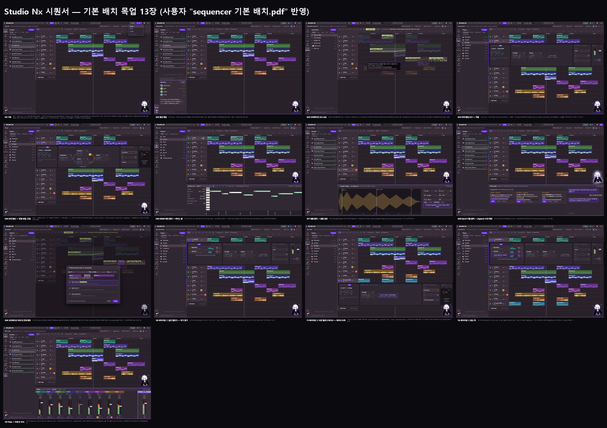
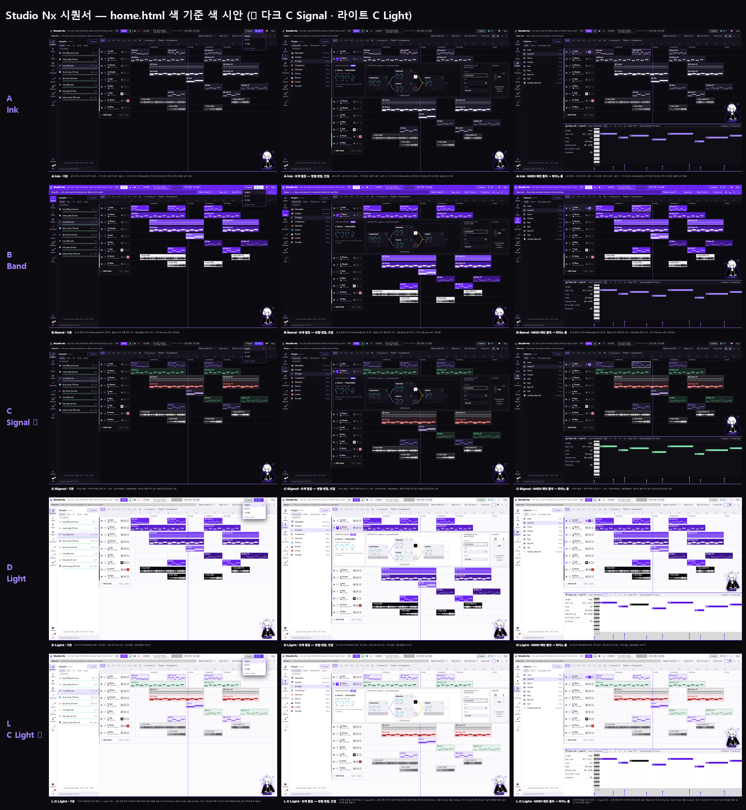

# Studio Nx — 시퀀서 기본 배치 목업

| 항목 | 내용 |
|---|---|
| 기준 | 사용자 레퍼런스 `studionx/frontend-reference/images/sequencer reference/sequencer 기본 배치.pdf` (5쪽, 2026-10-05) |
| 이전 문서 | [Sequencer_UI_Reference_Analysis.md](Sequencer_UI_Reference_Analysis.md) — Ableton : FL 유사도 목업 |
| 작성일 | 2026-10-05 |
| 목업 | `docs/page_mockups/sequencer/layout/` — 상태별 13장 + 개요, 소스 `_source/layout.html?s=1..13` |
| 색 시안 | `docs/page_mockups/sequencer/color/` — home.html 색 배치 기준 5개 × 3장 (§7), 소스는 같은 `layout.html?s=N&theme=A|B|C|D|L` |
| 상태 | 화면 배치 확인용 목업 (HTML/CSS 목업, 실제 화면 코드 아님). **Q1~Q12 모두 결정 (2026-10-05, §5)** |
| 갱신 | 2026-10-05 사용자 의견 반영: ① 샘플 클립은 트랙에서도 파형 ② 가(연결)를 단순하게 — Connect to Another ③ 화면 글자는 영어 (협업 채팅·Nyxi 채팅·목업 아래 설명 줄은 한국어) ④ M·S·● 버튼을 Cubase처럼 트랙 이름 옆으로 ⑤ 마지막 트랙 아래 `＋ Add Track` (트랙 머리와 같은 폭·높이) ⑥ 오토메이션 범위 규칙 + 빈 칸에 패턴이 들어올 때 창 (09) ⑦ 언어 설정 영어/한국어/일본어, 기본 영어 (01 상단바 `EN ▾`) ⑧ MIDI 패턴 클립 안에 실제 노트(음 높이·길이)를 작게 표시 ⑨ 레이어링 두 가지 (10~12, §4.4) |

---

## 1. 한눈에


| 번호 | 파일 | 상태 |
|---|---|---|
| 01 | `01_default.png` | 기본 (평소) |
| 02 | `02_collab.png` | 협업 패널 열림 (협업자 + 채팅) |
| 03 | `03_automation.png` | 오토메이션 모드 (A) |
| 04 | `04_track_serial.png` | 트랙 펼침 (V) — 이펙트 직렬 |
| 05 | `05_track_parallel.png` | 트랙 펼침 — 병렬 분기·병합, Connect to Another 연결 → Mixer 꺼짐 |
| 06 | `06_piano_roll.png` | MIDI 패턴 클릭 → 피아노 롤 |
| 07 | `07_sample.png` | 샘플 클릭 → 샘플 설정 |
| 08 | `08_nyxi_agent.png` | Nyxi 더블 클릭 → Agent 조언·채팅 |
| 09 | `09_automation_dialog.png` | 오토메이션 아래 빈 칸에 새 패턴 → 처리 방법을 묻는 창 |
| 10 | `10_layer_stack.png` | 레이어링 ① 같은 멜로디 — 한 트랙에 악기 쌓기 |
| 11 | `11_layer_track.png` | 레이어링 ② 다른 멜로디·옥타브 — 레이어 트랙(보내는 쪽) |
| 12 | `12_layer_from.png` | 레이어링 ② 받는 쪽 — `<from Track 10>` |
| 13 | `13_mixer.png` | `Tab` 또는 왼쪽 `Mixer` 버튼 → 아래 칸에 모든 트랙 믹서 + MASTER |

## 2. PDF 요구 → 목업 반영
| PDF 요구 | 목업 |
|---|---|
| 헤더는 Ableton 60 : FL 40 디자인 | 두 줄 툴바: 메뉴 · PAT/SONG · 재생 · BPM · 큰 시간 표시 · 오실로스코프 · CPU / 힌트 줄 · 패턴 선택 · Snap · Key · Chord · 창 바로가기 |
| 왼쪽 버튼: 파일 분류 버튼, 협업 버튼 | 왼쪽 버튼 줄 52px — 위: 파일 분류, 아래: 협업자 · 채팅 |
| 파일 5분류: 샘플 · 신스 프리셋 · 플러그인 · 패턴 · 오토메이션 | 버튼 5개 + AI 제안 3개(§4.1, 주황 점) |
| 검색창은 맨 아래 | 파일 패널 맨 아래 `⌕ (분류) 검색 (Ctrl+F)` |
| 추가는 끌어 넣기 또는 업로드 버튼 (샘플·MIDI) | 패널 위 `⤒ 업로드` 버튼 + 아래 끌어 넣기 칸 (WAV·MP3·FLAC·MID) |
| 협업: 평소엔 없고 버튼을 누르면 나타남, 협업자 목록 · 채팅은 각 버튼으로 | 파일 패널 아래에 나타남 (02). 협업자 목록(접속 상태·역할·편집 중인 트랙) + 채팅 |
| 트랙은 Ableton 50 : FL 50 디자인, 선 제거 | 패턴 색 클립 + 아이콘, Time Markers. 트랙 위 빨간 오토메이션 선 없음 |
| (갱신) 샘플은 MIDI 와 다르게 트랙에서도 파형으로 | MIDI 클립 = 패턴 안 **노트를 음 높이·길이대로** 작게 그린 미리보기 (FL 패턴 클립처럼), 샘플(오디오) 클립 = **파형** (8. Vocal, 9. Riser) |
| (갱신) MIDI 패턴은 트랙에서도 멜로디에 따라 노트가 보이게 | 클립마다 그 패턴의 노트를 그대로 축소해 그림 — 클립 안 높이는 그 패턴의 가장 낮은 음 ~ 가장 높은 음. Lead = 멜로디 선, Chords·Pad = 화음 덩어리, Bass·Sub = 낮은 음, Drums = Kick·Snare·Hat 세 줄. 06의 `Lead #2` 클립 모양이 아래 피아노 롤과 같음. 피아노 롤에서 노트를 고치면 같은 패턴의 클립이 모두 바로 바뀜 |
| 오토메이션 모드(A) → 패턴 흐리게, 그 위에 오토메이션 (FL) | 03: 패턴 불투명도 25% (§4.3), 연두색 오토메이션 곡선 클립, 도구 막대 `⤴ 오토메이션 A` |
| 오토메이션 재사용: 놓인 패턴 영역에 따라 적용 대상이 달라짐 | 03: 끌어 놓는 중 풍선 — "아래 패턴이 Bass → 6. Bass › Analog › Filter Cutoff 에 적용" |
| (갱신) 오토메이션은 패턴 범위를 벗어나도 되지만, 옆 패턴의 시작점과는 겹칠 수 없음 | 03: Filter rise 가 Bass(16~20) 끝을 넘어 빈 칸까지 늘어남. 다음 패턴 Bass #2 시작(24마디)에 빨간 점선 `max — Bass #2 start` |
| (갱신) 빈 칸에 다른 패턴이 들어오면 기존 오토메이션을 어떻게 할지 묻는 창 | 09: `Pattern placed under an automation` 창 — Trim / Split / Undo placement (§4.3) |
| 트랙 on/off 버튼(FL) + V 버튼 | 트랙 머리: ● 켜기/끄기 + `V`(펼치면 `⌃`) |
| (갱신) Mixer 의 M·S·● 는 트랙 이름 옆에, Cubase 트랙 모양처럼 | 트랙 머리 오른쪽에 `M`(Mute, 노랑) · `S`(Solo, 청록) · `●`(녹음 대기, 빨강). Mixer 칸에는 미터·볼륨·팬만 |
| (갱신) 트랙 추가는 마지막 트랙 아래 빈 곳에 버튼, 폭·높이는 트랙 칸과 같게 | 마지막 트랙 바로 아래 `＋ Add Track` — 트랙 머리 칸과 같은 200 × 44px (MIDI / Audio 선택) |
| 한 트랙 = 악기 하나 (Ableton) | 트랙 머리 아래 줄에 악기·샘플 이름 (예: `🎹 Wavetable`, `🎵 vox_take2.wav`) |
| 펼침 1칸: MIDI 트랙이면 Add Instrument, 끌어 놓기로 신스·가상 악기 | 04·05: 악기 칸 (빈 트랙이면 "Add Instrument" 칸) |
| 펼침 2칸: 이펙트, 끌어 놓기, FL Patcher 방식 | 04: 오른쪽 `＋` → 옆으로 이어 붙임 (직렬). 05: 아래 `＋` → 병렬로 나눔 (1-1 · 1-2) |
| 병렬 갈래 오른쪽: 위 `＋` / 아래 병합 버튼 — 하나라도 누르면 다음 이펙트부터 합쳐짐, 다시 나누려면 아래 `＋` | 05: 갈래마다 `＋`·`↘/↗`, 병합 후 Limiter 로 합쳐지는 주황 선 |
| 가: 다른 트랙 플러그인에 연결. (갱신) 종류를 나누지 말고 간단히 | **Connect to Another** 칸: `Connect` None ⇄ Connected · `Track` (number) · `Plugin` (select) — 세 가지뿐 |
| 가가 None 이 아니면 나 비활성 (sidechain 은 예외) | 05: Connected → Mixer 칸에 `OFF — Connected to Track 8 › Vocoder`. 규칙은 §4.2 |
| 나: dB 미터 · 패닝 · 볼륨 | **Mixer** 칸 — 04: L/R 미터 · 페이더 · 팬 (M·S·● 는 트랙 머리로 옮김) |
| 아래 칸: 평소엔 트랙, MIDI 패턴 = 피아노 롤, 샘플 = 샘플 설정, Nyxi = AI 조언 | 06 · 07 · 08. 평소(01)엔 아래 칸이 없어 트랙이 끝까지 |
| Nyxi: 재생 중 BPM 에 맞춰 춤 (fruity dance), 더블 클릭 → 조언·채팅이 아래에 | 오른쪽 아래에 Nyxi + `♪ 145 BPM 댄스`, 08 에서 아래 칸 |

> 목업의 Nyxi 는 이미 있는 화면용 그림(`frontend/static/characters/nyxi/character.png`)을 자리 표시로 쓴 것입니다. 춤추는 치비 Nyxi 에셋은 외부 AI 플랫폼에서 만들어야 합니다 (`characters/nyxi/reference/nyxi in sequencer…/` 참고).

## 3. 화면 구조
```
┌──────────────────────────────── 헤더 (두 줄, 62px) ─────────────────────────────────┐
├────┬──────────────┬─────────────────────────────────────────────────────────────────┤
│버튼│ 파일 패널     │ 도구 막대 (P B D T S C E · 오토메이션 A)                          │
│ 줄 │  분류·업로드  │ 마디 눈금 / Time Markers                                         │
│    │  목록         │ 트랙 머리(●·V·이름/악기·M S ●) │ 클립 (MIDI=노트, 샘플=파형)     │
│    │               │ ＋ Add Track (마지막 트랙 아래)                                   │
│    │  끌어 넣기    │   └ 펼침: [Instrument] [Effects] [Connect to Another] [Mixer]     │
│    │  검색(맨 아래)│                                                       Nyxi(춤)   │
│    ├──────────────┤ ─ 아래 칸 (필요할 때만): 피아노 롤 / 샘플 설정 / Nyxi Agent ─   │
│    │ 협업 (숨김)   │                                                                 │
└────┴──────────────┴─────────────────────────────────────────────────────────────────┘
```

## 4. AI가 정한 것 (PDF에서 "AI가 정리해 줄 것"이라고 한 부분)
### 4.1 파일 분류 — 더 넣은 것
| 분류 | 넣은 이유 | 비고 |
|---|---|---|
| **녹음** | 마이크·외부 악기로 녹음한 테이크가 샘플 라이브러리와 섞이지 않게 | 녹음한 프로젝트에 묶임 |
| **레퍼런스** | 핵심 기능 3번(레퍼런스 트랙 링크·파일 → AI 분석)을 올려 두고 비교해 듣는 곳 | Nyxi Agent 조언의 기준 |
| **즐겨찾기** | 다섯 분류를 가로질러 자주 쓰는 것을 모아 봄 | 별 표시만, 파일 복사 아님 |

- **MIDI 파일**은 따로 두지 않고 **패턴**으로 가져옵니다 (`.mid` → 패턴, 목록에 `가져옴` 표시). 업로드는 샘플·MIDI 모두 같은 `⤒ 업로드`·끌어 넣기로 받고, 확장자로 분류를 나눕니다.
- 목업 버튼 이름은 Records · Reference · Favorites 입니다. **셋 다 넣기로 결정** (Q1). 목업의 주황 점은 "AI가 더한 것" 표시일 뿐, 실제 화면에는 없습니다.
- 버튼 줄에는 보기 버튼 `🎚 Mixer`(`Tab`)도 있습니다 (Q6).

### 4.2 Connect to Another(가)와 Mixer(나) — 규칙 (Q2·Q3 결정)
화면에서는 **연결 종류를 고르지 않습니다.** `Connect`(**None ⇄ Connected**) · `Track`(번호) · `Plugin`(목록) 세 칸만 둡니다. 언어별 표기: None/Connected · 없음/연결됨 · なし/接続中.

**기본값은 받는 입력의 종류로 자동** — 받는 쪽이 이 소리를 **참고만** 하면(엿듣기) Mixer 를 켜 두고, **재료로 쓰면**(옮기기) 끕니다.

| 종류 | 예 | Mixer (나) 기본값 |
|---|---|---|
| None | — | 켜짐 |
| 엿듣기 — 사이드체인 (Compressor·Gate·Ducker) | Kick → Bass Compressor | **켜짐** |
| 엿듣기 — 변조 소스 (Envelope Follower) | Drums 크기 → Pad 필터 | **켜짐** |
| 엿듣기 — 분석·비교 | EQ 에 다른 트랙 주파수 겹쳐 보기, Nyxi 믹스 분석 | **켜짐** |
| 엿듣기 — 센드(병렬 보내기) | Vocal → Reverb 트랙 (원음 + 잔향) | **켜짐** |
| 옮기기 — Vocoder 입력, 레이어(`Instruments (layer)`), 버스로 보내기 | 신스 → Vocal Vocoder | **꺼짐** — `OFF — Connected to Track N › Plugin` |

- 애매한 경우(MIDI 보내기, 오디오 보내기)를 위해 Mixer 칸에 **`Also play this track`(원음도 함께 출력)** 스위치를 둡니다. 기본값은 위 표대로, 사용자가 바꿀 수 있습니다.
- 사용자는 종류를 고르지 않습니다 — 플러그인 정보에 "입력 종류(엿듣기/옮기기)"를 둡니다.
- `Connect`를 None 으로 돌리면 Mixer 가 바로 다시 켜집니다.

### 4.4 레이어링 (사용자 제안, 2026-10-05)
| 경우 | 방법 | 목업 |
|---|---|---|
| ① **같은 멜로디**에 악기를 더함 | 트랙 펼침의 INSTRUMENTS 칸 아래 `＋ Add instrument` → 같은 노트를 모든 악기가 연주. 악기마다 **볼륨 · 팬 · Solo** 만 둠. 합친 소리가 트랙의 이펙트·믹서로 감 | 10 |
| ② **다른 멜로디·옥타브**를 다른 악기로 | 새 트랙에서 노트를 따로 찍음. 그 트랙의 Connect to Another 를 `Connected` · `Track` = 받는 트랙 · `Plugin` = **Instruments (layer)** 로 정하면, 받는 트랙 INSTRUMENTS 칸에 `<from Track X>` 줄이 **병렬로** 생김 | 11 · 12 |

**의견 — 좋은 방식이라고 봅니다.**
- ①은 Ableton Instrument Rack, FL Layer 채널과 같은 기능을 트랙 안에서 바로 보여 줘서 이해하기 쉽습니다.
- ②는 새 연결 칸을 만들지 않고 **이미 있는 Connect to Another 를 그대로 다시 씀**이라 규칙이 하나로 유지됩니다. Plugin 목록에 `Instruments (layer)` 항목만 하나 더 생깁니다.
- `<from Track X>` 줄이 ① 의 다른 악기 줄과 **똑같이 볼륨·팬·Solo** 를 가지므로, "같은 멜로디 레이어"와 "다른 멜로디 레이어"를 한 곳에서 섞을 수 있습니다.

**세부 규칙**
| 항목 | 정한 값 | 이유 |
|---|---|---|
| 보내는 트랙(②)의 자기 이펙트 | ✅ 쓸 수 있음 — **보내기 전에** 적용 (예: 레이어만 EQ 로 깎기). Effects 칸 끝에 `→ sends to Track 1 › Instruments` 표시 (Q8) | 레이어마다 따로 다듬을 일이 많음 |
| 보내는 트랙의 Mixer | 꺼짐 (`OFF — Connected to Track 1 › Instruments`). 볼륨·팬은 받는 쪽 `<from Track X>` 줄에서 | §4.2 규칙과 같음 (옮기기 → 꺼짐) |
| 트랙 머리 표시 | 받는 트랙 `+1`(쌓은 악기 수) · `⇠10`(받는 레이어), 보내는 트랙 `→1` | 어느 트랙이 묶였는지 한눈에 |
| 막을 것 | 자기 자신에게 연결, 서로 연결(1→10, 10→1), 고리(1→10→5→1) | 소리가 무한히 돌아 멈춤 |
| 받는 트랙을 지우면 | 보내는 트랙의 Connect 를 None 으로 되돌리고 Mixer 다시 켬 (알림 표시) | 소리가 사라지지 않게 |
| 피아노 롤 | ✅ 레이어 트랙의 피아노 롤에 받는 트랙 노트를 **흐린 노트(ghost)**로 겹쳐 보여 줌 — 고를 수도 고칠 수도 없음. 레이어로 연결되면 **자동으로 켜지고**, 피아노 롤 위 `👻 Track N` 스위치로 끔 (Q9) | 옥타브·화음 맞추기 쉬움 |
| 악기 추가 개수 | 한 트랙 최대 4개 권장 (`<from Track X>` 포함) | 화면 높이·CPU |

### 4.3 그 밖에 정한 것
| 항목 | 정한 값 | 이유 |
|---|---|---|
| 오토메이션 모드에서 패턴 흐림 | ✅ 기본 **불투명도 25%** (PDF "투명도 70~80%" = 비침 75%), 환경 설정에서 **15~40%** 조절 (PRD 02 FR-2163 "크기·가독성"에 추가) (Q4) | 곡선이 잘 보이고 패턴 위치도 알아볼 정도 |
| 오토메이션 적용 대상 | 오토메이션 **시작 위치**의 패턴 하나 | 패턴 끝을 넘어 빈 칸까지 늘어나도 대상은 하나 |
| 오토메이션이 늘어날 수 있는 끝 | **같은 트랙 다음 패턴의 시작점**까지 (그 앞에서 멈추고 빨간 점선 표시) | 사용자 결정: 옆 패턴 시작점과 겹칠 수 없음 |
| 빈 칸에 새 패턴이 들어올 때 창의 선택지 | **Trim at bar N** (✅ 기본 선택, Q7 — 새 패턴 시작에서 자름) · **Split at bar N** (둘로 나눠 뒤쪽은 새 패턴에 적용) · **Undo placement** (놓기 취소) + `Always do this in this project` | 사용자 결정: 창을 띄워 고르게 함. "그대로 두기"는 시작점 겹침 규칙에 어긋나서 뺌 |
| 아래 칸 닫기 | `Esc` 또는 `✕`, 같은 클립 다시 클릭 | 평소 화면(트랙이 끝까지)으로 바로 돌아옴 |
| 아래 칸 높이 | 300px, 위 경계를 끌어 조절 | 트랙이 8줄 정도는 보이게 |
| 켜기/끄기 ● 와 M 의 차이 | 켜기/끄기(FL) = 트랙을 아예 멈춤 (플러그인 처리도 쉼, CPU 절약). `M` = 소리만 끔 (처리는 계속 — 곧바로 다시 켤 수 있음) | 둘 다 있으면 헷갈리기 쉬워 역할을 나눔 |
| 트랙 펼침 | ✅ 기본은 **트랙 하나만** 펼침 (다른 V 를 누르면 앞의 것은 접힘), **`Shift` + `V`** 클릭이면 여러 개 (Q5) | 평소엔 화면이 깔끔하고, 레이어처럼 두 트랙을 같이 볼 때만 여러 개 |
| 믹서 보기 | ✅ **`Tab`** 또는 왼쪽 버튼 줄 `🎚 Mixer` → 아래 칸에 모든 트랙 세로 믹서 띠(이름·악기·FX 수·팬·미터·볼륨·dB·M S ●) + 오른쪽 **MASTER** 고정. 다시 `Tab` → 직전 아래 칸 상태로. 트랙 펼침 Mixer 칸과 같은 값. **입력칸에 커서가 있으면 Tab 은 원래대로(다음 칸)**, 단축키 설정(FR-2167)에서 바꿀 수 있음 (Q6, 목업 13) | Ableton 처럼 Tab 으로 보기 전환. 트랙 높이는 그대로라 곡 전체를 보며 섞음 |
| 병렬 갈래 수 | 목업은 2갈래, `＋ 한 갈래 더`로 늘림 (최대 4 권장) | 화면 높이 안에서 보이게 |
| 협업 패널 | Members·Chat 을 둘 다 열면 위아래로 나눔, 안 읽은 채팅 수는 버튼에 빨간 숫자 | 버튼을 따로 누르는 PDF 방식 유지 |
| 언어 | 상단바 `EN ▾` — English(기본) / 한국어 / 日本語. 목업 01에 펼친 모습. 저장은 `user_settings.ui_settings.language` (DB 컬럼 추가 없음), PRD 02 FR-2171 | 사용자 결정 (2026-10-05). 목업 글자는 기본값인 영어로 그림 |
| 저장 상태 | 헤더 오른쪽 `● Saved` | 자동 저장·복구(FR-256/259) 상태를 늘 보여 줌 |

## 5. 결정 (2026-10-05) — Q1~Q12
| 번호 | 정할 것 | 결정 |
|---|---|---|
| Q1 | 더 넣은 파일 분류 3개 | ✅ **셋 다** — Records(이 프로젝트에서 녹음한 테이크) · Reference(AI 분석용 참고 곡) · Favorites(다섯 분류에서 별표만 모아 보기, 바로가기) |
| Q2 | Connected 일 때 Mixer 를 끄는 기준 | ✅ 받는 입력 종류로 **자동** — 엿듣기(사이드체인·변조·분석·센드)는 켜짐, 옮기기(Vocoder·레이어·버스)는 꺼짐 + Mixer 칸 **`Also play this track`** 스위치 (§4.2) |
| Q3 | `Connect` 의 반대말 | ✅ **Connected** (None / Connected · 없음 / 연결됨 · なし / 接続中) |
| Q4 | 오토메이션 흐림 정도 | ✅ 기본 **25%**, 환경 설정 15~40% |
| Q5 | 트랙 펼침 개수 | ✅ 기본 하나, **`Shift` + `V`** 로 여러 개 |
| Q6 | 믹서 전체 보기 | ✅ **`Tab`** / 왼쪽 `🎚 Mixer` 버튼 → **아래 칸 믹서** + MASTER (목업 13) |
| Q7 | 오토메이션 겹침 창 기본 선택 | ✅ **Trim** |
| Q8 | 레이어 트랙의 자기 이펙트 | ✅ **허용** — 보내기 전에 적용 |
| Q9 | 레이어 피아노 롤에 받는 트랙 노트 | ✅ **흐린 노트** — 레이어 연결 시 자동, `👻` 스위치로 끔 |
| Q10 | 기본 다크 색 | ✅ **C Signal** |
| Q11 | 보라 헤더 면 | ✅ **녹음 중에만** — 헤더가 보라 띠(`#6a24f6`)로, `●` 빨강 유지, `● REC` 글자 함께 |
| Q12 | 라이트 테마 | ✅ **C Light** — 라이트 바탕 + C 규칙(연한 면 + 트랙 색 테두리·이름·노트), 밝은 바탕용 진한 색 |

> 목업 이미지에는 Q2 의 `Also play this track` 스위치, Q9 의 `👻` 스위치, Q11 의 녹음 중 헤더는 아직 그려지지 않았습니다 (시퀀서 화면 HTML/CSS 만들 때 함께 반영).

## 6. 다시 만들기
```powershell
cd docs/page_mockups/sequencer/layout/_source
node shot.mjs ..        # 01~13 PNG (Chrome headless, 1440×960)
```
개요(`00_overview.png`)는 13장을 이어 붙인 그림입니다.

## 7. 색 시안 — home.html 색 배치 기준 (2026-10-05)


### 7.1 홈에서 가져온 색 규칙 (`static/css/tokens.css`, `home.css`)
| 요소 | 홈 | 시퀀서에 쓴 곳 |
|---|---|---|
| 바탕 | 먹색 `#0b0a0f`, 한 단 올린 면 `#15131c` | 화면 바탕·패널 |
| 글자 | 종이색 `#f4f3f7`, 보조 `#b9b6c4`, 흐림 `#7f7b8c` | 이름·값·안내 |
| 보라 면 | `#6a24f6` — 첫 화면의 큰 사선 띠 | B 헤더 면, 선택한 버튼 |
| 보라 글자 | `#a383ff` — "NOISE", 날짜, 짧은 막대 | 재생 위치, 선택, Solo, 업로드 윤곽 |
| 선 | 아주 얇은 흰 선(16%)·보라 구분선 | 트랙·칸 경계 |
| 버튼 | 검은 면 + 보라 윤곽/글자, 누르면 흰 면으로 반전 | `Upload` 버튼, `M` 켜짐(흰 면) |
| 그 밖 | 확인 `#7fe0a8`, 오류 `#ff8a8a`, 모서리 0(각진 포스터), Unbounded 대문자 | 녹음 대기(빨강), 칸 제목, 모서리 |

### 7.2 시안
| 시안 | 내용 | 파일 |
|---|---|---|
| **A Ink** | 홈의 흑백 + 보라 포인트 그대로. 클립은 어두운 면 + 얇은 보라 윤곽, 노트는 종이색, 샘플은 회색 파형. 보라는 선택·재생 위치에만 | `A_01·05·06.png` |
| **B Band** | 홈 첫 화면의 보라 띠를 **헤더 면**으로. MIDI 클립은 보라 계열 명도 차이, 샘플 클립은 **종이색 면 + 먹색 파형**(Nyxi 흑백 그림처럼) | `B_01·05·06.png` |
| **C Signal** | 어두운 클립에 **테두리·이름·노트만 색** — 보라 · 민트 · 코랄 · 종이색 (홈에 이미 있는 색만) | `C_01·05·06.png` |
| **D Light** | 홈 라이트 테마(`#f6f5f9` 바탕, 진한 보라 `#5a17e0`) + 보라 클립, 샘플은 먹색 면 | `D_01·05·06.png` |
| **L C Light** ✅ | 라이트 바탕(홈 라이트 토큰) + C 규칙 — 연한 면에 트랙 색 테두리·이름·노트만. 밝은 바탕용 진한 색: 보라 `#5a17e0` · 초록 `#137a45` · 빨강 `#c42b2b` · 먹색. **다크(C)와 트랙 색 순서가 같음** | `L_01·05·06.png` |

### 7.3 의견 — **결정: 다크 C Signal · 라이트 C Light · 녹음 중 보라 헤더** (2026-10-05)
| 항목 | 추천 | 이유 |
|---|---|---|
| 기본 다크 | **C Signal** (헤더·패널은 A 와 같음) | 홈과 가장 닮은 건 A 지만, 트랙이 10개 넘어가면 색 없이는 찾기 어렵습니다. C 는 홈 색만 쓰면서 트랙을 구분합니다 |
| 강조 | B 의 **보라 헤더 면**은 **녹음 중에만** (헤더가 보라 띠로 바뀌고 `● REC` 표시) | 늘 보라 면이면 오래 작업할 때 눈이 피곤합니다. 홈에서도 보라 면은 첫 화면에만 씁니다 |
| 라이트 | **C Light** — PRD 02 FR-2162(다크/라이트/시스템) 의 라이트 테마로 | 홈 라이트 토큰 + 다크와 같은 트랙 색 규칙이라 테마를 바꿔도 트랙을 찾는 감각이 같습니다 |
| 사용자 색 | 트랙 색은 사용자가 바꿀 수 있게 (FR-2162 트랙 기본 색 팔레트) — 기본 팔레트를 C 의 5색으로 | |

| 번호 | 정할 것 | AI 제안 |
|---|---|---|
| Q10 | 기본 다크 색 시안 | ✅ **C Signal** (2026-10-05 사용자 결정) |
| Q11 | 보라 헤더 면(B)을 쓸지·언제 쓸지 | ✅ **녹음 중에만** |
| Q12 | 라이트 테마 | ✅ **C Light** |

```powershell
cd docs/page_mockups/sequencer/color/_source
node shot.mjs ..        # A~D·L × 01·05·06 PNG (node shot.mjs .. L 처럼 일부만도 가능)
```

