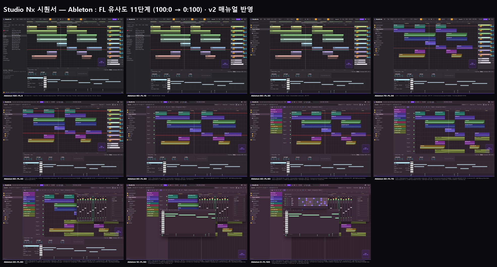

# Studio Nx — 시퀀서 UI 레퍼런스 분석 (Ableton · FL Studio)

| 항목 | 내용 |
|---|---|
| 기준 문서 | [PRD 02](PRD/02_Phase2_Sequencer_Core.md) §6 화면 구성, FR-258(별도 창) |
| 작성일 | 2026-10-05 |
| 레퍼런스 | `studionx/frontend-reference/images/sequencer reference/` — Ableton Live 12 (4장), FL Studio (6장), 사용자 캡처 |
| 매뉴얼 | [Ableton Live 12 Manual](https://www.ableton.com/en/live-manual/12/welcome-to-live/) — Live Concepts, Arrangement View · [FL Studio Online Manual](https://www.image-line.com/fl-studio-learning/fl-studio-online-manual) — Toolbar panels, Playlist, Channel Rack, Mixer (2026-10-05 확인) |
| 목업 | `docs/page_mockups/sequencer/similarity/` — Ableton : FL 유사도 100:0 → 0:100, 10 단위 11장 (v2: 매뉴얼의 화면 구성 요소 이름에 맞춰 갱신) |
| 상태 | 시퀀서 설계 문서 작성 전 참고용. **결정 필요** (§5) |

---

## 1. 한눈에

| | Ableton Live | FL Studio |
|---|---|---|
| 한 줄 요약 | **한 창에 다 붙어 있는** 정돈된 작업대 | **창을 띄워 쓰는** 패턴 중심 작업실 |
| 화면 모델 | 단일 창. 브라우저(왼쪽) · 어레인지(가운데) · 트랙 머리(오른쪽) · 상세 보기(아래)가 고정 | 플레이리스트 위에 피아노롤·믹서·채널 랙·샘플 창을 **떠 있는 창**으로 겹쳐 씀 |
| 음악을 쌓는 단위 | 트랙 = 악기. 클립은 그 트랙에 속함 | 패턴(악보 조각)을 만들고, 아무 트랙에나 놓음. 트랙은 악기와 무관한 "줄" |
| 색 | 무채색 회색 + 트랙별 파스텔 | 자줏빛 바탕 + 패턴별 진한 색 |

### 1.1 매뉴얼 기준 화면 구성 요소
| | Ableton Live 12 | FL Studio |
|---|---|---|
| 맨 위 | **Control Bar** 9구역: Browser 표시 · Tempo/박자/메트로놈 · **Scale**(근음·스케일) · Follow/위치 · Transport · Automation Arm/Capture MIDI · Loop/Punch · Draw/Key/MIDI/CPU · **View Selector**(Session ⇄ Arrangement) | 툴바 패널: Menu · **Title & Hint Bar** · Transport(**PAT/SONG**) · Song Position · Tempo · **Pattern Selector** · Global Snap · Monitor 볼륨 · Time(큰 시간 표시) · Output(오실로스코프) · CPU & Memory · Chord · **창 바로가기 아이콘** |
| 브라우저 | **Sidebar**(Collections · Library · Places) + **Content pane**, 태그 필터 | 폴더 트리(Current project · Plugin database · presets · Samples …) + 태그 |
| 곡 화면 | **Overview** · Beat-time Ruler · **Scrub Area**(Locators) · **Loop Brace** · 트랙 · **Time Ruler**(분:초) | Playlist: 도구 막대(**P** Draw · **B** Paint · **D** Delete · **T** Mute · **S** Slip · **C** Slice · **E** Select · Zoom · Playback) · **Picker Panel** · Track Header · **Time Markers** |
| 트랙 | **Track Headers**: 볼륨·팬·I/O(In/Auto/Off)·S·Arm, 보일 조작은 "Arrangement Track Controls"로 고름. **Return tracks**(A Reverb, B Delay)와 **Main** | Playlist Track은 **믹서 트랙에 묶이지 않음** ("Track Mode"를 켜면 악기·믹서와 연결) |
| 편집 | 아래 **Detail View** = **Clip View**(Notes · Envelopes · MPE) + **Device View**(디바이스 체인), 세모 버튼으로 접고 폄 | 떠 있는 **Piano roll**(Control 레인: Velocity 등) |
| 소리 만들기 | 디바이스가 왼쪽→오른쪽 체인 ("Drop Audio Effects Here") | **Channel Rack**: 줄마다 Mute/Solo LED · Pan · Volume · Mixer 번호 · Channel 버튼 · **16칸 스텝** (또는 피아노롤 미리보기), Swing, 필터 그룹. 모든 패턴이 같은 채널 묶음을 씀 |
| 믹서 | 트랙 머리 안 + Mixer 토글 (볼륨·팬·Sends 구역을 켜고 끔) | 별도 **Mixer** 창: Master · Insert(최대 500) · Current, 트랙마다 미터 · 페이더 · 팬 · 스테레오 분리 · Mute/Solo · Arm · **라우팅 케이블**·Send, **이펙트 슬롯 10개 · 3밴드 EQ** · 입출력, 보기 8단계(Compact ~ Extra large) |
| 도움말 | **Info View**(마우스 아래 요소 설명) · Learn View · **Status Bar**(오류·노트 정보) | **Hint Bar**(한 줄 설명) |

## 2. Ableton Live — 장단점
| 영역 | 장점 | 단점 |
|---|---|---|
| 화면 구성 | 모든 패널이 제자리에 붙어 있어 **창 관리가 없음**. 어디에 뭐가 있는지 늘 같음 | 아래 상세 보기·오른쪽 트랙 머리가 늘 자리를 차지 → 큰 화면이 필요 |
| 곡 구조 | 위쪽 **구간 표시(Intro·Verse·Chorus…)**로 곡 흐름이 한눈에 보임 | 구간 이름이 짧은 칸에서 겹침 (캡처의 Chorus/Breakdown 부근) |
| 트랙 머리 | 오른쪽 머리에 볼륨·팬·솔로·녹음·입출력이 들어 있어 **믹서를 따로 안 열어도** 섞을 수 있음 | 작은 글자·작은 버튼이 촘촘 — 처음 보는 사람에겐 낯섦 |
| 편집 | 클립을 고르면 아래에서 **클립 속성 + 피아노롤**이 바로 열림. 스케일 강조·Fit to Scale | 아래 패널 높이만큼 어레인지가 줄어듦 |
| 소리 만들기 | **디바이스 체인이 왼쪽→오른쪽** — 신호 흐름 그대로라 직관적 (`ableton3`) | 디바이스가 많아지면 가로로 길게 밀려 스크롤 |
| 오토메이션 | 클립 위에 **빨간 선으로 그 자리에서** 편집 (`ableton4`) | 선과 클립 내용이 겹쳐 지저분해지기 쉬움 |
| 도움말 | 왼쪽 아래 **Info View**가 마우스 아래 요소를 설명, **Learn View** 튜토리얼 — 초보에게 좋음 | 늘 자리를 차지 |
| 탐색 | **Overview**로 곡 전체를 보며 끌어서 이동·확대, Time Ruler로 실제 시간 확인 | 띠가 하나 더 생겨 세로 공간이 줄어듦 |
| 스케일 | Control Bar의 **Scale**이 클립·피아노롤 강조와 연결 | — |
| 시각 | 평평하고 일관된 디자인, 클립 이름이 잘 보임 | 회색 위 회색 글자 대비가 낮음, 파스텔 색끼리 구분이 약함 |

## 3. FL Studio — 장단점
| 영역 | 장점 | 단점 |
|---|---|---|
| 화면 구성 | 필요한 창만 띄워 크게 쓸 수 있음, 창 배치를 사람마다 맞춤 | 창이 플레이리스트를 **가림** (캡처 `fl studio1·2·3`에서 믹서·샘플·피아노롤 창이 덮음) → 창 관리 부담 |
| 패턴 | 패턴을 한 번 만들어 **여러 곳에 재사용**, 왼쪽 패턴 목록에서 바로 끌어 놓기 | "채널·패턴·믹서 인서트" 세 개념을 따로 이해해야 함 — 진입 장벽 |
| 트랙 | 트랙이 악기와 분리 — 어떤 클립이든 어느 줄에나 자유롭게 배치 | "Track 5"처럼 이름이 의미가 없음, 무엇이 어디 있는지 찾기 어려움 |
| 비트 | **채널 랙(스텝 시퀀서)**로 드럼을 가장 빨리 찍음 | 멜로디·긴 곡 편집에는 맞지 않음 |
| 피아노롤 | 크고 보기 좋은 노트, 노트 이름 표시, 벨로시티 막대 | 떠 있는 창이라 맥락(다른 트랙)이 가려짐 |
| 오토메이션 | **오토메이션도 클립** — 옮기고 복사하기 쉬움, 곡선 편집기(`fl studio4`) | 작은 오토메이션 클립이 수십 개 생겨 줄이 지저분 (`fl studio6` 아래 줄) |
| 믹서 | Insert 최대 500개, **라우팅 케이블**로 신호 흐름이 보임, 이펙트 슬롯 10개 + EQ, 보기 크기 8단계 (`fl studio5`) | Playlist Track·채널·Insert가 서로 묶이지 않아 **직접 연결**해야 함 (매뉴얼: Track Mode로 묶을 수 있음) — 어긋나기 쉬움 |
| 편집 도구 | Playlist 도구가 **한 글자 단축키**(P·B·D·T·S·C·E)로 통일 — 손에 익으면 빠름 | 도구 모드를 바꿔야 해서, 모드를 잊으면 실수 (예: Delete 모드) |
| 시각 | 큰 시간 표시, 위쪽 **힌트 줄**, 마스코트 | 자줏빛 바탕 위 글자 대비가 낮음, 좁은(condensed) 글꼴이 오래 보면 피곤 |

## 4. 유사도 목업 만드는 법
화면 요소 10가지를 FL 비율 **10%마다 하나씩** FL 방식으로 바꿨습니다. v2에서는 §1.1의 매뉴얼 구성 요소를 그대로 그려 넣었습니다 (예: Ableton의 Overview·Loop Brace·Time Ruler·Return tracks·Device View·Status Bar, FL의 Playlist 도구 막대·Picker 필터·Channel Rack의 LED/Pan/Vol/Mixer 번호·Mixer의 미터/라우팅 케이블/슬롯 10개). 바탕 색조(회색 → 자줏빛)와 모서리 둥글기는 비율만큼 섞었습니다. 모든 장에 Studio Nx의 로고·보라 포인트·떠 있는 Nyxi는 남겼습니다.

| FL 비율 | FL 방식으로 바뀌는 것 | Ableton 방식 (그 전) |
|---|---|---|
| 10% | 위쪽 **Hint Bar** | 왼쪽 아래 **Info View** + 맨 아래 **Status Bar** |
| 20% | 브라우저 **폴더 트리** | **Sidebar + Content pane** 두 칸, 태그 필터 |
| 30% | **Time Markers**, 클립 **종류별 진한 색 + 아이콘**(▤ 패턴 · ⇥ 오디오 · ⤴ 오토메이션) | **Overview** · **Scrub Area/Locators** · **Loop Brace**, 트랙 색 파스텔 클립 |
| 40% | **툴바 패널** 두 줄 (Menu · PAT/SONG · 큰 Song Position · Output · CPU & Memory · Pattern Selector · Snap · Chord · 창 바로가기) | **Control Bar** 한 줄 9구역 (Scale·Capture·Loop/Punch·View Selector 포함) |
| 50% | 왼쪽 **Playlist Track Header**("Track N", 트랙 ≠ 악기) + Playlist **도구 막대 P·B·D·T·S·C·E** | 오른쪽 **Track Headers**(번호·S·Arm·In/Auto/Off·볼륨·팬) · **Time Ruler** |
| 60% | **Picker Panel** (패턴·오디오·오토메이션 클립, 필터 스위치) | 없음 |
| 70% | **Automation clips** (별도 줄) | 트랙 안 오토메이션(빨간 선·점) |
| 80% | **Mixer 창** (Master·Insert, 미터·페이더·LED·라우팅 케이블, 슬롯 10개·EQ·입출력) | 트랙 머리 믹서 + **Return tracks**(A Reverb·B Delay) · Main |
| 90% | 떠 있는 **Piano roll** (노트 이름, Control › Velocity) | 아래 **Detail View** = Device View(Wavetable·EQ Eight·Reverb·Utility) + Clip View(Notes·Envelopes·MPE, 속성 + 피아노롤 + Velocity) |
| 100% | **Channel Rack** (LED·Pan·Vol·Mixer 번호·Channel 버튼·16칸 스텝, Swing·필터 그룹) | 없음 |

> 이 순서는 "바꿨을 때 화면 성격이 덜 바뀌는 것 → 많이 바뀌는 것"으로 제가 정한 것입니다. 실제 설계에서는 비율과 상관없이 **항목마다 골라** 섞을 수 있습니다 (§5).

| 목업 | 파일 |
|---|---|
| 100:0 ~ 0:100 | `01_ableton100_fl0.png` … `11_ableton0_fl100.png` |
| 개요 | `00_overview.png` |
| 소스 | `_source/mix.html?fl=0..100`, `_source/shot.mjs` |

## 5. Studio Nx에 맞추기 — 의견
### 5.1 PRD와 이미 맞는 쪽
| PRD 결정 | 가까운 쪽 |
|---|---|
| 트랙 바로 밑으로 펼치는 **아코디언**에서 디바이스·노트·오토메이션 편집, 하단 고정 패널 없음 (PRD 02 §6) | Ableton의 "그 자리에서 편집" + FL의 "가리지 않는 넓은 작업 공간"을 섞은 형태 — 어느 쪽 그대로도 아님 |
| 체인 뷰(Ableton식) ⇄ 패처 뷰(FL Patcher식) (FR-263) | 둘 다 |
| 패턴·클립 런처 (`patterns`, `launcher_scenes`) | FL 패턴 개념 + Ableton 세션 |
| 시퀀서는 **별도 브라우저 창** (FR-258) | 창 안에서 다시 창을 띄우면 이중 창 관리 → **단일 창(Ableton)** 쪽이 맞음 |
| Nyxi 도우미·초보 대상 | Ableton Info 창·FL 힌트 줄처럼 **설명이 보이는 화면** |

### 5.2 추천: 약 **Ableton 70 : FL 30**, 단 항목별로 고르기
| 항목 | 추천 | 이유 |
|---|---|---|
| 화면 모델 | **Ableton (단일 창, 겹치는 창 없음)** | 이미 별도 브라우저 창 — 그 안에서 창이 또 겹치면 웹에서는 더 불편 |
| 도움말 | **FL Hint Bar** + Nyxi (Status Bar는 없앰) | 늘 자리를 차지하는 Info 창 대신 한 줄. Nyxi 말풍선과 같은 자리로 묶기 좋음 |
| 브라우저 | **Ableton 두 칸** | 분류 → 항목이 한 번에 보여 샘플 찾기가 빠름 |
| 클립 | **FL 진한 패턴 색 + 아이콘** (오디오/MIDI/오토메이션 구분) | 파스텔보다 어두운 바탕에서 구분이 또렷, 종류가 아이콘으로 바로 보임 |
| 상단바 | **Ableton Control Bar 한 줄** (Scale·Loop 포함) + 큰 시간 표시만 FL에서 | 세로 공간 아끼기. Scale은 AI 추천(장르·키)과 연결하기 좋음 |
| 곡 탐색 | **Ableton Overview + Locators** | 곡 구조(Intro·Drop)를 AI 분석 결과와 같은 말로 보여 줄 수 있음 |
| 트랙 머리 | **Ableton (트랙 = 악기, 머리에 볼륨·솔로)** — 위치는 왼쪽 | 웹 초보에게 "Track 5"보다 이해 쉬움. 왼쪽이 읽는 순서에 맞음 |
| 패턴 | **FL 패턴 목록** (브라우저의 한 탭으로) | 재사용이 PRD `patterns` 설계와 맞음 |
| 오토메이션 | **Ableton (트랙 안, 아코디언의 오토메이션 탭)** | PRD 아코디언과 일치. 작은 클립이 흩어지지 않음 |
| 믹서 | **Ableton (트랙 머리 + MASTER 트랙)** | PRD FR-251 그대로 |
| 편집 창 | **아코디언** (둘 다 아님) | PRD §6 |
| 스텝 시퀀서 | **FL 채널 랙을 드럼 트랙 아코디언 안의 한 보기로** | 비트 찍기의 빠름은 가져오고 창은 늘리지 않음 |

### 5.3 정할 것
| 번호 | 정할 것 | 선택지 |
|---|---|---|
| Q1 | 기본 비율 | 위 목업 중 가장 가까운 단계 (추천 70:30) |
| Q2 | 트랙 모델 | 트랙 = 악기 (Ableton, 추천) / 트랙 ≠ 악기 (FL) |
| Q3 | 떠 있는 창 허용 | 없음 (추천) / 피아노롤·믹서만 / FL처럼 모두 |
| Q4 | 스텝 시퀀서 | 드럼 트랙 아코디언 안 (추천) / 별도 창 / 없음 |
| Q5 | 바탕 색조 | Studio Nx 먹색(지금) / Ableton 회색 / FL 자줏빛 |

> 이 답을 시퀀서 설계 문서(사용자 작성)에 넣으면, 그 문서를 기준으로 화면을 만듭니다.
