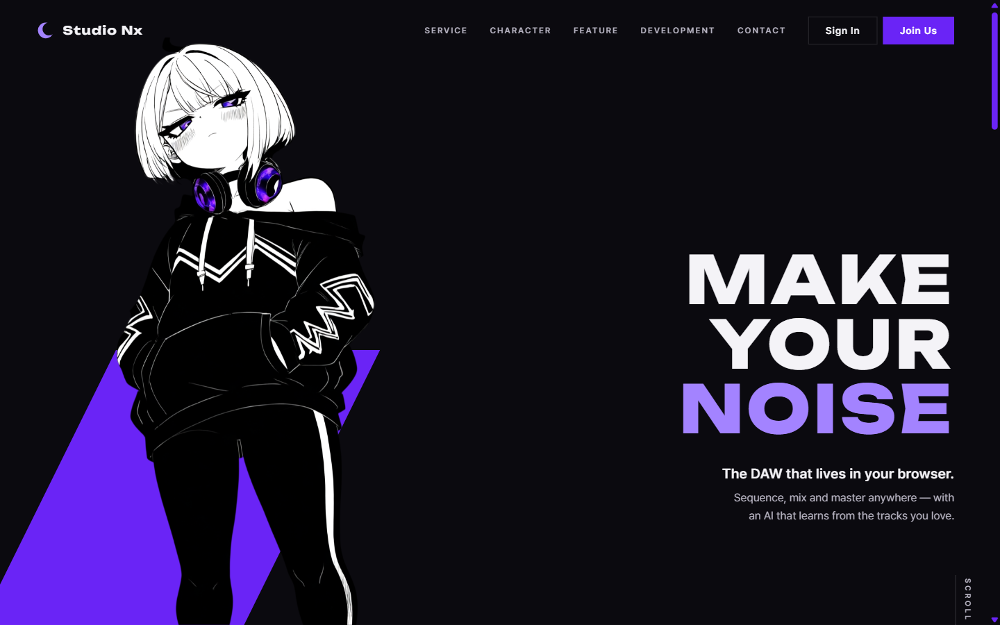
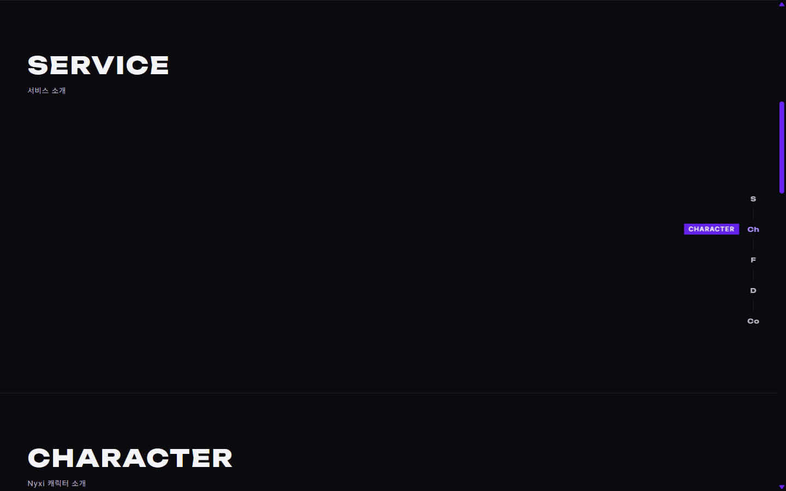
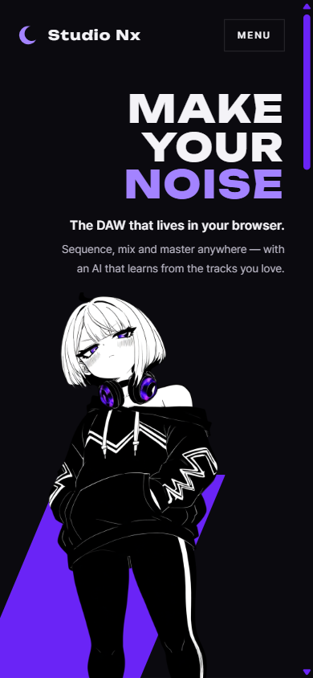
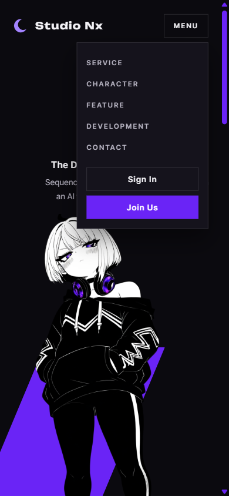

# AI 구현 설명 02 — 메인 페이지(home.html) 구조 · 첫 화면 + 공통 CSS

| 항목 | 내용 |
|---|---|
| 작성 | Claude (AI) |
| 작성일 | 2026-10-02 |
| 작업 | P1-01 공통 CSS + 메인 페이지 첫 화면 ([Implementation_Plan.md](../Implementation_Plan.md) §2.1) |
| 브랜치 | `feature/phase1/p1-01-common-css` |
| 기준 레퍼런스 | `studionx/frontend-reference/images/main page reference/mainpage수정사항(구조 및 firstpage).pdf` |
| 원칙 | HTML/CSS는 AI 작성, JS는 **템플릿만** (기획서 AI 규칙) |

---

## 1. 실행 결과
### 1.1 데스크톱 첫 화면 (1440 × 900)


### 1.2 두 번째 화면부터 나오는 세로 앵커 (Ch에 마우스를 올린 상태)


### 1.3 모바일 (390 × 844) — 첫 화면 / 메뉴 열림
| 첫 화면 | 메뉴 열림 |
|---|---|
|  |  |

## 2. 무엇을 만들었나
| 파일 | 역할 | 비고 |
|---|---|---|
| `studionx/frontend/home.html` | 메인 페이지 구조 | 첫 화면 + 빈 섹션 5개 + 푸터 |
| `studionx/frontend/static/css/tokens.css` | **공통** 디자인 변수 | 색(다크 기본, 라이트·시스템 준비), 글꼴, 글자 크기, 간격 |
| `studionx/frontend/static/css/base.css` | **공통** 기본 스타일 | 리셋, 버튼, 헤더, 모바일 메뉴, 섹션 제목, 푸터, 포커스·선택 영역·스크롤바 |
| `studionx/frontend/static/css/pages/home.css` | 메인 페이지 전용 | 첫 화면 배치, 등장 애니메이션, 세로 앵커, 모바일 배치 |
| `studionx/frontend/static/js/pages/home.js` | **템플릿** | 현재 섹션 표시, 모바일 메뉴 자동 닫기 — 함수 자리만 있음 |
| `studionx/frontend/static/characters/nyxi/hero.png` | 첫 화면 Nyxi 이미지 | `characters/nyxi/poses/main page transparent.png` 복사본(투명 배경). 출처 정보를 파일에 기록 |
| `PRODUCT.md` | 디자인 도구용 제품 요약 | PRD 기준, 사용자 확인 후 작성 |
| `.impeccable/surfaces/studionx-frontend-home-html.md` | 이 페이지의 설계 기록 | 개발용. 웹에는 포함되지 않음 |

### 2.1 페이지 구조
```
home.html
├─ header      로고(임시 초승달) + Studio Nx │ Service · Character · Feature · Development · Contact │ Sign In · Join Us
├─ main
│  ├─ #top        첫 화면: Nyxi(왼쪽) + MAKE / YOUR / NOISE(오른쪽 정렬) + SCROLL
│  └─ .sections   ← 여기부터 세로 앵커(S — Ch — F — D — Co) 표시
│     ├─ #service      서비스 소개      (빈 틀)
│     ├─ #character    Nyxi 캐릭터 소개 (빈 틀)
│     ├─ #feature      기능            (빈 틀)
│     ├─ #development  개발자 노트      (빈 틀)
│     └─ #contact      문의            (빈 틀)
└─ footer      Studio Nx · 개발자 연락처(준비 중) · 저작권  ← 앵커 없음
```

### 2.2 레퍼런스 요청 → 구현
| 레퍼런스 요청 | 구현 |
|---|---|
| 로고: Nyxi 머리띠 초승달, 글씨는 'Studio Nx' | 임시 초승달 SVG + `Studio Nx`. 외부 로고가 오면 `home.html`의 `<svg class="brand__mark">` 교체 |
| 메뉴 = 아래 섹션 앵커, 클릭 시 자동 스크롤 | 5개 앵커 + `scroll-behavior: smooth` |
| 두 번째 화면부터 S, Ch, F, D, Co 세로 배치 | 오른쪽 끝 세로 앵커, 마우스를 올리면 전체 이름 펼침 |
| 버튼 두 개: Sign In / Join Us | `login.html` / `join.html`로 연결 (페이지는 P1-06에서 생성) |
| 영어 카피: 큰 것(짧고 핵심) + 작은 것(설명), 오른쪽 정렬 | **MAKE / YOUR / NOISE** + "The DAW that lives in your browser." + 설명 한 줄 |
| Nyxi 캐릭터, 투명 배경 | 왼쪽 아래 기준, 화면 높이의 94% 크기 |
| 색감: Black & White 메인, Violet 포인트 | 먹색 바탕·흰 글자, 보라는 Nyxi 헤드폰 색(`#6820f8`)에서 추출 |
| 캐릭터 주변 장식은 아직 넣지 말 것 | 넣지 않음 |

## 3. 왜 이렇게 했나
### 3.1 세로 앵커를 JS 없이 구현
`position: sticky` + `height: 0`으로 만들었습니다. 세로 앵커가 `.sections`(두 번째 화면부터의 영역) 안에 있어서, 첫 화면에서는 보이지 않다가 섹션 영역에 들어오면 화면 가운데에 붙습니다. 스크롤 이벤트 코드가 필요 없어 JS 템플릿 원칙을 지키면서도 바로 동작합니다.

### 3.2 모바일 메뉴를 `<details>`로 구현
여닫기 버튼은 보통 JS가 필요하지만, HTML 기본 요소 `<details>`/`<summary>`를 쓰면 JS 없이 열고 닫을 수 있습니다. "링크를 누르면 닫기"만 JS 템플릿(`initMobileMenuClose`)으로 남겼습니다.

### 3.3 색 변수(`tokens.css`)를 따로 둔 이유
모든 페이지가 같은 색·글꼴 변수를 쓰도록 공통 파일로 분리했습니다(P1-01). `<html data-theme="dark|light|system">`만 바꾸면 테마가 바뀌는 구조라, 2단계(S2-10)에서 테마 전환 UI를 붙일 때 CSS를 다시 쓰지 않아도 됩니다.

### 3.4 보라색을 두 가지로 나눈 이유
| 변수 | 값 | 쓰는 곳 | 이유 |
|---|---|---|---|
| `--c-violet` | `#6a24f6` | 버튼·무대면 등 **면** | 헤드폰 색 그대로. 흰 글자 대비 충분 |
| `--c-violet-ink` | `#a383ff` | NOISE 등 **글자** | 헤드폰 색 그대로는 검은 바탕 위 글자 대비가 부족(약 2.6:1) → 밝혀서 약 6:1 |

### 3.5 글꼴
| 용도 | 글꼴 | 이유 |
|---|---|---|
| 큰 제목·로고 | **Unbounded** (Google Fonts) | 레퍼런스의 넓고 두꺼운 대문자 제목 느낌, 음악·나이트 분위기 |
| 본문·메뉴 | **Pretendard** (CDN) | 한글·영문을 함께 깔끔하게 표시 |

### 3.6 레퍼런스에 없던 것 (AI가 결정, 바꾸기 쉬움)
| 항목 | 내용 | 바꾸는 곳 |
|---|---|---|
| 보라 무대면 | Nyxi 발밑의 평행사변형. 레퍼런스 두 번째 이미지의 바닥면 참고, 검은 후드가 바탕에 묻히지 않게 함 | `home.css` `.hero__stage` (빼려면 `home.html`의 `<div class="hero__stage">` 삭제) |
| 등장 애니메이션 | 제목이 한 줄씩 올라오고 Nyxi가 뒤따름. 동작 줄이기 설정을 켠 사용자에게는 나오지 않음 | `home.css` `@keyframes` 부분 |
| 마우스 효과 | 메뉴 밑줄, 세로 앵커 이름 펼침 | `base.css`, `home.css` |
| 파비콘 | 임시 초승달 | `home.html` `<link rel="icon">` |

## 4. 검증 결과 (2026-10-02)
| 확인 | 결과 |
|---|---|
| 데스크톱 1440×900 첫 화면 | 레퍼런스 배치대로 표시 (§1.1) |
| 첫 화면에서 세로 앵커 숨김 / 두 번째 화면부터 표시 | 정상 (§1.2) |
| 모바일 390px 가로 넘침 | 없음 |
| 모바일 메뉴 열기 | 정상 (§1.3) |
| 디자인 자동 검사(impeccable detect) | 문제 0건 |
| 브라우저 콘솔 오류 | 없음 (파비콘 404는 수정) |
| 이미지 출처 기록 | `hero.png`에 출처(사용자 제공 PixAI 이미지) 기록 |

## 5. 남은 일
| 항목 | 담당 |
|---|---|
| `home.js`: 현재 보고 있는 섹션을 세로 앵커에 보라색 표시(`aria-current`), 모바일 메뉴 링크 클릭 시 닫기 | 사용자 (JS) |
| 외부 AI로 만든 초승달 로고로 교체 | 사용자 에셋 → AI 교체 |
| 푸터 개발자 연락처 | 사용자 결정 |
| 섹션 5개 내용 디자인 | 다음 작업 |
| `/` 주소를 home.html로 연결 | 백엔드 (사용자 또는 요청 시 AI) |
| 디자인 독립 검토, `DESIGN.md`(디자인 시스템 문서) 작성 | 요청 시 진행 |

## 6. 자주 받을 질문 대비
- **Q. 왜 CSS 프레임워크(Tailwind 등)를 안 썼나?** 기술 스택이 Vanilla이고, 변수(`tokens.css`)만으로 테마와 일관성을 관리할 수 있어서.
- **Q. 세로 앵커는 어떻게 첫 화면에서만 숨겨지나?** sticky 요소는 자기를 담은 부모 영역 안에서만 붙어 있습니다. 부모를 두 번째 화면부터의 영역(`.sections`)으로 두었기 때문에 첫 화면에서는 나타나지 않습니다(§3.1).
- **Q. 캐릭터 이미지는 왜 `frontend/static`에 복사했나?** `studionx/characters/`는 원본 보관용이라 웹에 공개되지 않습니다. 화면에 쓰는 파일만 공개 폴더(`static/characters/nyxi/`)에 둡니다.
- **Q. 접근성은?** 본문 바로가기 링크, 이미지 대체 텍스트, 키보드 포커스 표시, 동작 줄이기 설정 존중, 글자 대비 4.5:1 이상(보조 글자 포함).
