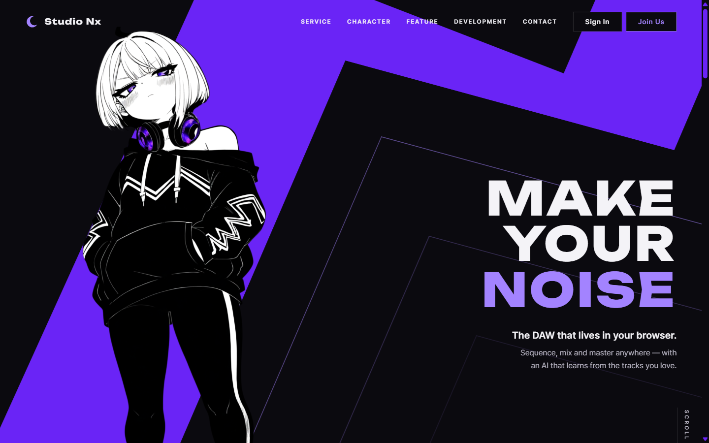
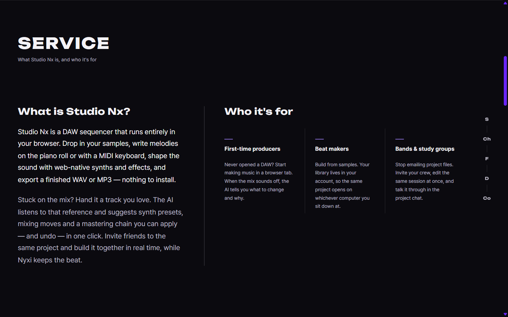
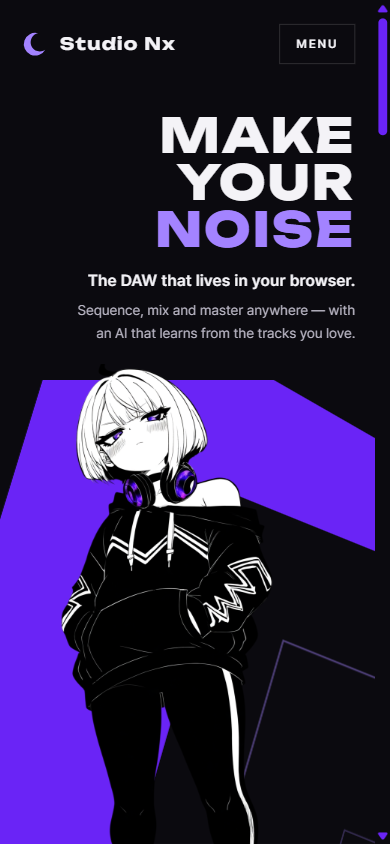
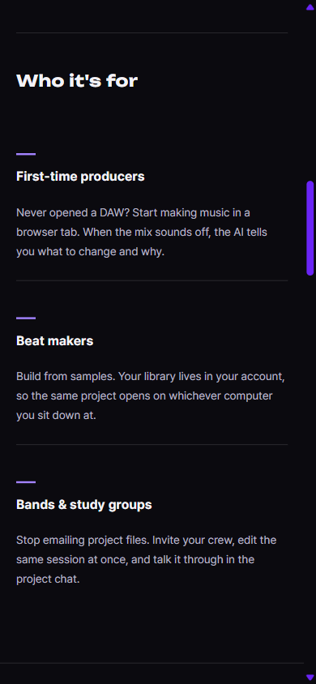

# AI 구현 설명 03 — 메인 페이지 수정(첫 화면) · Service 섹션

| 항목 | 내용 |
|---|---|
| 작성 | Claude (AI) |
| 작성일 | 2026-10-02 |
| 작업 | P1-11 메인 페이지 (첫 화면 수정과 Service 섹션), 이전 작업: [02_home_first_page.md](02_home_first_page.md) |
| 브랜치 | `feature/phase1/p1-01-common-css` |
| 기준 레퍼런스 | `studionx/frontend-reference/images/main page reference/mainpage수정사항(firstpage 수정내용 및 Service단).pdf` |
| 원칙 | HTML/CSS만 고쳤고, **JS는 없습니다** |

---

## 1. 실행 결과
### 1.1 데스크톱 (1440 × 900)
| 첫 화면 | Service |
|---|---|
|  |  |

### 1.2 모바일 (390 × 844)
| 첫 화면 | Service의 추천 대상 |
|---|---|
|  |  |

## 2. 레퍼런스 요청과 구현
| 레퍼런스 요청 | 구현 | 파일 |
|---|---|---|
| Nyxi 뒤의 보라 도형을 그림 속 파란 선 모양으로 바꾸고, 캐릭터 뒤에 유지 | **지그재그 보라 띠**(Nyxi 후드 무늬와 같은 모양)를 SVG 다각형으로 그렸습니다 | `home.html`의 `.hero__ribbon` |
| 빈 화면에 도형 윤곽을 따라 반투명 선을 넣고, 멀어질수록 더 투명하게 | 띠의 안쪽 윤곽을 바깥으로 **130, 300, 470**만큼 평행 이동한 선 3개이며, 투명도는 0.5 → 0.26 → 0.12입니다 | `home.html`의 `.hero__echo--1~3` |
| Join Us: 보라 윤곽과 글자, 검은 배경, 마우스를 올리면 흰 배경 | `.btn--primary`를 새로 만들었습니다 (hover: 흰 배경과 보라 글자) | `base.css` |
| 세로 앵커: 첫 화면이 **완전히** 사라질 때부터 나오고, 처음부터 화면 가운데에 **고정** | `position: fixed`와 스크롤 연동 애니메이션 (아래 §3.2) | `home.css` |
| 각 섹션이 화면을 꽉 채우도록 | `.section { min-height: 100svh }` | `home.css` |
| 한글은 모두 영어로 | 섹션 부제, 푸터, 바로가기 링크, 이미지 대체 텍스트, 메뉴 라벨, 페이지 설명을 영어로 바꾸고 `<html lang="en">`으로 했습니다 | `home.html` |
| Service 왼쪽: "What is Studio Nx?"와 내용 | 제목과 소개 2문단 (기능 → AI 레퍼런스 분석, 협업, Nyxi) | `home.html`의 `.service__intro` |
| Service 오른쪽: 추천 대상 3칸 (페르소나 기준의 소제목과 내용) | **Who it's for**와 First-time producers / Beat makers / Bands & study groups (PRD 00 §2의 대상 사용자) | `home.html`의 `.personas` |

### 2.1 Service 문구
| 위치 | 문구 |
|---|---|
| 부제 | What Studio Nx is, and who it's for |
| 소개 1 | Studio Nx is a DAW sequencer that runs entirely in your browser. Drop in your samples, write melodies on the piano roll or with a MIDI keyboard, shape the sound with web-native synths and effects, and export a finished WAV or MP3 — nothing to install. |
| 소개 2 | Stuck on the mix? Hand it a track you love. The AI listens to that reference and suggests synth presets, mixing moves and a mastering chain you can apply — and undo — in one click. Invite friends to the same project and build it together in real time, while Nyxi keeps the beat. |
| First-time producers | Never opened a DAW? Start making music in a browser tab. When the mix sounds off, the AI tells you what to change and why. |
| Beat makers | Build from samples. Your library lives in your account, so the same project opens on whichever computer you sit down at. |
| Bands & study groups | Stop emailing project files. Invite your crew, edit the same session at once, and talk it through in the project chat. |

다른 섹션의 부제: Character — Meet Nyxi / Feature — What you can make with it / Development — Notes from the developer / Contact — Get in touch

## 3. 왜 이렇게 했나
### 3.1 지그재그 띠와 평행선 좌표
- 레퍼런스 스크린샷의 파란 선 꼭짓점을 1440×900 기준 좌표로 옮겨서 다각형을 만들었습니다 (`viewBox="0 0 1440 900"`이며, 화면 비율에 맞춰 늘어납니다).
- 평행선은 감으로 그리지 않았습니다. **각 변을 법선 방향으로 같은 거리만큼 밀어낸 뒤 꼭짓점을 다시 교차시켜** 계산했습니다 (모서리가 뾰족하게 이어집니다). 거리 130과 300은 레퍼런스의 주황, 파란 점선 위치에 맞춘 값이고, 470은 더 옅은 바깥 선입니다.
- 선 굵기는 `vector-effect: non-scaling-stroke`로 화면 크기와 관계없이 1.5px로 유지합니다.
- 모바일에서는 띠가 제목 뒤에 깔려 글씨가 읽히지 않아서, 띠가 화면의 45% 지점부터 시작하도록 내렸습니다.

### 3.2 세로 앵커: JS 없이 "첫 화면이 사라질 때"를 감지
- 첫 화면(`.hero`)에 **스크롤 연동 타임라인**(`view-timeline: --hero`)을 걸고, 세로 앵커의 표시 애니메이션을 그 타임라인의 `exit 99% ~ 100%` 구간(첫 화면이 마지막 몇 px만 남은 순간)에 연결했습니다. 그 전에는 숨기고, 그 뒤로는 보여 줍니다.
- 위치는 `position: fixed; top: 50%`이므로 처음부터 화면 가운데에 고정되어, 스크롤해도 움직이지 않습니다.
- 스크롤 연동 애니메이션을 지원하지 않는 브라우저(구형 Firefox, Safari)에서는 앵커가 항상 보입니다 (`@supports`로 분기합니다).

### 3.3 Join Us 버튼 스타일을 새로 만든 이유
기존의 `.btn--solid`(보라 배경)는 다른 화면에서 쓸 수 있도록 남기고, 주요 행동용 `.btn--primary`를 따로 만들었습니다. 보라 글자는 검은 배경 위에서 읽히는 밝은 보라(`#a383ff`)를 쓰고, hover 때 흰 배경 위에서는 진한 보라(`#6a24f6`)를 써서 두 상태 모두 글자 대비가 4.5:1 이상입니다.

### 3.4 함께 바꾼 것
| 변경 | 이유 |
|---|---|
| 헤더 메뉴 글자색을 회색에서 흰색으로, 밑줄은 글자색으로 | 메뉴가 보라 띠 위에 놓여서 회색은 대비가 부족했습니다 |
| Sign In 버튼에 검은 배경 | 보라 띠 위에서도 버튼 모양이 보이게 했습니다 |
| 섹션 부제의 자간을 0.08em에서 0.02em으로 | 부제가 영어 문장이 되면서 넓은 자간이 읽기를 방해했습니다 |
| 추천 대상 3칸은 카드가 아니라 세로 구분선으로 | 레퍼런스의 세로 선 구성을 따랐고, 칸 제목 위의 짧은 보라 막대로 시작점을 맞췄습니다 |

## 4. 검증 결과 (2026-10-02)
| 확인 | 결과 |
|---|---|
| 데스크톱 첫 화면 | 레퍼런스의 띠와 평행선 배치와 일치합니다 (§1.1) |
| 세로 앵커 위치 | 스크롤 0~1200px 내내 화면 세로 가운데(450px)에 고정되어 있습니다 |
| 세로 앵커가 나타나는 시점 | 첫 화면이 20px 남았을 때는 숨겨져 있고, 마지막 몇 px에서 나타나며, 첫 화면이 완전히 사라지면 100%가 됩니다 |
| Join Us hover | 배경은 흰색, 글자는 `#6a24f6`임을 확인했습니다 |
| 섹션 높이 | 데스크톱에서 Service가 화면 한 장(900px)을 채우고, 다른 섹션이 함께 보이지 않습니다 |
| 모바일 390px | 가로 넘침이 없고, 제목 위에 띠가 겹치지 않습니다 |
| 디자인 자동 검사 | 0건입니다 (부제 자간과 구분선 경고는 고쳤고, 글자 크기 단계 경고는 검사기가 CSS 변수를 계산하지 못한 오탐이라 이 파일만 예외로 처리했습니다) |

## 5. 남은 일
| 항목 | 담당 |
|---|---|
| Character, Feature, Development, Contact 섹션의 내용 | 다음 레퍼런스 |
| 공통 폼 스타일 (P1-01의 나머지) | 다음 논의 |
| `home.js`: 지금 보고 있는 섹션을 앵커에 보라색으로 표시 | 사용자 (JS) |
| 로고 교체, 푸터 연락처 | 사용자 자료 |

## 6. 자주 받을 질문 대비
- **Q. 세로 앵커를 왜 JS(IntersectionObserver)로 만들지 않았나요?** 기획서 규칙상 JS는 사용자가 구현합니다. CSS 스크롤 연동 애니메이션으로 같은 동작을 만들 수 있었으므로 JS가 필요하지 않았습니다.
- **Q. 화면 비율이 달라지면 띠가 찌그러지지 않나요?** `preserveAspectRatio="none"`이라서 가로와 세로가 화면에 맞춰 늘어납니다. 캐릭터도 화면 높이를 기준으로 하므로 대부분의 비율에서 띠가 캐릭터 뒤에 맞습니다. 선 굵기는 고정입니다.
- **Q. 나중에 React/Next.js로 옮길 때는 어떻게 하나요?** 띠 SVG와 섹션은 순수 HTML과 CSS라서 그대로 컴포넌트로 옮길 수 있습니다 (기획서 원칙: 변환할 여지를 남기기).
