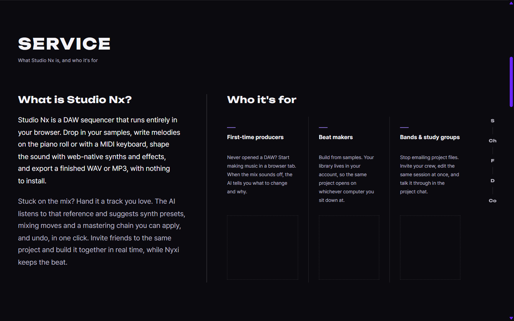
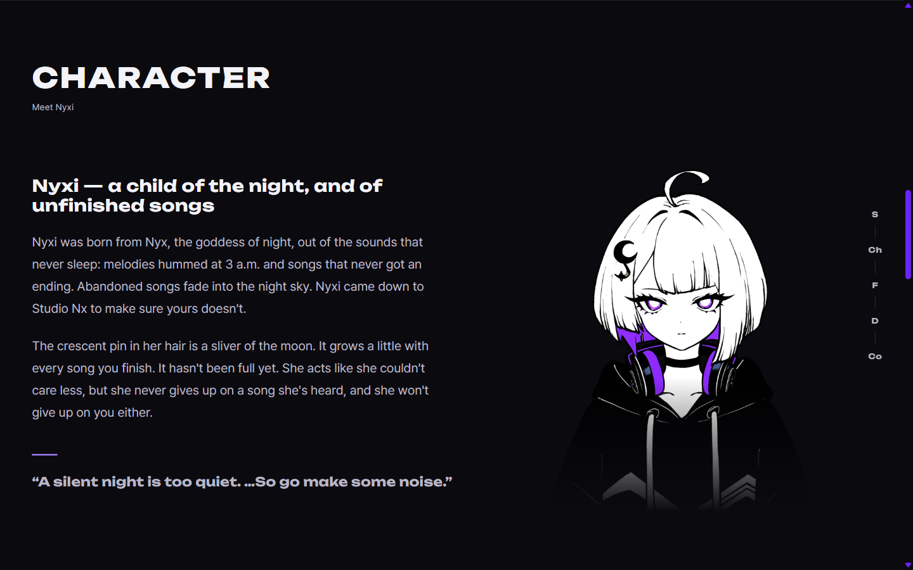
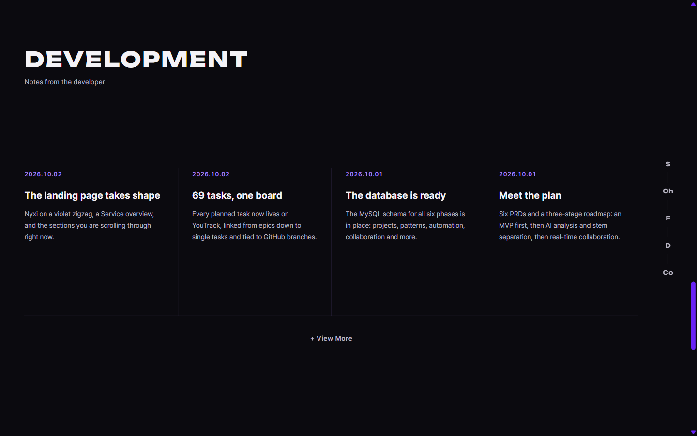
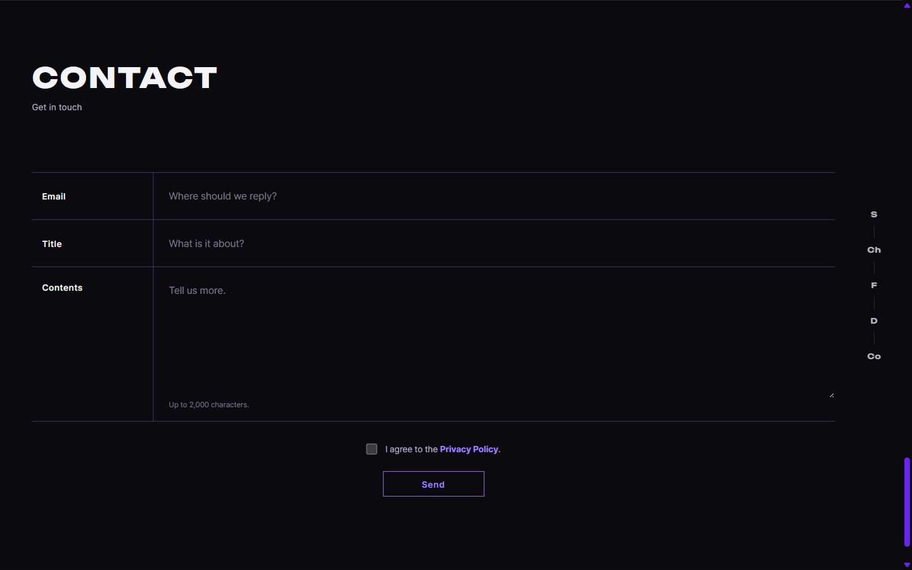
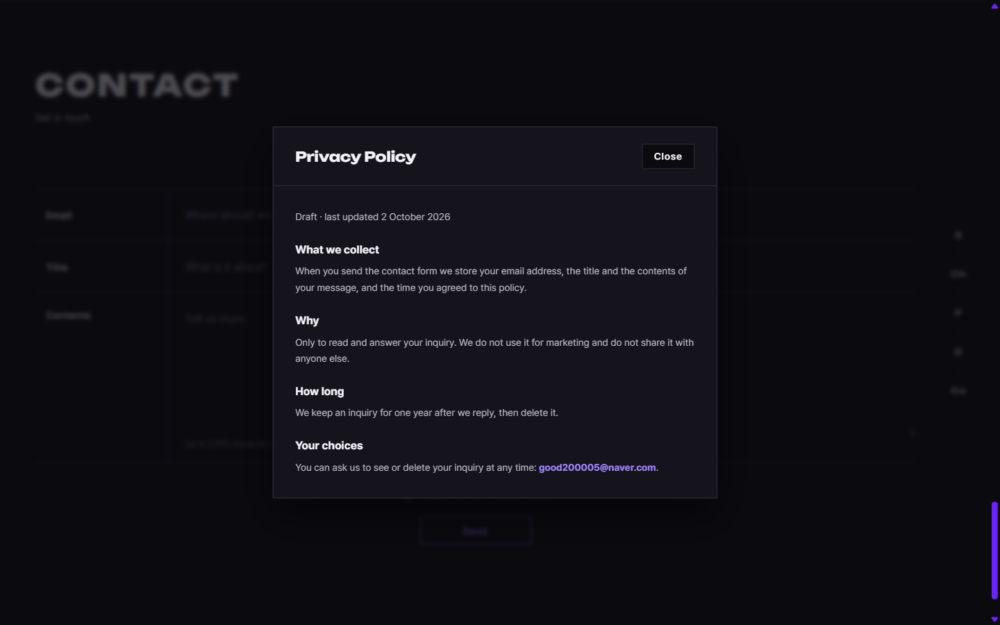
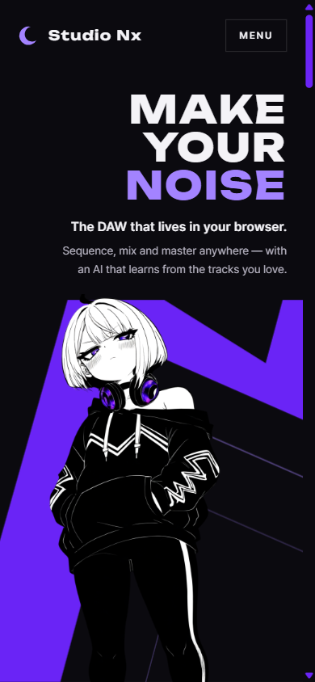
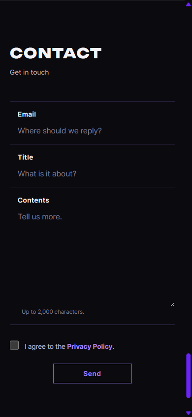

# AI 구현 설명 04 — 메인 페이지 나머지 섹션 프로토타입

| 항목 | 내용 |
|---|---|
| 작성 | Claude (AI) |
| 작성일 | 2026-10-02 |
| 작업 | P1-11 메인 페이지 (Service 일러스트 자리, Character, Development, Contact, 푸터, 버튼 템플릿), 이전: [03_home_revision_service.md](03_home_revision_service.md) |
| 브랜치 | `feature/phase1/p1-01-common-css` |
| 기준 레퍼런스 | `studionx/frontend-reference/images/main page reference/mainpage수정사항(나머지).pdf` |
| 원칙 | HTML/CSS를 작성하고, JS는 **템플릿만** 만들었습니다 (모달은 JS 없이 동작합니다) |

---

## 1. 실행 결과
### 1.1 데스크톱 (1440 × 900)
| Service | Character |
|---|---|
|  |  |

| Development | Contact |
|---|---|
|  |  |

### 1.2 모바일 (390 × 844)
| 첫 화면 (띠 축소) | Contact |
|---|---|
|  |  |

## 2. 레퍼런스 요청과 구현
| 레퍼런스 요청 | 구현 | 파일 |
|---|---|---|
| 모바일에서 띠가 잘리므로, 줄이되 위의 글씨를 방해하지 않게 | 모바일 띠를 화면 폭 124%, 높이 56%로 줄이고 제목과 설명 아래(44%)부터 시작하게 했습니다. 그래서 지그재그 전체가 보입니다 | `home.css` |
| Sign In은 디자인을 유지하고 hover는 Join Us처럼 / 두 버튼을 템플릿으로 | **버튼 템플릿 2종** `.btn--primary`(주요 행동)와 `.btn--ghost`(보조)를 만들었고, 둘 다 hover하면 흰 배경이 됩니다 | `base.css` |
| Service 추천 대상 아래의 일러스트 자리 (구분선 연장, 영역 표시) | 각 칸 아래에 점선 영역(`.persona__art`)을 두고, 칸 구분선이 그 영역까지 이어지며, 세 칸의 높이가 같습니다 | `home.html`, `home.css` |
| Character: 소개 글과 투명 일러스트, 아래쪽은 흐리게 | 왼쪽에 제목, 2문단, 인용구(주신 글 그대로)를 두고, 오른쪽 일러스트의 아래 38%가 서서히 사라지게 했습니다 (`mask-image`) | `home.html`, `home.css` |
| Development: 공지형 4칸과 구분선, "+ View More"(버튼 모양 X, hover하면 진한 보라)로 전체 목록 모달 | 날짜, 제목, 요약의 4칸과 보라색 세로·가로선, 글자형 링크(`.text-link`)를 두었고, 누르면 `<dialog>` 모달이 열립니다 (목록 디자인은 나중에) | `home.html`, `home.css`, `base.css` |
| Development 작성 권한은 관리자만, 방식은 AI가 결정 | **SQLAdmin**(`/admin`)과 `users.role = 'ADMIN'` (§3.3) | PRD 01 FR-114·115, DB |
| Contact: Email, Title, Contents(2000자), 동의 체크박스, Send, 입력칸 테두리 X | 라벨 \| 입력의 2열, 보라 구분선, 테두리 없는 입력칸(포커스하면 행 배경과 라벨 색이 바뀜), `maxlength="2000"` | `home.html`, `home.css` |
| "개인정보정책": 밑줄 X, 굵은 보라, 클릭할 때 색 변화 없음, 모달 | `.text-link--strong` (hover와 active의 색 고정)이며, 누르면 정책 모달이 열립니다 (초안 문구) | `base.css`, `home.html` |
| Send는 Join Us 방식 | `.btn--primary` | `home.html` |
| 푸터의 개발자 연락처 | `good200005@naver.com` (메일 링크) | `home.html` |

## 3. 왜 이렇게 했나
### 3.1 모달을 JS 없이 연 방법
HTML `<dialog>`와 버튼의 `command="show-modal"` / `commandfor="모달 id"` 속성(Invoker Commands)을 썼습니다. 버튼을 누르면 브라우저가 모달을 열고, 배경 클릭 차단, Esc 닫기, 포커스 이동을 자동으로 처리합니다. 이 속성을 지원하지 않는 구형 브라우저용 대체 코드는 `home.js`의 `initModalFallback()` 템플릿으로 남겼습니다.

### 3.2 "+ View More"의 hover 색
요청은 "진한 보라"였지만, 진한 보라(`#6a24f6`)는 검은 배경 위의 작은 글씨에서 대비가 약 2.6:1이라 읽기 어렵습니다. 그래서 밝은 보라(`#a383ff`, 약 6:1)로 바꿨습니다. 회색에서 보라로 확실히 바뀌는 효과는 같습니다.

### 3.3 관리자 방식: SQLAdmin 선택
| 선택지 | 장점 | 단점 |
|---|---|---|
| **SQLAdmin** (선택) | FastAPI + SQLAlchemy용 관리자 패널입니다. 모델만 등록하면 목록, 작성, 수정 화면이 생기므로 **공지 작성과 문의 답변**을 한 곳에서 할 수 있습니다 | 화면 디자인이 이 사이트와 다르지만 관리자 전용이라 문제가 없습니다. 로그인 방식(AuthenticationBackend)은 따로 연결해야 합니다 |
| 별도 관리 페이지를 직접 제작 | 디자인을 통일할 수 있습니다 | 화면, API, 권한 처리를 모두 직접 만들어야 합니다 (Phase 1 일정에 부담) |

- 연결 방식: `/admin`에 로그인할 때 `users` 테이블에서 `role = 'ADMIN'`인지 확인하고, 아니면 거부합니다.
- 작업 위치: 구현 계획의 **P1-21**입니다 (사용자 구현, 요청하면 AI).

### 3.4 DB 변경
| 변경 | 이유 |
|---|---|
| `dev_notes` 테이블 추가 (작성자, 제목, 요약, 본문, 공개 여부, 공개 시각) | Development 공지용입니다. 메인 페이지는 `is_published = 1`인 최신 4건만 읽습니다 |
| `inquiries.name`을 NULL 허용으로 | 새 문의 폼은 이름을 받지 않습니다 |
| `inquiries.privacy_agreed_at` 추가 (필수) | 개인정보 정책 동의를 기록합니다 |

- 반영한 곳: `docs/DB.md`, `studionx/db/01_phase1_account.sql`, `99_drop_all_tables.sql`, ERD(`ERD.png`, `ERD.md`), DB 가이드(md, docx)이며, 모두 **34개 테이블**입니다.
- **이미 만든 DB용 변경 SQL**: `studionx/db/migrations/2026-10-02_contact_devnotes.sql` (아직 실행하지 않았습니다).
- 함께 고친 것: DB.md §2.1에 남아 있던 **이전 버전의 테이블 목록(26개)**을 지웠습니다.

### 3.5 Character 일러스트
새로 넣어 주신 `studionx/characters/nyxi/poses/character page transparent.png`(1232×1632, 투명 배경)를 그대로 `static/characters/nyxi/character.png`로 복사해서 썼습니다. 원본 자료 폴더(`characters/`)는 웹에 공개되지 않으므로 화면용 복사본을 따로 둡니다. 다른 그림으로 바꿀 때는 **이 파일만 바꾸면** 되고, 크기가 달라지면 `home.html`의 `width`와 `height` 속성만 맞추면 됩니다.

### 3.6 Development의 예시 공지 4개
지금 보이는 4개는 이 프로젝트에서 실제로 한 일(메인 페이지, YouTrack, DB, 기획 문서)을 적은 **예시**입니다. 관리자 화면이 생기면 `GET /api/v1/dev-notes?limit=4`로 받은 데이터로 바뀝니다 (`home.js`의 `loadDevNotes()` 템플릿).

### 3.7 개인정보 정책 문구는 초안
수집 항목, 목적, 보관 기간(답변 후 1년), 삭제 요청 방법을 적은 **초안**이며, 모달 위쪽에 "Draft"로 표시했습니다. 보관 기간 등은 확인한 뒤 확정해 주십시오.

## 4. 검증 결과 (2026-10-02)
| 확인 | 결과 |
|---|---|
| 섹션 높이 (데스크톱 900px) | Service, Character, Development, Contact 모두 화면 한 장입니다 |
| Service 일러스트 자리 | 세 칸의 위치가 같습니다 (604~784px) |
| 모달 | View More와 Privacy Policy를 누르면 열리고(`:modal`), JS는 없습니다. Privacy Policy를 눌러도 동의 체크박스는 바뀌지 않습니다 |
| 버튼 hover | Sign In은 흰 배경과 검은 글자, Join Us와 Send는 흰 배경과 보라 글자입니다 |
| 모바일 390px | 가로 넘침이 없고, 띠가 제목, 설명과 겹치지 않습니다 (띠 시작 371px > 설명 끝 346px) |
| 디자인 자동 검사 | 0건입니다 (줄표 과다 경고가 나와서 제가 쓴 문장의 줄표만 정리했고, 주신 Nyxi 제목은 그대로 두었습니다) |
| 이미지 출처 | `character.png`에 출처(사용자가 제공한 PixAI 이미지)를 기록했습니다 |
| SQL | 34개 테이블의 순서와 문법 검사를 통과했습니다 (실행하지 않았습니다) |

## 5. 남은 일
| 항목 | 담당 |
|---|---|
| Feature 섹션의 내용 | 다음 레퍼런스 |
| View More 전체 목록 모달의 디자인 | 나중의 레퍼런스 |
| Service 일러스트 3장 | 사용자 에셋 |
| `home.js`: 문의 전송, 공지 불러오기, 모달 대체 코드 | 사용자 (JS) |
| 변경 SQL 실행 (`migrations/2026-10-02_contact_devnotes.sql`) | 사용자 |
| SQLAdmin 관리자 화면, 공지와 문의 API (P1-21, P1-12) | 사용자 (요청하면 AI) |
| 개인정보 정책 문구 확정 | 사용자 |

## 5.1 수정 기록
| 날짜 | 내용 |
|---|---|
| 2026-10-02 | Contact 섹션 제목(`<h2 id="contact-title">`)과 Title 입력칸의 id가 같아서 중복되었습니다. 그래서 입력칸의 id를 `contact-subject`로 바꿨습니다. 중복 때문에 `<label for>`가 입력칸이 아닌 제목을 가리키고 있었습니다. 전송 이름(`name="title"`)과 DB 컬럼은 그대로입니다 |

## 6. 자주 받을 질문 대비
- **Q. 모달을 왜 `<dialog>`로 만들었나요?** 접근성 기능(포커스 가두기, Esc로 닫기, 배경 비활성화)이 브라우저에 내장되어 있어서 직접 구현할 필요가 없기 때문입니다.
- **Q. 관리자 화면을 왜 직접 만들지 않았나요?** 관리자 1명이 공지와 문의만 관리하는 용도라서, 디자인보다 빠르고 안정적으로 쓰는 것이 중요합니다. SQLAdmin은 기존 SQLAlchemy 모델을 그대로 쓰므로 추가 작업이 적습니다 (§3.3).
- **Q. 문의 폼이 이름을 받지 않는데 DB는 어떻게 했나요?** `inquiries.name`을 NULL 허용으로 바꾸고, 동의 시각 컬럼을 추가했습니다. 기존 DB는 변경 SQL로 맞춥니다 (§3.4).
