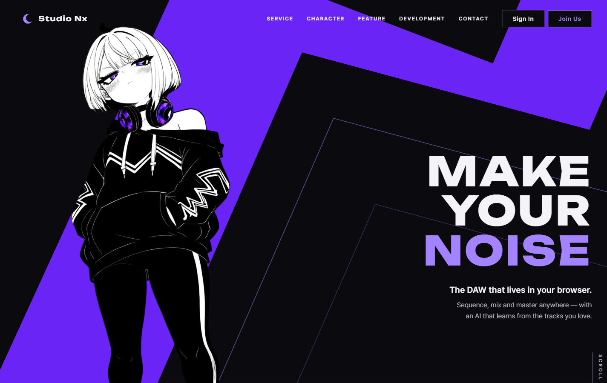
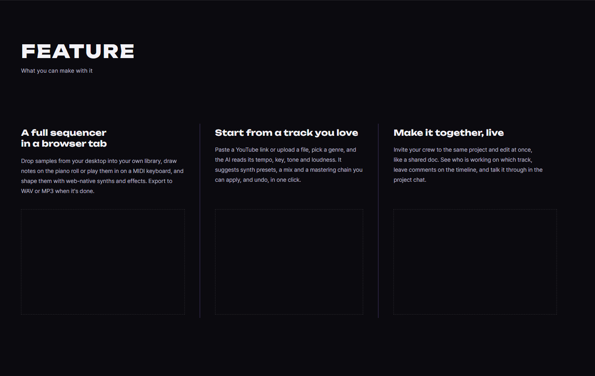
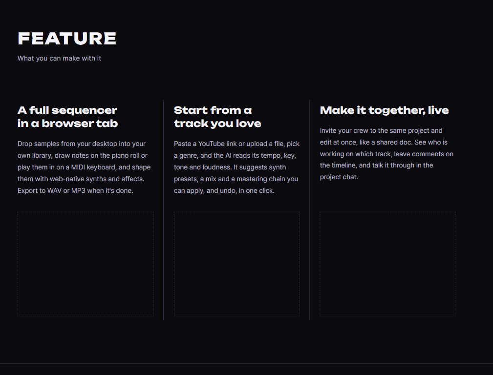
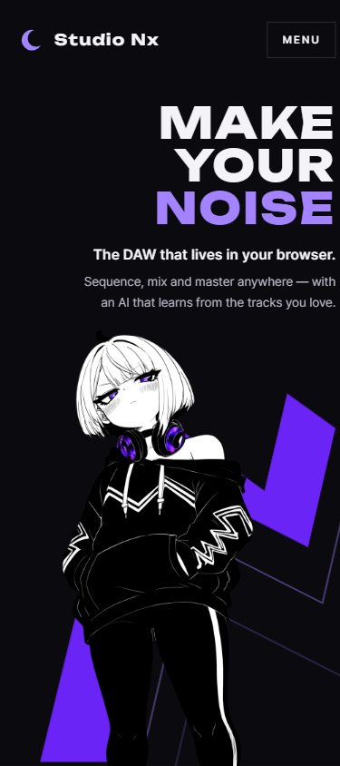
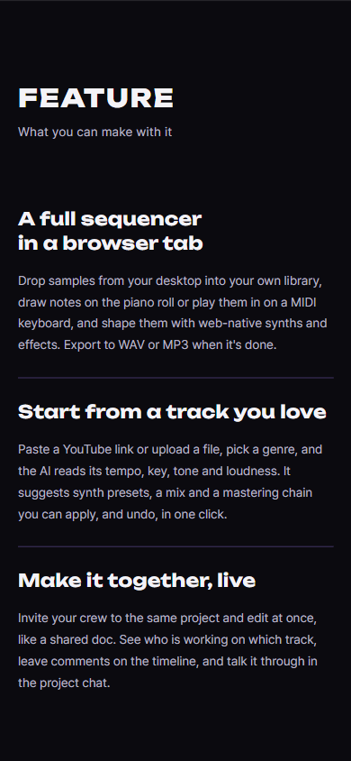
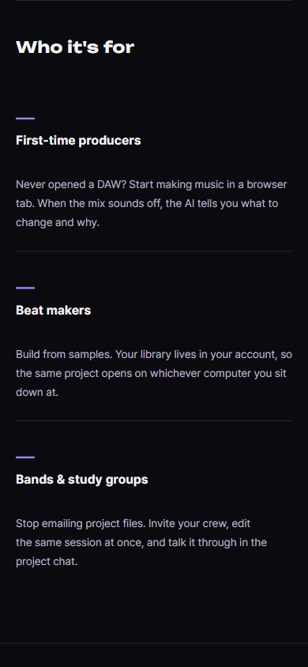
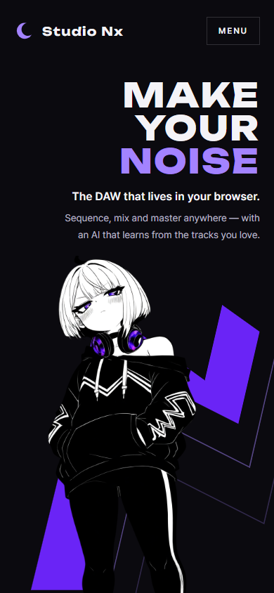
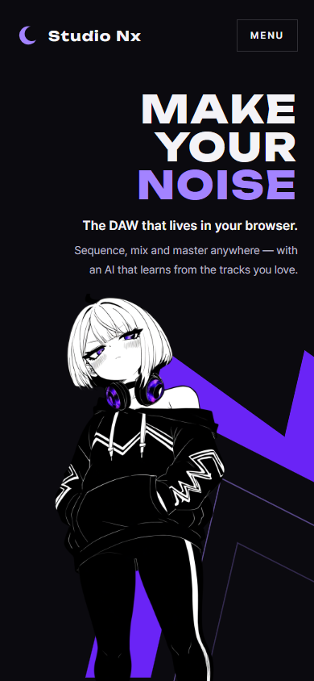

# AI 구현 설명 05 — 모바일 띠 재조정 · Feature 섹션

| 항목 | 내용 |
|---|---|
| 작성 | Claude (AI) |
| 작성일 | 2026-10-02 |
| 작업 | P1-11 메인 페이지 추가 수정 (모바일 동의 문구 가운데 정렬 포함), 이전 문서: [04_home_sections.md](04_home_sections.md) |
| 브랜치 | `feature/phase1/p1-01-common-css` |
| 기준 레퍼런스 | `studionx/frontend-reference/images/main page reference/mainpage수정사항(추가수정).pdf` |
| 원칙 | HTML/CSS만 고쳤습니다 (JS는 바꾸지 않았습니다) |

---

## 1. 실행 결과
### 1.1 데스크톱 (1440 × 900)과 태블릿 (1024 × 768)
| 첫 화면 (변화 없음 확인) | Feature |
|---|---|
|  |  |

### 1.2 모바일 (390 × 844)
| 첫 화면 (띠 전체가 보임) | Feature (스크린샷 자리 없음) | Service 추천 대상 (일러스트 자리 없음) |
|---|---|---|
|  |  |  |

## 2. 레퍼런스 요청과 구현
| 레퍼런스 요청 | 구현 | 파일 |
|---|---|---|
| 모바일 지그재그가 여전히 잘리므로, 잘린 부분(파란 선)을 살리고 초록 사각형 크기로 축소 | 띠의 잘린 끝 두 곳을 원래 선의 연장선으로 완성했습니다(§3.1). 모바일에서는 띠 전체를 화면 오른쪽 아래(가로 12~96%, 세로 51~100%)에 줄여서 넣었습니다 | `home.html`, `home.css` |
| 모바일 Who it's for: 일러스트 공간 없애기 | 760px 이하에서 `.persona__art`를 숨깁니다 | `home.css` |
| Feature: 대표 기능 3개의 제목, 내용, 스크린샷 | 3칸 그리드와 보라 세로 구분선을 두었습니다. 각 칸은 제목, 설명, 스크린샷 자리(점선)로 되어 있습니다 | `home.html`, `home.css` |
| 모바일 Feature: 스크린샷 공간 없애기 | 760px 이하에서 `.feature__shot`을 숨기고, 칸은 세로로 쌓아서 보라 가로선으로 구분합니다 | `home.css` |

## 3. 왜 이렇게 했나
### 3.1 띠가 "잘려" 보였던 이유와 해결
띠(`polygon`)는 원래 데스크톱 화면 틀(1440 × 900) 밖으로 나가는 모양이었습니다. 그래서 위쪽 끝이 틀의 윗변(y = 0)에서 평평하게 끝났습니다.

- **데스크톱:** 틀이 곧 화면이므로 끝이 화면 밖에 숨어 문제가 없었습니다.
- **모바일:** 띠를 화면 가운데에 작게 놓으니 평평한 끝이 그대로 드러났습니다.

그래서 끝을 계산해 완성했습니다.

| 끝 | 계산 방법 | 결과 좌표 |
|---|---|---|
| 왼쪽 다리 위 꼭짓점 | 왼쪽 다리의 바깥 선과 위쪽 사선을 위로 연장해서 만나는 점입니다 (레퍼런스의 파란 선) | `(453, -121)` |
| 오른쪽 다리 끝 | 같은 높이까지 올린 뒤, 위쪽 사선과 같은 기울기로 비스듬히 잘랐습니다 (후드 무늬 끝 모양) | `(1275, -121) → (1527, -25)` |

- 데스크톱에서는 새로 그린 부분이 모두 화면 밖(y < 0 또는 x > 1440)이라 **보이는 모양이 이전과 같습니다**. 1.1의 첫 화면 캡처로 확인했습니다.
- 모바일에서는 SVG 박스를 기준 틀(0~1440 × 0~900) 크기로 두고, 틀 밖에 그린 꼭짓점은 `overflow: visible`로 박스 위에 보이게 했습니다. 박스 위치는 띠 전체 범위(-20~1530 × -130~900)가 목표 영역에 들어가도록 비율로 계산했습니다.

### 3.2 고른 대표 기능 3가지
| 칸 | 제목 | 근거 (기획서 핵심 기능) |
|---|---|---|
| 1 | A full sequencer in a browser tab | ② 시퀀서 (샘플 라이브러리, 피아노롤과 MIDI 입력, 웹 신스) + ⑤ WAV/MP3 출력 |
| 2 | Start from a track you love | ③ 레퍼런스 분석 → 프리셋, 믹싱, 마스터링 추천 |
| 3 | Make it together, live | ⑥ 실시간 협업 + 단체 톡 |

다른 서비스와 가장 구별되는 기능 위주로 골랐습니다. 악기 분리(④)는 3칸 구성을 위해 뺐고, 회원 기능(①)은 기본 기능이라 넣지 않았습니다. 문구는 영어 페이지에 맞춰 영어로 썼습니다.

### 3.3 스크린샷 자리의 높이
처음에는 가로세로 비율(16:10)로 크기를 정했습니다. 그런데 칸마다 안쪽 여백이 달라 박스 높이가 222~245px로 어긋났습니다. 그래서 Service 일러스트 자리처럼 **고정 높이**(`clamp(10rem, 28svh, 16rem)`)로 바꿨고, `margin-top: auto`로 세 칸의 시작 위치를 맞췄습니다.

### 3.4 스크린샷을 넣는 방법
시퀀서 화면이 완성되면 각 `.feature__shot` 안에 ``를 넣습니다. 이미지 크기는 박스에 맞게 `object-fit: cover`를 권장합니다. 그때 점선 테두리는 지워도 됩니다.

### 3.5 모바일 동의 문구 가운데 정렬 (추가 요청)
모바일 규칙에 남아 있던 왼쪽 정렬(`justify-content: flex-start`)을 지웠습니다. 이제 데스크톱과 같은 `justify-content: center`가 적용되어, 체크박스와 문장 묶음이 **폼 폭 기준으로 가운데**에 옵니다. 고정 px 값이 아니라 폭에 따라 자동으로 계산됩니다. 화면이 아주 좁아 문장이 두 줄이 되어도 가운데에 오도록 `text-align: center`를 더했습니다.

| 브라우저 폭 | 왼쪽 여백 | 오른쪽 여백 |
|---|---|---|
| 320px | 26px | 26px |
| 390px | 62px | 62px |
| 600px | 165px | 165px |
| 760px | 240px | 240px |

### 3.6 추가 수정: 모바일 띠를 오른쪽으로 (2026-10-03)
모바일에서 띠 가운데(위로 꺾이는 부분)가 Nyxi의 머리와 몸 뒤에 가려져서, 띠가 **왼쪽 아래 조각과 오른쪽 위 조각으로 끊겨** 보였습니다. 사용자 요청으로 띠와 윤곽선을 함께 오른쪽으로 옮겼습니다.

| 항목 | 이전 | 이후 |
|---|---|---|
| `.hero__ribbon` 왼쪽 위치 (760px 이하) | `12.1%` | `28%` |
| 보이는 모양 | 두 조각으로 끊기고, 띠 전체가 화면 안에 있었습니다 | 띠가 Nyxi 어깨 뒤에서 이어져 나와 오른쪽 위로 뻗습니다. 오른쪽 위 끝은 데스크톱처럼 화면 밖으로 나갑니다 |

- 12.1%, 20%, 28%, 36%의 네 가지를 나란히 비교해서 사용자가 28%를 골랐습니다.
- 크기(`width: 78%`, `height: 42.4%`)와 세로 위치는 그대로입니다.
- 데스크톱(1440)과 태블릿(1024)은 변경 전과 **0픽셀 차이**이고, 모바일 390px과 320px에서 가로 넘침이 없습니다.

| 이전 (12.1%) | 이후 (28%) |
|---|---|
|  |  |

## 4. 검증 결과 (2026-10-02)
| 확인 | 결과 |
|---|---|
| 모바일 띠 위치 | 띠 범위는 x 44~370, y 434~840px입니다 (화면 390 × 844). 설명 글 끝(346px)보다 아래에서 시작하고, 오른쪽 끝이 화면 안에 들어옵니다. 2026-10-03 §3.6에서 오른쪽으로 옮겼습니다 |
| 모바일 숨김 | `.persona__art`와 `.feature__shot` 모두 `display: none`입니다 |
| 가로 넘침 | 데스크톱, 태블릿, 모바일 모두 없습니다 |
| Feature 섹션 높이 | 데스크톱에서 900px입니다 (화면 한 장) |
| 스크린샷 자리 정렬 | 세 칸 모두 위치와 높이가 같습니다 (섹션 기준 501px, 높이 252px) |
| 디자인 자동 검사 | 0건 |

## 5. 남은 일
| 항목 | 담당 |
|---|---|
| Feature 스크린샷 3장 (시퀀서 화면이 완성된 뒤) | 사용자 |
| Feature 문구의 확인과 수정 | 사용자 |
| 이전 문서(04)의 남은 일 (View More 목록 디자인, JS, SQLAdmin 등) | 그대로 남아 있습니다 |

## 6. 자주 받을 질문 대비
- **Q. 모바일용 띠를 따로 그리지 않은 이유는 무엇인가요?** 같은 도형 하나에서 데스크톱은 일부만, 모바일은 전체를 보여 주는 방식입니다. 도형을 고칠 때 한 곳만 바꾸면 됩니다.
- **Q. 모바일에서는 스크린샷을 왜 숨기나요?** 좁은 화면에서는 스크린샷이 너무 작아 내용을 알아보기 어렵고, 스크롤만 길어집니다. 레퍼런스의 요청이기도 합니다.
