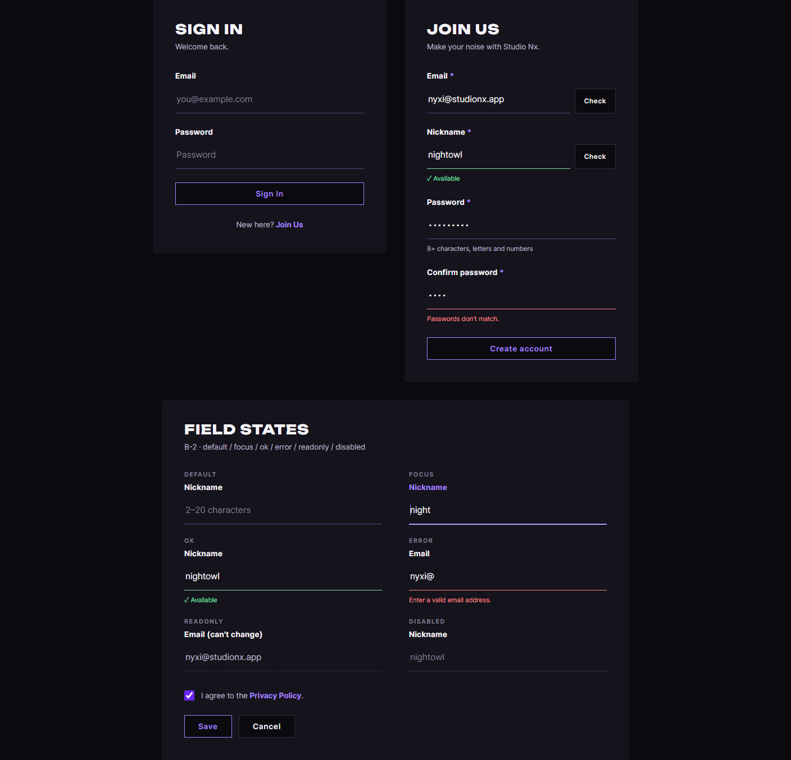
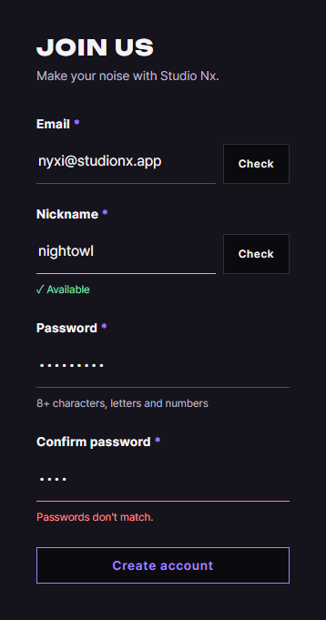
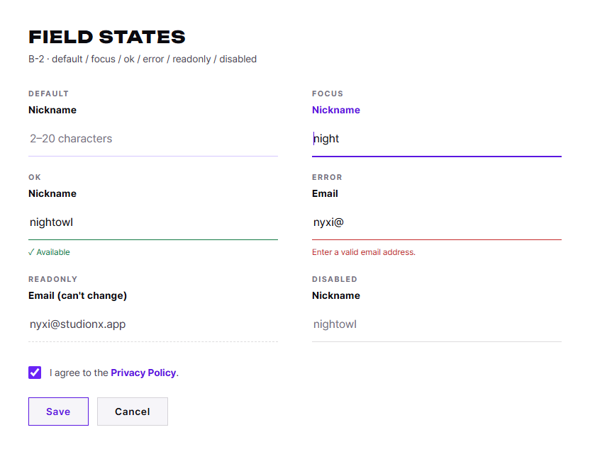
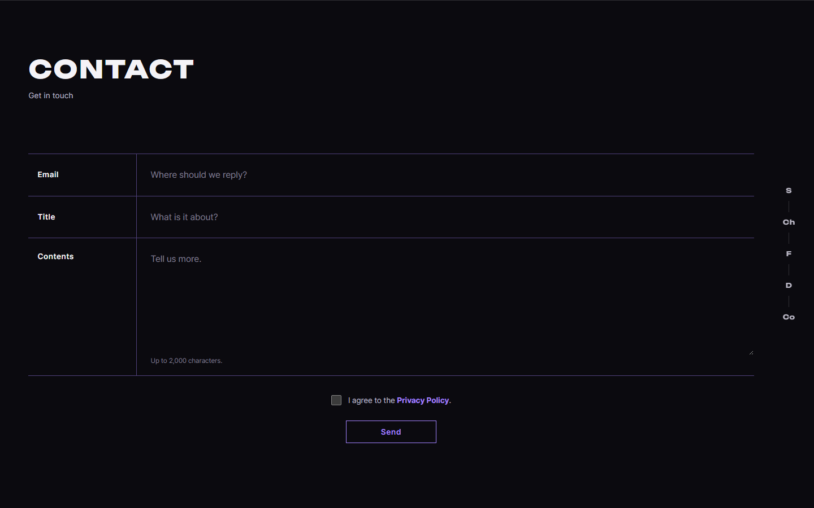
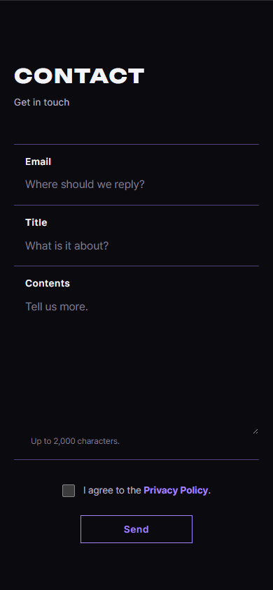

# AI 구현 설명 06 — 공통 폼 스타일 (B-2 밑줄형)

| 항목 | 내용 |
|---|---|
| 작성 | Claude (AI) |
| 작성일 | 2026-10-02 |
| 작업 | P1-01 공통 CSS 마지막 — 공통 폼 스타일. 이전 문서: [05_home_feature.md](05_home_feature.md) |
| 브랜치 | `feature/phase1/p1-01-common-css` |
| 기준 시안 | `docs/form_mockups/05_states_B2_line.png` (사용자 선택), `03_B2_stacked_line.png` |
| 원칙 | CSS만 작성 (JS 변경 없음). Contact 폼은 가로형(A)을 그대로 유지 |

---

## 1. 실행 결과
> 아래 화면은 확인용 시험 페이지(저장소에 넣지 않음)를 캡처한 것입니다. 로그인·회원가입 페이지는 P1-06에서 이 스타일로 만듭니다.

### 1.1 데스크톱 (1440 × 900) — 로그인, 회원가입, 상태 6가지


### 1.2 모바일 (390 × 844)과 라이트 테마
| 모바일 회원가입 | 라이트 테마 상태 6가지 |
|---|---|
|  |  |

### 1.3 Contact 폼 (변화 없음 확인)
| 데스크톱 | 모바일 |
|---|---|
|  |  |

## 2. 무엇을 만들었나
| 파일 | 변경 | 내용 |
|---|---|---|
| `static/css/forms.css` | 새 파일 | 입력칸 템플릿(B-2), 상태 6가지, 작은 버튼, 동의 체크박스, 버튼 줄 |
| `static/css/tokens.css` | 수정 | 상태 색 `--c-ok`, `--c-error` 추가 (다크·라이트·시스템) |
| `static/css/pages/home.css` | 수정 | Contact의 공통 부분을 `forms.css`로 옮기고, Contact 전용 정렬만 남김 |
| `home.html` | 수정 | `forms.css` 연결 (`base.css` 다음) |

### 2.1 클래스 사용법
| 클래스 | 붙이는 곳 | 역할 |
|---|---|---|
| `.form-stack` | `<form>` | 입력칸을 세로로 쌓고 간격 24px |
| `.field` | 입력칸 하나를 감싸는 `<div>` | 라벨, 입력칸, 문구를 세로로 묶음 |
| `.field__label` | `<label>` | 굵은 라벨. 입력 중이면 보라 |
| `.field__req` | 라벨 안 `<span>` | 필수 표시 `*` (보라) |
| `.field__control` | `<input>`, `<textarea>` | 테두리 없이 밑줄만 있는 입력칸 |
| `.field__group` | 입력칸 + 버튼을 감싸는 `<div>` | 옆에 Check 버튼이 있을 때 |
| `.field__msg` | 입력칸 아래 `<p>` | 안내·확인·오류 문구 |
| `.btn--sm` | `.btn`에 추가 | 입력칸 옆 작은 버튼 (높이 44px) |
| `.form-consent` | 체크박스 줄 `<p>` | 동의 체크박스 + 문장 |
| `.form-actions` | 버튼 줄 | Save · Cancel 등 가로 배치 |

```
<div class="field is-error">
  <label class="field__label" for="pw2">Confirm password <span class="field__req" aria-hidden="true">*</span></label>
  <input class="field__control" id="pw2" type="password" aria-invalid="true" aria-describedby="pw2-msg">
  <p class="field__msg" id="pw2-msg">Passwords don't match.</p>
</div>
```

### 2.2 상태 6가지
| 상태 | 켜는 방법 | 모양 |
|---|---|---|
| default | 없음 | 옅은 보라 밑줄 1px |
| focus | 브라우저가 자동 (`:focus`) | 밝은 보라 밑줄 2px + 라벨 보라 |
| ok | `.field`에 `is-ok` | 초록 밑줄 + 초록 문구 |
| error | `.field`에 `is-error` + 입력칸에 `aria-invalid="true"` | 빨강 밑줄 + 빨강 문구 |
| readonly | 입력칸에 `readonly` | 점선 밑줄, 흐린 글자. 입력 중에도 보라로 바뀌지 않음 |
| disabled | 입력칸에 `disabled` | 더 흐린 글자·밑줄, 금지 커서 |

- JS는 **클래스와 속성만** 바꾸면 됩니다. 색과 모양은 CSS가 처리합니다.

## 3. 왜 이렇게 했나
### 3.1 Contact는 가로형(A)으로 유지
사용자가 고른 시안은 B-2이지만, Contact 폼은 이미 메인 페이지 디자인(보라 구분선 표)에 맞춰 완성되어 있습니다. 그래서 이전 추천대로 **Contact는 A를 유지**하고, 다른 모든 폼(로그인, 회원가입, 회원정보 등)에 B-2를 씁니다. Contact도 B-2로 바꾸려면 `home.html`의 `.form-row`를 `.field`로 바꾸면 됩니다.

### 3.2 Contact에서 옮긴 것과 남긴 것
| 항목 | 위치 | 이유 |
|---|---|---|
| 동의 체크박스 모양, 버튼 줄 배치, 안내 문구 색 | `forms.css` | 모든 폼에서 같음 |
| 가로 줄 배치(`.form-row`), 가운데 정렬, 버튼 최소 폭 | `home.css` | Contact에서만 씀 |

옮긴 뒤 Contact 화면을 이전과 픽셀 단위로 비교했고 **차이가 0픽셀**이었습니다(§4).

### 3.3 focus 밑줄을 `box-shadow`로 두껍게
밑줄(`border`)을 1px에서 2px로 바꾸면 입력칸 높이가 1px 늘어나 아래 내용이 흔들립니다. 그래서 1px 밑줄 아래에 1px `box-shadow`를 더해 2px처럼 보이게 했습니다.

### 3.4 상태 색을 토큰으로
시안에서 임시로 쓴 초록 `#7fe0a8`, 빨강 `#ff8a8a`를 `tokens.css`의 `--c-ok`, `--c-error`로 옮겼습니다. 라이트 테마에서는 이 색이 흰 바탕에서 잘 안 보여서 진한 색을 따로 정했습니다.

| 토큰 | 다크 | 라이트 |
|---|---|---|
| `--c-ok` | `#7fe0a8` (바탕 대비 12.3:1) | `#137a45` (흰 바탕 대비 5.4:1) |
| `--c-error` | `#ff8a8a` (바탕 대비 8.7:1) | `#c42b2b` (흰 바탕 대비 5.6:1) |

### 3.5 브라우저 자동 완성 색 막기
Chrome은 저장된 이메일을 자동으로 채울 때 입력칸 배경을 노랑·흰색으로 바꿉니다. 어두운 화면에서 눈에 띄므로 `.field__control`과 Contact 입력칸 모두 배경이 바뀌지 않게 했습니다.

## 4. 검증 결과 (2026-10-02)
| 확인 | 결과 |
|---|---|
| Contact 회귀 | 변경 전후 캡처 비교: 데스크톱 1440 × 900, 모바일 390 × 844 모두 **차이 0픽셀** |
| 상태별 밑줄 색 | 계산된 스타일로 확인: default 옅은 보라, ok `#7fe0a8`, error `#ff8a8a`, readonly 점선, disabled 옅은 회색 |
| 글자 대비 | 상태 색 4가지 모두 WCAG AA(4.5:1) 이상 (§3.4) |
| 가로 넘침 | 데스크톱, 모바일 모두 없음 |
| 디자인 자동 검사 (`impeccable detect`) | `studionx/frontend` 0건. 시험 페이지에서 나온 6건은 시험용 상태 이름표(DEFAULT 등)이며 `forms.css`와 무관 |

## 5. 남은 일
| 항목 | 담당 |
|---|---|
| 로그인·회원가입 페이지(P1-06)에 이 스타일 적용 | AI (요청 시) |
| 중복 확인·비밀번호 확인 등 상태를 바꾸는 JS | 사용자 (P1-07) |
| Contact도 B-2로 바꿀지 결정 | 사용자 (지금은 A 유지) |

## 6. 자주 받을 질문 대비
- **Q. 오류 표시는 `is-error`와 `aria-invalid` 중 무엇을 쓰나?** 둘 다 씁니다. `is-error`는 문구 색까지 바꾸고, `aria-invalid`는 화면 읽기 프로그램에 오류를 알립니다. 입력칸만 빨강으로 바꾸려면 `aria-invalid`만으로도 됩니다.
- **Q. 문구를 화면 읽기 프로그램이 읽게 하려면?** 입력칸의 `aria-describedby`에 문구 `<p>`의 `id`를 넣습니다. 예시는 §2.1에 있습니다.
- **Q. 플레이스홀더 색이 흐린데 괜찮나?** 플레이스홀더는 예시일 뿐이고, 필요한 정보는 항상 라벨에 있습니다. 기존 Contact 폼과 같은 색(`--c-ink-faint`)입니다.
