# AI 구현 설명 07 — 회원가입 페이지 · 로그인 모달

| 항목 | 내용 |
|---|---|
| 작성 | Claude (AI) |
| 작성일 | 2026-10-02 |
| 작업 | P1-06 `join.html`, `home.html` 로그인 모달, 로그인 상태 헤더, 이전 문서: [06_common_forms.md](06_common_forms.md) |
| 브랜치 | `feature/phase1/p1-06-auth-pages` |
| 기준 시안 | `docs/form_mockups/03_B2_stacked_line.png`(가입), `07_login_C2_email_first.png`(로그인), `09_login_C2_oauth_hover.png`(소셜 버튼) |
| 원칙 | HTML/CSS를 작성하고, JS는 **템플릿만** 만들었습니다 (구현은 P1-07) |

---

## 1. 실행 결과
### 1.1 메인 페이지 헤더 (데스크톱 1440 × 900)
| 로그아웃 상태 (변화 없음) | 로그인 상태 (`data-auth="in"`) |
|---|---|
| 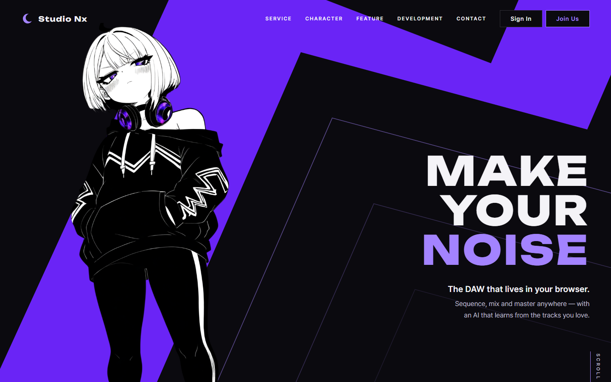 |  |

### 1.2 로그인 모달
| 데스크톱 (SoundCloud에 마우스를 올린 상태) | 모바일 (390 × 844) |
|---|---|
| 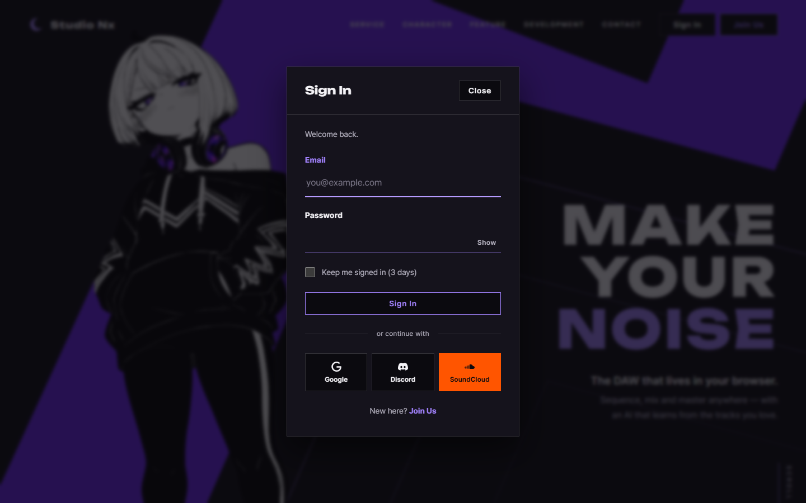 | 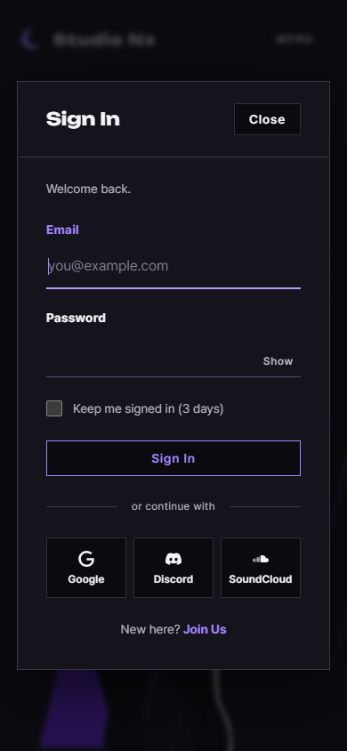 |

### 1.3 회원가입 페이지
| 기본 | 상태 표시 (닉네임 확인, 비밀번호 불일치) |
|---|---|
| 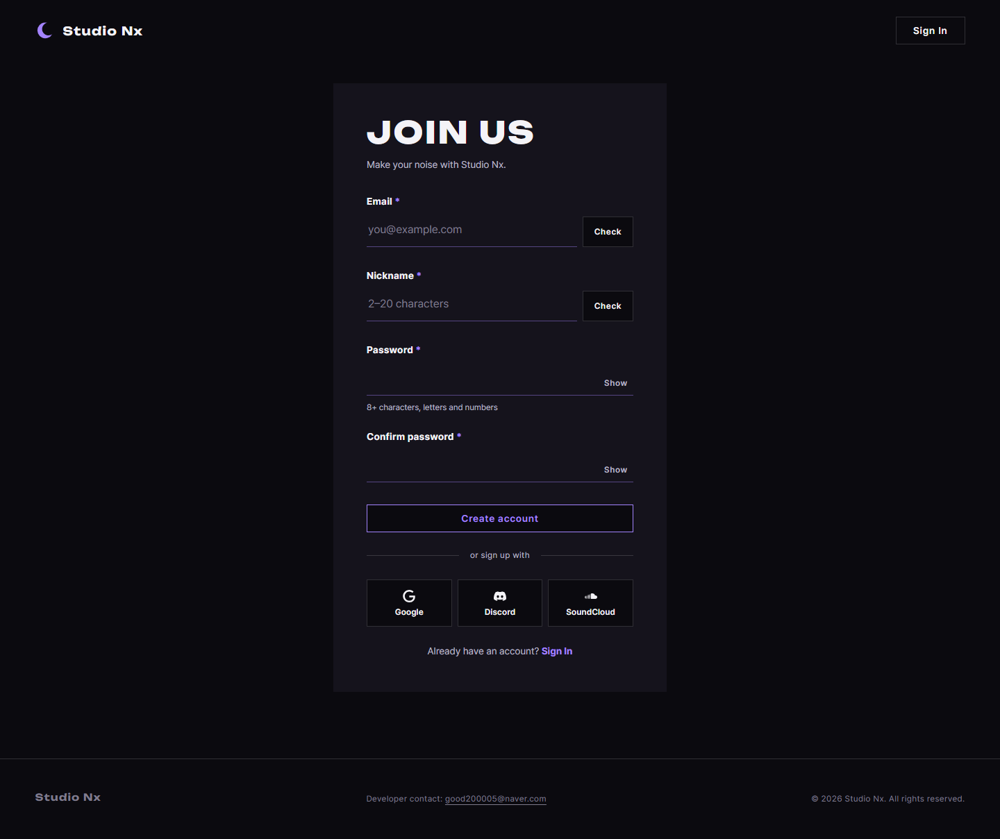 | 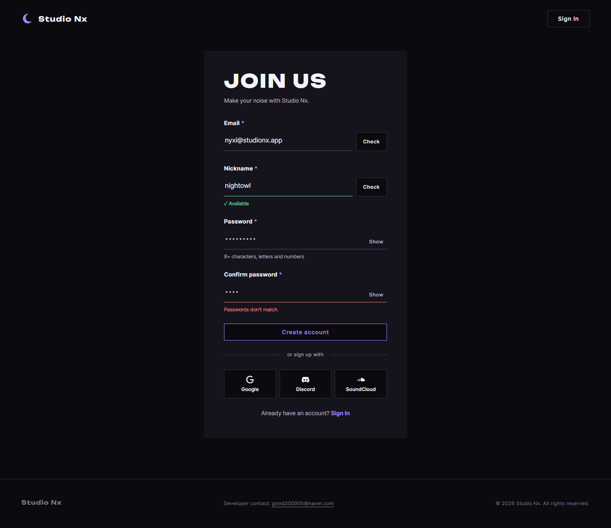 |

| 모바일 | 라이트 테마 (Google에 마우스를 올린 상태) |
|---|---|
| 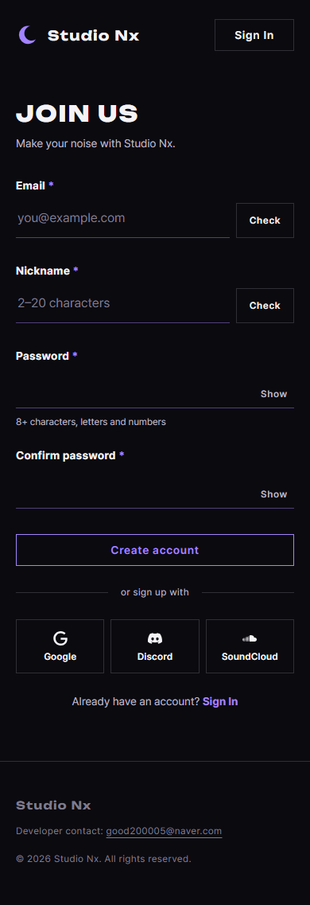 | 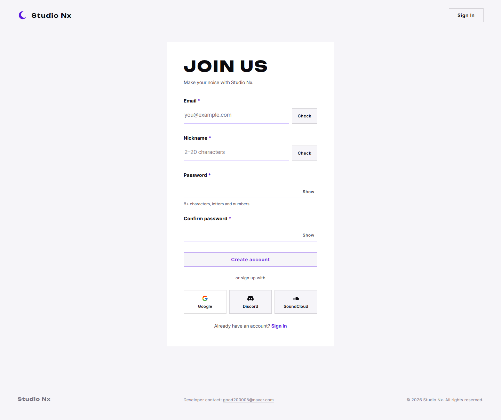 |

## 2. 무엇을 만들었나
| 파일 | 변경 | 내용 |
|---|---|---|
| `join.html` | 새 파일 | 회원가입 화면입니다. 이메일과 닉네임(Check 버튼), 비밀번호와 확인(Show 버튼), Create account, 소셜 버튼 줄이 있습니다 |
| `home.html` | 수정 | 헤더 버튼 4개(로그인 상태별)와 로그인 모달 `#login-modal`을 넣고 `auth.css`를 연결했습니다 |
| `static/css/auth.css` | 새 파일 | 로그인과 가입의 공통 스타일입니다. 로그인 상태 표시, 좁은 모달, 비밀번호 Show, 구분선, 소셜 버튼 색, 폼 오류를 다룹니다 |
| `static/css/pages/join.css` | 새 파일 | 가입 페이지 배치입니다 (가운데 카드, 모바일에서는 카드 면 없음) |
| `static/js/core/auth-ui.js` | 새 파일 (템플릿) | 공통 동작입니다. 로그인 상태, 비밀번호 Show, 소셜 버튼 안내, 입력칸 상태 바꾸기를 맡습니다 |
| `static/js/pages/join.js` | 새 파일 (템플릿) | 중복 확인, 비밀번호 규칙, 가입 전송을 맡습니다 |
| `static/js/pages/home.js` | 수정 (템플릿) | 주소가 `#login`이면 모달을 열고, 로그인을 전송합니다 |

## 3. 왜 이렇게 했나
### 3.1 로그인은 페이지가 아니라 모달
2026-10-02에 결정했습니다 (PRD 01 FR-103, FR-105). 폼이 두 칸뿐이라 페이지를 따로 둘 이유가 적고, 메인을 보다가 그 자리에서 로그인할 수 있습니다.

| 상황 | 동작 |
|---|---|
| 헤더 Sign In | `command="show-modal"`로 모달이 열림 (JS 없이 동작) |
| 로그인이 필요한 페이지 | `home.html#login?next=<원래 페이지>`로 보냄 → home.js가 모달을 열고, 로그인 후 원래 페이지로 (P1-07) |
| 가입 페이지의 Sign In | 그 자리에서 같은 로그인 모달이 열림 (§3.7 추가 수정) |

모달을 열면 이메일 칸에 바로 커서가 갑니다(`autofocus`).

### 3.2 로그인 상태에 따라 바뀌는 헤더
버튼 4개를 모두 HTML에 넣고, 각 버튼에 `data-auth-show="out"` 또는 `"in"`을 붙였습니다. CSS가 `<html>`의 `data-auth` 값을 보고 한 세트만 보여 줍니다.

| `<html data-auth>` | 보이는 버튼 |
|---|---|
| 없음 (기본) | Sign In, Join Us |
| `in` | My Page, My Projects |
| `pending` | 버튼 자리는 차지하지만 보이지 않습니다 (확인 중의 깜빡임 방지) |

- **JS가 없거나 실패해도** 속성이 없으므로 Sign In과 Join Us가 보입니다.
- 주요 버튼(보라)은 My Projects입니다. 로그인한 사람이 가장 자주 하는 일이 프로젝트 열기이기 때문입니다.
- 모바일 메뉴 안의 버튼도 같은 방식입니다.

### 3.3 자동 로그인 (3일)
모달의 "Keep me signed in (3 days)" 체크박스입니다. 기본은 **체크 안 됨**입니다. 공용 PC에서 로그인이 남지 않도록 하기 위해서입니다.

| 체크 | 리프레시 토큰 쿠키 (P1-05에서 구현) |
|---|---|
| 체크함 | 만료일이 3일입니다 (`config.py`의 `jwt_refresh_days = 3`) |
| 체크하지 않음 | 세션 쿠키입니다 (브라우저를 닫으면 사라집니다) |

### 3.4 소셜 버튼: 평소 단색, 마우스를 올리면 서비스 색
페이지 전체가 흑백과 보라 한 가지라서, 평소에는 기존 ghost 버튼과 같은 단색으로 두었습니다. 마우스를 올리거나 키보드로 고르면(`:focus-visible`) 각 서비스 색이 됩니다.

| 버튼 | 바탕 | 글자 | 이유 |
|---|---|---|---|
| Google | 흰색 | 진한 회색과 컬러 G 로고 | Google 버튼 규정의 밝은 버튼 모양입니다 |
| Discord | `#5865F2` | 흰색 (대비 4.6:1) | Discord의 공식 색입니다 |
| SoundCloud | `#FF5500` | **검은색** (대비 6.2:1) | 흰 글자는 3.2:1이라서 기준(4.5:1)에 못 미칩니다 |

- **연동은 추후**입니다(PRD 01 FR-110). 지금은 누르면 "준비 중" 안내만 합니다(JS 템플릿).
- 비활성(`aria-disabled`)으로 두지 않은 이유: `base.css`가 비활성 버튼을 반투명하게 만들어 hover 색이 흐려집니다.
- 아이콘은 Simple Icons의 단색 아이콘을 HTML에 직접 넣었습니다(외부 요청 없음). Google만 hover 때 컬러 G로 바뀝니다.

### 3.5 가입 폼 입력 규칙
| 칸 | HTML 속성 | 근거 |
|---|---|---|
| 이메일 | `type="email"`, 최대 255자 | `users.email VARCHAR(255)` |
| 닉네임 | 2~20자 | 시안 문구를 따랐고, DB(`VARCHAR(50)`)보다 좁게 잡았습니다. PRD 01 FR-101에 반영했습니다 |
| 비밀번호 | 8~20자와 조건 목록 | FR-102 (2026-10-02 변경, §3.8) |

- 폼에 `novalidate`를 붙였습니다. 브라우저 기본 말풍선 대신, JS가 시안의 상태 표시(밑줄 색 + 문구)로 오류를 보여 주기 위해서입니다(P1-07).
- 확인 결과 문구(`.field__msg`)에 `aria-live="polite"`를 붙여 화면 읽기 프로그램이 결과를 읽습니다.

### 3.6 모달 안 문단 규칙 덮기
`base.css`의 `.modal__body p`(개인정보 정책 모달용)가 모달 안 모든 문단에 위 여백과 글자 크기를 줍니다. 로그인 모달의 구분선과 안내 줄도 문단이라서 간격이 어긋났습니다. 그래서 `auth.css` 끝에서 모달 안일 때만 되돌렸습니다.

### 3.7 추가 수정: 가입 페이지에서도 로그인 모달 (2026-10-02)
처음에는 가입 페이지의 Sign In이 `home.html#login`으로 이동했습니다. 사용자 제안으로 **그 자리에서 같은 로그인 모달이 열리도록** 바꿨습니다.

| 변경 | 내용 |
|---|---|
| `join.html` | 헤더 Sign In과 아래 "Already have an account? Sign In"을 `command="show-modal"` 버튼으로 |
| 로그인 모달 | `home.html`과 `join.html`이 **같은 파일 하나**(`static/partials/login-modal.html`)를 불러옴 → [10_common_partials.md](10_common_partials.md) |
| `core/auth-ui.js` | `initLoginForm({ onSuccess })` — 로그인 전송을 `home.js`에서 옮겨 두 페이지가 같이 씀. 성공 후 동작만 다름 (메인: 모달 닫고 헤더 전환 / 가입: `home.html`로 이동) |
| `core/modal.js` (새 파일) | 모달 대체 코드 `initModalFallback`을 `home.js`에서 옮김 (두 페이지 공통) |

- 가입 페이지에서 모달 안 "New here? Join Us"를 누르면 가입 페이지를 다시 엽니다(모달이 닫힌 상태). 공통 모달이라 페이지마다 링크를 다르게 두지 않았습니다.
- **검증:** 두 Sign In 모두 누르면 모달이 열리고 이메일 칸에 커서가 가며, 콘솔 오류는 없습니다. 가입 페이지의 모양은 변경 전과 **0픽셀 차이**입니다 (데스크톱, 모바일).

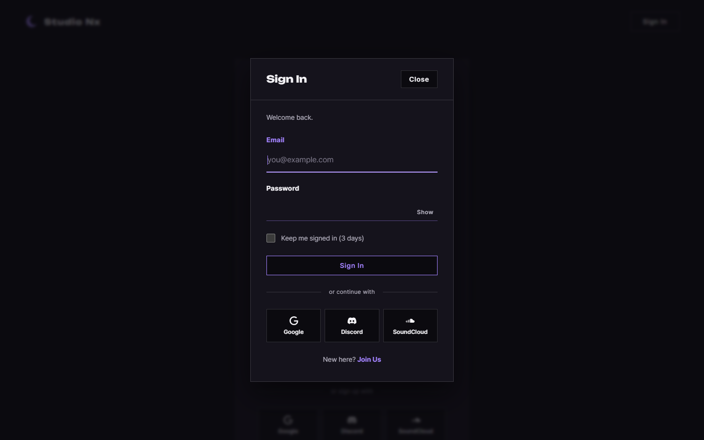

### 3.8 추가 수정: 비밀번호 조건 강화와 조건 목록 (2026-10-02)
사용자 요청으로 비밀번호 규칙을 바꾸고, 가입 화면에서 조건을 보여 주며 입력을 유도합니다(PRD 01 FR-102).

| 조건 | 규칙 |
|---|---|
| 길이 | 8~20자 |
| 대문자, 소문자, 숫자 | 각각 1개 이상 |
| 특수기호 | 키보드 기호(`!@#$%^&*` 등, ASCII 기호 32종) 1개 이상 |
| 쓸 수 있는 문자 | 영문, 숫자, 키보드 기호만 쓸 수 있습니다. **한글과 공백은 쓸 수 없습니다** (특수기호로 세지 않습니다) |

| 파일 | 변경 |
|---|---|
| `join.html` | 안내 한 줄 → 조건 목록 `#join-password-rules` (5개 `li[data-rule]`), 최대 20자 |
| `auth.css` | `.pw-rules`: 기본은 회색 ○이고, `li.is-met`이면 초록 ✓입니다. 넓으면 2열, 좁으면 1열입니다 |
| `pages/join.js` | `PASSWORD_RULES`(조건별 검사 함수 5개)와 `PASSWORD_ALLOWED`(허용 문자) **완성**. 입력마다 `is-met`을 바꾸는 `initPasswordRules`는 TODO |
| `core/security.py` | 서버 검사 `check_password_rules`는 TODO입니다 (같은 규칙) |

- 조건 목록마다 화면 읽기 프로그램용 글자(`, met` / `, not met`)를 숨겨 두었습니다. JS가 함께 바꿉니다.
- 검사 함수는 예시 9개로 확인했습니다: `Nightowl1!` 통과, `Nightowl1` → 특수기호 없음, `Night owl1` → 공백 때문에 실패, `가나다Ab1` → 한글 때문에 실패, 21자 → 길이 초과.
- 비밀번호 칸 위쪽 화면은 변경 전과 **0픽셀 차이**이고, 디자인 자동 검사는 0건입니다.

| 일부 만족 (데스크톱) | 모두 만족 | 모바일 |
|---|---|---|
| 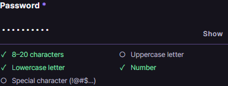 | 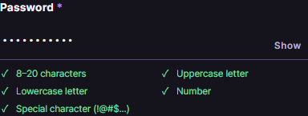 | 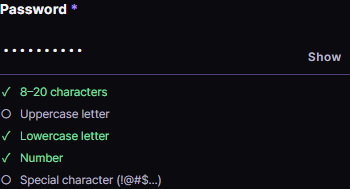 |

## 4. 검증 결과 (2026-10-02)
| 확인 | 결과 |
|---|---|
| 메인 첫 화면 회귀 | 변경 전후 캡처 비교: 데스크톱·모바일 모두 **차이 0픽셀** (Sign In을 링크 → 버튼으로 바꿨지만 모양 동일) |
| 가로 넘침 | 8개 화면 모두 없습니다 |
| 콘솔 오류 | 없습니다 (JS 템플릿 import도 정상입니다) |
| 디자인 자동 검사 (`impeccable detect`) | 파일·`home.html`·`join.html` 모두 0건. 처음 1건(구분선 글자 대비 4.48:1)은 글자색을 한 단계 진하게 바꿔 해결 |
| 소셜 버튼 대비 | §3.4의 표대로 모두 4.5:1 이상입니다 |

## 5. 남은 일
| 항목 | 담당 |
|---|---|
| 가입·로그인 JS (중복 확인, 비밀번호 규칙, 전송, `#login` 모달 열기, 로그인 상태 헤더, Show 버튼, 소셜 버튼 안내) | 사용자 (P1-07) |
| 회원가입과 로그인 API, 자동 로그인 쿠키 | 사용자 (P1-04, 05) |
| 로그아웃 버튼 위치 (마이페이지 왼쪽 메뉴 아래 추천) | 사용자 결정 → P1-17 |
| 소셜 로그인 연동 (SoundCloud 앱 등록이 가능한지 먼저 확인) | 나중에 |

## 6. 자주 받을 질문 대비
- **Q. 로그인 페이지가 없으면 즐겨찾기나 링크로 로그인 화면을 열 수 있나요?** `home.html#login`이 그 주소입니다. 이 주소로 들어오면 모달이 열립니다(P1-07 JS).
- **Q. 로그인 상태를 왜 `<html>` 속성으로 표시하나요?** 페이지 어디서든 CSS 한 줄로 로그인 전후 요소를 바꿀 수 있습니다. 나중에 다른 페이지(마이페이지 등)도 같은 규칙을 씁니다.
- **Q. 자동 로그인을 체크하지 않으면 언제 로그아웃되나요?** 리프레시 토큰이 세션 쿠키라서 브라우저를 완전히 닫으면 사라집니다. 브라우저를 열어 둔 동안은 Access Token(30분)이 만료되어도 자동으로 재발급됩니다.
