# AI 구현 설명 11 — 오류 페이지 (F-2 "숫자 자체가 신호")

| 항목 | 내용 |
|---|---|
| 작성 | Claude (AI) |
| 작성일 | 2026-10-03 |
| 작업 | P1-22 오류 페이지 7종. 이전 문서: [10_common_partials.md](10_common_partials.md) |
| 브랜치 | `feature/phase1/p1-22-error-pages` |
| 기준 시안 | `docs/page_mockups/16~37` (F-2), 비교 `26_error_F2_compare_all.png` |
| 원칙 | HTML/CSS 작성, JS는 템플릿만 (버튼 동작), 백엔드 연결은 TODO |

---

## 1. 실행 결과
### 1.1 데스크톱 (1440 × 900)
| 404 (`/a/b/c` — 깊은 주소) | 500 |
|---|---|
| 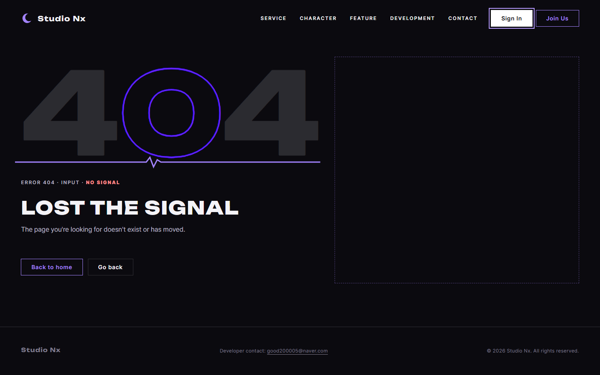 | 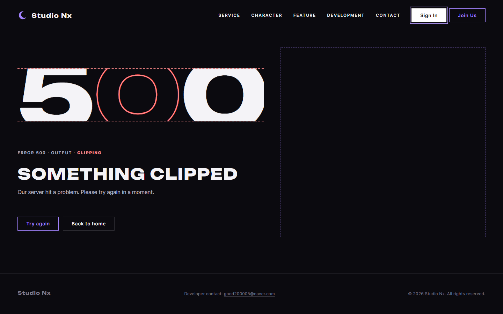 |

| 403 | 503 |
|---|---|
| 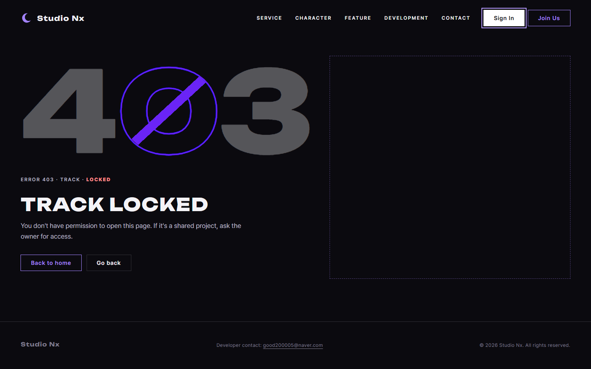 | 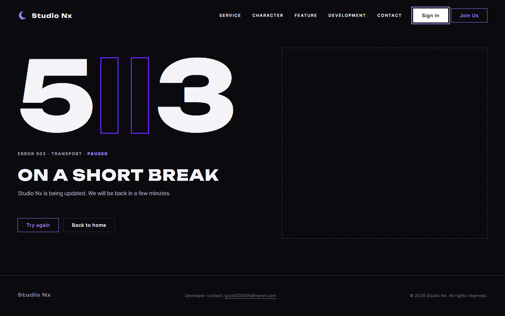 |

| 429 | 400 | 504 |
|---|---|---|
| 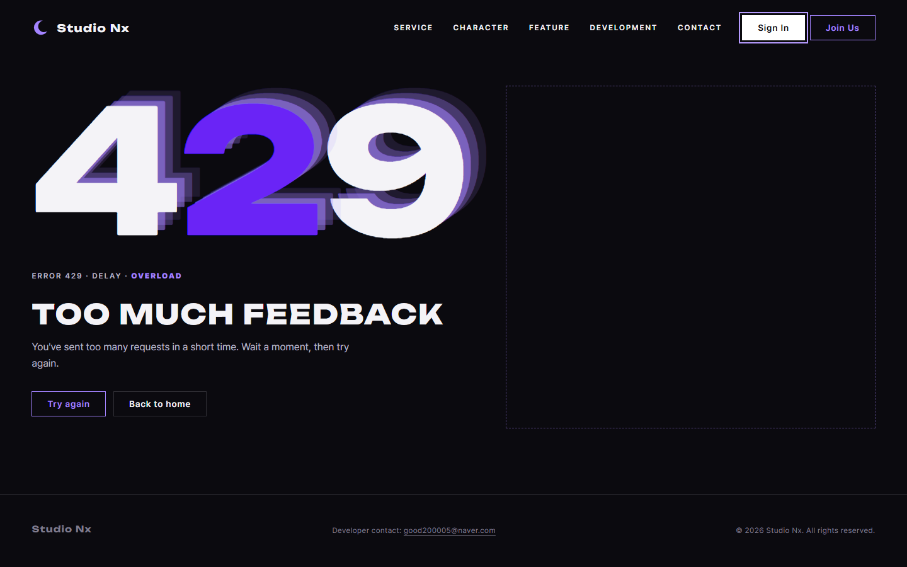 | 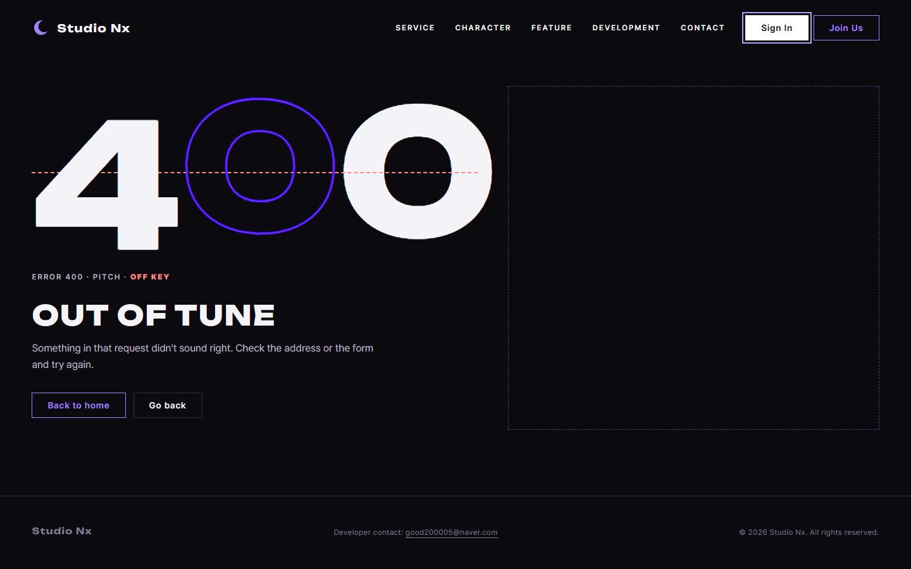 | 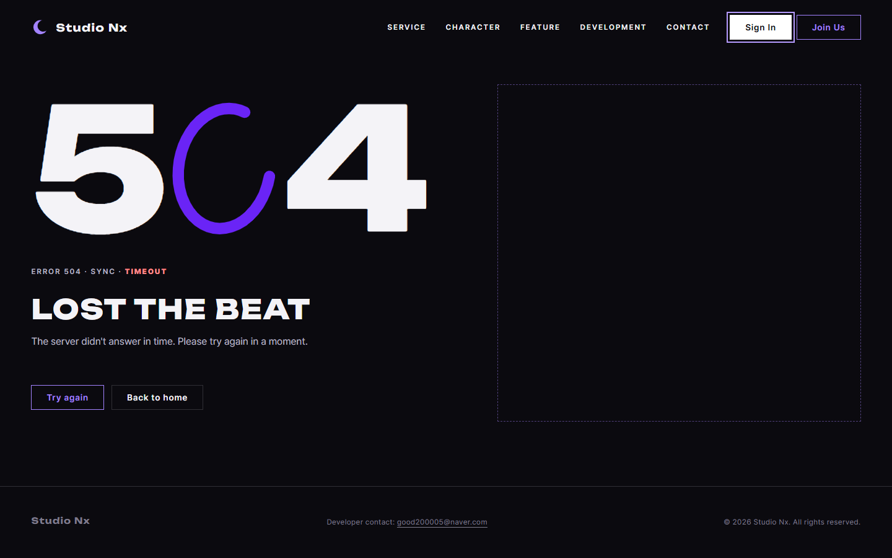 |

### 1.2 모바일 (390 × 844)
| 404 | 500 | 403 | 503 |
|---|---|---|---|
| 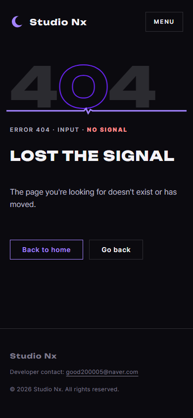 | 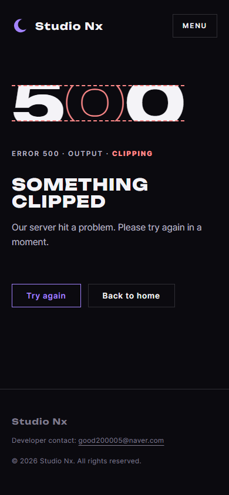 | 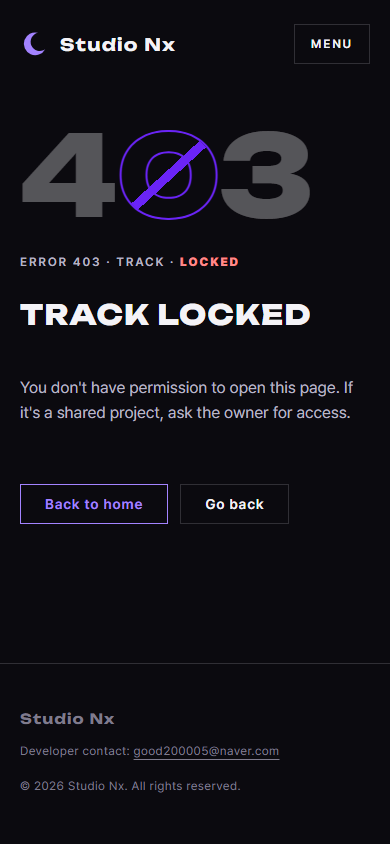 | 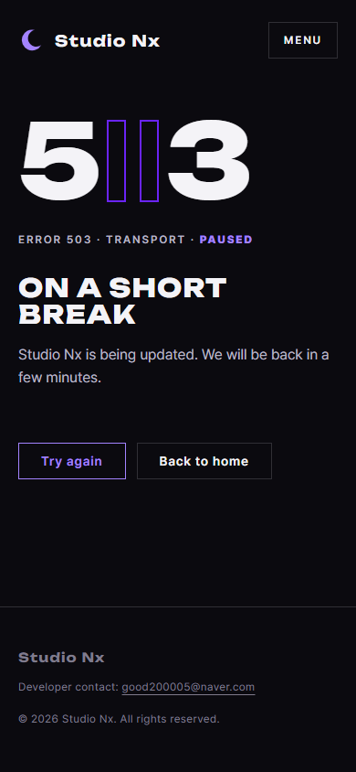 |

## 2. 무엇을 만들었나
| 파일 | 내용 |
|---|---|
| `frontend/404.html` | 없는 주소. 정적 파일 마운트가 **자동으로** 이 파일을 상태 404로 보여 줌 |
| `frontend/errors/400·403·429·500·503·504.html` | 나머지 6종. 백엔드가 페이지 요청 오류일 때 돌려줌 (TODO) |
| `static/css/pages/error.css` | 7종 공통 배치 + 상태별 숫자 표현 |
| `static/js/pages/error.js` | 공통 조각 끼우기(구현됨) + 버튼 동작 `initErrorActions` (TODO) |
| `backend/app/core/errors.py` | `ERROR_PAGES`(상태 → HTML 파일) + 연결 방법 TODO |
| `.impeccable/config.json` | 429 검사 예외 1건 (§3.5) |

### 2.1 상태별 표현과 문구
| 상태 | 숫자 표현 | 신호 표시 | 제목 | 버튼 |
|---|---|---|---|---|
| 404 | 바랜 숫자 + 끊긴 평평한 선 | Error 404 · Input · no signal | Lost the signal | Back to home / Go back |
| 500 | 위아래가 잘린 숫자(클리핑) | Error 500 · Output · clipping | Something clipped | Try again / Back to home |
| 403 | 흐린 숫자 + `0`에 금지 사선 | Error 403 · Track · locked | Track locked | Back to home / Go back |
| 503 | `0` 자리에 일시정지 ‖ | Error 503 · Transport · paused | On a short break | Try again / Back to home |
| 429 | 딜레이 메아리 | Error 429 · Delay · overload | Too much feedback | Try again / Back to home |
| 400 | 기준선 위아래로 틀어진 숫자 | Error 400 · Pitch · off key | Out of tune | Back to home / Go back |
| 504 | 멈춘 로딩 고리 | Error 504 · Sync · timeout | Lost the beat | Try again / Back to home |

## 3. 왜 이렇게 했나
### 3.1 모든 페이지의 위치 통일
7종이 같은 격자·같은 간격을 씁니다. 숫자 무대 높이를 `1em`으로 고정하고(잘린 500, 메아리 429도 같은 중심), 위쪽 기준으로 정렬하고, 설명은 최소 2줄(모바일 3줄) 자리를 잡아 **버튼까지 같은 높이**입니다(§4 측정).

### 3.2 `<base href="/">`
404는 `/a/b/c`처럼 어떤 깊이의 주소에서도 열립니다. 상대 경로(`static/css/…`, 공통 조각, 헤더 링크)가 깨지지 않도록 모든 오류 페이지에 `<base href="/">`를 넣어 사이트 루트 기준으로 동작하게 했습니다.

### 3.3 오류 번호를 신호 표시에 합침
시안에는 제목 위에 "ERROR 404" 라벨이 따로 있었습니다. 디자인 자동 검사가 "제목 바로 위의 작은 대문자 라벨"을 금지 패턴(`kicker-above-heading`)으로 잡아서, 검사가 권하는 대로 **정보를 다른 곳에 합쳤습니다.**
- 숫자와 신호 표시를 한 그림(`<figure>` + `<figcaption>`)으로 묶고, 오류 번호를 신호 표시 앞에 넣음: `ERROR 404 · INPUT · NO SIGNAL`
- 숫자는 일부러 흐리거나 잘려 있어 글자로 된 번호가 필요하므로 지우지 않았습니다.
- 화면 읽기 프로그램용으로 제목 앞에 `Error 404:`를 숨겨 둠 (`sr-only`)

### 3.4 403 사선 위치는 측정값
사선 양 끝이 `0`의 **바깥 고리**에 정확히 닿도록, Unbounded 글꼴의 고리 범위를 픽셀로 측정해 `inset`(em 단위)으로 넣고 타원으로 잘랐습니다. 글꼴이나 숫자 무대 구조를 바꾸면 다시 측정해야 합니다.

### 3.5 검사 예외 1건 (429)
429의 메아리는 보라색 `text-shadow`라서 검사가 "보라 네온 글자"(`ai-color-palette`)로 잡습니다. 빛 번짐이 아니라 딜레이 메아리이고, 보라는 Nyxi 헤드폰에서 온 유일한 강조색이며, 사용자가 승인한 디자인이라 `.impeccable/config.json`에 이유와 함께 예외로 등록했습니다.
> 예외는 **파일 경로 기준**이라 파일 검사에서는 0건이지만, 실행 중인 주소(`http://localhost:8000/errors/429.html`)를 검사하면 이 1건이 그대로 표시됩니다.

### 3.6 API 경로는 아직 HTML 404 (백엔드 TODO)
정적 파일 마운트가 루트(`/`)에 걸려 있어 **없는 API 주소(`/api/v1/없는경로`)도 404.html을 돌려줍니다.** API는 JSON 오류 형식이어야 하므로 `core/errors.py`의 TODO에 처리 방법을 적었습니다(API 라우터 끝에 모든 경로를 받는 핸들러를 두고 `AppError(NOT_FOUND, 404)`).

## 4. 검증 결과 (2026-10-03)
| 확인 | 결과 |
|---|---|
| 응답 | `/nope`, `/a/b/c` → **404** + 오류 페이지 HTML / `/api/v1/health` → 200 JSON (영향 없음) |
| 위치 통일 (데스크톱) | 7종 모두 숫자 136px · 신호 표시 432 · 제목 476 · 버튼 621 |
| 위치 통일 (모바일) | 7종 모두 120 · 256 · 300 · 484 |
| 공통 조각 | 7종 모두 헤더·푸터·로그인 모달 끼워짐, 헤더 Sign In → 모달 열림 |
| 실패한 요청 | 404 페이지 자체(의도된 404) 외 없음. 콘솔 오류 없음 |
| 가로 넘침 | 없음 |
| 디자인 자동 검사 | 주소 검사 7종 중 6종 0건, 429는 예외 등록 건 1건(§3.5) |
| 백엔드 | `ruff` 통과, `pytest` 3개 통과 |

## 5. 남은 일
| 항목 | 담당 |
|---|---|
| 버튼 동작 `initErrorActions` (Go back, Try again) | 사용자 |
| 페이지 요청 오류 → `ERROR_PAGES` HTML, API 요청 → JSON (`core/errors.py`) | 사용자 (P1-03 오류 처리기와 함께) |
| 없는 API 주소를 JSON 404로 | 사용자 |
| 503 점검 모드 (선택) | 사용자 |
| Nyxi 일러스트 7장 (자세는 각 HTML 주석) | 사용자 (외부 플랫폼) |
| 401·413·507 디자인을 앱 안 알림·모달로 (시안 28·29·31) | 추후 |

## 6. 자주 받을 질문 대비
- **Q. 404만 루트에 있는 이유는?** Starlette `StaticFiles(html=True)`는 없는 파일을 요청받으면 디렉터리 루트의 `404.html`을 찾아 보여 줍니다. 그래서 404는 코드 없이 바로 동작합니다. 나머지는 상태를 백엔드가 알아야 하므로 `errors/`에 두고 연결합니다.
- **Q. 일러스트 자리가 비어 보이는데?** 메인 페이지의 일러스트 자리와 같은 방식(빈 점선 상자)입니다. 각 HTML 주석에 필요한 Nyxi 자세를 적어 두었습니다.
- **Q. 오류 페이지에도 로그인 모달이 있는 이유는?** 공통 헤더의 Sign In 버튼이 모든 페이지에서 동작하도록 같은 조각을 넣었습니다.
