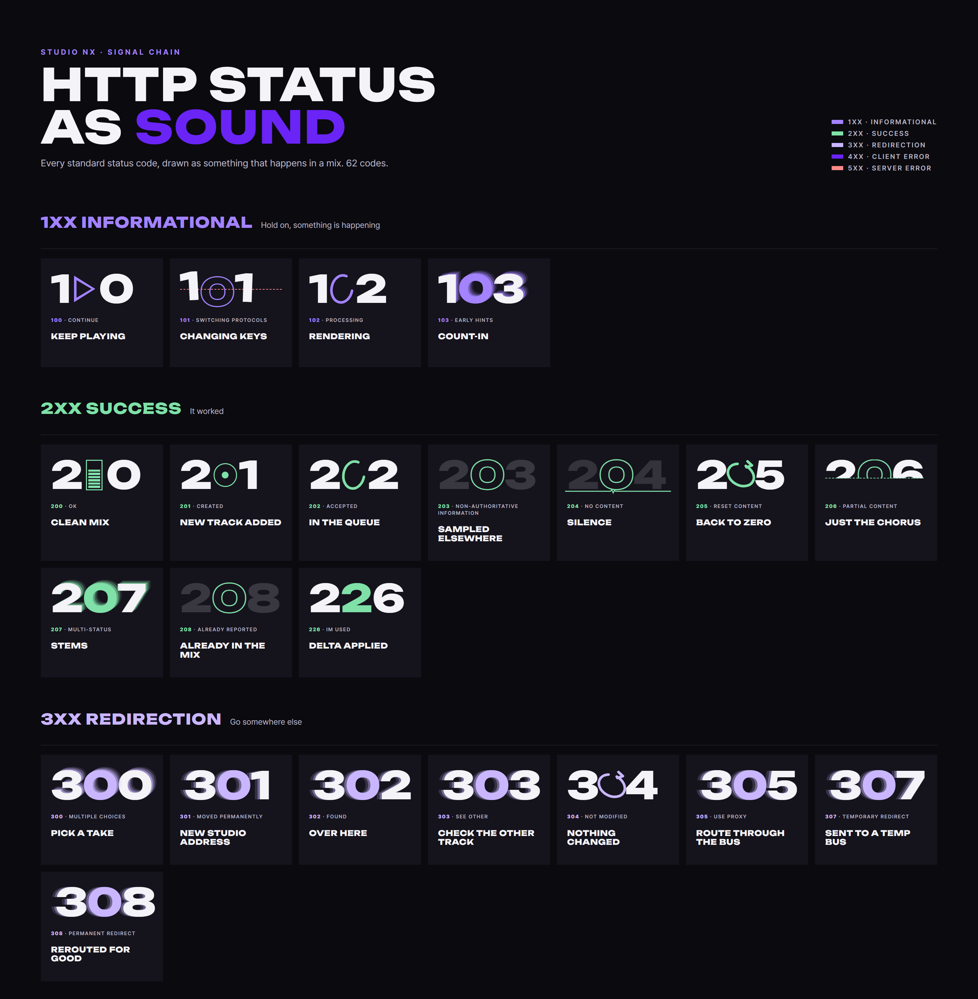
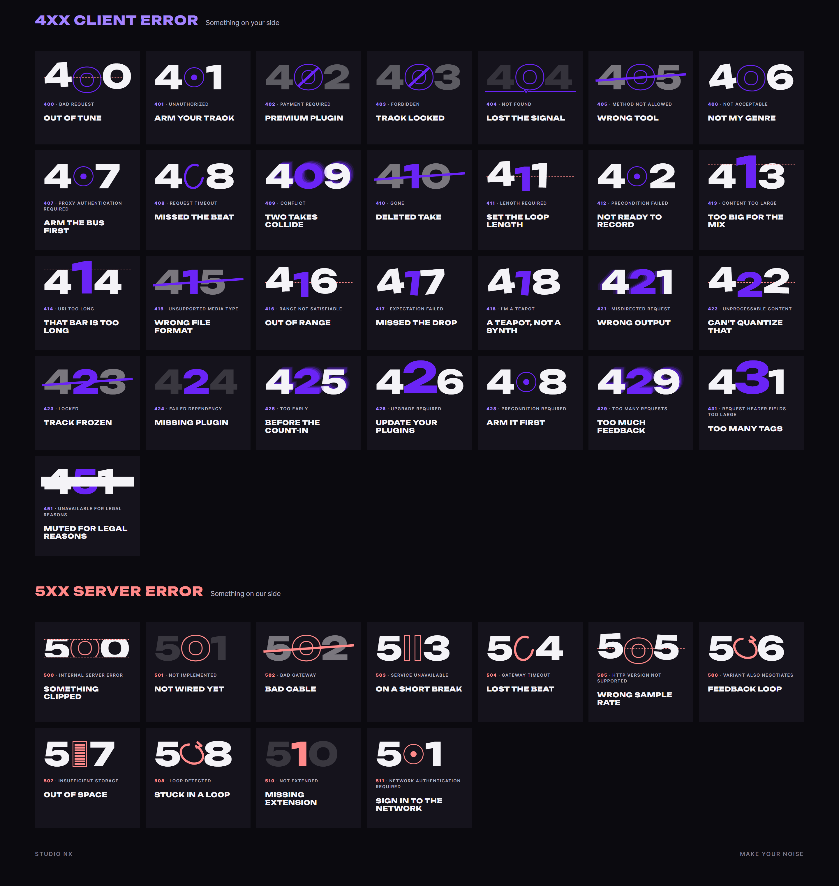

# AI 구현 설명 12 — HTTP 상태 코드 포스터 "HTTP Status as Sound"

| 항목 | 내용 |
|---|---|
| 작성 | Claude (AI) |
| 작성일 | 2026-10-03 |
| 작업 | 사용자 개인 요청: 오류 페이지 F-2 디자인을 HTTP 상태 코드 전체로 넓힌 포스터 |
| 이미지 | `docs/page_mockups/38_http_status_poster.png` (2880 × 5985px) — **저장소에 커밋하지 않음** (사용자 결정) |
| 관련 | [11_error_pages.md](11_error_pages.md) — 실제 오류 페이지 7종 |

---

## 1. 무엇을 만들었나
표준 HTTP 상태 코드 **62개**를 F-2 디자인("숫자 자체가 신호")으로 한 장에 모은 포스터입니다. 각 칸에는 숫자 그림, 표준 이름(예: `404 · Not Found`), Studio Nx 식 제목(예: *Lost the signal*)이 들어갑니다.

> 원본 한 장은 `docs/page_mockups/38_http_status_poster.png`, 문서에는 쪽에 맞게 4xx 앞에서 두 장으로 나눠 넣었습니다.

## 2. 디자인 규칙
| 규칙 | 내용 |
|---|---|
| 숫자 무대 | 높이 `1em` 고정, 가운데 정렬 → 모든 칸의 숫자 위치가 같음 (오류 페이지와 같은 구조) |
| 가운데 숫자 | 계열 색으로 강조. **0일 때만 윤곽선**, 다른 숫자는 채움 — Unbounded 글꼴의 1·2 등은 윤곽선으로 그리면 안쪽 겹친 선이 드러나서 |
| 금지 사선 | 0의 바깥 고리 범위를 측정한 값으로 그림 → 가운데가 0이 아닌 코드(402는 0, 423은 2)는 사선 대신 줄 긋기로 대체 |
| 글꼴 | 숫자·제목 Unbounded 800, 설명 Pretendard |
| 바탕 | 사이트와 같은 먹색 `#0b0a0f`, 칸 `#15131c` |

### 2.1 계열별 색
| 계열 | 뜻 | 색 | 개수 |
|---|---|---|---|
| 1xx 정보 (Informational) | 아직 진행 중 | 보라 `#a383ff` | 4 |
| 2xx 성공 (Success) | 잘 됨 | 초록 `--c-ok` `#7fe0a8` | 10 |
| 3xx 이동 (Redirection) | 다른 곳으로 가라 | 연보라 `#c9b6ff` | 8 |
| 4xx 클라이언트 오류 (Client error) | 요청한 쪽(브라우저·사용자) 문제 | 보라 `#6a24f6` (기준선·헤드룸은 빨강) | 29 |
| 5xx 서버 오류 (Server error) | 서버 쪽 문제 | 빨강 `--c-error` `#ff8a8a` | 11 |

## 3. 숫자 표현 = DAW·이펙트
숫자 모양을 바꾸는 방법 20가지를 DAW에서 실제로 보는 장면에 대응시켰습니다. 상태 코드의 뜻과 가장 가까운 장면을 골랐습니다.

| DAW · 이펙트 | 숫자 모양 | DAW에서의 뜻 | 쓴 코드 |
|---|---|---|---|
| 클리핑 (Clipping) | 위아래가 잘린 숫자 + 빨간 점선 | 신호가 0 dBFS 를 넘어 파형 위아래가 잘림 | 500 |
| 구간 재생 (Loop region) | 위쪽 절반만 보이는 숫자 | 곡 일부 구간만 재생 | 206 |
| 딜레이 · 에코 (Delay) | 오른쪽 위로 옅어지며 반복되는 숫자 | 같은 소리가 시간차를 두고 점점 작게 반복 | 103, 207, 300, 409, 425, 429 |
| 트랜스포트 일시정지 (Pause) | 0 자리에 ‖ | 재생 헤드 정지 | 503 |
| 트랜스포트 재생 (Play) | 0 자리에 ▶ | 재생 계속 | 100 |
| 녹음 대기 (Record Arm) | 0 자리에 빈 원 + 가운데 점 | 트랙을 녹음 가능 상태로 거는 버튼 | 201, 401, 407, 412, 428, 511 |
| 렌더링 · 동기화 대기 | 오른쪽이 끊긴 채 멈춘 고리 | 처리 중이거나 응답을 기다림 | 102, 202, 408, 504 |
| 루프 (Loop) | 고리 + 화살표 | 같은 구간을 반복 재생 | 205, 304, 506, 508 |
| 레벨 미터 피크 (Meter) | 끝까지 빨갛게 찬 세로 미터 | 입력이 최대치에 닿음 | 507 |
| 적정 레벨 | 70% 정도 찬 초록 미터 | 여유(헤드룸)가 있는 깨끗한 레벨 | 200 |
| 헤드룸 초과 (Headroom) | 가운데 숫자가 커져 빨간 점선을 뚫음 | 허용 범위 위로 신호가 솟음 | 413, 414, 426, 431 |
| 음정 · 튜닝 (Pitch / Detune) | 빨간 기준선 위아래로 틀어진 숫자 | 기준 음에서 벗어남 | 101, 400, 411, 416, 422, 505 |
| 트랙 삭제 · 연결 끊김 | 숫자 위로 기울어진 줄 | 지워지거나 쓸 수 없게 된 것 | 405, 410, 415, 423, 502 |
| 트랙 잠금 (Lock) | 0 바깥 고리에 닿는 금지 사선 | 편집·접근 금지 | 402, 403 |
| 음소거 · 바이패스 (Mute / Bypass) | 거의 투명한 숫자 | 소리가 있어도 들리지 않거나 효과가 빠짐 | 203, 208, 424, 501, 510 |
| 무신호 (No signal) | 바랜 숫자 + 아래 평평한 선 | 입력이 들어오지 않음 | 204, 404 |
| 라우팅 이동 (Send / Bus) | 왼쪽에 잔상을 남기며 오른쪽으로 밀린 숫자 | 신호를 다른 버스·출력으로 보냄 | 301, 302, 303, 305, 307, 308, 421 |
| 구간 음소거 (Censor bleep) | 숫자 가운데를 가로지르는 막대 | 특정 구간을 가림 | 451 |
| 그루브 어긋남 (Off-grid) | 제각각 기운 숫자 | 박자 격자에서 벗어난 느낌 | 406, 417, 418 |
| 변경분 표시 | 강조색으로 채운 가운데 숫자 | 바뀐 부분만 강조 | 226 |

> 대응 원칙: **"막혔다"는 잠금·줄 긋기**, **"넘쳤다"는 클리핑·헤드룸·피크**, **"기다린다"는 고리·일시정지**, **"다른 곳으로"는 라우팅 잔상**, **"반복"은 루프**, **"너무 많다"는 딜레이 메아리**, **"없다·약하다"는 무신호·바이패스**, **"틀렸다"는 음정 어긋남**.

## 4. 코드별 설명
### 4.1 1xx 정보 (Informational)
| 코드 | 표준 이름 | 뜻 | 포스터 제목 | 숫자 표현 | DAW 비유 |
|---|---|---|---|---|---|
| 100 | Continue | 요청 앞부분을 받았으니 계속 보내도 됨 | Keep playing | 트랜스포트 재생 (Play) | 재생을 멈추지 말고 계속 — 재생 버튼 |
| 101 | Switching Protocols | 서버가 다른 프로토콜로 전환함 (예: 웹소켓) | Changing keys | 음정 · 튜닝 (Pitch / Detune) | 곡의 키를 바꾸는 전조 — 숫자가 위아래로 옮겨 감 |
| 102 | Processing | 처리 중, 아직 결과 없음 (WebDAV) | Rendering | 렌더링 · 동기화 대기 | 렌더링 진행 중 — 로딩 고리 |
| 103 | Early Hints | 본 응답 전에 미리 읽을 자원 힌트를 줌 | Count-in | 딜레이 · 에코 (Delay) | 본 연주 전 카운트인 — 메아리처럼 먼저 들리는 박 |

### 4.2 2xx 성공 (Success)
| 코드 | 표준 이름 | 뜻 | 포스터 제목 | 숫자 표현 | DAW 비유 |
|---|---|---|---|---|---|
| 200 | OK | 요청 성공 | Clean mix | 적정 레벨 | 레벨이 적당한 깨끗한 믹스 — 초록 레벨 미터 |
| 201 | Created | 새 자원을 만듦 | New track added | 녹음 대기 (Record Arm) | 새 트랙 추가 — 녹음 버튼 |
| 202 | Accepted | 접수했지만 처리는 나중에 | In the queue | 렌더링 · 동기화 대기 | 렌더 대기열 — 돌아가는 고리 |
| 203 | Non-Authoritative Information | 다른 출처에서 가공한 정보 | Sampled elsewhere | 음소거 · 바이패스 (Mute / Bypass) | 다른 곳에서 가져온 샘플 — 바랜 숫자 |
| 204 | No Content | 성공했지만 돌려줄 내용 없음 | Silence | 무신호 (No signal) | 무음 구간 — 평평한 선 |
| 205 | Reset Content | 입력 화면을 초기화하라 | Back to zero | 루프 (Loop) | 처음(0)으로 되감기 — 루프 화살표 |
| 206 | Partial Content | 요청한 범위 일부만 보냄 (이어받기 등) | Just the chorus | 구간 재생 (Loop region) | 곡 전체가 아니라 후렴만 — 위쪽 절반만 보이는 숫자 |
| 207 | Multi-Status | 여러 자원의 상태를 한꺼번에 (WebDAV) | Stems | 딜레이 · 에코 (Delay) | 여러 스템(파트) — 겹쳐 보이는 메아리 |
| 208 | Already Reported | 이미 앞에서 보고한 항목 (WebDAV) | Already in the mix | 음소거 · 바이패스 (Mute / Bypass) | 이미 믹스에 들어간 소리 — 바랜 숫자 |
| 226 | IM Used | 변경분(델타)을 적용한 결과 | Delta applied | 변경분 표시 | 변경분만 적용 — 강조색 가운데 숫자 |

### 4.3 3xx 이동 (Redirection)
| 코드 | 표준 이름 | 뜻 | 포스터 제목 | 숫자 표현 | DAW 비유 |
|---|---|---|---|---|---|
| 300 | Multiple Choices | 선택지가 여러 개 | Pick a take | 딜레이 · 에코 (Delay) | 녹음 테이크 중 하나 고르기 — 여러 겹의 메아리 |
| 301 | Moved Permanently | 영구히 다른 주소로 옮김 | New studio address | 라우팅 이동 (Send / Bus) | 스튜디오 주소가 바뀜 — 오른쪽으로 쓸려 가는 잔상 |
| 302 | Found | 다른 주소에서 찾음 (임시) | Over here | 라우팅 이동 (Send / Bus) | 여기로 오세요 — 이동 잔상 |
| 303 | See Other | 다른 주소를 GET 으로 보라 | Check the other track | 라우팅 이동 (Send / Bus) | 다른 트랙을 확인 — 이동 잔상 |
| 304 | Not Modified | 바뀐 것 없음, 저장본을 써라 | Nothing changed | 루프 (Loop) | 변화 없음, 같은 루프 반복 — 루프 화살표 |
| 305 | Use Proxy | 프록시를 거쳐야 함 (지금은 안 씀) | Route through the bus | 라우팅 이동 (Send / Bus) | 버스(보조 채널)를 거쳐 라우팅 — 이동 잔상 |
| 307 | Temporary Redirect | 임시로 다른 주소, 방식은 그대로 | Sent to a temp bus | 라우팅 이동 (Send / Bus) | 임시 버스로 보냄 — 이동 잔상 |
| 308 | Permanent Redirect | 영구히 다른 주소, 방식은 그대로 | Rerouted for good | 라우팅 이동 (Send / Bus) | 라우팅을 영구히 바꿈 — 이동 잔상 |

### 4.4 4xx 클라이언트 오류 (Client error)
| 코드 | 표준 이름 | 뜻 | 포스터 제목 | 숫자 표현 | DAW 비유 |
|---|---|---|---|---|---|
| 400 | Bad Request | 요청 형식이 잘못됨 | Out of tune | 음정 · 튜닝 (Pitch / Detune) | 음정이 맞지 않음 — 기준선에서 틀어진 숫자 |
| 401 | Unauthorized | 인증(로그인)이 필요함 | Arm your track | 녹음 대기 (Record Arm) | 녹음 대기(Arm)를 걸어야 녹음 가능 — 녹음 버튼 |
| 402 | Payment Required | 결제가 필요함 (예약된 코드) | Premium plugin | 트랙 잠금 (Lock) | 유료 플러그인 — 잠긴 0 |
| 403 | Forbidden | 권한이 없음 | Track locked | 트랙 잠금 (Lock) | 잠긴 트랙 — 금지 사선 |
| 404 | Not Found | 찾을 수 없음 | Lost the signal | 무신호 (No signal) | 입력 신호가 없음 — 바랜 숫자 + 평평한 선 |
| 405 | Method Not Allowed | 이 주소에서 허용하지 않는 방식 | Wrong tool | 트랙 삭제 · 연결 끊김 | 잘못된 도구 — 줄이 그어진 숫자 |
| 406 | Not Acceptable | 요청한 형식으로 줄 수 없음 | Not my genre | 그루브 어긋남 (Off-grid) | 내 장르가 아님 — 삐딱하게 기운 숫자 |
| 407 | Proxy Authentication Required | 프록시 인증이 필요함 | Arm the bus first | 녹음 대기 (Record Arm) | 버스부터 녹음 대기 — 녹음 버튼 |
| 408 | Request Timeout | 요청이 너무 늦게 도착함 | Missed the beat | 렌더링 · 동기화 대기 | 박자를 놓침 — 멈춘 고리 |
| 409 | Conflict | 현재 상태와 충돌 | Two takes collide | 딜레이 · 에코 (Delay) | 두 테이크가 겹침 — 메아리 |
| 410 | Gone | 영구히 사라짐 | Deleted take | 트랙 삭제 · 연결 끊김 | 지운 테이크 — 줄이 그어진 숫자 |
| 411 | Length Required | 길이(Content-Length) 정보가 필요함 | Set the loop length | 음정 · 튜닝 (Pitch / Detune) | 루프 길이를 정해야 함 — 기준선에서 틀어진 숫자 |
| 412 | Precondition Failed | 전제 조건이 맞지 않음 | Not ready to record | 녹음 대기 (Record Arm) | 녹음 준비가 안 됨 — 녹음 버튼 |
| 413 | Content Too Large | 보낸 내용이 너무 큼 | Too big for the mix | 헤드룸 초과 (Headroom) | 믹스에 넣기엔 너무 큼 — 헤드룸 선을 뚫는 숫자 |
| 414 | URI Too Long | 주소가 너무 김 | That bar is too long | 헤드룸 초과 (Headroom) | 마디가 너무 김 — 헤드룸을 넘는 숫자 |
| 415 | Unsupported Media Type | 지원하지 않는 파일 형식 | Wrong file format | 트랙 삭제 · 연결 끊김 | 잘못된 파일 형식 — 줄이 그어진 숫자 |
| 416 | Range Not Satisfiable | 요청한 범위를 줄 수 없음 | Out of range | 음정 · 튜닝 (Pitch / Detune) | 재생 범위를 벗어남 — 틀어진 숫자 |
| 417 | Expectation Failed | Expect 헤더 조건을 못 맞춤 | Missed the drop | 그루브 어긋남 (Off-grid) | 드롭을 놓침 — 기운 숫자 |
| 418 | I'm a teapot | '나는 찻주전자' 농담 코드 (RFC 2324) | A teapot, not a synth | 그루브 어긋남 (Off-grid) | 찻주전자지 신스가 아님 — 기운 숫자 |
| 421 | Misdirected Request | 요청이 엉뚱한 서버로 감 | Wrong output | 라우팅 이동 (Send / Bus) | 잘못된 출력으로 라우팅 — 이동 잔상 |
| 422 | Unprocessable Content | 형식은 맞지만 내용을 처리할 수 없음 | Can't quantize that | 음정 · 튜닝 (Pitch / Detune) | 퀀타이즈할 수 없는 연주 — 틀어진 숫자 |
| 423 | Locked | 자원이 잠겨 있음 (WebDAV) | Track frozen | 트랙 삭제 · 연결 끊김 | 프리즈(고정)된 트랙 — 줄이 그어진 숫자 |
| 424 | Failed Dependency | 앞선 요청이 실패해 이것도 실패 (WebDAV) | Missing plugin | 음소거 · 바이패스 (Mute / Bypass) | 필요한 플러그인이 없음 — 바랜 숫자 |
| 425 | Too Early | 너무 이른 요청 (재전송 위험) | Before the count-in | 딜레이 · 에코 (Delay) | 카운트인 전에 들어옴 — 앞서 들리는 메아리 |
| 426 | Upgrade Required | 프로토콜 업그레이드가 필요함 | Update your plugins | 헤드룸 초과 (Headroom) | 플러그인을 업데이트하라 — 커진 숫자 |
| 428 | Precondition Required | 조건부 요청이어야 함 | Arm it first | 녹음 대기 (Record Arm) | 먼저 녹음 대기 — 녹음 버튼 |
| 429 | Too Many Requests | 요청이 너무 많음 | Too much feedback | 딜레이 · 에코 (Delay) | 피드백이 너무 심함 — 딜레이 메아리 |
| 431 | Request Header Fields Too Large | 헤더가 너무 큼 | Too many tags | 헤드룸 초과 (Headroom) | 태그가 너무 많음 — 헤드룸을 넘는 숫자 |
| 451 | Unavailable For Legal Reasons | 법적 이유로 제공할 수 없음 | Muted for legal reasons | 구간 음소거 (Censor bleep) | 법적 이유로 음소거 — 검열 막대 |

### 4.5 5xx 서버 오류 (Server error)
| 코드 | 표준 이름 | 뜻 | 포스터 제목 | 숫자 표현 | DAW 비유 |
|---|---|---|---|---|---|
| 500 | Internal Server Error | 서버 내부 오류 | Something clipped | 클리핑 (Clipping) | 출력이 클리핑됨 — 위아래가 잘린 숫자 |
| 501 | Not Implemented | 서버가 아직 지원하지 않는 기능 | Not wired yet | 음소거 · 바이패스 (Mute / Bypass) | 아직 배선(연결)이 안 됨 — 바랜 숫자 |
| 502 | Bad Gateway | 중간 서버가 잘못된 응답을 받음 | Bad cable | 트랙 삭제 · 연결 끊김 | 불량 케이블 — 줄이 그어진 숫자 |
| 503 | Service Unavailable | 서비스를 잠시 쓸 수 없음 (점검·과부하) | On a short break | 트랜스포트 일시정지 (Pause) | 트랜스포트 일시정지 — ‖ |
| 504 | Gateway Timeout | 중간 서버가 응답을 제때 못 받음 | Lost the beat | 렌더링 · 동기화 대기 | 박자를 놓침 — 멈춘 로딩 고리 |
| 505 | HTTP Version Not Supported | 지원하지 않는 HTTP 버전 | Wrong sample rate | 음정 · 튜닝 (Pitch / Detune) | 샘플레이트가 맞지 않음 — 틀어진 숫자 |
| 506 | Variant Also Negotiates | 콘텐츠 협상 설정이 순환함 | Feedback loop | 루프 (Loop) | 피드백 루프 — 루프 화살표 |
| 507 | Insufficient Storage | 저장 공간 부족 (WebDAV) | Out of space | 레벨 미터 피크 (Meter) | 저장 공간이 가득 — 끝까지 찬 레벨 미터 |
| 508 | Loop Detected | 처리 중 무한 반복 감지 (WebDAV) | Stuck in a loop | 루프 (Loop) | 루프에 갇힘 — 루프 화살표 |
| 510 | Not Extended | 요청에 필요한 확장이 없음 | Missing extension | 음소거 · 바이패스 (Mute / Bypass) | 확장 기능이 없음 — 바랜 숫자 |
| 511 | Network Authentication Required | 네트워크 접속 인증이 필요함 (와이파이 로그인 등) | Sign in to the network | 녹음 대기 (Record Arm) | 네트워크에 먼저 로그인 — 녹음 버튼 |

## 5. 실제 오류 페이지와의 관계
| 포스터 | 실제 사이트 |
|---|---|
| 62개 전체, 칸 크기 그림 | 7개만 페이지로 구현 (404·500·403·503·429·400·504) — [11_error_pages.md](11_error_pages.md) |
| 401·413·507 | 앱 안 알림·모달용으로 남겨 둠 (시안 `28·29·31`) |
| 나머지 | 브라우저·서버가 거의 보여 주지 않는 코드라 포스터에만 |

## 6. 다시 만드는 법
포스터는 개발 서버에 임시 HTML을 두고 헤드리스 Chrome으로 전체 페이지를 캡처해 만들었습니다(가로 2880px). 생성 코드는 저장소에 넣지 않았습니다. 다시 만들려면 이 문서의 §3·§4 표를 데이터로 쓰고, 오류 페이지 CSS(`static/css/pages/error.css`)의 숫자 표현을 칸 크기(112px)로 적용하면 됩니다.
