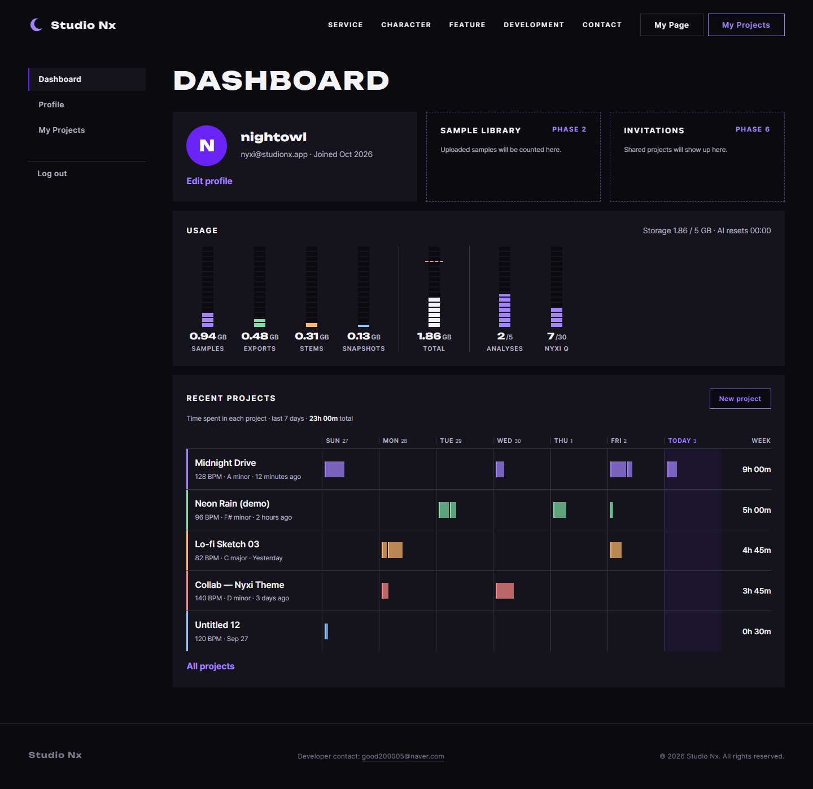
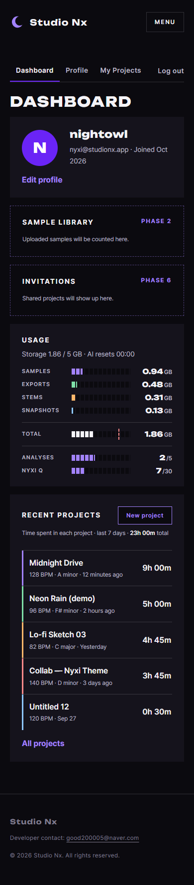
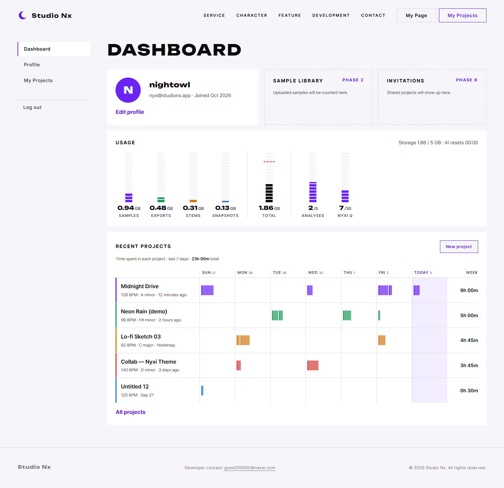
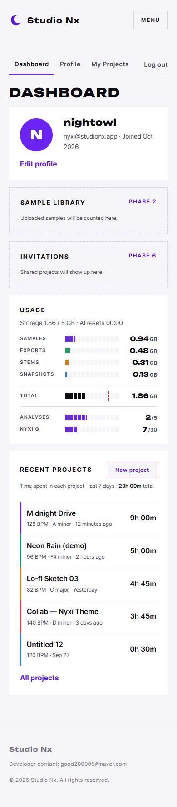

# AI 구현 설명 13 — 마이페이지 대시보드 (M-2 믹서 콘솔형)

| 항목 | 내용 |
|---|---|
| 작성 | Claude (AI) |
| 작성일 | 2026-10-03 |
| 작업 | P1-17 마이페이지 (`myPage.html`), 이전 문서: [11_error_pages.md](11_error_pages.md) |
| 브랜치 | `feature/phase1/p1-17-mypage` |
| 기준 시안 | `docs/page_mockups/mypage/05_M2_sessions_desktop.png`, `06_M2_sessions_mobile.png` (사용자 확정) |
| 원칙 | HTML/CSS를 작성하고, JS는 템플릿만 만들었습니다 (값 채우기, 로그아웃). 백엔드 API는 사용자가 만듭니다 |

---

## 1. 실행 결과
### 1.1 다크 테마 (기본)
| 데스크톱 1440 × 900 | 모바일 390 × 844 |
|---|---|
|  |  |

### 1.2 라이트 테마
| 데스크톱 | 모바일 |
|---|---|
|  |  |

> 캡처는 개발 서버(`http://localhost:8000/myPage.html`)에서 `<html data-auth="in">`을 붙여 로그인 상태 헤더로 찍었습니다. 숫자와 프로젝트는 HTML에 넣어 둔 **예시 값**입니다.

## 2. 무엇을 만들었나
| 파일 | 내용 | 비고 |
|---|---|---|
| `frontend/myPage.html` | 왼쪽 메뉴와 로그아웃, 프로필 카드, 준비 중 2칸, 사용량 미터 7개, 최근 프로젝트 5줄 | 공통 헤더와 푸터는 `static/partials/`에 있습니다 |
| `static/css/pages/mypage.css` | 배치, 레벨 미터, 요일별 세션 막대, 모바일 전환, 라이트 테마 색 | 이 페이지 전용 색은 `--mp-c1~5`입니다 |
| `static/js/pages/mypage.js` | 템플릿: `loadDashboard`, `renderProfile`, `renderUsage`, `renderRecentProjects`, `formatDuration`, `initLogoutButton` | 공통 조각 끼우기만 동작합니다 |
| `studionx/db/01_phase1_account.sql` 외 | `project_sessions` 테이블을 추가했습니다 (§4) | 로컬 DB에서 실행을 마쳤습니다 (35개) |
| `docs/PRD/01`, `02` | FR-128(마이페이지 작업 시간 표시), FR-257(시퀀서 기록), API 한 줄을 추가했습니다 | |

### 2.1 화면 구성
```
PC (960px 초과)                                  모바일 (960px 이하)
┌──────────┬──────────────────────────────────┐  ┌──────────────────────────┐
│Dashboard │ DASHBOARD                        │  │Dashboard Profile … Logout│ ← 가로 탭
│Profile   │ [프로필 카드] [Phase 2] [Phase 6]│  ├──────────────────────────┤
│Projects  │ USAGE  ▮ ▮ ▮ ▮ │ ▮ │ ▮ ▮          │  │ USAGE                    │
│──────────│        세로 레벨 미터 7개        │  │ SAMPLES ▮▮▯▯▯  0.94 GB   │ ← 가로 막대
│Log out   │ RECENT PROJECTS                  │  │ RECENT PROJECTS          │
│          │ 이름 │Sun│Mon│…│Today│ 7일 합계 │  │ Midnight Drive   9h 00m  │ ← 합계만
└──────────┴──────────────────────────────────┘  └──────────────────────────┘
```

## 3. 왜 이렇게 했나
### 3.1 사용량: 믹서 레벨 미터
| 결정 | 이유 |
|---|---|
| 세로 미터 (PC) | DAW 믹서 채널처럼 보이게 해서 서비스의 성격(음악 작업)을 드러냅니다. 사용자가 M-1 카드형 대신 M-2를 골랐습니다 |
| 가로 막대 (모바일) | 세로 미터 7개는 390px에 다 들어가지 않아서 잘립니다. 그래서 사용자의 요청으로 가로 막대(이름, 막대, 값)를 씁니다 |
| 같은 값 하나로 두 방향 | 채움 비율을 `style="--p: 18.8%"` 변수로 넣고, CSS가 PC에서는 `height`로, 모바일에서는 `width`로 씁니다. JS는 PC와 모바일을 구분하지 않고 `--p`만 바꾸면 됩니다 |
| 미터 칸 무늬 | `repeating-linear-gradient`로 LED 미터 칸을 표현합니다 (그림 파일 없음) |
| TOTAL 경고선 | 80% 위치에 빨간 점선이 있습니다 (`--w: 80%`). 80% 이상이면 `.strip`에 `is-warn`이 붙어서 미터가 빨강이 됩니다 (FR-133) |

### 3.2 최근 프로젝트: 최근 7일 작업 시간
처음 시안은 막대를 클립 모양으로 그렸는데, 사용자가 "프로젝트를 열어서 작업한 시간"으로 바꾸자고 제안해서 그렇게 결정했습니다.

| 항목 | 결정 |
|---|---|
| 범위 | 최근 7일(오늘 포함)이며, 요일 눈금을 두고 오늘 칸을 강조합니다 |
| 막대 하나 | 작업 세션 한 번입니다. 하루 칸 안에서 시간 순서대로 왼쪽부터 붙입니다 |
| 막대 길이 | `active_seconds ÷ 8시간`입니다 (8시간이면 칸이 가득 찹니다). 마우스를 올리면 `Fri 2 · 19:30–22:00 · 2h 30m`이 나옵니다 |
| 대상 | 내 시간만 셉니다 (협업 프로젝트에서도 다른 사람의 시간은 뺍니다) |
| 모바일 | 막대 없이 7일 합계만 보여 줍니다 (사용자 요청). CSS가 요일 칸을 숨깁니다 |
| 줄 색 | 프로젝트에 색 컬럼이 없으므로 **순서대로 5가지**를 씁니다 (`.lane:nth-child(5n + …)`) |

### 3.3 그 밖의 결정
| 결정 | 이유 |
|---|---|
| 로그아웃은 왼쪽 메뉴 맨 아래 | 로그인 상태 헤더에 버튼을 더 넣지 않기로 한 추천안입니다. 모바일에서는 탭 줄 오른쪽 끝에 둡니다 |
| 준비 중 칸(Phase 2, 6) | FR-121의 샘플 개수는 Phase 2부터이므로 자리만 점선으로 보여 줍니다 |
| 라이트 테마 색 | 밝은 파스텔은 흰 바탕에서 보이지 않아서 `--mp-c1~5`를 진한 색으로 다시 정의했고, TOTAL 미터는 `--c-ink`(테마 글자색)를 씁니다 |
| 예시 값을 HTML에 넣음 | 메인 페이지 공지(`home.html`)와 같은 방식입니다. JS를 구현하기 전에도 모양을 확인할 수 있고, JS는 같은 구조로 덮어씁니다 |

## 4. DB 변경: `project_sessions`
| 컬럼 | 뜻 |
|---|---|
| `session_id` | PK |
| `project_id` | FK → projects (CASCADE) |
| `user_id` | FK → users: 작업한 사람 |
| `started_at` | 프로젝트를 연 시각 |
| `last_seen_at` | 마지막 신호 시각 (신호가 끊긴 시각 = 세션 끝) |
| `active_seconds` | 실제 작업 시간(초)입니다. 입력이 5분 넘게 없는 구간은 뺍니다 |

- **기록 (Phase 2, FR-257):** 시퀀서가 1분마다 `POST /projects/{id}/sessions/heartbeat`를 보냅니다. 마지막 신호가 10분 넘게 지났으면 새 세션을 만듭니다. 브라우저를 그냥 닫으면 "닫음" 신호가 오지 않을 수 있어서, 닫은 시각 대신 마지막 신호 시각을 씁니다.
- **표시 (Phase 1, FR-128):** `GET /me/dashboard`가 최근 프로젝트마다 최근 7일 세션을 함께 돌려줍니다. Phase 1에는 기록하는 쪽이 없으므로 실제로는 모두 `0h 00m`입니다.
- 함께 고친 파일: `docs/DB.md`(§2.1, §3.1, §4, §5, 변경 이력), `01_phase1_account.sql`, `99_drop_all_tables.sql`, `migrations/2026-10-03_project_sessions.sql`, `docs/_build/erd.js` → `ERD.png`, `docs/ERD.md`, `studionx/db/docs/StudioNx_DB_Guide`(md·docx·PDF).

## 5. 검증 결과
| 확인 | 결과 |
|---|---|
| 시안과 비교 | PC와 모바일 모두 확정 시안(05, 06)과 배치가 같습니다 |
| 가로 넘침 | 1440과 390 모두 0px입니다. 모바일 탭 줄도 넘침이 0px입니다 (Log out이 잘리지 않습니다) |
| 라이트 테마 | 미터, 막대, 줄 색이 모두 보입니다 |
| 콘솔 오류, 404 | 없습니다 |
| 디자인 검사 `npx impeccable detect` | 통과했습니다. `flat-type-hierarchy`(정적 검사가 CSS를 읽지 못함, 실제 h1은 44px)와 `side-tab`(트랙 색 띠, 확정 시안)은 이유를 적어서 `.impeccable/config.json`에 예외로 등록했습니다 |
| 백엔드 테스트 | `pytest` 6개가 통과했습니다 (기존) |
| DB | 로컬 MySQL에서 변경 SQL을 실행해서 테이블이 35개가 되었고, `SHOW CREATE TABLE project_sessions`로 확인했습니다 |

## 6. 남은 일 (사용자)
| 할 일 | 위치 |
|---|---|
| 로그인 확인: 로그인하지 않았으면 `home.html#login?next=myPage.html`로 보내기 | `mypage.js` 맨 아래 TODO (`requireLogin`) |
| 대시보드 API `GET /api/v1/me/dashboard` (응답 예시는 `loadDashboard` 주석) | 백엔드 P1-16 |
| 값 채우기 함수 4개와 `formatDuration` | `mypage.js` |
| 로그아웃 버튼에 `core/auth.js logout()` 연결 | `initLogoutButton` |
| (Phase 2) 작업 세션 신호 API와 시퀀서 쪽의 1분 신호 | PRD 02 FR-257 |
| `userInfo.html`, `myProject.html` | P1-10, P1-14 (메뉴 링크는 이미 걸려 있음) |

## 7. 자주 받을 질문 대비
| 질문 | 답 |
|---|---|
| 세션 막대 위치는 실제 시각인가요? | 아니요. 하루 칸 안에서 **시간 순서대로 왼쪽부터** 붙입니다. 24시간 축으로 그리면 1시간이 칸의 4%라 너무 가늘어서, 길이(작업량)를 보여 주는 쪽을 택했습니다. 정확한 시각은 마우스를 올리면 나옵니다 |
| 하루 8시간을 넘기면 어떻게 되나요? | 막대는 칸 가득(100%)에서 멈추고, 합계 숫자에는 전부 들어갑니다 |
| 왜 열어 둔 시간 대신 `active_seconds`인가요? | 탭만 열어 두고 자리를 비우면 시간이 계속 늘어나기 때문입니다. 입력이 5분 넘게 없는 구간은 뺍니다 |
| 시간대는 어떻게 처리하나요? | DB는 UTC로 저장하고, 요일 구분은 브라우저 시간대로 JS가 합니다 |
| PC와 모바일 HTML이 다른가요? | 같습니다. 미디어 쿼리(960px)로 CSS만 바뀝니다 |
| 왜 테이블을 Phase 1 SQL에 넣었나요? | 기록은 Phase 2지만 마이페이지(Phase 1) 쿼리가 이 테이블을 읽으므로, 테이블이 먼저 있어야 오류 없이 0을 돌려줄 수 있습니다 |
