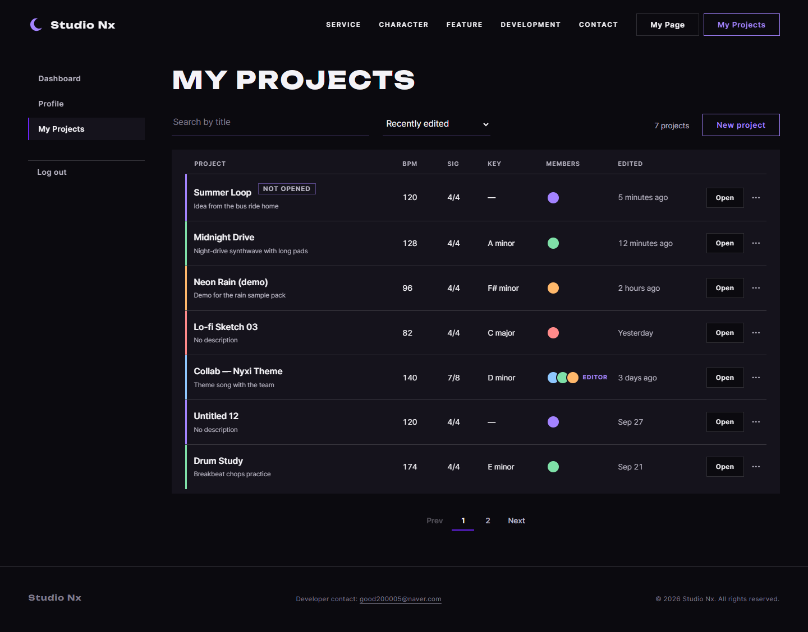
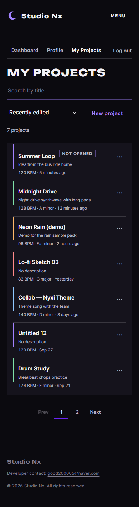
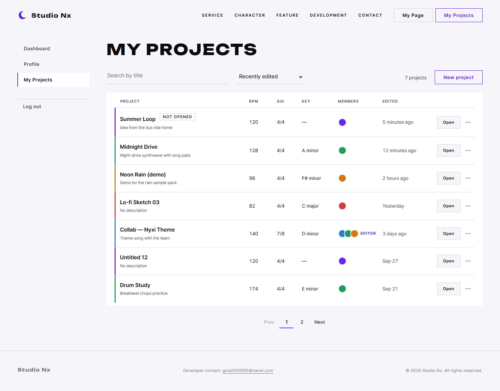
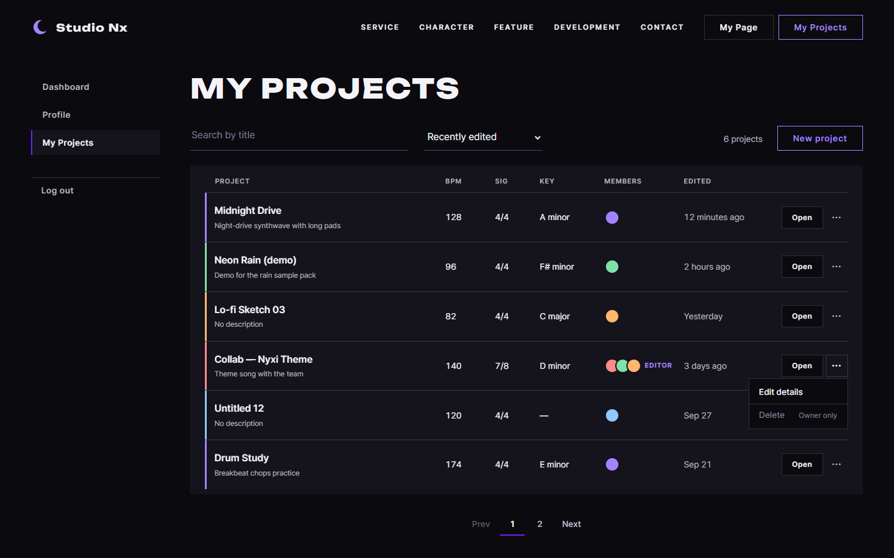
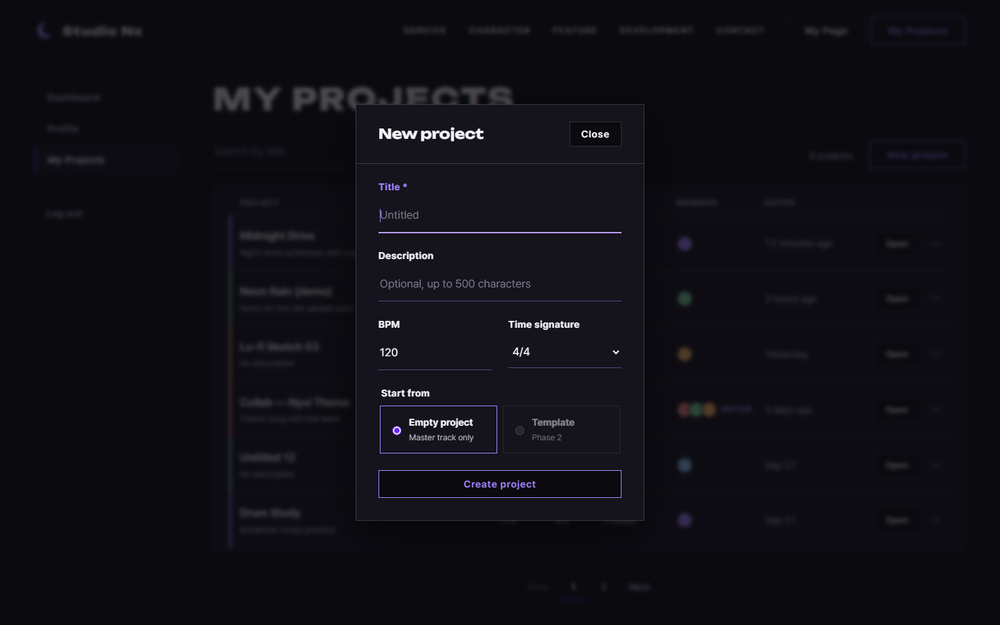
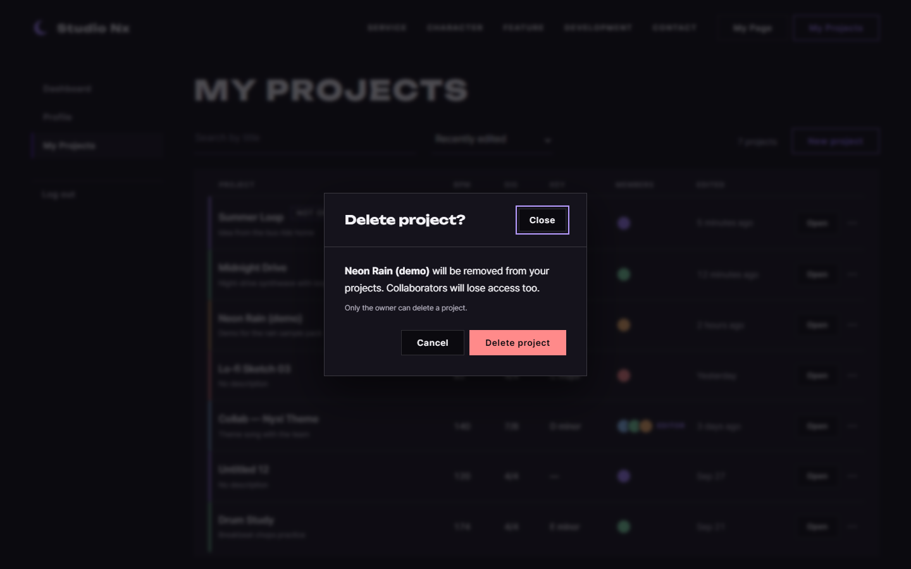
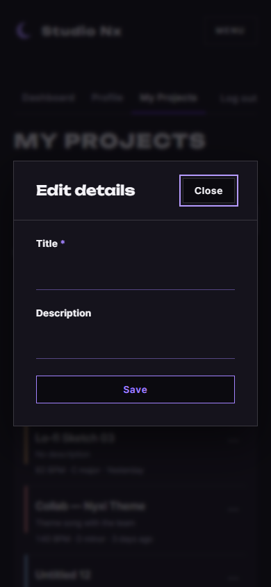
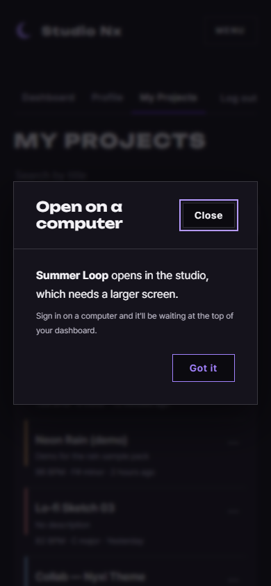
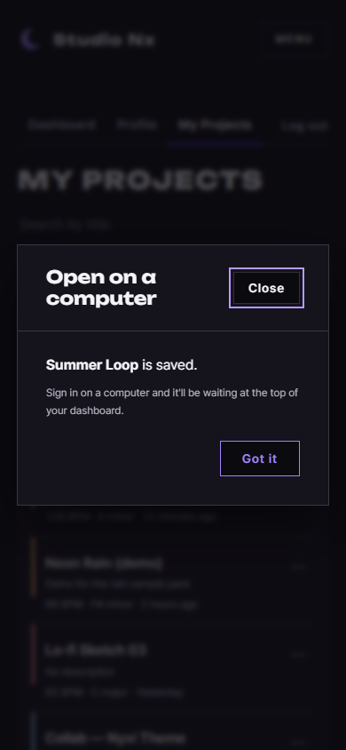
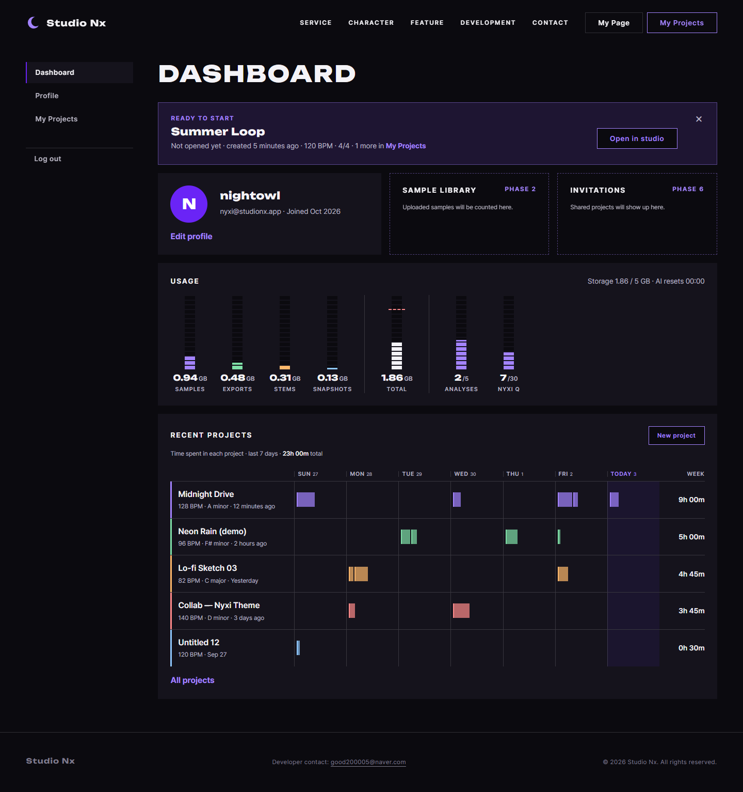

# AI 구현 설명 14 — 나의 프로젝트 (P-2 콘솔 목록형)

| 항목 | 내용 |
|---|---|
| 작성 | Claude (AI) |
| 작성일 | 2026-10-03 |
| 작업 | P1-14 나의 프로젝트 (`myProject.html`) + 작은 화면 안내·이어 하기 배너 (FR-129, FR-130), 이전 문서: [13_mypage.md](13_mypage.md) |
| 브랜치 | `feature/phase1/p1-14-myproject-page` |
| 기준 시안 | `docs/page_mockups/myproject/03·04`(P-2, 사용자 선택), `05·06`(모달). 비교안 P-1 카드형 `01·02` |
| 원칙 | HTML/CSS를 작성하고, JS는 템플릿만 만들었습니다 (목록, 검색, 모달 연결). 프로젝트 API(P1-13)는 사용자가 만듭니다 |

---

## 1. 실행 결과
### 1.1 목록
| 데스크톱 (다크) | 모바일 |
|---|---|
|  |  |

| 라이트 테마 | ··· 메뉴 (EDITOR 프로젝트: 삭제 비활성) |
|---|---|
|  |  |

> 맨 위 **Summer Loop**는 아직 시퀀서에서 한 번도 열지 않은 프로젝트의 예시라 `Not opened` 표시가 붙습니다 (FR-130).

### 1.2 모달
| 새 프로젝트 | 삭제 확인 | 수정 (모바일) |
|---|---|---|
|  |  |  |

### 1.3 작은 화면 안내와 이어 하기 배너 (FR-129, FR-130)
| 모바일에서 Open을 누름 | 모바일에서 만든 직후 | PC 대시보드의 Ready to start 배너 |
|---|---|---|
|  |  |  |

> 개발 서버에서 `<html data-auth="in">`을 붙여 찍었습니다. 목록 6개는 HTML에 넣어 둔 **예시**이고, 모달은 `showModal()`로 열어 찍었습니다.

## 2. 무엇을 만들었나
| 파일 | 내용 | 비고 |
|---|---|---|
| `frontend/myProject.html` | 검색, 정렬, 개수, New project, 목록(예시 6줄), 페이지 넘김, 한 줄 틀(`<template>`), 모달 3개가 있습니다 | |
| `static/css/pages/myproject.css` | 목록 열, ··· 메뉴, 모달 안 배치, 모바일 한 줄 정보를 정합니다 | |
| `static/js/pages/myproject.js` | 템플릿: `loadProjects`, `renderProjects`, `renderPager`, `initSearch`, `initNewProjectForm`, `initRowMenus`, `initEditProjectForm`, `initDeleteProject`, `formatRelativeTime` | 공통 조각 끼우기만 동작합니다 |
| `static/css/account.css` (**새 파일**) | 마이페이지 3종의 공통 틀입니다. 왼쪽 메뉴와 로그아웃, 카드, 준비 중 칸, 사진 동그라미, 순서 색 5가지가 있습니다 | `pages/mypage.css`에서 떼어 냈습니다 |
| `static/css/base.css` | `.btn--danger`(빨간 면)와 `.btn--danger-ghost`(빨간 윤곽)를 추가했습니다 | 삭제와 탈퇴에 공통으로 씁니다 |
| `myPage.html` | `account.css` 링크, **Ready to start 배너**, 안내 모달 조각을 넣었습니다 | 배너는 폭 1280px 이상에서만 보입니다 |
| `static/partials/desktop-only-modal.html` (**새 파일**) | 작은 화면 안내 모달이며, myProject와 myPage가 함께 씁니다 | 문구는 2종류입니다 (`created` / `open`) |
| `static/js/core/studio.js` (**새 파일**) | 템플릿: `STUDIO_MIN_WIDTH`(1280), `canOpenStudio`, `showDesktopOnly`, `initDesktopOnlyLinks` | |
| `static/js/pages/mypage.js` | 템플릿 `renderReadyBanner`를 추가하고, 응답 예시에 `ready_projects`를 넣었습니다 | |
| `base.css` 확인창 문구 | `.modal__lead`, `.modal__note`, `.modal__actions`로 삭제, 탈퇴, 안내 모달이 같은 모양이 됩니다 | 페이지별 클래스를 하나로 합쳤습니다 |

### 2.1 화면 구성
```
┌ 검색 ──────────┐ ┌ 정렬 ─────┐            6 projects [New project]
├──────────────────────────────────────────────────────────────────┤
│ PROJECT            BPM  SIG  KEY      MEMBERS     EDITED   [Open]··· │
│▌Midnight Drive     128  4/4  A minor  ●           12 min    [Open]··· │
│▌Collab — Nyxi      140  7/8  D minor  ●●● EDITOR  3 days    [Open]··· │
└──────────────────────────────────────────────────────────────────┘
                         Prev  1  2  Next
모바일: ▌제목 / 설명 / "128 BPM · A minor · 12 minutes ago"  ···  (이름을 누르면 열림)
```

## 3. 왜 이렇게 했나
| 결정 | 이유 |
|---|---|
| P-2 목록형 | 사용자가 골랐습니다. BPM, 키 등을 열로 비교하기 쉽고, 마이페이지 Recent Projects(트랙 레인)와 같은 디자인 언어입니다 |
| 줄 색 순서 5가지 | DB에 프로젝트 색이 없어서 마이페이지와 같은 규칙(`nth-child`)을 씁니다. 순서가 같으면 두 화면의 색이 맞습니다 |
| ··· 메뉴는 `<details>` | JS 없이 열고 닫힙니다 (키보드도 동작합니다). 바깥을 눌러 닫는 것만 JS(TODO)입니다 |
| 메뉴 항목 2개 (Edit details, Delete) | 시안의 Rename과 Edit details가 같은 일(FR-124: 제목과 설명 변경)이라서 하나로 합쳤습니다 |
| OWNER가 아니면 Delete 비활성과 "Owner only" | FR-125입니다. 서버도 403으로 막지만, 누르기 전에 알려 줍니다 |
| 모달은 `command="show-modal"` | 다른 페이지와 같은 방식입니다 (JS 없이 열림). 어느 프로젝트인지 채우는 일만 JS가 합니다 |
| `<template id="project-row-template">` | JS가 줄을 만들 때 HTML 구조를 JS 문자열로 다시 쓰지 않게 합니다 (React 컴포넌트로 옮기기도 쉽습니다) |
| 모바일 한 줄 정보는 `data-meta` | BPM과 키를 따로 칸으로 두지 않고, 수정 시각 앞에 CSS `::before`로 붙입니다. 그래서 HTML 하나로 PC와 모바일을 모두 처리합니다 |
| 새 프로젝트의 Template 비활성 | FR-127은 2단계부터라서 자리만 보여 줍니다 |
| `account.css` 분리 | 세 페이지가 같은 메뉴와 카드를 쓰므로 한 곳에서 관리합니다. 분리 전후의 `myPage.html` 캡처는 0픽셀 차이입니다 |

### 3.1 작은 화면에서 시퀀서를 열지 않는 이유와 이어 하기 (FR-129, FR-130)
| 결정 | 이유 |
|---|---|
| 모바일에서도 만들기는 허용 | 폼이 네 칸이라서 작은 화면에서도 쉽습니다. 이동 중에 떠오른 아이디어(제목, BPM, 박자)를 미리 만들어 둘 수 있습니다 |
| 시퀀서 이동만 막음 (폭 1280px 미만) | PRD 00 반응형 기준에서 `studioNx.html`은 데스크톱 1280px 이상을 우선합니다. 작은 화면에서는 안내 모달만 띄웁니다 |
| 기준은 화면 폭 | 기기 종류(UA)보다 단순하고, 창을 줄인 PC와 태블릿 가로도 같은 규칙으로 처리할 수 있습니다 |
| 이어 하기는 배너로 (새 인증 장치 없음) | 같은 계정으로 로그인하면 프로젝트는 이미 있습니다. 필요한 것은 "찾아 들어가는 수고"를 줄이는 일입니다. QR 로그인 등은 보안 설계가 필요해서 Phase 1 범위 밖입니다 |
| "열지 않은 프로젝트" = 내 작업 세션 0개 | `project_sessions`가 이미 있으므로 **DB를 바꾸지 않고** 판단합니다. 시퀀서에서 한 번 열면 자동으로 배너에서 빠집니다 |
| 로그인한 뒤 자동으로 이동하지 않음 | 다른 일로 들어온 사용자를 원하지 않는 곳으로 보내지 않기 위해서입니다. 배너는 ×로 닫을 수 있습니다 |
| 안내 모달은 공통 조각 | myProject 목록과 myPage 최근 프로젝트 모두 같은 안내가 필요합니다 |

## 4. 검증 결과
| 확인 | 결과 |
|---|---|
| 가로 넘침 | 1440과 390 모두 0px이고, 모바일 탭 줄도 0px입니다 |
| 다크, 라이트 | 줄 색, 참여자, 메뉴가 모두 보입니다 |
| 모달 3개 | PC와 모바일에서 열리는 것을 확인했습니다 |
| 콘솔 오류, 404 | 없습니다 |
| 디자인 검사 | 통과했습니다 (`flat-type-hierarchy`는 오탐이고, `side-tab` 트랙 색 띠는 마이페이지와 같은 이유로 예외에 파일을 추가했습니다) |
| `myPage.html` 회귀 | CSS 분리 전후의 캡처가 0픽셀 차이입니다 (배너 추가 전 기준) |
| 배너 | 1440px에서 보이고, 1180px과 390px에서는 숨겨지는 것을 확인했습니다 |
| 안내 모달 | 390px에서 `open`과 `created` 두 문구를 확인했습니다 |

## 5. 남은 일 (사용자)
| 할 일 | 위치 |
|---|---|
| 프로젝트 API (생성 시 OWNER + MASTER 트랙 트랜잭션, 검색·페이지, 권한) | P1-13 |
| 목록·검색·페이지·모달 연결 (응답 예시는 `loadProjects` 주석) | `myproject.js` |
| `studioNx.html` 빈 페이지 (열기 테스트) | P1-15 |
| 작은 화면 판단·안내·배너 | `core/studio.js`, `mypage.js renderReadyBanner` |
| `/me/dashboard`에 `ready_projects`, 목록 응답에 `opened` | P1-16, P1-13 |

## 6. 자주 받을 질문 대비
| 질문 | 답 |
|---|---|
| 목록을 왜 `<table>`로 만들지 않았나요? | 모바일에서 줄이 카드처럼 접혀야 해서 `<ul>`과 CSS 그리드를 썼습니다. 열 이름 줄은 화면 읽기 프로그램에서 숨기고, 각 줄에 이름과 링크가 있습니다 |
| 참여자 동그라미는 몇 개까지 나오나요? | 최대 3개입니다 (JS에서 자릅니다). 사진이 생기면 `<i>` 안에 ``를 넣습니다 |
| 검색은 언제 보내나요? | 입력을 멈추고 0.3초 뒤에 보냅니다 (글자마다 보내지 않습니다). 정렬은 바꾸는 즉시 보냅니다 |
| 휴대폰에서 만든 걸 PC에서 어떻게 찾나요? | PC로 마이페이지에 들어가면 위쪽 **Ready to start** 배너에 나옵니다. 목록에서도 `Not opened` 표시가 붙어 있습니다 |
| 태블릿은요? | 화면 폭이 1280px 이상이면 PC와 같이 시퀀서가 열립니다 |
| 삭제하면 바로 사라지나요? | 서버는 소프트 삭제(`deleted_at`)를 합니다. 목록에서는 빠지고, 복구 기능은 아직 없습니다 |
