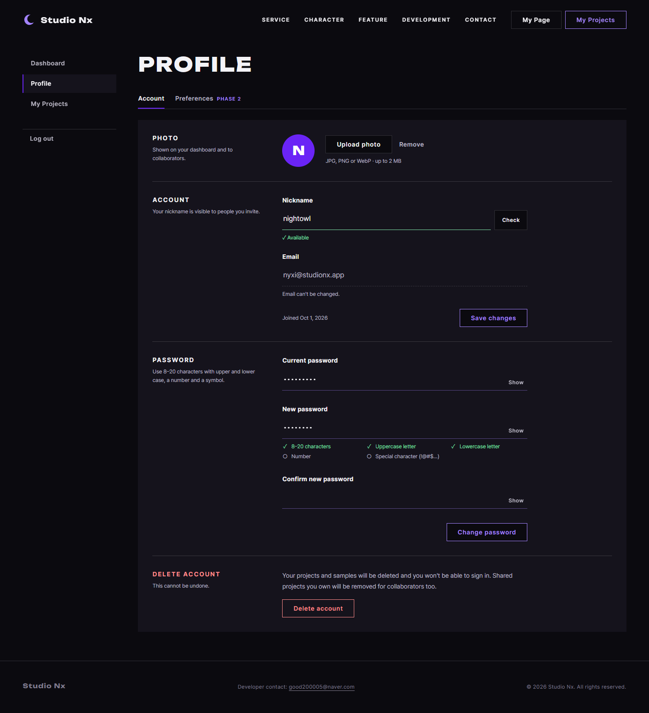
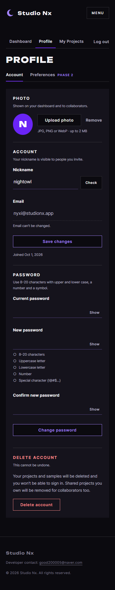
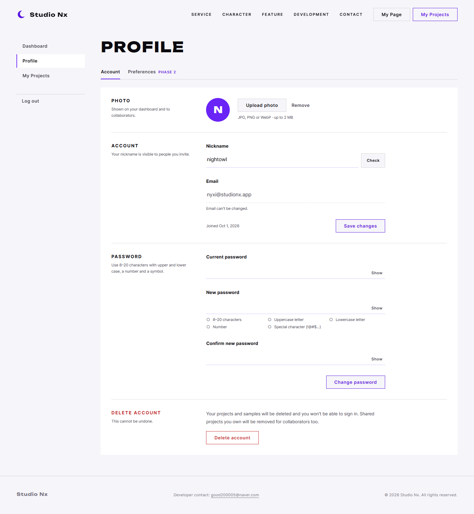
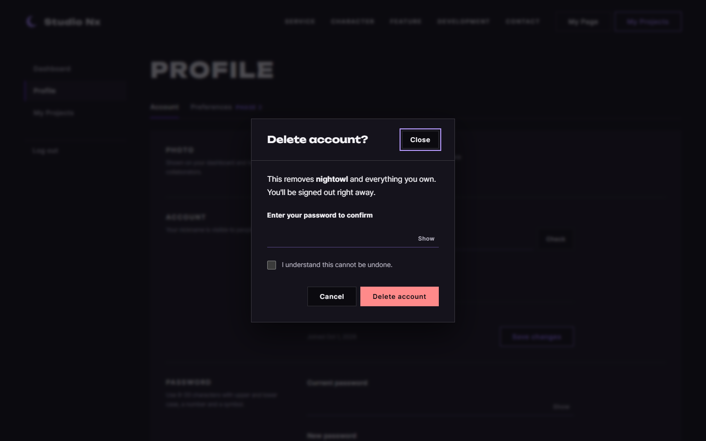

# AI 구현 설명 15 — 회원 정보 (U-2 2열 설정형)

| 항목 | 내용 |
|---|---|
| 작성 | Claude (AI) |
| 작성일 | 2026-10-03 |
| 작업 | P1-10 회원 정보 (`userInfo.html`) [Account] 탭, 이전 문서: [14_myproject.md](14_myproject.md) |
| 브랜치 | `feature/phase1/p1-10-userinfo-page` (P1-14 브랜치에서 갈라졌으며, 공통 `account.css`를 씁니다) |
| 기준 시안 | `docs/page_mockups/userinfo/03·04`(U-2, 사용자 선택), `05`(탈퇴 확인). 비교안 U-1 `01·02` |
| 원칙 | HTML/CSS를 작성하고, JS는 템플릿만 만들었습니다. 회원 API(P1-08, 09)는 사용자가 만듭니다 |

---

## 1. 실행 결과
| 데스크톱 (확인 완료와 조건 표시 상태) | 모바일 |
|---|---|
|  |  |

| 라이트 테마 | 탈퇴 확인 |
|---|---|
|  |  |

> 데스크톱 첫 캡처는 닉네임 확인 완료(✓ Available)와 비밀번호 조건 3개 만족 상태를 **화면에 직접 표시해서** 찍었습니다 (실제로는 `userinfo.js`가 하는 일입니다).

## 2. 무엇을 만들었나
| 파일 | 내용 |
|---|---|
| `frontend/userInfo.html` | 탭(Account / Preferences는 Phase 2), Photo, Account, Password, Delete account의 4항목, 탈퇴 확인 모달이 있습니다 |
| `static/css/pages/userinfo.css` | 탭, 2열 항목 배치, 사진 버튼, 읽기 전용 칸, 저장 줄, 모바일 한 줄을 정합니다 |
| `static/js/pages/userinfo.js` | 템플릿 `loadMe`, `initPhotoUpload`, `initProfileForm`, `initPasswordForm`, `initWithdrawForm`과 사진 제한 상수 `PHOTO_TYPES`, `PHOTO_MAX_BYTES`가 있습니다 |

### 2.1 항목별 내용
| 항목 | 입력 | API (PRD 01 §7) | FR |
|---|---|---|---|
| Photo | 파일 선택(JPG, PNG, WebP, 2MB), Remove | `POST /users/me/profile-image` | 106 |
| Account | 닉네임(중복 확인), 이메일(읽기 전용), 가입일 | `PATCH /users/me`, `GET /auth/check-nickname` | 106 |
| Password | 현재, 새, 확인 비밀번호와 조건 목록 5개 | `PUT /users/me/password` | 107 |
| Delete account | 확인창에서 비밀번호와 "되돌릴 수 없음" 체크 | `DELETE /users/me` | 108 |

## 3. 왜 이렇게 했나
| 결정 | 이유 |
|---|---|
| U-2 2열 | 사용자가 골랐습니다. 항목마다 설명을 붙일 수 있고, Phase 2의 Preferences 탭도 같은 틀로 늘리기 쉽습니다 |
| 폼을 항목마다 따로 둠 | 닉네임 저장과 비밀번호 변경은 API가 다르고, 한쪽의 오류가 다른 쪽의 입력을 막지 않게 하기 위해서입니다 |
| 사진 버튼은 `<label for>`와 숨긴 `<input type=file>` | 파일 칸의 기본 모양은 테마를 따라가지 못합니다. 숨겨도 키보드 초점이 오면 버튼에 테두리가 표시됩니다 |
| 이메일 점선 밑줄 | 바꿀 수 없는 칸이라는 것을 모양으로도 알립니다 (`readonly`와 안내 문구) |
| 비밀번호 조건 목록 | 가입 화면과 같은 마크업(`pw-rules`, `data-rule`)이므로 같은 CSS와 같은 규칙을 씁니다 |
| 탈퇴는 2단계 | 항목의 빨간 윤곽 버튼을 누르고, 확인창에서 비밀번호와 체크를 한 뒤 빨간 면 버튼을 누릅니다 (`btn--danger-ghost` → `btn--danger`) |
| Preferences 탭은 비활성 | FR-141은 2단계부터라서 탭 자리와 빈 `tabpanel`만 두었습니다 |
| 모바일 저장 버튼은 폭을 가득 채움 | 엄지로 누르기 쉽게 했고, 안내 문구는 버튼 아래로 옮겼습니다 |

## 4. 검증 결과
| 확인 | 결과 |
|---|---|
| 가로 넘침 | 1440과 390 모두 0px입니다 |
| 다크, 라이트 | 정상입니다 |
| 탈퇴 모달 | PC와 모바일에서 열리는 것을 확인했습니다 |
| 콘솔 오류, 404 | 없습니다 |
| 디자인 검사 | 통과했습니다. 처음에 "Phase 2" 글자가 10px이라서 지적받았고, 11px로 올렸습니다 |

## 5. 남은 일 (사용자)
| 할 일 | 위치 |
|---|---|
| `/users/me` 조회와 수정, 사진 업로드 | P1-08 |
| 비밀번호 변경, 회원 탈퇴(재확인, 소프트 삭제, 로그인 차단) | P1-09 |
| 화면 연결 | `userinfo.js` TODO |
| (권장) 비밀번호 규칙을 `core/password.js`로 옮겨서 가입 화면과 회원 정보 화면이 함께 쓰기 | `join.js` → core |
| Preferences 탭 (테마, 강조 색, UI 배율, 캐릭터, Nyxi 팁, 단축키) | Phase 2 (PRD 02 §4.16, `user_settings`) |

## 6. 자주 받을 질문 대비
| 질문 | 답 |
|---|---|
| 이메일은 왜 바꿀 수 없나요? | 로그인 ID이기 때문입니다. 바꾸려면 새 이메일 인증이 필요해서 Phase 1 범위 밖입니다 |
| 사진 크기는 화면에서만 검사하나요? | 아닙니다. 화면(`PHOTO_MAX_BYTES`)은 빠른 안내용이고, 서버가 다시 검사합니다 (확장자, MIME, 크기) |
| 비밀번호를 바꾼 뒤 다른 기기는 어떻게 되나요? | 서버 구현(P1-09)에서 리프레시 토큰을 무효화하면, 다른 기기는 다시 로그인해야 합니다 |
| 탈퇴한 뒤 같은 이메일로 다시 가입할 수 있나요? | 소프트 삭제라서 행이 남습니다. 허용 여부는 P1-09에서 정합니다 (PRD 01 FR-108) |
