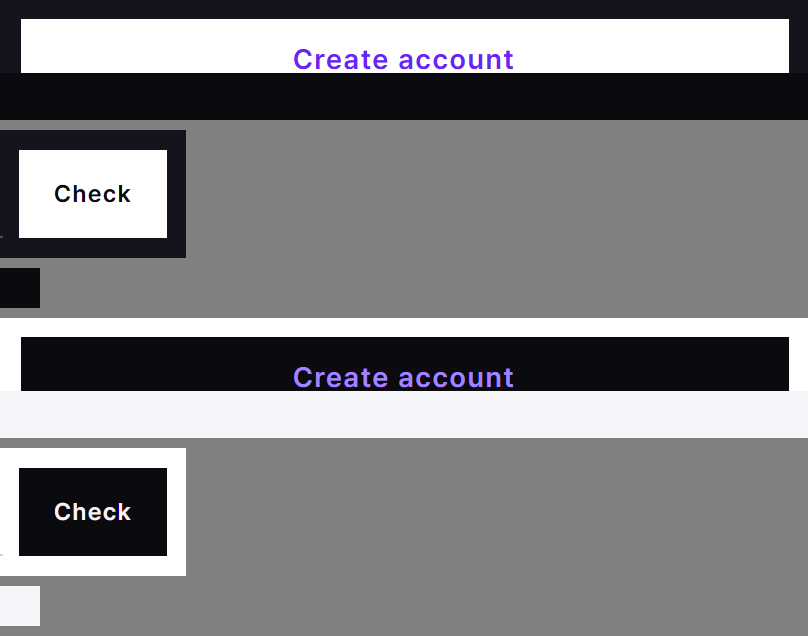
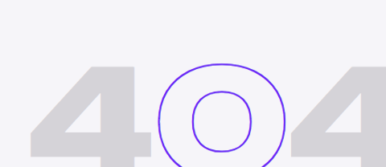
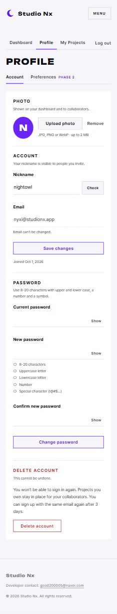

# AI 구현 설명 24 — Phase 1 화면 점검과 수정

| 항목 | 내용 |
|---|---|
| 작성 | Claude (AI) |
| 작성일 | 2026-10-03 |
| 작업 | 완성된 화면 7종(home, join, myPage, myProject, userInfo, 오류 404·500) 점검 → 라이트 테마·누르는 영역·문구 수정. 이전 문서: [23_dev_notes_admin_template.md](23_dev_notes_admin_template.md) |
| 브랜치 | `feature/phase1/ui-review` |
| 원칙 | HTML·CSS만 수정 (JS·백엔드 변경 없음) |

---

## 1. 실행 결과

## 2. 점검 방법
| 항목 | 내용 |
|---|---|
| 도구 | Chrome 헤드리스 + DevTools 프로토콜(CDP). 개발 서버(`localhost:8000`)에서 페이지를 열고 `<html data-theme>`를 바꿔 가며 캡처 |
| 범위 | 7개 화면 × PC(1440×900)·모바일(390×844) × 다크·라이트 = 28장 |
| 자동 검사 | 가로 넘침, 콘솔 오류·예외, 4xx·5xx 요청, 중복 `id`, `alt` 없는 이미지, 라벨 없는 입력칸, 이름 없는 버튼, 24px보다 작은 누르는 영역(모바일) |
| 눈으로 확인 | 캡처를 보며 글자 대비, 배치 깨짐, 문구 |

## 3. 찾은 문제와 수정
| # | 문제 | 원인 | 수정 | 파일 |
|---|---|---|---|---|
| 1 | 라이트 테마에서 버튼에 마우스를 올리면 글자가 사라짐 (Check, Close, Cancel, 탈퇴 버튼) | hover 면이 `#ffffff`로 고정, 글자는 바탕색(라이트에서는 거의 흰색) | 반전 색 토큰 `--c-invert`(다크 흰색 / 라이트 먹색), `--c-invert-accent`(반전 면 위 보라) 추가 → `.btn--primary`·`--ghost`·`--danger` hover가 토큰을 씀 | `tokens.css`, `base.css` |
| 2 | 라이트 테마 404·403 오류 페이지의 흐린 숫자가 거의 안 보임 | 다크 글자색 `rgb(244 243 247 / .14)`를 그대로 씀 | `color-mix(in srgb, var(--c-ink) 14%, transparent)` — 테마 글자색 기준으로 흐리게 | `pages/error.css` |
| 3 | 탈퇴 안내가 오늘 결정과 다름 ("프로젝트가 지워진다") | 결정 전 문구 | "다시 로그인할 수 없음 · 내 프로젝트는 협업자를 위해 남음 · 3일 뒤 같은 이메일로 다시 가입 가능"으로 수정, 확인창 문구도 맞춤 | `userInfo.html` |
| 4 | 모바일에서 Show, Remove, + View More, Edit profile, All projects 버튼 높이가 20~22px | 글자 높이만큼만 영역이 잡힘 | `.text-link`, `.pw__toggle`에 `min-height: 24px` (WCAG 2.2 2.5.8 최소 크기) | `base.css`, `auth.css` |

> 다크 테마 모양은 바뀌지 않습니다 (`--c-invert`의 다크 값이 이전과 같은 `#ffffff`, `--c-invert-accent`는 이전 `--c-violet`과 같은 값).

## 4. 문제 없음 / 그대로 둔 것
| 항목 | 판단 |
|---|---|
| 콘솔 오류, 실패한 요청, 중복 `id`, 가로 넘침 | 28장 모두 없음 |
| 홈 첫 화면 띠(SVG)가 화면 밖까지 그려짐 | 의도된 장식, 바깥 상자가 잘라서 가로 스크롤 없음 |
| 푸터 이메일 링크 높이 14px | 문장 안 링크라 최소 크기 예외 |
| 문의 동의 체크박스 18px, 숨긴 사진 입력칸 | 라벨·버튼이 함께 눌려서 실제 영역은 충분 |
| 마이페이지·나의 프로젝트 헤더가 Sign In / Join Us로 보임 | 로그인 상태 전환은 JS(`initAuthState`, P1-07) 할 일 — 화면 문제 아님 |

## 5. 검증 결과 (2026-10-03)
| 확인 | 결과 |
|---|---|
| 수정 후 자동 검사 다시 실행 | 남은 항목은 §4의 예외뿐 |
| hover 캡처 | 다크: 흰 면 + 보라·검은 글자 (이전과 같음) / 라이트: 먹 면 + 밝은 글자 |
| 404 라이트 | 바랜 숫자가 회색으로 보임 |

## 6. 자주 받을 질문 대비
- **Q. 왜 hover 색을 테마마다 따로 쓰지 않고 토큰을 만들었나?** 같은 규칙(`:root[data-theme="light"]`, 시스템 설정)을 파일마다 반복하지 않으려고요. 토큰 두 개만 테마별로 정의하면 버튼 3종이 모두 따라갑니다.
- **Q. `color-mix`는 모든 브라우저에서 되나?** 최신 Chrome·Edge·Firefox·Safari 모두 지원합니다 (2023년부터).
- **Q. 점검 스크립트는 어디 있나?** 일회성 점검이라 저장소에 넣지 않았습니다. 다시 필요하면 같은 방법(CDP 캡처 + 자동 검사)으로 만들 수 있습니다.
