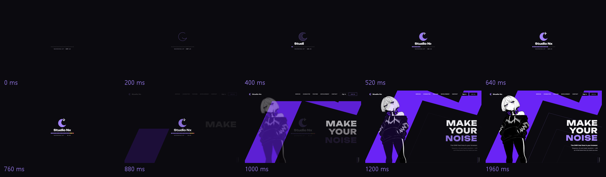
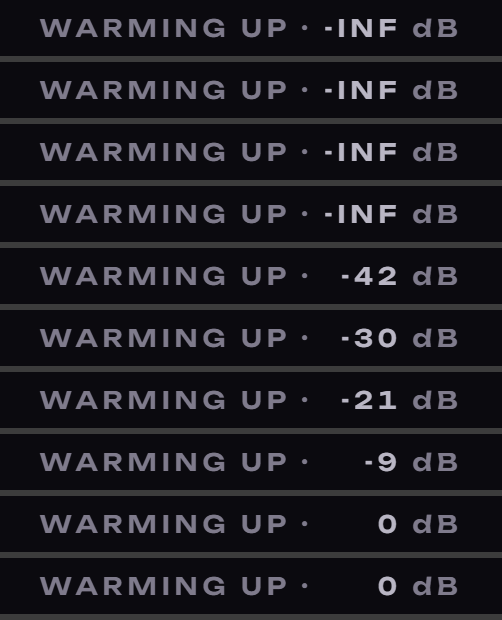

# AI 구현 설명 25 — 로고(S2) 확정과 첫 접속 로딩

| 항목 | 내용 |
|---|---|
| 작성 | Claude (AI) |
| 작성일 | 2026-10-03 |
| 작업 | P1-20 첫 접속 로딩(로딩 C "Crescent") + 로고 S2를 확정하고 헤더 로고와 파비콘을 교체했습니다. 이전 문서: [24_ui_review.md](24_ui_review.md) |
| 브랜치 | `feature/phase1/p1-20-intro-loader` |
| 원칙 | HTML과 CSS는 AI가 작성했고, "첫 접속에만 보이기" JS는 템플릿(`home.js`의 `initIntro`)만 만들었습니다 |

---

## 1. 실행 결과

> **실제 동작 영상** (실제 `home.html`을 새로 열며 실시간 녹화, 60fps): [데스크톱 1440×900](images/25_intro_logo/04_intro_desktop.mp4) · [모바일 390×844](images/25_intro_logo/05_intro_mobile.mp4) — PDF에서는 재생되지 않으므로 파일을 직접 여십시오. 시간을 멈추고 찍은 GIF는 `images/25_intro_logo/01_intro.gif` · 고르는 과정의 목업: `docs/page_mockups/loader/`, `docs/page_mockups/logo/`

## 2. 무엇을 만들었나
| 파일 | 상태 | 내용 |
|---|---|---|
| `static/assets/logo/mark.svg` | 새 파일 | 로고 마크의 원본입니다 (밝은 보라 한 가지 색) |
| `static/assets/logo/favicon.svg` | 새 파일 | 파비콘. 밝은 탭은 진한 보라, 어두운 탭은 밝은 보라 (SVG 안의 `prefers-color-scheme`) |
| `static/partials/header.html` | 수정 | 임시 초승달을 S2 마크로 바꿨습니다 (`currentColor`라서 테마 색을 따릅니다) |
| 모든 페이지 12개 (`*.html`, `errors/*.html`) | 수정 | 파비콘을 `static/assets/logo/favicon.svg`로 바꿨습니다 |
| `home.html` | 수정 | 로딩 오버레이 `.intro` (body 맨 앞), `intro.css` 연결, Unbounded `display=block` |
| `static/css/pages/intro.css` | 새 파일 | 로딩 애니메이션 전부(-INF → 0 dB 숫자 포함) + 첫 화면 등장을 800ms 미루기 |
| `static/js/pages/home.js` | 템플릿 추가 | `initIntro()` — 첫 접속만 보이기 (TODO) |

## 3. 왜 이렇게 했나
### 3.1 로고 S2: 마스크 대신 경로 하나
목업에서는 SVG 마스크로 그렸지만, 실제 파일은 **경로(path) 하나와 `fill-rule="evenodd"`**로 바꿨습니다.

| 부분 | 만드는 법 |
|---|---|
| 초승달 | 바깥 원 (48,50) r42와 비켜난 원 (67,44) r28의 **교점 두 개**를 계산 → 바깥 호(큰 호)로 내려가고 안쪽 호로 돌아오는 닫힌 경로 |
| 반짝임 | 중심 (64,17), 반지름 19의 4갈래 별 (변은 2차 곡선) |
| 겹친 곳 비우기 | 두 경로를 한 `d`에 넣고 `evenodd` → 겹친 곳은 "두 번 감싸짐"이라 칠하지 않음 (XOR) |
| 보이는 영역 | `viewBox="-1 -5 98 98"` — 반짝임 끝(위쪽 y=-2)까지 잘리지 않게 |

마스크는 `id`가 필요해서 한 페이지에 여러 번 넣으면 충돌하고, 파비콘처럼 작은 곳에서는 무겁습니다. 경로 하나로 만들면 `currentColor`로 색만 바꿔서 어디에든 그대로 쓸 수 있습니다.

> 로딩처럼 두 색(초승달 보라 + 반짝임 흰색)이 필요할 때는 같은 경로를 두 번 그리고 각각 `clipPath`(초승달 / 별)로 잘라 냅니다 (`#intro-moon`, `#intro-star`).

### 3.2 로딩 시간표 (CSS만)
| 시간 (ms) | 동작 |
|---|---|
| 0 → 400 | 초승달 윤곽선이 그려집니다 (`stroke-dashoffset`, `pathLength="100"`) |
| 300 → 600 | "Studio Nx" 글자가 왼쪽부터 펼쳐집니다 (`clip-path`) |
| 380 → 560 | 초승달이 채워집니다 |
| 480 → 640 | 반짝임이 회전하며 튀어나옵니다. 뿔과 겹친 곳은 비어 있습니다 |
| 380 → 780 | 레벨 미터 16칸이 25ms 간격으로 켜집니다 (끝의 3칸은 노랑과 빨강) |
| 0 → 755 | 태그 숫자가 `-INF dB`에서 시작해, 380ms부터 미터 칸마다 3 dB씩 `-45 … 0 dB`로 올라갑니다 (§3.4) |
| 800 → 1020 | 살짝 커지면서 사라지고, 끝나면 `visibility: hidden`이 됩니다 (클릭을 막지 않습니다) |
| 800 → | 첫 화면 등장 애니메이션이 시작됩니다 (원래 지연값에 800ms를 더함) |

JS 없이 CSS만으로 재생되고 사라지기까지 하므로, JS가 늦거나 실패해도 로딩이 화면을 막고 남는 일이 없습니다.

### 3.3 보이지 않는 경우
| 경우 | 처리 |
|---|---|
| 움직임 줄이기 설정 (`prefers-reduced-motion: reduce`) | 로딩을 아예 그리지 않습니다 (첫 화면 등장도 home.css의 규칙대로 없습니다) |
| 같은 탭에서 두 번째 방문 | `<html data-intro="seen">`이면 숨기고 첫 화면은 원래 시간대로 나옵니다. 이 값을 넣는 일은 `home.js`의 `initIntro`가 하며, 사용자가 직접 구현합니다 |
| 화면 읽기 프로그램 | `aria-hidden="true"`로 두어, 장식이므로 읽지 않습니다 |

### 3.4 -INF → 0 dB 숫자 (2026-10-03 추가)

| 부분 | 만드는 법 |
|---|---|
| 숫자 값 | `@property --db { syntax: "<integer>" }`로 **정수 변수**를 등록하고, `-48 → 0`으로 애니메이션합니다 |
| 미터와 박자 맞추기 | `steps(16, start)` 400ms로, 미터가 한 칸 켜질 때(25ms)마다 3 dB씩 올라갑니다: -45, -42 … 0 |
| 화면에 표시 | `counter-reset: db var(--db)` + `::before { content: counter(db) }`로, CSS 카운터가 정수를 글자로 바꿔 줍니다 |
| -INF | 미터가 켜지기 전(0~380ms)에는 `-INF` 글자, 380ms에 숫자로 바꿉니다 (두 글자를 같은 칸에 겹쳐 놓고 투명도만 바꿉니다) |
| 흔들림 방지 | 겹쳐 놓은 칸의 너비를 가장 넓은 `-INF`에 맞추므로, 숫자가 바뀌어도 "dB"의 위치가 그대로이고 숫자는 오른쪽에 맞춰집니다 |

> `@property`를 모르는 오래된 브라우저에서는 중간 숫자 없이 `-INF` 다음 `0`만 보입니다 (등록되지 않은 변수는 처음 값과 끝 값만 바뀝니다).

### 3.5 글꼴이 중간에 바뀌던 문제 (2026-10-03 수정)
| 항목 | 내용 |
|---|---|
| 증상 | 로딩 초반의 "WARMING UP · 0 DB"가 한 번 바뀌어 보였습니다 |
| 원인 | 태그 줄이 Pretendard(외부 CDN, `font-display: swap`) 이므로, 웹폰트가 오기 전에는 **대체 글꼴(맑은 고딕)**로 먼저 그렸다가 도착하면 바꿨습니다. 실시간 녹화의 0.62초 프레임에서 글자 폭과 위치가 뒤의 프레임과 다른 것을 확인했습니다 |
| 수정 1 | 태그 줄도 "Studio Nx"와 같은 **Unbounded**로 바꿨습니다 (`·`, `-INF`, 숫자 모두 Unbounded의 글자 범위 안에 있습니다) |
| 수정 2 | `home.html`만 Google Fonts 주소를 `display=block`으로 바꿨습니다. 받기 전에는 글자를 잠깐 숨기고(최대 3초) 대체 글꼴은 보여 주지 않으며, 로딩이 첫 화면을 덮고 있어서 숨김이 드러나지 않습니다 |
| 확인 | `CSS.getPlatformFontsForNode`: 이름, 태그, `-INF` 모두 `Unbounded (web)`이고, 실시간 녹화에서도 처음 보이는 순간부터 같은 글꼴과 같은 위치입니다 |

## 4. 검증 결과 (2026-10-03)
| 확인 | 결과 |
|---|---|
| 실제 `home.html`에서 40ms마다 캡처 | 목업과 같은 순서로 재생되고, 800ms에 첫 화면으로 이어집니다 |
| **실시간 녹화** (페이지를 새로 열며 CDP screencast, 약 70fps) | 데스크톱과 모바일 모두 로딩이 재생된 뒤 첫 화면이 등장합니다. MP4는 2개입니다 (`04`, `05`). 녹화와 변환 스크립트는 `docs/page_mockups/loader/_source/record.mjs`, `encode.py` |
| 끝난 뒤 | `.intro`는 `visibility: hidden`이고, 화면 가운데를 클릭하면 첫 화면의 요소가 받습니다 |
| `data-intro="seen"` | 로딩은 `display: none`이고, 띠 등장 지연은 `0s`입니다 (원래대로) |
| 움직임 줄이기 | 로딩이 `display: none`입니다 |
| 콘솔 오류 | 없습니다 |
| 경로 확인 | 경로 하나로 그린 S2가 목업(마스크)과 같은 모양이고, 16px과 32px에서도 반짝임이 보입니다 |
| 태그 글꼴·숫자 (수정 후) | 세 줄 모두 Unbounded 웹폰트이고, -INF → -45 … 0 dB가 미터 칸과 같은 박자로 올라갑니다 |

## 5. 남은 일 (사용자)
| 할 일 | 파일 |
|---|---|
| `initIntro`: sessionStorage로 첫 접속에만 보이게 합니다. 깜빡임 없이 하려면 `<head>`의 인라인 스크립트로 구현합니다 | `static/js/pages/home.js` |
| (선택) 로고 사용 규칙: 최소 크기, 주변 여백, 색 조합 | — |

## 6. 자주 받을 질문 대비
- **Q. evenodd가 왜 겹친 곳을 비우나요?** 어떤 점에서 바깥으로 선을 그었을 때 경로를 몇 번 넘는지 셉니다. 홀수이면 칠하고 짝수이면 비웁니다. 초승달과 별이 겹친 곳은 두 경로를 모두 넘으므로 짝수이고, 그래서 비게 됩니다.
- **Q. 첫 화면 애니메이션 시간을 왜 CSS에서 다시 적었나요?** 로딩이 있을 때만 800ms 미뤄야 합니다. `:root:not([data-intro="seen"])` 조건으로 묶어 두면, 두 번째 방문(`seen`)에는 자동으로 원래 시간이 됩니다.
- **Q. 로딩 때문에 첫 화면이 늦게 뜨지 않나요?** 로딩은 이미 그려진 페이지 위에 덮는 장식이라 페이지 불러오기를 늦추지 않습니다. 사용자가 보는 시간만 약 0.8초 늘어나고, 그것도 첫 접속 한 번뿐입니다.
