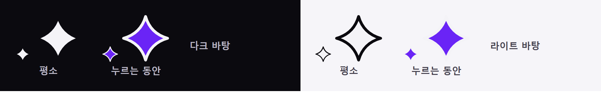

# AI 구현 설명 26 — 별 커서

| 항목 | 내용 |
|---|---|
| 작성 | Claude (AI) |
| 작성일 | 2026-10-03 |
| 작업 | 시퀀서를 뺀 모든 페이지의 마우스 커서를 로고 S2의 반짝임(별)으로 바꿨습니다. 평소에는 흰색이고 누르는 동안에는 보라색입니다. 이전 문서: [25_intro_logo.md](25_intro_logo.md) |
| 브랜치 | `feature/phase1/p1-01-common-css` (공통 CSS) |
| 원칙 | CSS와 SVG만 썼습니다 (JS는 없습니다) |

---

## 1. 실행 결과

## 2. 무엇을 만들었나
| 파일 | 상태 | 내용 |
|---|---|---|
| `static/assets/cursor/star.svg` | 새 파일 | 평소의 커서입니다. 흰 별에 먹색 테두리이고 24×24입니다 |
| `static/assets/cursor/star-active.svg` | 새 파일 | 누르는 동안의 커서입니다. 보라 별(`#6a24f6`)에 흰 테두리입니다 |
| `static/css/cursor.css` | 새 파일 | 커서 규칙 전부를 담았습니다 |
| 페이지 12개 (`*.html`, `errors/*.html`) | 수정 | `base.css` 다음에 `cursor.css`를 연결했습니다 |

> 시퀀서(`studioNx.html`)는 `cursor.css`를 연결하지 않습니다 (§4).

## 3. 왜 이렇게 했나
### 3.1 어디에 적용하고 어디는 그대로 두나
| 곳 | 커서 | 이유 |
|---|---|---|
| 일반 영역, 링크, 버튼, 체크박스, 메뉴 | 별 | 사용자의 요청입니다 |
| 글자 입력칸(`input` 글자형, `textarea`) | 원래의 I자 커서 | 글자를 넣는 곳임을 알려 주는 커서이므로, 바꾸면 입력칸인지 알기 어렵습니다 |
| 비활성 요소(`:disabled`, `aria-disabled`) | 원래의 금지 커서 | 누를 수 없다는 신호이기 때문입니다 |
| `<html data-cursor="system">` | 전부 원래의 커서 | 나중에 환경 설정(FR-141)에서 끌 수 있게 하려는 것입니다 |

### 3.2 누르는 동안 보라로
마우스를 누르면 브라우저가 눌린 요소와 그 **조상 전부(html까지)**에 `:active`를 붙입니다. 그래서 `:root:active *`로 "어디를 누르든" 보라색 별로 바꿀 수 있습니다.

### 3.3 우선순위
기존 CSS 여러 곳(`.btn`, `.text-link`, `summary` 등)에 `cursor: pointer`가 있습니다. 하나씩 고치지 않고 `:root:not([data-cursor="system"]) *:not(…)`처럼 앞에 `:root`를 붙여 **우선순위를 높였습니다**. 파일 순서와 상관없이 별이 이깁니다.

### 3.4 모양
| 항목 | 값 |
|---|---|
| 모양 | 로고 S2의 4갈래 반짝임입니다 (24px에서 잘 보이도록 허리를 조금 굵게 했습니다) |
| 크기 | 24×24입니다 (브라우저 권장 크기는 32px 이하) |
| 기준점 | 별의 가운데 (12, 12)입니다. 별 모양에는 "끝"이 넷이라서 가운데가 가장 자연스럽습니다 |
| 테두리 | 흰 별은 먹색, 보라 별은 흰색 테두리를 둡니다. 그래서 밝은 바탕과 어두운 바탕 모두에서 보입니다 |

## 4. 검증 결과 (2026-10-03)
| 확인 | 결과 |
|---|---|
| 일반 영역, 제목, 링크, 버튼, 체크박스, `summary`, `.text-link` | `star.svg 12 12` |
| 글자 입력칸 (이메일, 비밀번호, 검색) | `text` (I자 그대로) |
| 비활성 탭과 비활성 시작 방식 카드 | `default` / `not-allowed` (그대로) |
| 빈 곳이나 버튼 위에서 누른 뒤 뗌 | `star-active.svg` → `star.svg` |
| `data-cursor="system"` | `auto` |
| SVG 응답 | 둘 다 200 `image/svg+xml`입니다 |

> 헤드리스 캡처에는 커서가 찍히지 않으므로, 계산된 `cursor` 값과 마우스 누름 흉내(CDP)로 확인했습니다.

## 5. 남은 일
| 할 일 | 담당 |
|---|---|
| 시퀀서의 커서 방침 정하기 (도구별 커서 등) | 사용자가 결정 |
| 환경 설정에 "별 커서 켜기/끄기"(`data-cursor`) 넣기 | Phase 2 FR-141 |

## 6. 자주 받을 질문 대비
- **Q. 왜 링크 위에서도 손가락 대신 별인가요?** 요청대로 모든 곳을 별로 통일했습니다. 대신 링크와 버튼은 hover했을 때 색이 바뀌므로 누를 수 있다는 것이 드러납니다.
- **Q. 터치 화면에서는 어떻게 되나요?** 마우스 커서가 없으므로 영향이 없습니다.
- **Q. 운영체제에서 커서를 크게 쓰는 사용자는 어떻게 되나요?** 사이트가 정한 커서 그림은 운영체제 크기 설정을 따르지 않습니다. 환경 설정에서 끌 수 있게 `data-cursor="system"`을 마련해 두었습니다.
