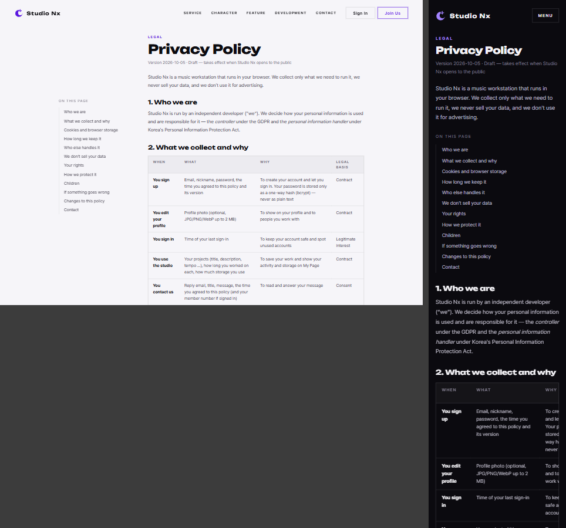
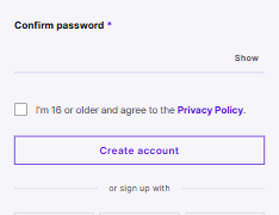

# AI 구현 설명 27 — 개인정보 처리방침 페이지와 가입 동의

| 항목 | 내용 |
|---|---|
| 작성 | Claude (AI) |
| 작성일 | 2026-10-05 |
| 작업 | 처리방침 결정(D1~D7) 반영: `privacy.html`, 푸터 링크, 문의 모달 요약, 가입 동의 체크, `users` 동의 기록 컬럼, 보관 기간 정리 작업 템플릿. 이전 문서: [26_star_cursor.md](26_star_cursor.md) |
| 결정 원본 | [Privacy_Policy_Draft.md](../Privacy_Policy_Draft.md) — GDPR · CCPA/CPRA · 개인정보 보호법 기준 |
| 브랜치 | `feature/phase1/privacy-policy` |
| 원칙 | HTML/CSS는 AI 작성. JS·백엔드는 템플릿만 (가입 동의 전송·서버 검사·정리 작업 구현은 사용자) |

---

## 1. 실행 결과

> 전체 페이지(PC 다크): `images/27_privacy_policy/02_privacy_full_pc_dark.png`

## 2. 무엇을 만들었나
| 파일 | 상태 | 내용 |
|---|---|---|
| `privacy.html` | 새 파일 | 처리방침 전문(영어) 12절 — 받는 정보·처리 근거, 쿠키, 보관 기간, 위탁·국외 이전, 판매 없음, 권리, 보호 조치, 16세, 유출 통지, 변경, 연락처 |
| `static/css/pages/privacy.css` | 새 파일 | 문서형 배치: PC 왼쪽 목차(따라 내려옴) + 본문, 좁은 화면은 한 줄 |
| `static/js/pages/privacy.js` | 새 파일 | 공통 조각만 끼움 + `initTocActiveState` 템플릿(선택) |
| `static/partials/footer.html` | 수정 | 모든 페이지 푸터에 **Privacy Policy** 링크 |
| `home.html` | 수정 | 문의 모달 정책을 요약판(2026-10-05)으로 바꾸고 전문 링크 |
| `join.html`, `pages/join.css` | 수정 | "I'm 16 or older and agree to the Privacy Policy" 체크 (필수) |
| `pages/join.js` | 템플릿 | `PRIVACY_VERSION`, 가입 전송에 `privacy_agreed`·`privacy_version` |
| `schemas/auth.py`, `services/auth_service.py`, `models/user.py` | 템플릿 | `SignupRequest.privacy_agreed`·`privacy_version`, 서버 `PRIVACY_VERSION`, 가입 때 동의 검사·기록 TODO |
| `app/workers/retention.py` | 새 템플릿 | `purge_withdrawn_accounts`(탈퇴 3일), `purge_old_inquiries`(답변 1년), `python -m app.workers.retention` |
| DB | 변경 | `users.privacy_agreed_at`, `privacy_version` — DB.md·SQL 01·변경 SQL `2026-10-05_users_privacy_consent.sql`·DB 가이드(md·docx·PDF), 로컬 DB 실행 완료 |
| PRD 01 | 수정 | FR-101(동의·16세), FR-108(정리 작업), **FR-117**(처리방침 페이지) |

## 3. 왜 이렇게 했나
### 3.1 세 법 중 더 엄격한 쪽
| 항목 | 따른 기준 |
|---|---|
| 나이 | GDPR 기본 16세 (한국 14세, 미국 COPPA 13세보다 높음 → 셋 모두 충족) |
| 처리 근거 | GDPR 6조 — 정보마다 계약 이행·정당한 이익·동의를 표에 밝힘 |
| 권리 | GDPR 15~22조(열람·이동권·정정·삭제·제한·반대·동의 철회) + 감독기관 신고, 30일 안에 답변 |
| 판매 | CCPA/CPRA — "팔지 않고 맞춤 광고용으로 공유하지 않음" 명시 |
| 유출 | 72시간 안에 이용자·감독기관 통지 (GDPR 33·34조, 개인정보 보호법 34조) |
| 쿠키 | 꼭 필요한 것만 쓰므로 동의 배너 없음 (ePrivacy 기준) |

### 3.2 동의 기록 — 시각 + 버전
가입 때 동의 시각만 남기면, 나중에 처리방침이 바뀌었을 때 어느 판에 동의했는지 알 수 없습니다. 그래서 `privacy_version`(시행일 문자열)을 함께 남깁니다. 화면(`join.js`)과 서버(`schemas/auth.py`)에 같은 `PRIVACY_VERSION`을 두고, 다르면 예전 화면에서 보낸 가입으로 보고 다시 동의하게 합니다.

> 기존 DB에 이미 회원이 있었다면 변경 SQL이 `privacy_version = 'legacy'`로 표시합니다. 지금 로컬 DB는 회원이 0명이었습니다.

### 3.3 보관 기간을 "약속"이 아니라 "작업"으로
처리방침에 "탈퇴 3일 뒤 비움", "문의 답변 1년 뒤 삭제"라고 쓰면 실제로 지우는 코드가 있어야 합니다. 기존 템플릿은 같은 이메일로 다시 가입할 때만 비웠기 때문에, 아무도 가입하지 않으면 영원히 남았습니다. 하루 한 번 실행하는 `retention.py`로 이 차이를 없앴습니다.

### 3.4 화면 배치
- 헤더는 홈처럼 화면 위에 띄우지 않고 문서 흐름에 둡니다 (`join.css`·`error.css`와 같은 방식).
- 표는 좁은 화면에서 표 상자 안에서만 가로로 밀어 보고, 페이지 전체는 가로로 넘치지 않습니다. 표 상자는 키보드로도 스크롤할 수 있게 `tabindex="0"`과 이름(`aria-label`)을 줬습니다.
- 쿠키 이름 같은 코드는 고정폭 글꼴로 따로 표시합니다.

## 4. 검증 결과 (2026-10-05)
| 확인 | 결과 |
|---|---|
| 자동 검사 (`privacy.html`, `join.html` × PC·모바일 × 다크·라이트) | 콘솔 오류·실패 요청·중복 id·가로 넘침 없음 |
| 화면 확인 | PC 목차 + 본문, 모바일 한 줄, 가입 동의 체크, 푸터 링크 |
| 로컬 DB | `users`에 두 컬럼 생성, 테이블 35개 그대로 |
| `pytest` / `ruff` | 14개 통과 / 통과 |

## 5. 남은 일
| 할 일 | 담당 | 시기 |
|---|---|---|
| 가입 전송·서버 동의 검사 (`join.js`, `auth_service.signup`) | 사용자 | P1-04·P1-07 |
| `retention.py` 구현 + 하루 한 번 실행 설정 | 사용자 | P1-09·P1-12, 배포 때 실행 방법 결정 |
| **글꼴 자체 호스팅** (Google Fonts·jsDelivr 제거) → 처리방침 §5 글꼴 행 삭제 | AI | **정식 공개 전 필수** |
| 호스팅 회사가 정해지면 처리방침 §5에 추가 | AI | 배포 때 |
| 업로드 파일·AI 분석·채팅이 생기면 받는 정보 표에 추가 | AI | 해당 Phase 전 |

## 6. 자주 받을 질문 대비
- **Q. 왜 16세인가?** 세 나라 기준 중 가장 높은 GDPR 기본값입니다. 이 기준이면 한국(14세)과 미국(13세) 기준을 따로 맞출 필요가 없습니다.
- **Q. 쿠키 동의 배너는 왜 없나?** 로그인 유지 쿠키와 화면 상태를 기억하는 저장소만 써서 "꼭 필요한" 범주입니다. 분석·광고 쿠키를 쓰기 시작하면 배너가 필요합니다.
- **Q. 문의 폼과 가입은 왜 동의 기록 방식이 같나?** 둘 다 "언제 어느 정책에 동의했는가"를 보여 줘야 하는 증빙입니다. 문의는 `inquiries.privacy_agreed_at`, 가입은 `users.privacy_agreed_at`·`privacy_version`에 남깁니다.
