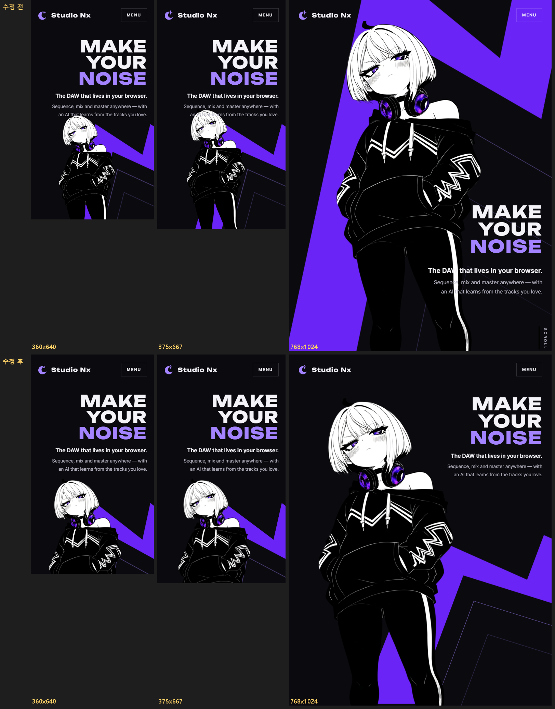

# AI 구현 설명 28 — 홈 첫 화면 모바일 겹침 수정

| 항목 | 내용 |
|---|---|
| 작성 | Claude (AI) |
| 작성일 | 2026-10-05 |
| 작업 | 모바일·태블릿 세로에서 `home.html` 첫 화면의 Nyxi와 글자가 겹치던 문제 수정 (사용자 제보). 이전 문서: [27_privacy_policy.md](27_privacy_policy.md) |
| 브랜치 | `feature/phase1/p1-11-home-page` |
| 바꾼 파일 | `static/css/pages/home.css` (CSS만) |

---

## 1. 실행 결과


## 2. 무엇이 문제였나
| 화면 | 증상 | 원인 |
|---|---|---|
| 세로가 짧은 폰 (360×640, 360×780, 375×667) | Nyxi 머리가 설명 두 줄과 겹침 | 글자는 위에 고정, Nyxi는 "아래에서부터 화면 높이의 58%"로 **서로 따로** 자리를 잡음 → 화면이 짧으면 Nyxi 머리가 글자 영역까지 올라감 |
| 태블릿 세로 (768×1024 등) | 제목·설명이 Nyxi 몸 위에 올라감 | 폭 760px 이상이라 PC 배치(글자가 오른쪽 아래에서 그림 위에 겹침)를 그대로 씀 |

## 3. 어떻게 고쳤나
### 3.1 폰 — 두 칸 격자
폭 760px 이하(폰 세로·가로)는 첫 화면을 **두 칸 격자**로 바꿨습니다.

```
┌───────────────┐
│ 헤더           │
│ MAKE YOUR     │  ← 1칸: 글자 (높이 = 글자만큼)
│ NOISE · 설명  │
├───────────────┤
│     Nyxi      │  ← 2칸: 남은 공간 전부. Nyxi 는 이 칸 높이만큼만 (최대 30rem)
└───────────────┘
```

| 항목 | 값 |
|---|---|
| 적용 조건 | 폭 760px 이하 (태블릿 세로는 §3.2가 덮어씀) |
| `.hero` | `display: grid; grid-template-rows: auto minmax(0, 1fr)` |
| 글자 `.hero__copy` | 1칸, 화면 흐름 안에 둠 (위 여백 = 헤더 높이 + 여백) |
| Nyxi `.hero__nyxi` | 2칸, 아래에 붙임, `height: 100%`, 최대 30rem, 가운데에서 10% 왼쪽 (띠가 오른쪽에 보이게) |
| 보라 띠 | 그대로 (2026-10-03 위치) |

### 3.2 태블릿 세로 — Nyxi 크게 + 글자 오른쪽 위 (사용자 의견 반영)
두 칸으로 나누면 태블릿(768×1024)에서 Nyxi가 화면에 비해 너무 작아 존재감이 떨어졌습니다. 그래서 폭 761~1100px의 세로 화면은 PC처럼 Nyxi를 크게 둡니다.

| 항목 | 값 |
|---|---|
| Nyxi | 왼쪽 아래, 폭 **70vw**(높이 116.7vw — 단 헤더 아래로만), 왼쪽 **`0`** (처음 `-10vw`는 너무 왼쪽에 치우쳐 보여 옮김) |
| 글자 | 오른쪽 위 (헤더 아래), 폭 최대 **44vw** |
| 보라 띠 | 폰과 같은 오른쪽 아래 → 글자 자리는 어두운 바탕 (보라 "NOISE"가 보라 띠 위에 오지 않게) |

왼쪽 위치는 **실측 간격**으로 정했습니다. 글자 줄 높이에서 Nyxi의 그려진 오른쪽 끝과 글자 왼쪽 끝 사이 거리를 쟀습니다. 글자 줄 높이에는 Nyxi의 폭이 좁은 머리 쪽만 옵니다.

| Nyxi 왼쪽 | 768×1024 간격 | 판단 |
|---|---|---|
| -10vw | 118px | 너무 왼쪽 |
| **0** | **42px** | ✅ 선택 (다른 태블릿 세로 크기 68~226px) |
| 4vw | 11px | 너무 붙음 |
| 8vw | 겹침 | ✗ |

> 세로가 아주 짧은 폰에서는 첫 화면이 화면보다 조금 길어져 Nyxi 다리 아래쪽은 스크롤하면 보입니다. 겹치는 것보다 낫다고 판단했습니다.

## 4. 검증 결과 (2026-10-05)
로딩·등장 애니메이션을 끝낸 상태에서 확인했습니다. 폰은 Nyxi 상자와 글자 상자가 겹치는지, 태블릿 세로는 Nyxi를 캔버스에 그려 **글자 상자 안에 불투명 픽셀이 있는지**(그려진 부분 기준)로 계산했습니다.

| 크기 | 수정 전 | 수정 후 |
|---|---|---|
| 360×640, 360×780, 375×667 | 설명과 겹침 | 없음 |
| 390×844, 414×896, 430×932 | 없음 | 없음 |
| 768×1024, 810×1080, 820×1180, 1024×1366, 1100×1366 (태블릿 세로) | 제목·설명 겹침 | 없음 — Nyxi 크게 (768×1024에서 높이 896px), 글자와 간격 42~226px |
| 900×950, 1000×1100 (세로가 조금 긴 창) | — | 없음 |
| 1440×900, 1280×800, 1024×768, 1100×1000 (PC·태블릿 가로) | 없음 | 없음 (PC 배치 그대로) |
| 844×390, 932×430, 667×375 (폰 가로) | — | 없음 |

## 5. 자주 받을 질문 대비
- **Q. 왜 `position: absolute` 대신 격자인가?** 절대 위치는 서로의 크기를 모릅니다. 격자는 글자 칸이 먼저 자리를 잡고 Nyxi가 남은 칸만 쓰니, 글자 줄 수나 화면 높이가 바뀌어도 겹칠 수 없습니다.
- **Q. 태블릿 세로는 왜 폰과 다르게 했나?** 폰은 화면이 좁아 위아래로 나눠야 둘 다 보이지만, 태블릿은 폭이 넓어 그림과 글자를 나란히 둘 수 있습니다. 나누면 Nyxi가 작아져 첫 화면의 주인공이 약해집니다.
- **Q. 태블릿 가로는?** 가로 화면은 PC와 비슷한 비율이라 PC 배치(왼쪽 Nyxi, 오른쪽 글자)가 그대로 맞습니다.
