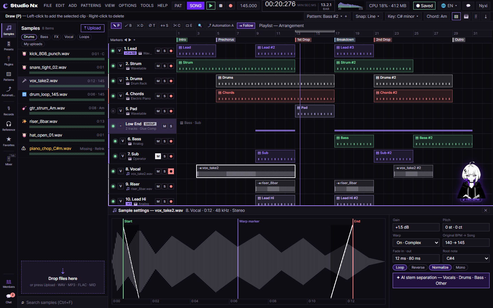
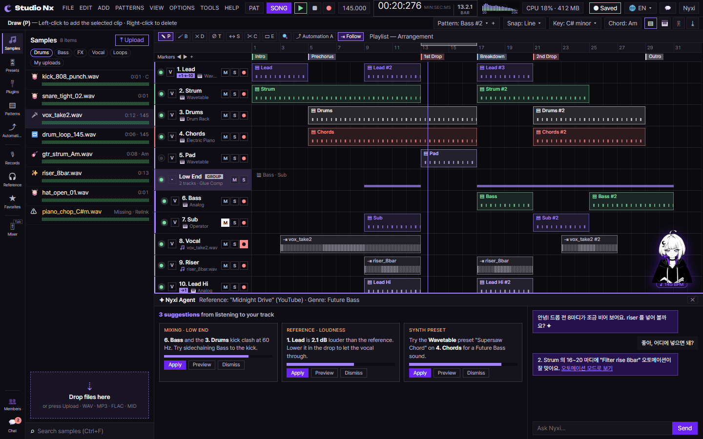
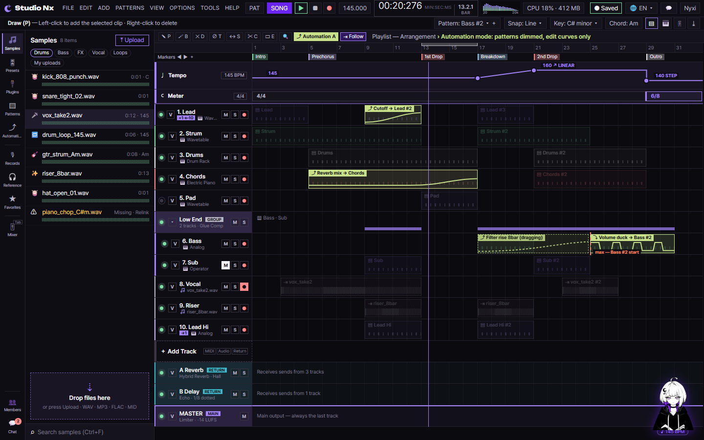
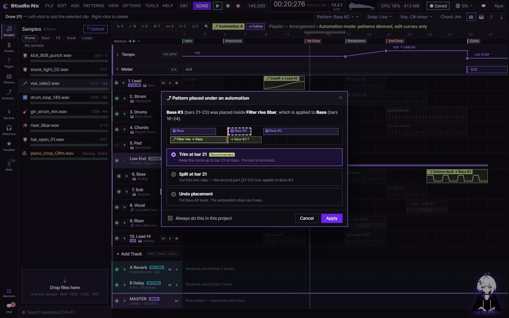
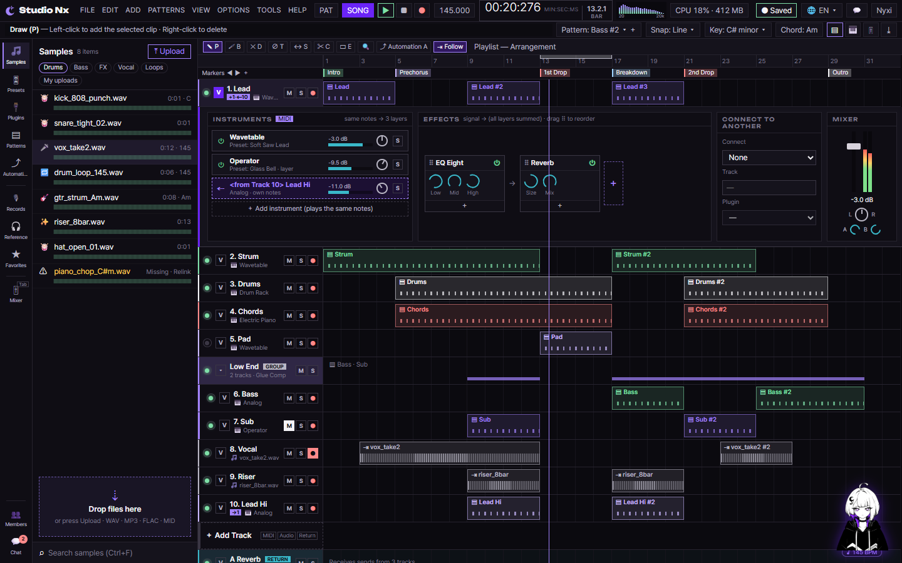
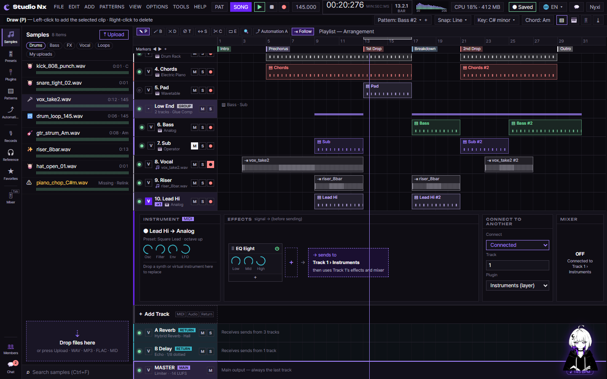
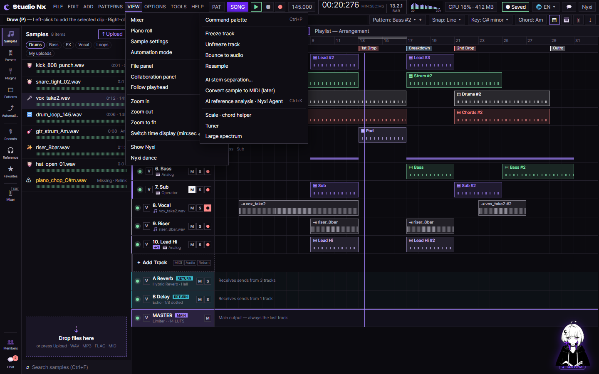
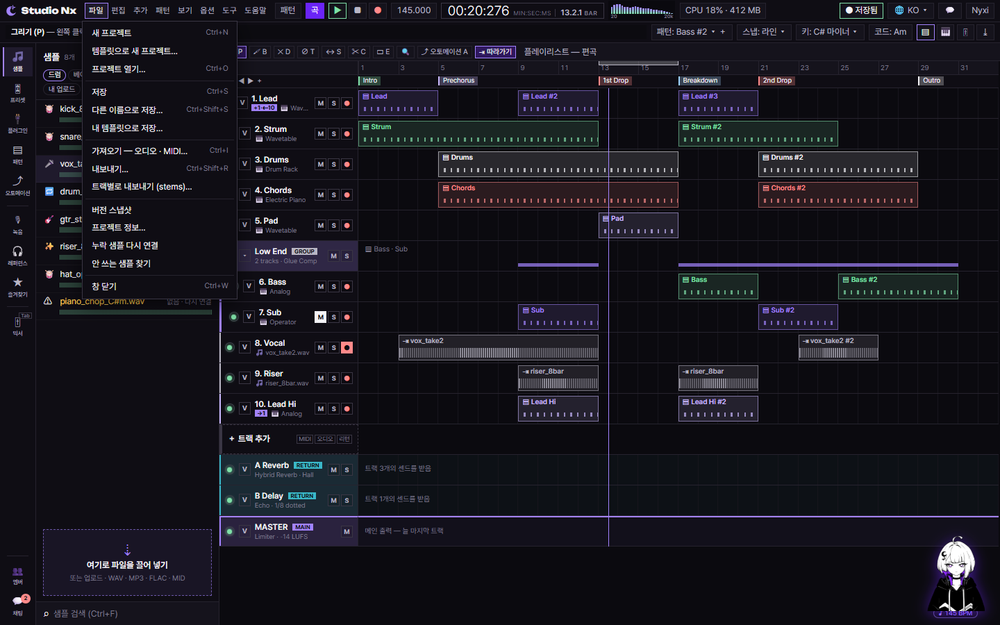
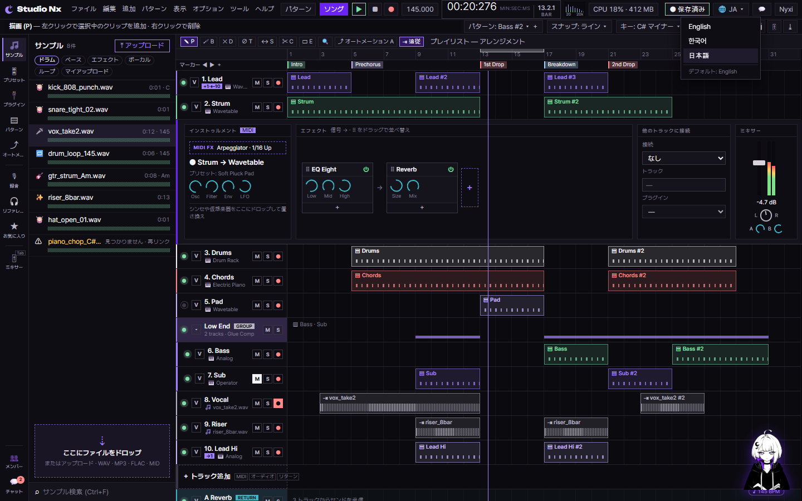

# AI 구현 설명 29 — 시퀀서 화면 (studioNx.html)

| 항목 | 내용 |
|---|---|
| 작성 | Claude (AI) |
| 작성일 | 2026-10-06 |
| 작업 | 확정된 목업 01~18을 실제 페이지로 옮김 (HTML·CSS). JS는 템플릿만. 이전 문서: [28_home_mobile_hero.md](28_home_mobile_hero.md) |
| 브랜치 | `feature/phase1/p1-15-studionx-stub` |
| 기준 | [Sequencer_Layout_Mockup.md](../Sequencer_Layout_Mockup.md) · PRD 02 §4.17 FR-2191~2202 · §4.18 · §4.19 FR-2241~2249 · 색 C Signal(다크) / C Light(라이트) |
| 만든 파일 | `studionx/frontend/studioNx.html` · `static/css/pages/studio.css` · `static/js/pages/sequencer.js`(템플릿) · `static/i18n/sequencer.json`(언어 사전) |

---

## 1. 실행 결과 (1440×900)
### 1.1 기본 화면


### 1.2 트랙 펼침 (V)


### 1.3 아래 칸 — 피아노롤 · 믹서


### 1.4 아래 칸 — 샘플 설정 · Nyxi Agent




### 1.5 오토메이션 모드 (A)




### 1.6 그룹 · 리턴 · 레이어 트랙





### 1.7 상단 메뉴 · 언어






> 언어 캡처는 사전(`sequencer.json`)을 캡처 스크립트에서 적용해 찍은 것입니다. 실제 화면에서 바꾸는 `setLanguage()`는 템플릿입니다.

### 1.8 협업 패널 + 편집 메뉴


### 1.9 녹음 중 · 라이트 테마


> 화면의 트랙·클립·파일·숫자는 **모양 확인용 예시**입니다. `sequencer.js`를 구현하면 `GET /projects/{id}/full` 결과로 다시 그립니다.

## 2. 화면 구조
```
┌──────────────────────────────── .sq-top (2줄) ────────────────────────────────┐
│ 로고 · FILE~HELP · PAT/SONG · ▶■● · BPM · 시간 · 스펙트럼 · CPU · Saved · 🌐 · 💬 · Nyxi │
│ 힌트 · Pattern · Snap · Key · Chord · 창 바로가기                                │
├──────┬──────────────┬──────────────────────────────────────────────────────┤
│.sq-  │ .sq-side     │ .sq-main                                             │
│rail  │  파일 패널    │  .sq-tools (도구 막대)                                │
│ 52px │  (264px)     │  .sq-scroll ─ 눈금 · 마커 · 트랙들 · ＋Add Track · MASTER │
│      │  드롭 존      │  .sq-bottom (평소 숨김: 피아노롤/샘플/Agent/믹서)        │
│      │  검색        │  .sq-nyxi (오른쪽 아래에 떠 있음)                       │
│      │ (협업 패널)   │                                                       │
└──────┴──────────────┴──────────────────────────────────────────────────────┘
```
- `<body class="sq">`가 **격자 하나**로 전체를 나눕니다: 행 = 상단바 / 나머지, 열 = 버튼 줄 / 파일 패널 / 편곡.
- 페이지 전체는 스크롤하지 않습니다 (`height: 100svh; overflow: hidden`). 스크롤은 편곡 영역(`.sq-scroll`)과 파일 목록만 합니다.
- 최소 폭 1280px — `core/studio.js`의 `STUDIO_MIN_WIDTH`와 같은 값입니다.

## 3. 주요 부분과 클래스
| 영역 | 클래스 · id | 설명 |
|---|---|---|
| 상단바 | `.sq-top`, `.sq-menu`, `.sq-transport`, `#time`, `#spectrum` | 시간은 큰 글씨 분:초:밀리초 + 작은 글씨 마디(목업 결정). 스펙트럼 막대 24개는 자리 표시 → JS가 canvas로 교체 |
| 메뉴 | `.sq-dropdown#menu-{file·edit·add·patterns·view·options·tools·help}` + `#menu-lang` | 항목은 PRD 02 §4.19 (FR-2241~2248). 메뉴 버튼의 `aria-controls`가 드롭다운 id. 항목마다 `data-command` (예: `edit.undo`, `track.addReturn`) |
| 버튼 줄 | `.sq-rail__btn[data-category]` | 선택된 것은 `aria-pressed="true"` → 왼쪽 보라 줄 |
| 파일 패널 | `.sq-files`, `.sq-file`, `.sq-drop`, `.sq-search` | 누락 파일은 `.is-missing` (노란 이름 + Relink) |
| 협업 | `#collab` (`hidden`) | Members · Chat 버튼으로 엶 (Phase 6) |
| 눈금·마커 | `.sq-ruler`, `.sq-loop`, `.sq-markers`, `.sq-marker` | 위에 붙어 있음 (`position: sticky; top`) |
| 트랙 | `li.sq-track[data-color]` → `.sq-track__head` + `.sq-track__lane` | 머리는 왼쪽에 붙어 있음 (`sticky; left: 0`). 순서: 켜기/끄기 · V · 이름/악기 · M S ● |
| 클립 | `.sq-clip--midi` / `.sq-clip--audio` + `canvas.sq-clip__preview` | 어두운 면 + 트랙 색 테두리(C 스타일). 그리기 전에는 CSS 무늬가 자리를 표시 |
| 트랙 펼침 | `li.sq-acc` (`hidden`) | 4칸: Instrument · Effects · Connect to Another · Mixer |
| 그룹 트랙 | `.sq-track--group` › `.sq-fold`(▾ 접기) · `.sq-gbar`(안쪽 클립 위치) / 안쪽 트랙 `.sq-track.is-child[data-parent]` | 들여쓰기 + 왼쪽 보라 줄 |
| 리턴 트랙 | `.sq-track--return` | ＋ Add Track 아래, MASTER 위. 청록 표시 |
| 연결 표시 | `.sq-link` (악기 줄 앞) | `+1` 악기 하나 더 · `⇠10` 10번에서 받음 · `→1` 1번으로 보냄 |
| 악기 스택 | `.sq-acc--stack` › `.sq-istack` › `.sq-irow`(켜기 · 이름 · 볼륨 `--v` · 팬 `--p` · 솔로), 받은 레이어 `.is-from`, `.sq-iadd` | 첫 칸을 20.5rem 으로 넓힘 |
| 레이어 트랙 | `#acc-10` › `.sq-route.is-live` + `.sq-sendto` + 믹서 `.sq-off` | 1번으로 보내므로 자기 믹서는 꺼짐 |
| 트랙 추가 · MASTER | `.sq-addrow`, `.sq-track--master` | MASTER는 늘 맨 아래 (FR-252). 추가 종류 MIDI · Audio · Return |
| 오토메이션 | `.sq-auto`(클립, 곡선은 svg path) · `.sq-auto.is-ghost`(끄는 중) · `.sq-auto-limit`(멈추는 곳) | 오토메이션 모드일 때만 보임 |
| 템포 · 박자 줄 | `.sq-global--tempo`(`.sq-global__pt`, `__lab`, polyline) · `.sq-global--meter`(`.sq-global__seg`, 바뀌는 곳 `.is-change`) | 오토메이션 모드일 때만 보임. 점 높이 `--y` = (170 − BPM) ÷ 40 × 100 |
| 겹침 창 | `dialog#auto-overlap` › `.sq-mini`(작은 그림, `--s`·`--l` = %) + `.sq-option` 라디오 3개 | `showModal()`, 기본 선택 Trim |
| 아래 칸 | `#bottom` > `.sq-panel[data-panel]` | 한 번에 하나만 보임 |
| 샘플 설정 | `#panel-sample` › `.sq-wave`(파형·`.sq-wave__mark`·`.sq-wave__fade`) + `.sq-sset` | 마커·페이드 위치는 `--at`·`--len` (%) |
| Nyxi Agent | `#panel-agent` › `.sq-advice`(`.sq-card` 3개) + `.sq-achat`(말풍선 `.sq-bubble.is-nyxi / .is-user`) | 카드 막대 `--w` = 확신도 |
| Nyxi | `.sq-nyxi` | 재생 중(`body.is-playing`)이면 BPM 속도로 흔들림 |

### 3.1 위치를 숫자로 정하는 방법 (CSS 변수)
클립·마커·재생선은 **마디 단위 숫자**만 주면 CSS가 자리를 계산합니다.

| 변수 | 쓰는 곳 | 뜻 |
|---|---|---|
| `--sq-bar-w` | `.sq` | 1마디 폭 (가로 확대·축소 때 이것만 바꿈) |
| `--sq-bars` | `.sq` | 보이는 마디 수 → 편곡 영역 전체 폭 |
| `--s`, `--l` | `.sq-clip`, `.sq-loop` | 시작 마디(0부터) · 길이(마디) |
| `--at` | `.sq-marker`, `.sq-playhead` | 위치(마디) |
| `--y` | `.sq-global__pt` | 템포 점 높이 (0 = 170 BPM, 100 = 130 BPM) |
| `--tc` | 트랙·클립 | 트랙 색 (`data-color="1~5 | audio"`가 정함) |
| `--bpm` | `body` | Nyxi 춤 속도 |
| `--sq-acc-h`, `--sq-bottom-h` | `.sq` | 펼침 높이 · 아래 칸 높이 (경계를 끌어 바꿀 때 이 값만 바꿈) |

예: 13마디부터 4마디 클립 → `style="--s:12; --l:4"`. JS에서는 tick을 마디로 바꿔 넣습니다 (`tick / (960 × 박자 분자)`).

### 3.2 테마
- 다크(기본)는 `tokens.css`의 색을 그대로 쓰고, 시퀀서 전용 면 색(`--sq-panel`, `--sq-line` …)과 트랙 5색(`--tc-1~5`)을 `.sq`에 둡니다.
- 라이트는 `:root[data-theme="light"] .sq`에서 같은 변수만 바꿉니다. 밝은 바탕에서 읽히도록 트랙 색을 진하게 (#5a17e0 · #137a45 · #0b0a0f · #c42b2b · #7d45f7) 했습니다.

### 3.3 상태 클래스 (JS가 붙임)
| 클래스 | 붙는 곳 | 화면 |
|---|---|---|
| `.is-playing` | `body` | Nyxi 춤 (움직임 줄이기 설정이면 안 움직임) |
| `.is-recording` | `body` | 상단바 보라 띠 + `● REC` |
| `.is-automation` | `body` | 패턴 25% 흐림, 오토메이션 클립·템포/박자 줄 보임, 도구 막대에 모드 안내 |
| `.is-open` / `aria-expanded` | 트랙 / V 버튼 | 펼친 트랙 머리 강조 |
| `.is-selected` | 클립 · 노트 | 흰 테두리 |
| `.is-over` | `#drop-zone` | 파일을 끌어 올렸을 때 |

### 3.4 언어 사전 (`static/i18n/sequencer.json`)
| 키 | 내용 |
|---|---|
| `text` | 영어 글자 → `{ ko, ja }`. 글자 **전체**가 같을 때만 바꿈 (약 250개 — 메뉴 항목, 버튼, 칸 이름, 안내 문구) |
| `prefix` | 정규식 → `{ ko, ja }`. 뒤에 값이 붙는 글자 (예: `^Pattern: ` → `패턴: `, `^(\d+) items?$` → `$1개`) |
| `skip` | 바꾸지 않는 곳의 선택자 — 트랙·패턴·마커·파일 이름, 채팅, Nyxi 조언 본문, 플러그인 이름·파라미터, 숫자 (FR-2171) |
| `templates` | JS가 값을 넣어 만드는 문장 (`{pattern}` 자리) — 겹침 창 설명처럼 이름이 섞인 문장 |
| `labels` | 언어 버튼 글자 (`🌐 KO ▾`) |

- 목업 사전(`docs/page_mockups/sequencer/layout/_source/i18n.js`)의 단어를 옮기고, 실제 화면에서 새로 생긴 글자를 더했습니다.
- 빠진 글자 확인: 화면의 모든 글자 노드를 돌며 `skip` 밖에서 사전에 없는 글자를 뽑음 → 남은 것은 `MIDI`·`S` 같은 기호와 클립 이름뿐.
- 일본어는 글자가 길어 메뉴 이름·트랙 추가 칩이 두 줄로 꺾였음 → `white-space: nowrap`.

## 4. 만들면서 고친 것
| 문제 | 원인 | 해결 |
|---|---|---|
| 상단 메뉴 글자가 `FILEEDITADD…`로 붙고 칩 테두리가 사라짐 | 버튼 초기화 규칙 `.sq button`(우선순위 0,1,1)이 `.sq-chip`(0,1,0)의 여백·테두리를 덮음 | 초기화를 `:where(.sq) button`으로 바꿔 우선순위를 0으로 |
| 악기 스택 첫 칸이 넓어지지 않음 | `.sq-acc--stack`이 뒤에 오는 `.sq-acc` 규칙에 덮임 (같은 우선순위) | `.sq-acc.sq-acc--stack` |
| 트랙 이름 옆 `→1`·`GROUP`이 잘림 | 트랙 머리 200px 에 버튼 넷 + 이름 | 연결 표시는 악기 줄(small) 앞으로, 그룹은 녹음(●) 버튼을 뺌 |
| 루프 구간이 1마디에 붙음 | 눈금 숫자 규칙 `.sq-ruler__bars span`이 루프에도 적용 | 루프를 `<i>`로, 숫자 규칙은 `> span`만 |
| 피아노롤 노트 칸이 눌림 | 아래 칸의 두 줄 격자를 바깥 `.sq-bottom`에 줘서 패널 안 머리줄·본문이 나뉘지 않음 | 격자를 각 `.sq-panel`로 옮김 |
| 라이트에서 GROUP·MAIN 배지가 안 보임 | 라이트 배지 바탕이 진한데 글자도 진함 | 라이트에서 배지 글자 흰색 |
| 시간 글자가 상단 줄을 넘침 | 1.55rem | 1.2rem |
| 믹서를 열면 Nyxi가 MASTER 줄을 가림 | Nyxi가 늘 바닥에 붙음 | `.sq-main:has(.sq-bottom:not([hidden]))`일 때 아래 칸 위로 올림 |

## 5. JS 템플릿 (`static/js/pages/sequencer.js`)
구현은 하지 않고 함수 이름·할 일·쓸 API만 적었습니다.

| 함수 | 할 일 |
|---|---|
| `init()` | `projectId` 읽기 → 로그인 확인 → `loadProject` → 각 `init*` |
| `loadProject(id)` | `GET /api/v1/projects/{id}/full` → 예시 트랙을 지우고 다시 그림 |
| `renderTrack` · `drawClipPreview` | 트랙 한 줄 HTML, 클립 canvas에 노트·파형 |
| `openSamplePanel(clip)` · `initAgent` | 샘플 설정 채우기·마커 끌기, Agent 카드 버튼·대화 |
| `setAutomationMode` · `dragAutomation` · `askAutomationOverlap` · `renderGlobalLanes` | 오토메이션 모드, 클립 끌기(다음 패턴 시작에서 멈춤), 겹침 창, 템포·박자 줄 |
| `toggleGroup` · `addTrack` · `renderInstrumentStack` · `updateConnection` | 그룹 접기, 트랙 추가(Return 은 MASTER 위), 악기 스택, Connect to Another |
| `toggleTrackPanel` | V 펼침 (기본 하나, Shift+V 여러 개) |
| `openBottom(name)` | `'roll' · 'sample' · 'agent' · 'mixer'` 중 하나만 보이기 |
| `initRail` · `initTracks` · `initBottom` | 버튼 줄, 트랙 버튼, 아래 칸 |
| `initShortcuts` | Space · Tab · A · P/B/D/T/S/C/E · V · Esc |
| `initDropZone` | 파일 끌어 놓기·업로드 |
| `initMenus` · `runCommand(command)` | 메뉴 열기·위치·키보드 이동, `data-command`로 명령 실행 (단축키·팔레트와 같은 명령) |
| `setLanguage` · `initLanguage` | `sequencer.json`으로 글자 바꾸기, en 으로 되돌리기, 설정 저장 |
| `updateTransport(state)` | 재생·녹음 상태, 시간 표시, 재생선 |

## 6. 남은 것
- 화면(HTML/CSS)은 목업 01~18 을 모두 옮겼습니다. 다음은 `sequencer.js` 구현(직접)입니다.
- 목업에만 있는 세부: 편곡 시간 범위 선택·오른쪽 클릭 메뉴·펀치 구간·크로스페이드(목업 16), 피아노롤 확장 레인(목업 17), 이펙트 병렬 갈래 그림(목업 05). 화면 틀은 같아서 JS 구현 때 같은 클래스로 붙이면 됩니다.
