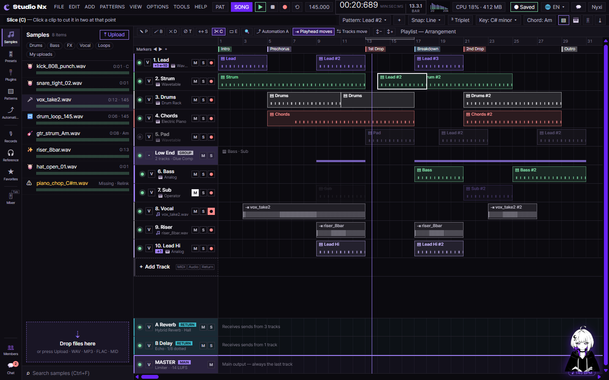
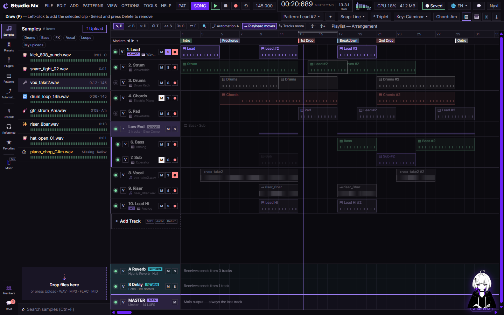
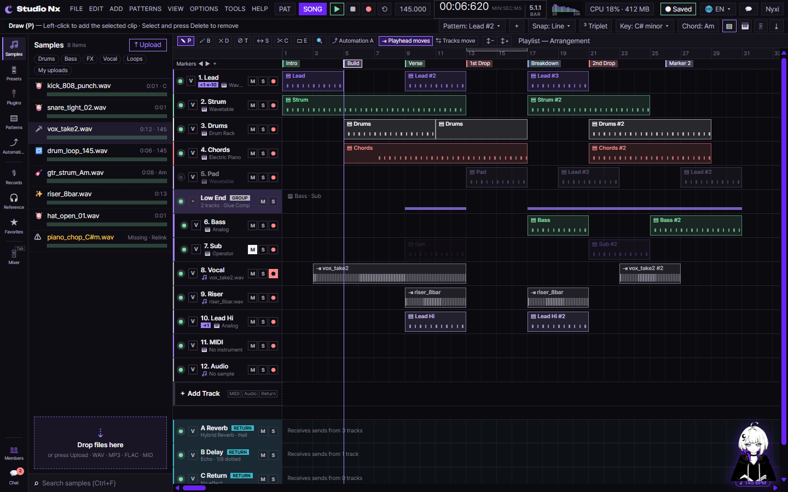
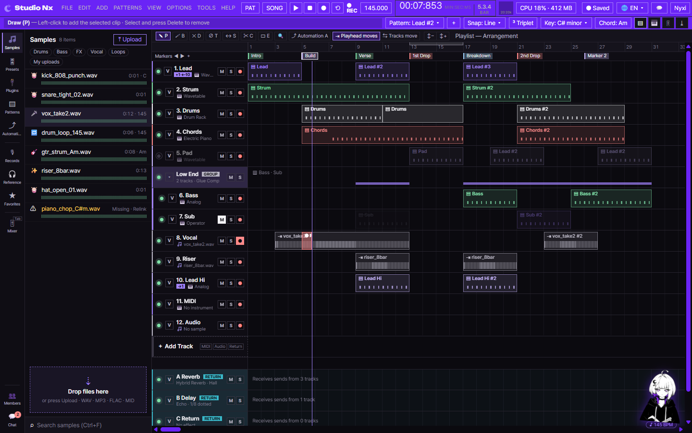
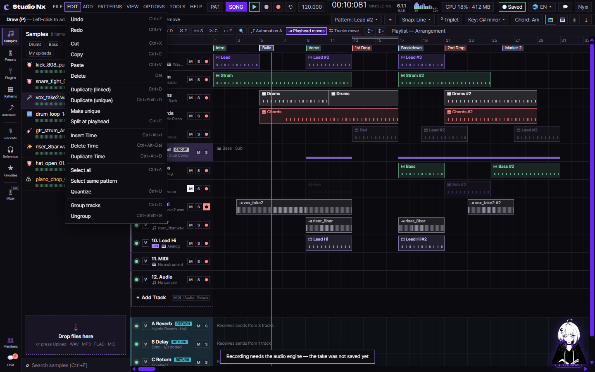
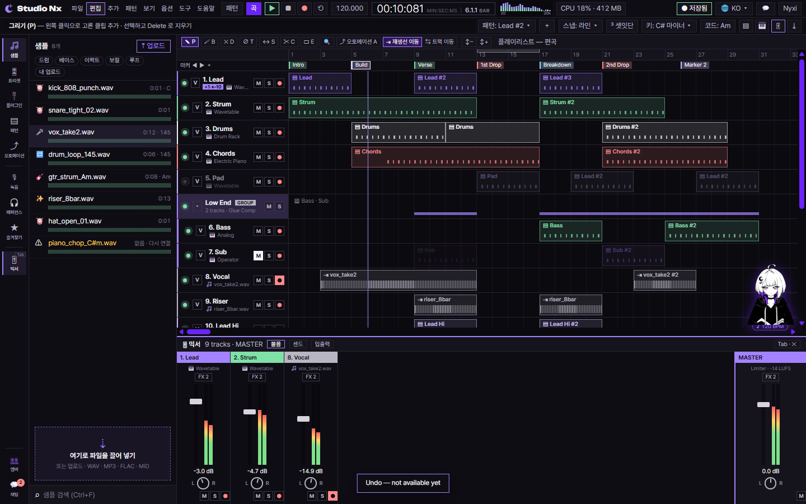
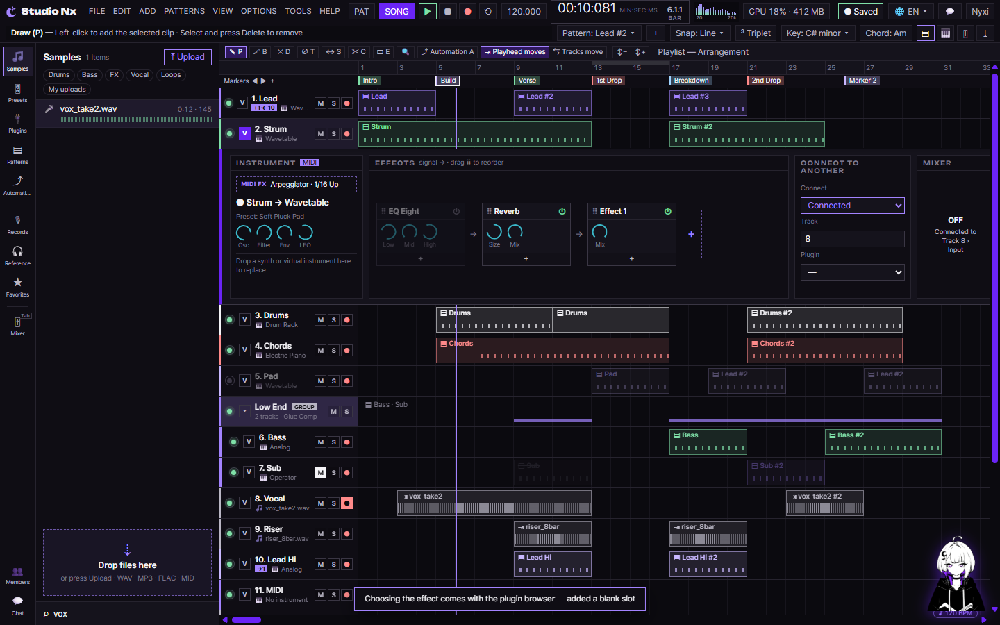
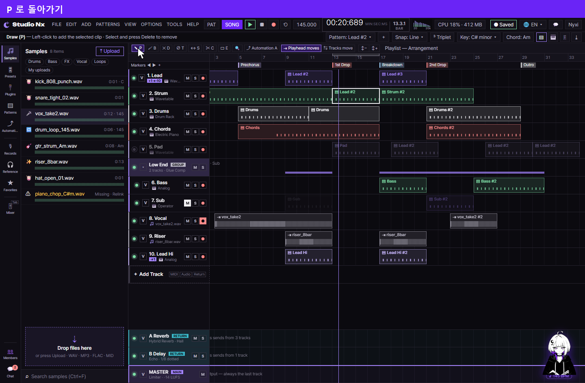
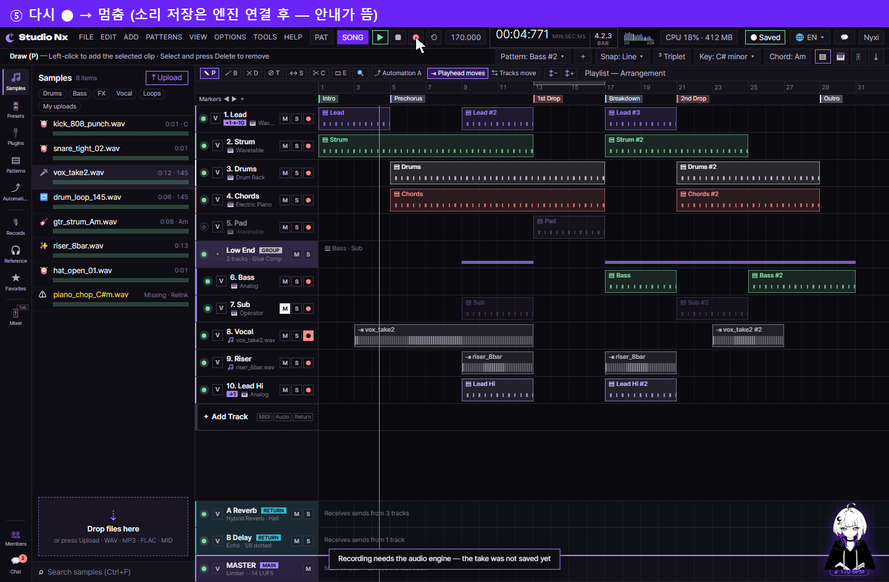

# AI 구현 설명 31 — 시퀀서 화면 버튼 전체

| 항목 | 내용 |
|---|---|
| 작성 | Claude (AI) |
| 작성일 | 2026-10-06 |
| 작업 | 사용자 요청 "왼쪽 위 P, B · D, T · S, C · E, Zoom, Tracks move, 트랙 on/off, Mute, Solo, Record, 마커 추가(＋ 버튼, 마커 빈 곳 오른쪽 클릭) 포함해서 나머지 버튼들도 구현". 이전 문서: [30_sequencer_arrange_drag.md](30_sequencer_arrange_drag.md) |
| 브랜치 | `feature/phase1/p1-15-studionx-stub` |
| 바꾼 파일 | `static/js/pages/sequencer-arrange.js`(도구, 트랙 머리, 마커, 녹음, 시간, 알림), `sequencer-roll.js`(피아노롤 명령), **새 파일** `sequencer-ui.js`(나머지 버튼), `sequencer.js`(불러오기), `studioNx.html`, `studio.css` |

> **원칙:** 소리 엔진(Web Audio), 서버(API)가 아직 없어서, 그게 필요한 버튼은 **화면 상태만 바꾸고 아래에 짧은 안내(`showToast`)** 를 띄웁니다: 예: 녹음 저장, 내보내기, Undo, AI 분리. 저장할 곳은 모두 `onChange({ type, … })` 로 넘깁니다.

## 1. 실행 결과

### 1.1 동작 영상 (실제 조작을 녹화)
헤드리스 Chrome 에 **실제 마우스, 키보드 이벤트**를 보내 조작하면서 한 장면씩 찍었습니다. 위쪽 보라 띠 = 단계 자막, 흰 화살표 = 마우스, 노란 원 = 누르고 있는 중. 파일은 애니메이션 **WebP**(브라우저, 사진 앱으로 열기, PDF 에는 정지 화면).

| 영상 | 길이 | 담긴 동작 |
|---|---|---|
| [demo_tools.webp](images/31_sequencer_buttons/demo_tools.webp) | 23초 | P 놓기 → B 칠하기 → D 지우기 → T 음소거 → S 내용 밀기 → C 자르기 → Zoom 확대, Alt 축소 |
| [demo_tracks.webp](images/31_sequencer_buttons/demo_tracks.webp) | 21초 | 끄기 → M → S(다른 트랙 흐림) → Ctrl+S → ● → V(새 펼침) → 그룹 ▾ → ＋ MIDI, Audio, Return |
| [demo_markers.webp](images/31_sequencer_buttons/demo_markers.webp) | 21초 | ＋ "Verse" → 빈 곳 오른쪽 클릭 "Hook" → ▶ ▶ ◀ → 클릭 이동 → 더블 클릭 "Build" → Outro Delete → 마커 끌기 → 오른쪽 끌기 Loop |
| [demo_playback.webp](images/31_sequencer_buttons/demo_playback.webp) | 19초 | Space 재생, 멈춤 → 시간 표시 바꾸기 → BPM 170 → Tracks move 재생 → ● 녹음(빨간 띠) → 멈춤, 안내 |
| [demo_ui.webp](images/31_sequencer_buttons/demo_ui.webp) | 32초 | FILE → EDIT, ADD, VIEW 옮겨 가기 → Mixer → 한국어 → 영어 → Plugins → Drums 칩 → 채팅 → Nyxi Agent(Dismiss, 질문) → 펼침 이펙트 ⏻, ＋ → Connect |
| [demo_roll.webp](images/31_sequencer_buttons/demo_roll.webp) | 20초 | Lead #2 더블 클릭 → 노트 찍기, 옮기기, 길이 → Legato, Chop, Glue, Quantize → Ctrl+휠, Shift+휠 |

## 2. 편곡 도구 (도구 막대, 단축키)
| 도구 | 키 | 동작 |
|---|---|---|
| ✎ Draw | **P** | 트랙 빈 곳 **클릭** → '놓을 것'을 그 칸(왼쪽 격자선)에 놓음. 끌면 좌우 이동(예전과 같음). 클립 끌기, 선택도 이 도구에서 |
| 🖌 Paint | **B** | 트랙 위를 **누른 채 끌기** → 놓을 것을 그 길이 간격으로 이어서 칠함 (왼쪽으로 끌어도 됨, 같은 자리에 있으면 건너뜀) |
| ✕ Delete | **D** | 클립 클릭 → 지움, 누른 채 지나간 클립도 |
| ∅ Mute | **T** | 클립 클릭 → 그 클립만 음소거, 해제 (흐리게 + 이름 줄 긋기) |
| ↔ Slip | **S** | 클립 안을 끌기 → 길이, 위치는 그대로, **내용만** 밀기 (`--o` 마디, −길이 ~ +길이) |
| ✂ Slice | **C** | 클립 클릭 → 그 자리(격자, Alt 무시)에서 둘로. 뒤 클립은 내용이 이어지도록 `--o` 를 당김 |
| ▭ Select | **E** | 빈 곳 끌기 = 영역 선택 (문서 30) |
| 🔍 Zoom |: | 클릭 = 확대(1.5배), **Alt+클릭, 오른쪽 클릭** = 축소, 누른 곳 기준 |
|: | **Z** | 전체 보기 (Zoom to fit) |
|: | **A** | 오토메이션 모드 (문서 30 §4.17) |

- **놓을 것(Draw, Paint):** 마지막으로 누른 클립, 왼쪽 목록에서 누른 샘플/패턴, 상단 `Pattern ▾` 에서 고른 패턴. MIDI 면 상단 `Pattern: … ▾` 글자도 바뀜. 종류가 다른 트랙(예: 오디오 트랙에 MIDI)이면 그 트랙의 첫 클립을 본떠 놓음.
- 도구마다 커서가 다름(`body.tool-*`), 힌트 바 문구도 바뀜.
- `onChange`: `create`, `delete`, `muteClip`, `slip`, `slice`.

| 시험 | 결과 |
|---|---|
| Lead #2 클릭 → 2. Strum 13.4마디 클릭 (P) | `Pattern: Lead #2 ▾`, Lead #2 클립 13마디 |
| B → 5. Pad 18 → 26.5마디 끌기 | 18, 22, 26마디 (4마디 간격) |
| D → 22마디 클립 클릭 | 지워짐 |
| T → 7. Sub 클립 클릭 | `muted` |
| S → 4. Chords 안을 2마디 끌기 | `--o` 2 (위치, 길이 그대로) |
| C → 3. Drums(4~16) 10.3마디 클릭 | 4~10 + 10~16(`--o` −6) |
| Zoom 클릭, Alt+클릭 | 1마디 29 → 43 → 29px |

## 3. 트랙 머리 버튼
| 버튼 | 동작 |
|---|---|
| ● 켜기/끄기 | 끄면 트랙 흐림 (`.is-off`) |
| **M** | 음소거: 클립 칸 흐림 (`.is-muted`), 믹서 줄 M 도 같이 |
| **S** | 솔로: 하나라도 솔로면 솔로 아닌 트랙(리턴, MASTER 제외, 솔로 그룹의 안쪽 트랙 제외)이 흐려짐. **Ctrl+S** = 그 트랙만 솔로 |
| **●** | 녹음 대기: 믹서 줄 ● 도 같이. 상단 ● 녹음 때 이 트랙에 녹음 띠 |
| **V** | 펼침 열고 닫기: 기본은 하나만, **Shift+V** 는 여러 개. 펼침 칸이 없는 트랙이면 2번 트랙 펼침을 본떠 새로 만듦(오디오, 리턴, MASTER 는 악기 칸 대신 AUDIO) |
| 그룹 **▾** | 안쪽 트랙(`data-parent`)과 그 펼침 접기, 펴기 |
| 믹서 줄 M, S · ● | 같은 트랙 버튼을 누른 것과 같음 (`.sq-strip[data-track-id]`) |
| ＋ Add Track, 칩 MIDI, Audio, Return | MIDI/Audio 는 목록 끝(이름 `MIDI`, `Audio`, 번호는 위치대로), Return 은 MASTER 위(`C Return` …) |

`onChange({ type: 'trackState', trackId, what: 'power'|'mute'|'solo'|'arm', on })`, `createTrack`.

## 4. 마커
| 동작 | 결과 |
|---|---|
| 마커 줄 왼쪽 **＋** | 재생선 자리(격자)에 `Marker N` → 바로 이름 입력칸 |
| 마커 줄 **빈 곳 오른쪽 클릭**(끌지 않음) | 그 자리에 마커 + 이름 입력칸. **오른쪽으로 끌면** 예전처럼 Loop 구간 |
| **◀, ▶** | 재생선을 앞, 다음 마커로 (화면 밖이면 스크롤) |
| 마커 **클릭** | 그 마커 선택 + 재생선을 마커로 |
| 마커 **더블 클릭** | 이름 바꾸기 (마커 위에 입력칸, Enter, 바깥 클릭 = 확정, Esc = 취소, 입력 중엔 단축키 안 먹음) |
| 마커 선택 후 **Delete, Backspace** | 지우기 |
| 마커 끌기 | 좌우 이동 (문서 30) |
| EDIT/ADD › Marker | ＋ 와 같음 |

`onChange`: `markerAdd`, `markerRename`, `markerDelete`, `marker`(옮김).

## 5. 상단, 왼쪽, 아래 칸
| 어디 | 버튼 | 동작 |
|---|---|---|
| 상단 | FILE ~ HELP | 눌러서 열고 닫기, 열린 채 옆 메뉴에 마우스 → 그 메뉴로, ← → 로 옆 메뉴, Esc, 바깥 클릭 닫기. 항목 → 명령 실행 후 닫힘. 아직 없는 명령은 `…: not available yet` 안내 |
| | 동작하는 메뉴 명령 | Delete, Select all, Mixer, Piano roll, Sample settings, Automation mode, File panel(숨기기), Collaboration panel, Playback 두 방식, Zoom 3가지, 시간 표시 바꾸기, Show Nyxi, Nyxi dance, 트랙 높이 3가지, Triplet, MIDI/Audio/Return track, Marker, Close window, Keyboard shortcuts(안내) |
| | 🌐 언어 | EN, KO, JA: `static/i18n/sequencer.json` 으로 화면 글자만 바꿈(문서 29 §3.4), EN 으로 처음 영어 그대로 되돌림, 새로 생기는 글자(새 트랙, 힌트, 알림)도 그 언어로, 고른 언어는 이 브라우저에 기억 |
| | PAT / SONG | 둘 중 하나 (`body.is-pattern-mode`): 패턴만 재생은 엔진 연결 후 |
| | ▶ ■ ● | ▶ 재생/일시정지, ■ 멈춤 (문서 30), **● 녹음** = 녹음 대기 트랙에 빨간 띠가 재생선까지 늘어나며 재생, 다시 ● 나 ■ 로 멈춤 → 띠는 지우고 "엔진 연결 후 저장" 안내 |
| | BPM | 눌러서 바로 입력(20 ~ 999), Enter 확정, Esc 취소 → 재생 속도, Nyxi 춤 속도, 시간 표시가 따라감 |
| | 시간 | 재생선을 따라 분:초:밀리초, 마디.박.16분(4/4, 지금 BPM)이 바뀜, 누르면 큰 글씨 ⇄ 작은 글씨 |
| | 스펙트럼 | 재생 중 움직임(모양만, 분석은 엔진 후) |
| | 💬, Nyxi | 협업 패널 열기, 아래 칸 Agent |
| | Pattern ▾, ＋ | 패턴 고르기 → Draw 로 놓을 것 / 새 패턴 `Pattern N`(4마디)을 목록에 |
| | Key ▾ | 24개 조 중 고르기 → 피아노롤 Scale 도 |
| | ▤ 🎹 🎚 ⤓ | 아래 칸 닫기, 피아노롤, 믹서, 내보내기(안내): 지금 열린 칸이 눌린 상태로 |
| 키 | **Space**, **Tab** | 재생/일시정지, 믹서 열고 닫기 (입력칸 밖) |
| 왼쪽 | 카테고리 | Samples, Patterns(문서 30) 말고 Presets, Plugins, Automation, Records, Reference, Favorites 도 예시 목록으로 바뀜(서버 연결 전) |
| | 목록 항목 클릭 | 선택: 샘플, 패턴이면 Draw 로 놓을 것 |
| | 필터 칩, 검색 | Drums, Bass, FX, Vocal, Loops (이름으로 거름, 다시 누르면 전체), 검색칸은 글자로 거름, **Ctrl+F** 로 검색칸 |
| | Upload, 드롭 존 | 파일 고르기, 끌어 놓기까지: "업로드는 서버 연결 후" 안내 |
| | Members, Chat | 협업 패널 열고 닫기(안 읽음 숫자 지움), 채팅 Enter → 내 말 추가(서버 없이 화면에만) |
| 아래 칸 | ✕ | 닫기 |
| | 믹서 Volume, Sends, I/O | 탭 바뀜 (Sends, I/O 화면은 엔진 후 안내) |
| | 오디오 클립 더블 클릭 | 샘플 설정 (제목, 트랙 이름), Loop/Reverse/Normalize/Mono 토글, AI 분리(Phase 4 안내) |
| | Nyxi Agent | Dismiss = 카드 지움, Apply = `Applied ✓`(실제 적용은 엔진 후), Preview 안내, 질문 보내기 → 내 말 + "AI 연결 전" 답 |
| | 피아노롤 Chop, Glue, Legato, Humanize, Quantize 75% | 선택한 노트(없으면 전체)에: Chop = 지금 격자 단위로 자르기, Glue = 같은 음 이어진 노트 붙이기, Legato = 다음 노트까지 늘리기, Humanize = 시작 ±1/64, 벨로시티 ±12 흔들기, Quantize = 시작을 격자 쪽으로 75% |
| | 벨로시티 줄 탭 | Velocity 만 값이 있고 나머지 탭은 고르기만 |
| 펼침 | ⏻ (이펙트) | 켜기/끄기 (끄면 흐림) |
| | ＋ (마지막 뒤) | 빈 이펙트 칸 `Effect N` 추가 (종류 고르기는 플러그인 목록 연결 후) |
| | ＋ (카드 아래) | 병렬 갈래: 엔진 후 안내 |
| | ⠿ 끌기 | 이펙트 순서 바꾸기: 끼울 자리에 보라 선, 카드 사이 → 다시 그림 |
| | 악기 레이어 ⏻, S · ＋ Add instrument | 켜기/끄기, 솔로, 빈 레이어 줄 추가 |
| | Connect to Another | Connected + 트랙 번호 → 플러그인 칸 켜짐, 믹서에 OFF 덮개(`Connected to Track N › …`), None → 덮개 지움. 선택지 값은 `none`, `connected` 로 고정(한국어, 일본어에서도 동작) |

## 6. 시험 (헤드리스 Chrome, 실제 마우스, 키보드)
위 §2 표 말고:

| 시험 | 결과 |
|---|---|
| 3 끄기, 4 M, 2 S, 1 ● | 3·5 `is-off`, 4 `is-muted`, 2 말고 모두 `is-solo-dimmed`, 믹서 줄 1 ●, 2 S 같이 켜짐 |
| 1 번 Ctrl+S | 솔로 = 1 번만 |
| 3 V (펼침 없음) → 1 V → Shift+2 V | 3 에 새 펼침(`Drums → Drum Rack`), 열린 것 acc-1, acc-2 |
| 그룹 ▾ | 6, 7 숨김 |
| 칩 MIDI, Audio, Return | `11. MIDI`, `12. Audio`, `C Return` |
| ＋ (재생선 8) → "Verse" Enter | `Verse@8` |
| 빈 곳 오른쪽 클릭 25.2 → Esc | `Marker 2@25`, Loop 그대로 12/4 |
| ▶, ◀ | 재생선 12, 8 |
| Outro 클릭 → Delete | 재생선 28, Outro 지워짐 |
| Prechorus 더블 클릭 → "Build" | 이름 바뀜 |
| ● → 1.2초 → ● | 녹음 중, 재생 중, 띠 0.73마디 → 멈춤, 띠 지움, 안내 |
| 시간 클릭 | `00:07:908 / 5.4.1` ⇄ `5.4.1 / 00:07:908` |
| BPM → 120 | `120.000`, Nyxi `♪ 120 BPM` |
| Space 두 번 | 재생 → 멈춤 |
| FILE → EDIT 에 마우스 | EDIT 로 바뀜, Undo → `Undo: not available yet` |
| VIEW › Mixer | 아래 칸 믹서, 🎚 눌린 상태 |
| 언어 KO → EN | `파일`, `🌐 KO ▾`, `＋ 트랙 추가` → `FILE`, `🌐 EN ▾` |
| Plugins, Drums 칩, 검색 vox | `Plugins, 10 items`, 드럼 샘플 4개, `vox_take2.wav` |
| Chat, Enter | 패널 열림, 안 읽음 숫자 지움, 내 말 추가 |
| Tab 두 번 | 믹서 열림 → 닫힘 |
| Nyxi, Dismiss, 질문 | Agent 열림, 카드 3 → 2, "AI 연결 전" 답 |
| 이펙트 ⏻, ＋ · Connected 8 | `EQ Eight(off) → Reverb → Effect 1 +`, OFF `Connected to Track 8 › Input` |
| Legato, Chop, Glue | E4 0.375 → 0.5(다음 노트까지), 1/16 단계라 58개로, 다시 8개 |

시험 중 고친 것:

| 문제 | 해결 |
|---|---|
| ＋ Add Track 칩 이름이 `11. MIDI 12` | 이름을 `MIDI`, `Audio` 로 (번호는 위치대로 붙음) |
| 한국어, 일본어일 때 Connect 선택지 값도 번역돼 `Connected` 판정 실패 | `<option value="connected">` 처럼 값을 고정 |
| 마커 이름을 버튼 안에서 바로 고치면 스페이스가 버튼 클릭으로 처리됨 | 마커 위에 입력칸을 띄움 |
| 정규식 `\b` 가 셸 heredoc 을 거치며 제어 문자(백스페이스)로 들어감 | 스크립트 파일로 고치고, 프로젝트 전체에 제어 문자가 없는지 검사 |

## 7. 아직 (엔진, 서버, 다음 단계)
- 소리: 재생, 녹음 입력, 메트로놈, 미리 듣기, 스펙트럼 분석, 패턴 모드 재생, 내보내기
- 서버: 저장, 업로드, 누락 파일 다시 연결, 초대, 채팅 동기화, Nyxi AI
- 편집: Undo/Redo, 복사, 붙여넣기, 시간 삽입/삭제/복제, 이펙트 종류 고르기, 병렬 갈래, 오토메이션 클립 옮기기, 겹침 창, 템포/박자 점 편집
