# AI 구현 설명 34 — P1-02 · P1-03 실제 사이트 시험 (화면 캡처)

| 항목 | 내용 |
|---|---|
| 작성 | Claude (AI) · 2026-10-06 |
| 대상 | P1-02 프론트 공통 JS ([32](32_p1-02_frontend_api_core.md)) · P1-03 백엔드 공통 ([33](33_p1-03_backend_core.md)) |
| 환경 | 로컬 개발 서버 `http://localhost:8000` (uvicorn) · 실제 MySQL · Chrome (헤드리스, 1280×860) |
| 결과 | **16개 모두 기대한 대로** |
| 캡처 | `docs/ai-notes/images/34_p1-02_03_site_test/` (PNG 16장) |

## 1. 시험 방법
- 실제 사이트 페이지(`home.html` · `myProject.html` · `myPage.html`)를 Chrome 으로 열고, **그 페이지 안에서** 요청을 보내거나 JS 모듈(`core/api.js` · `core/auth.js`)을 불러 실행했다.
- 결과는 화면 오른쪽 위 **패널**에 적고 그대로 캡처했다. 테두리가 초록이면 기대와 같고, 빨강이면 다르다는 뜻이다(이번에는 빨강 없음).
- 패널은 시험할 때 열린 화면에만 잠깐 넣은 것이다. **사이트 파일은 바꾸지 않았다.**
- 회원 상태 시험을 위해 시험 계정 2개를 DB 에 잠시 만들었다.
  - `sitetest_active@example.com` (`ACTIVE`) · `sitetest_deleted@example.com` (`DELETED`)
  - 토큰은 서버 비밀값으로 직접 만들었다. 로그인 API 는 P1-05 에서 만든다.
  - 시험이 끝난 뒤 두 계정을 지웠다(남은 행 0개 확인).
- 캡처에 보이는 토큰은 앞뒤 일부만 적었다.

## 2. 아직 템플릿인 API 때문에 생기는 것
| API | 지금 | 영향 |
|---|---|---|
| `POST /auth/refresh` · `POST /auth/logout` | P1-05 템플릿 → 500 | JS 는 "재발급 실패" · "로그아웃 요청 실패" 로 처리한다. 만든 그대로의 동작이다 |
| `GET /users/me` (라우터 본문) | P1-08 템플릿 → 500 | 06 검사를 통과하면 라우터에서 500 이 난다. 401 이 아니라 500 이 나왔다는 것이 **06 을 통과했다는 증거**다 |

## 3. 결과 한눈에
| # | 대상 | 시험 | 결과 |
|---|---|---|---|
| 01 | P1-03 · 03 | 없는 API 를 브라우저로 열기 | 404 `NOT_FOUND` JSON ✔ |
| 02 | P1-03 · 03 | 없는 페이지를 브라우저로 열기 | 오류 HTML 404 화면 ✔ |
| 03 | P1-03 · 03 | `DELETE /health` | 405 `METHOD_NOT_ALLOWED` ✔ |
| 04 | P1-03 · 02 | 문의 폼 형식 오류 | 422 + 칸별 `details` ✔ |
| 05 | P1-03 · 06 | 토큰 없음 | 401 "Please sign in." ✔ |
| 06 | P1-03 · 05 | 엉터리 토큰 | 401 "Please sign in again." ✔ |
| 07 | P1-03 · 05 | 만료 토큰 | 401 ✔ |
| 08 | P1-03 · 05 | 서명 없는 위조 토큰 (`alg: none`) | 401 ✔ |
| 09 | P1-03 · 05 | 리프레시 토큰을 Access 자리에 | 401 ✔ |
| 10 | P1-03 · 06 | 탈퇴 회원의 진짜 토큰 | 401 ✔ |
| 11 | P1-03 · 06 → 04 | ACTIVE 회원의 진짜 토큰 | 06 통과 → 라우터 템플릿 500 일반 문장 (내용 숨김) ✔ |
| 12 | P1-02 · 03 · 04 · 05 | 돌아갈 주소 검사 | 우리 경로만 통과, 바깥 주소 `null` ✔ |
| 13 | P1-02 · 06 · 01 · 02 | 로그인 안 된 상태 | `isLoggedIn()` false · `ApiError` 401 ✔ |
| 14 | P1-02 · 02 × P1-03 · 06 | 메모리에 토큰이 있을 때 | `Bearer` 헤더로 한 번만 요청 ✔ |
| 15 | P1-02 · 07 | 로그인 안 된 채 내 프로젝트 열기 | 홈 `#login?next=…` 로 이동 ✔ |
| 16 | P1-02 · 08 | 로그아웃 | 토큰 지우고 홈으로 ✔ |

## 4. P1-03 백엔드

### 01 없는 API 주소 → JSON 404
브라우저 주소창에 `/api/v1/nope` 을 연 화면이다. 예전 기본 응답 `{"detail":"Not Found"}` 대신 우리 오류 모양이 나온다.

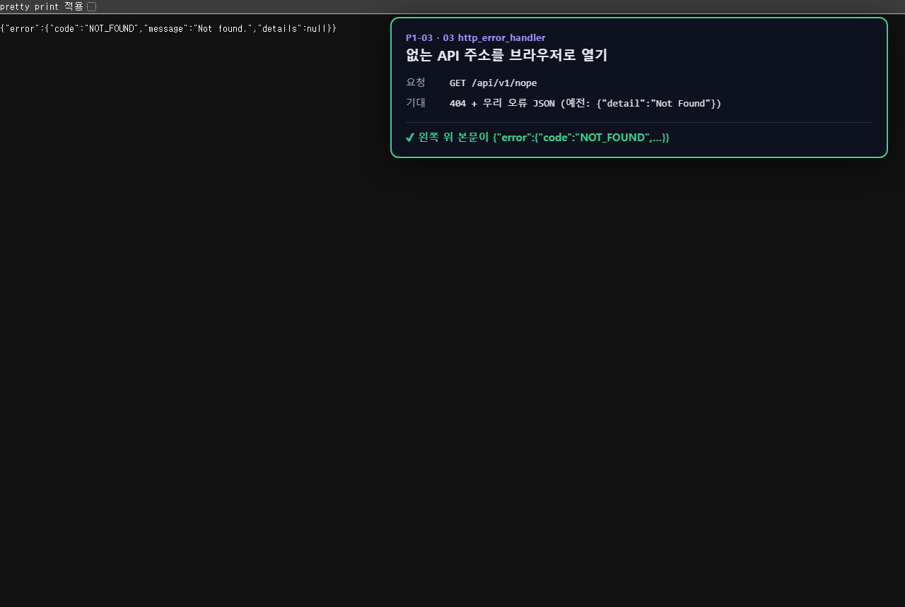

### 02 없는 페이지 주소 → HTML 404
`/nope.html` 처럼 사람이 보는 페이지 주소는 JSON 이 아니라 오류 페이지(`errors/404.html`)가 나온다. 같은 404 라도 API 와 페이지를 구분한다.

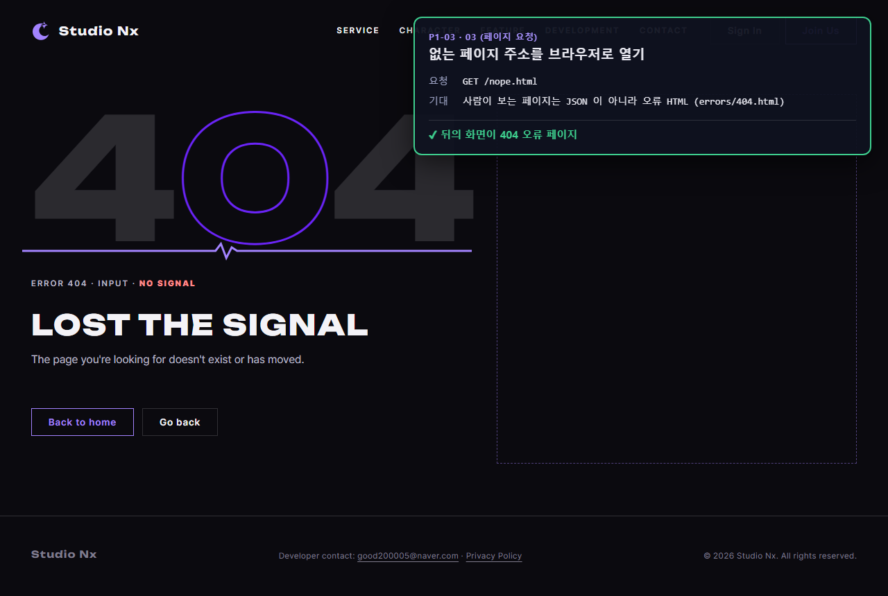

### 03 허용하지 않는 방식 → 405

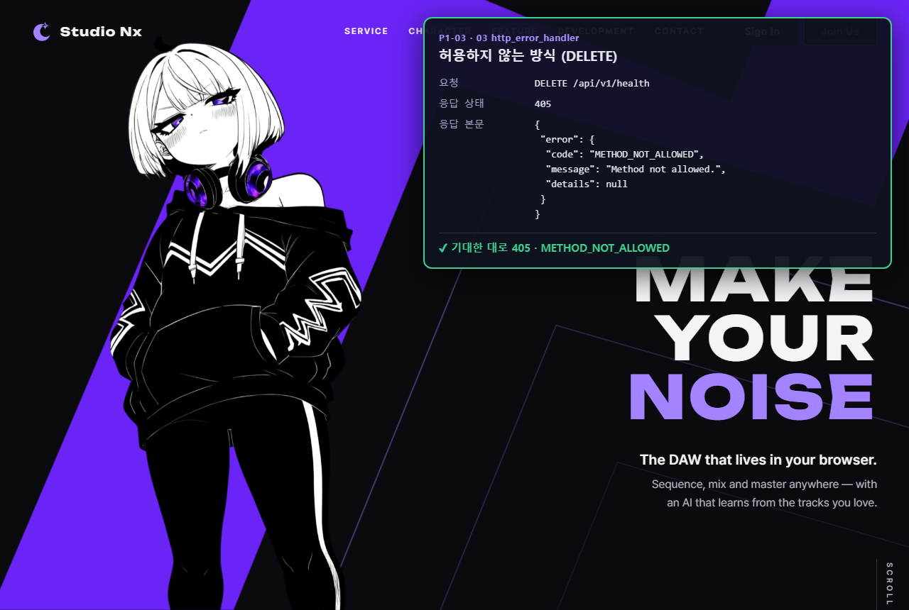

### 04 입력 형식 오류 → 422
문의 폼에 제목을 비우고 동의 칸을 빼고 보냈다. 칸별 이유가 `details` 에 담겨, 화면(P1-12)이 칸 아래에 문구를 띄울 수 있다.

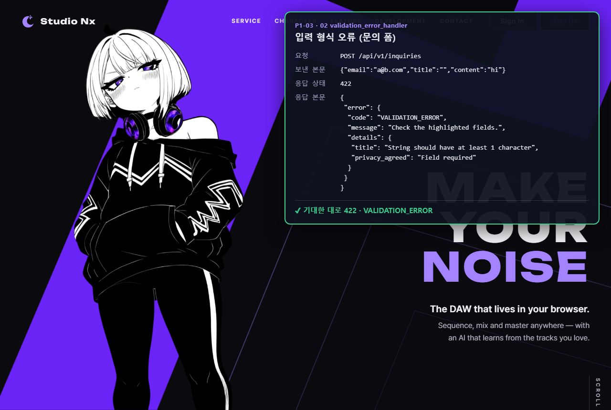

### 05 ~ 10 토큰 검사 → 모두 같은 401
헤더가 없을 때만 문구가 "Please sign in." 이다. 나머지(엉터리 · 만료 · 위조 · 종류 다름 · 탈퇴 회원)는 모두 "Please sign in again." 으로 같아서, 무엇이 틀렸는지 알려 주지 않는다.

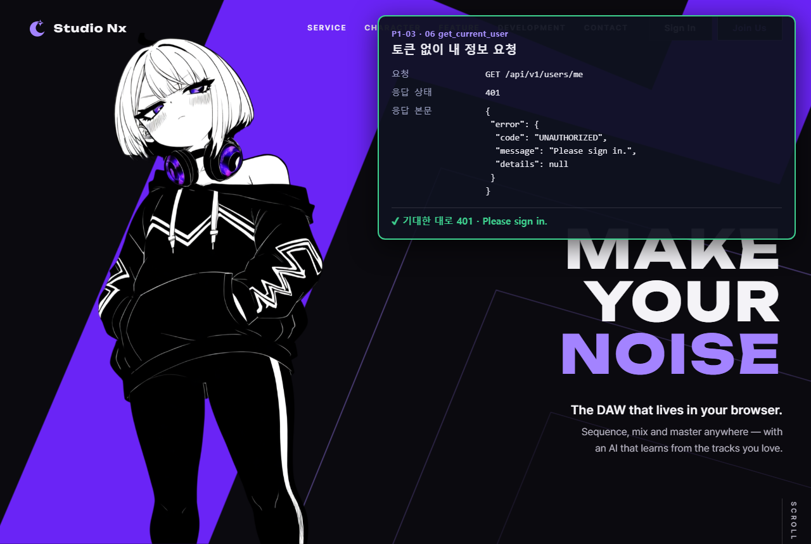

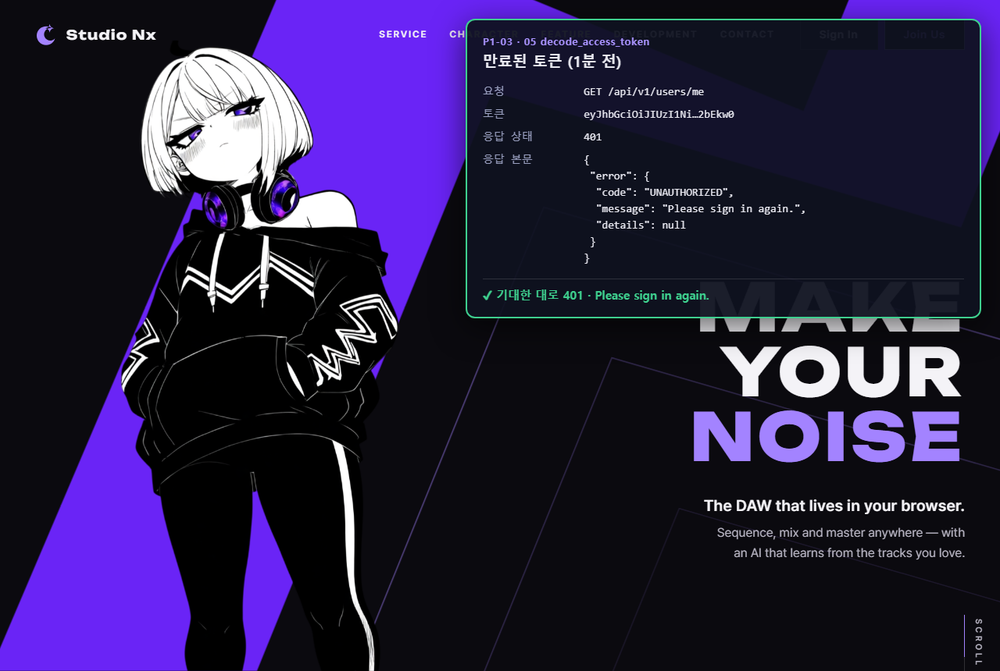

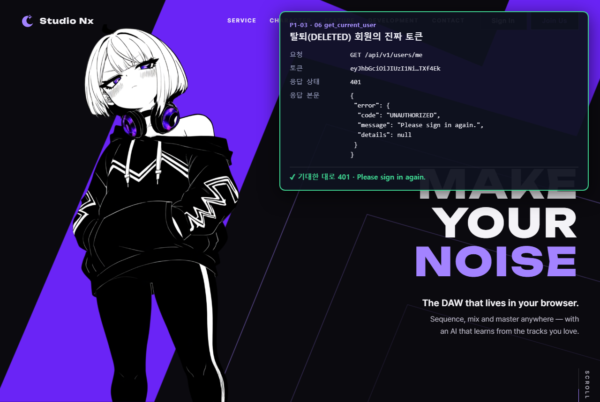

### 11 ACTIVE 회원 → 06 통과, 04 가 오류 내용을 숨김
06 검사는 통과했다(401 이 아님). 라우터 `read_me` 가 아직 템플릿이라 `NotImplementedError` 가 났고, 04 가 내용 없이 500 일반 문장으로 바꿨다. 오류 내용은 서버 터미널 로그에만 남았다(시험 중 `NotImplementedError` 기록 확인).

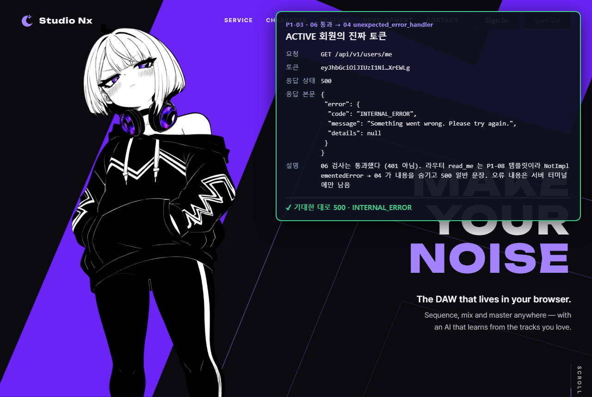

## 5. P1-02 프론트 JS

### 12 돌아갈 주소 검사
`home.html` 에서 `auth.js` 를 불러 실행했다. 우리 사이트 경로(쿼리 · 해시 포함)만 통과하고, `https://evil.com/` · `//evil.com/x` · `javascript:` · `/\evil.com` 은 모두 `null` 이다 (열린 리다이렉트 방지).

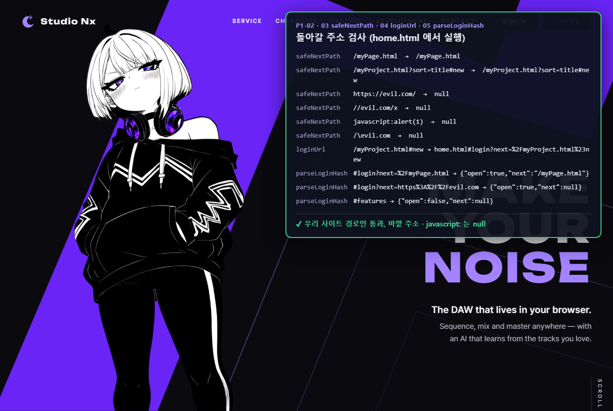

### 13 로그인 안 된 상태
네트워크 순서는 다음과 같았다.

| 순서 | 요청 | 결과 |
|---|---|---|
| ① | `isLoggedIn()` → `POST /auth/refresh` | 500 → 재발급 실패, `false` |
| ② | `api.get('/users/me')` → 토큰이 없어 먼저 `POST /auth/refresh` | 500 → 토큰 없이 진행 |
| ③ | `GET /users/me` | 401 |
| ④ | 401 이므로 `POST /auth/refresh` 를 한 번 더 시도 | 500 → 다시 보내지 않고 `ApiError` 401 `UNAUTHORIZED` |

②와 ④에서 재발급을 두 번 시도한다. 둘 다 [JS 02](javascript/02_api_apiFetch.md) 의 규칙대로다(토큰이 없으면 먼저 재발급, 401 이면 재발급 후 한 번만 다시 보냄). P1-05 에서 재발급이 동작하면 ②에서 토큰을 받으므로 ③이 성공한다.

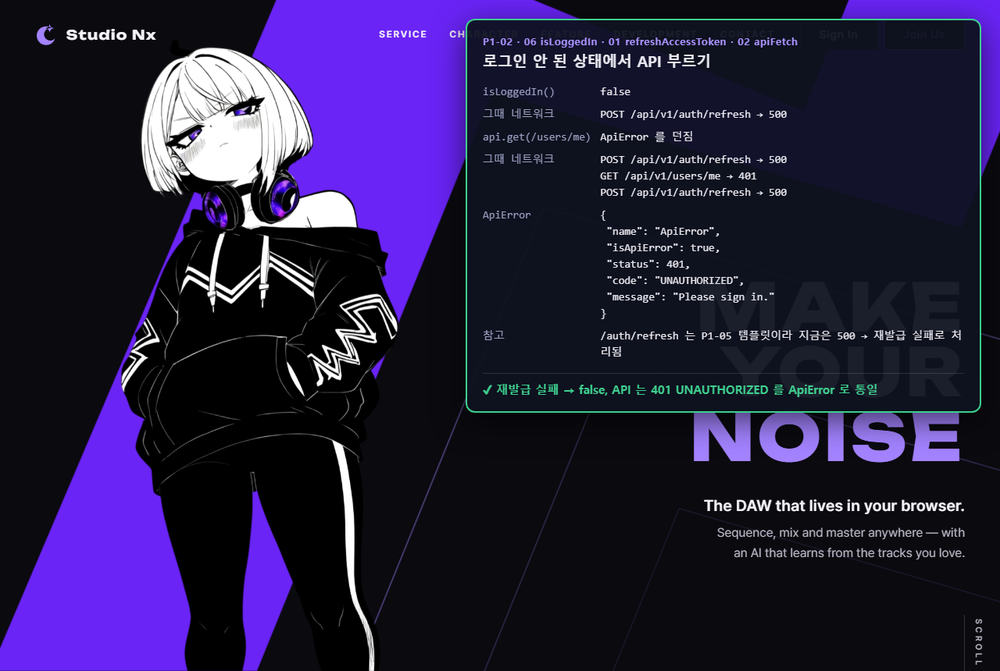

### 14 메모리에 토큰이 있을 때
`apiFetch` 가 `Authorization: Bearer …` 를 붙여 **한 번만** 보냈다. 서버 06 은 통과했고, 라우터 템플릿 때문에 500 이 났다. 401 이 아니므로 재발급을 시도하지 않았다.

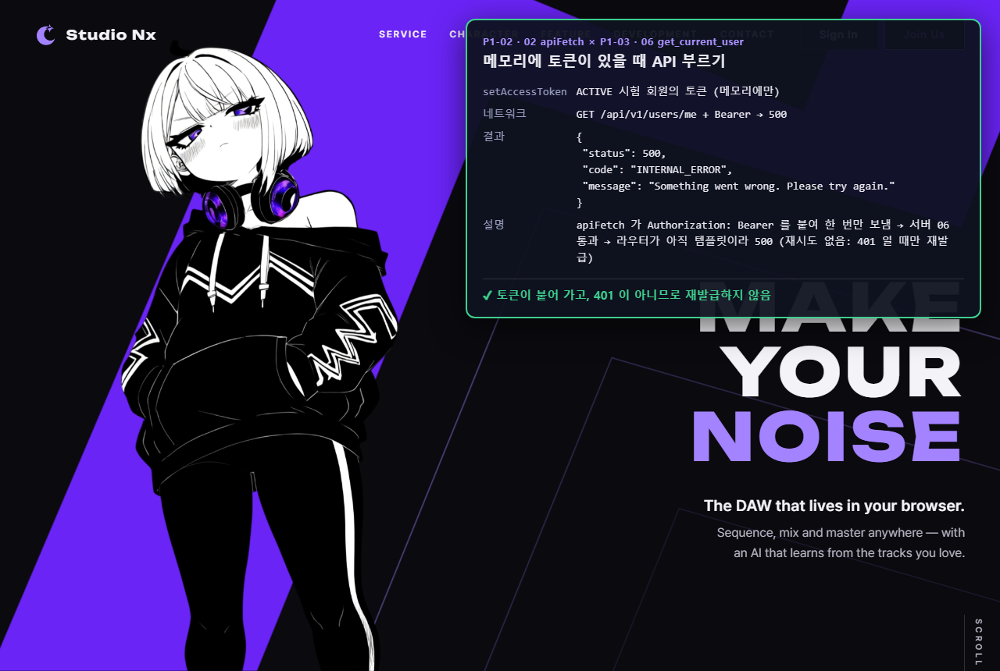

### 15 로그인 안 된 채 내 프로젝트 열기 → requireLogin
`/myProject.html?sort=title#new` 에서 `requireLogin()` 을 부르자 `home.html#login?next=%2FmyProject.html%3Fsort%3Dtitle%23new` 로 옮겨 갔다. 홈에서 `parseLoginHash()` 를 부르면 돌아갈 주소가 쿼리 · 해시까지 그대로 나온다. 이 주소를 보고 로그인 모달을 여는 것은 P1-07 이다.

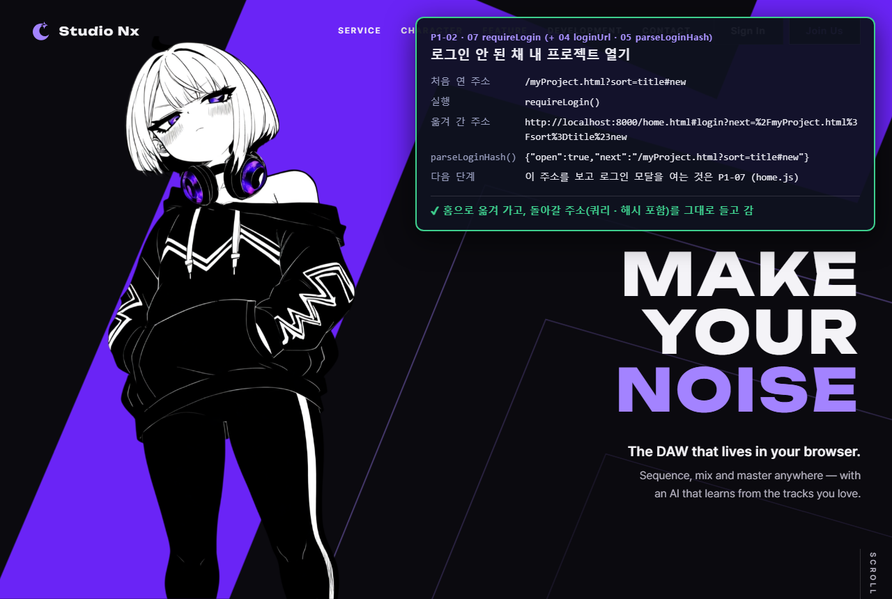

### 16 로그아웃
`myPage.html` 에서 `logout()` 을 불렀다. `/auth/logout` 은 아직 500 이지만, 만든 대로 실패를 무시하고 메모리 토큰을 지운 뒤 홈으로 옮겨 갔다.

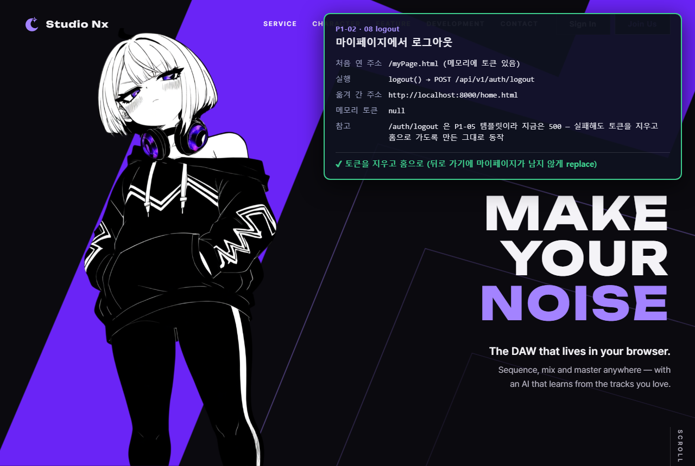

## 6. 정리
- P1-03 의 오류 응답 4종 · 토큰 검사 · 회원 상태 확인이 실제 서버와 실제 DB 에서 기대대로 동작한다.
- P1-02 의 JS 는 실제 페이지에서 서버 응답에 맞게 동작한다 (재발급 시도 · `ApiError` 통일 · 로그인 주소 이동 · 로그아웃).
- 로그인 · 재발급이 실제로 성공하는 흐름은 P1-05(로그인 API) 이후 다시 시험한다.
