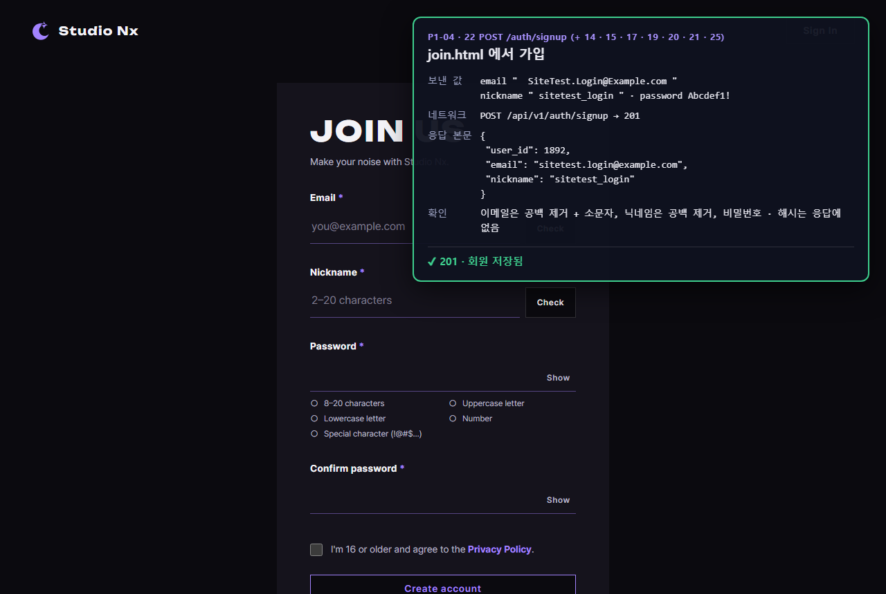
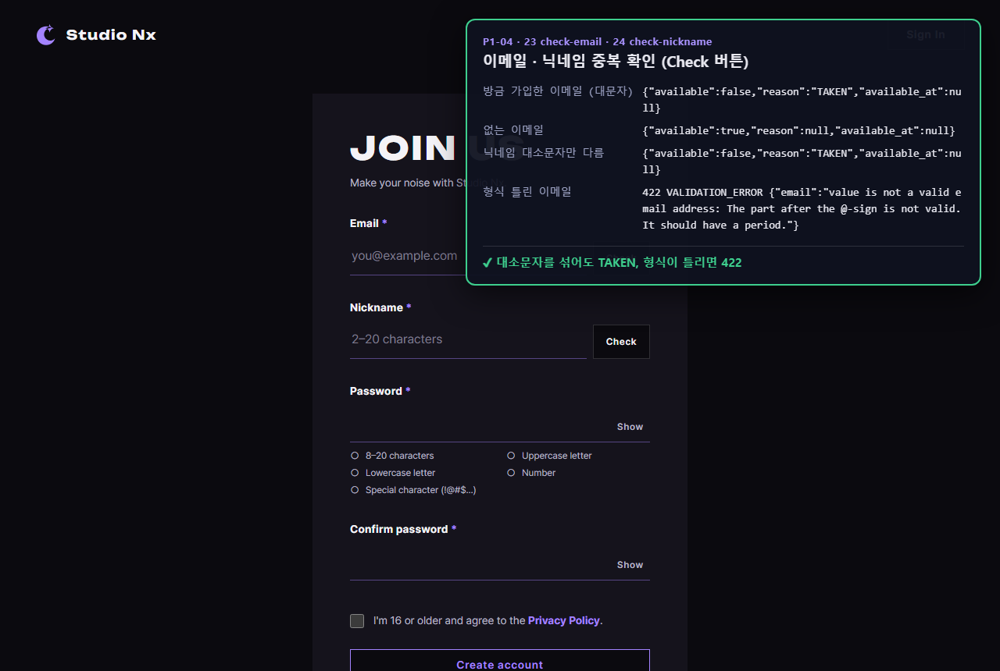
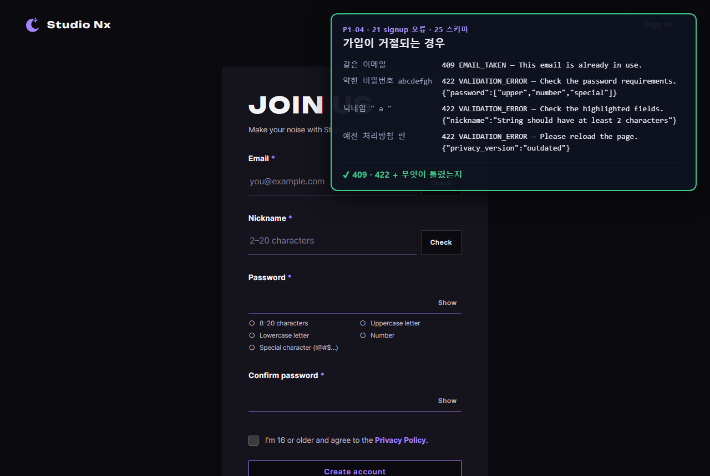
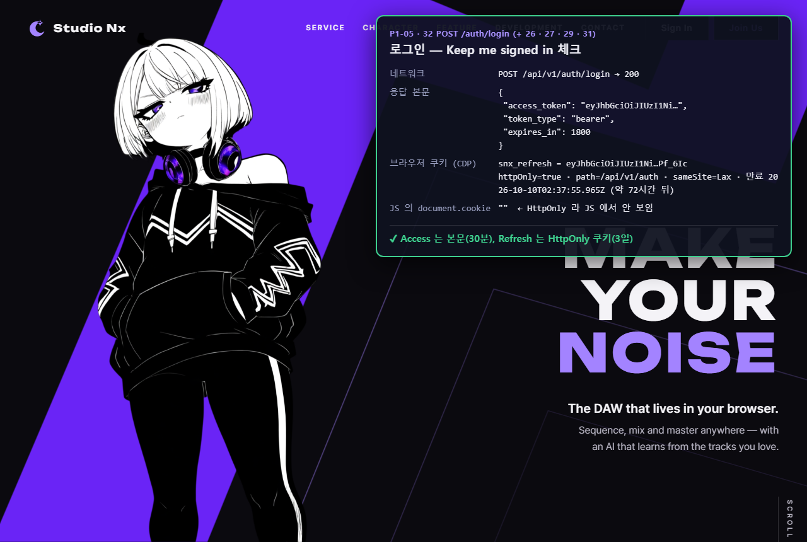
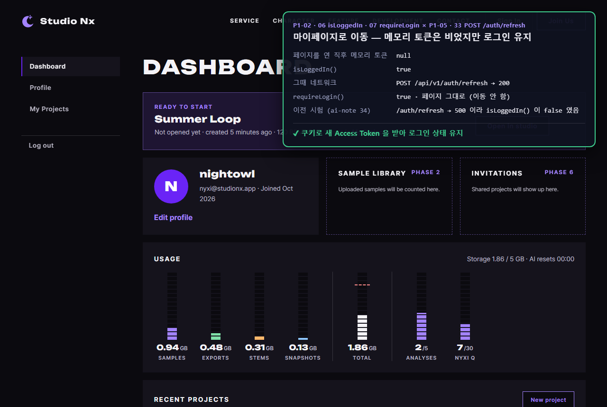
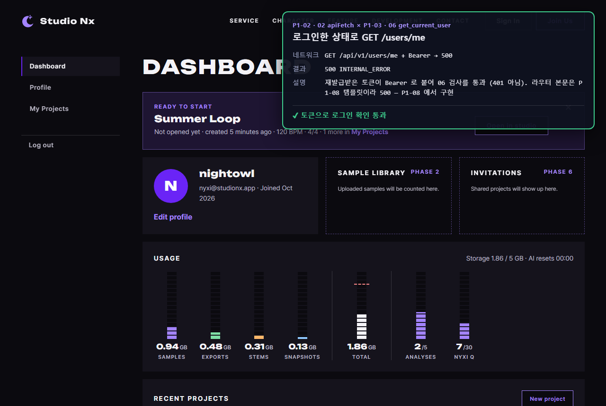
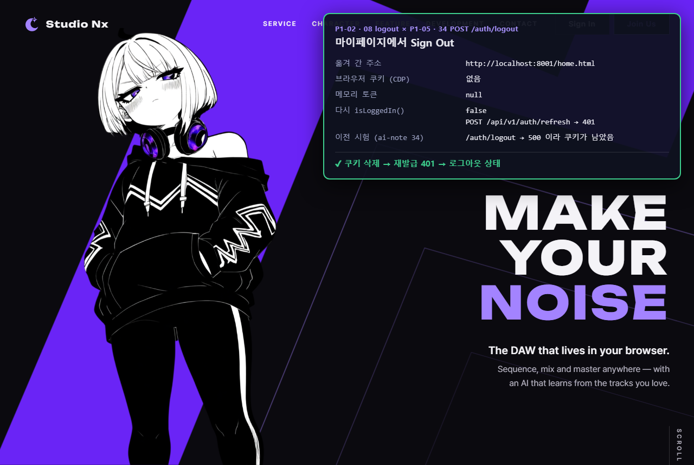
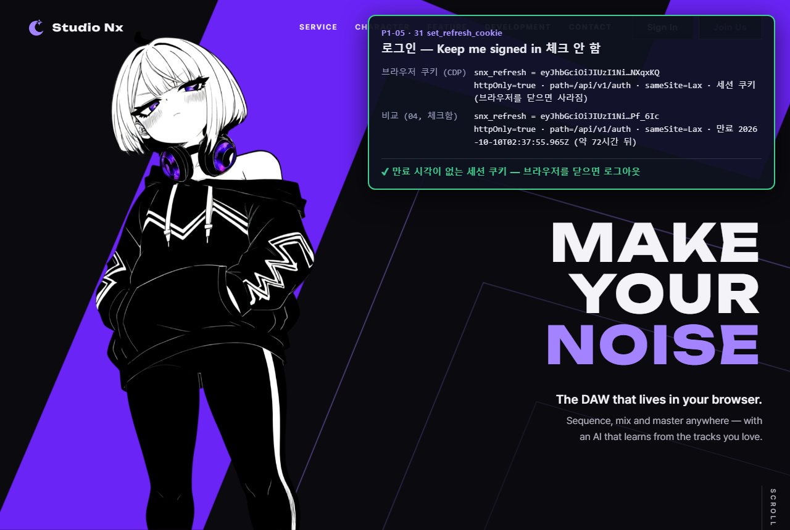
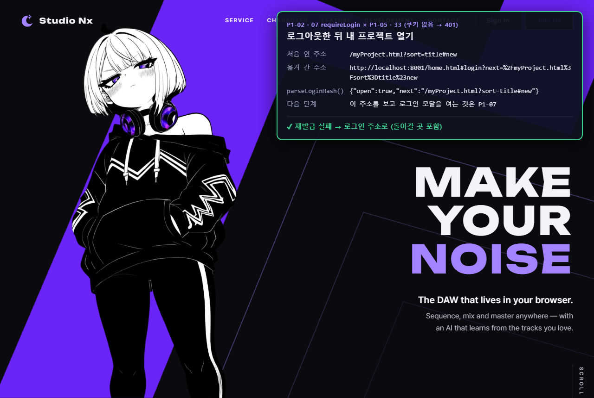

# AI 구현 설명 37 — P1-04 · P1-05 실제 사이트 시험 (가입 · 로그인 · 재발급 · 로그아웃)

| 항목 | 내용 |
|---|---|
| 작성 | Claude (AI) · 2026-10-07 |
| 대상 | P1-04 회원가입 API ([35](35_p1-04_signup_api.md)) · P1-05 로그인 API ([36](36_p1-05_login_api.md)) · P1-02 JS 와 함께 |
| 환경 | 시험용 개발 서버 `http://localhost:8001` (**Sentry 끔**) · 실제 MySQL · Chrome (헤드리스, 1280×860) |
| 결과 | **10개 모두 기대한 대로** |
| 캡처 | `docs/ai-notes/images/37_p1-04_05_site_test/` (PNG 10장) |
| 이전 시험 | [34](34_p1-02_03_site_test.md) — 그때 500 이었던 `/auth/refresh` · `/auth/logout` 을 다시 확인 |

## 1. 시험 방법
- 실제 페이지(`join.html` · `home.html` · `myPage.html` · `myProject.html`)를 열고, **그 페이지 안에서** P1-02 JS(`api.js` · `auth.js`)로 서버 API 를 불렀다. 결과를 오른쪽 위 패널에 적어 캡처했다 (34 와 같은 방식, 사이트 파일은 바꾸지 않음).
- 가입 · 로그인 **화면 동작**(폼 · 모달)은 P1-07 이라 아직 없다. 그래서 버튼 대신 JS 함수를 직접 불렀다.
- 쿠키는 Chrome 개발 도구 기능(CDP `Network.getAllCookies`)으로 읽었다. JS 로는 `HttpOnly` 쿠키를 볼 수 없기 때문이다.
- 시험 계정 `sitetest.login@example.com` 은 시험 중 **실제 가입 API 로 만들고**, 끝난 뒤 DB 에서 지웠다 (남은 행 0개 확인).
- 8000 번에 떠 있던 개발 서버(어제 켠 것, Sentry 켜짐)는 그대로 두고, Sentry 를 끈 서버를 8001 번에 따로 켜서 시험했다.
- 패널 · 캡처에 보이는 토큰은 앞뒤 일부만 적었다.

## 2. 결과 한눈에
| # | 시험 | 결과 |
|---|---|---|
| 01 | join.html 에서 가입 (`"  SiteTest.Login@Example.com "`) | 201, 이메일 소문자 · 공백 제거 ✔ |
| 02 | 중복 확인 4가지 | 대소문자 섞어도 `TAKEN`, 없는 이메일 `available`, 닉네임 대소문자도 `TAKEN`, 형식 틀림 422 ✔ |
| 03 | 가입 거절 4가지 | 같은 이메일 409 · 약한 비밀번호 422 + `["upper", …]` · 닉네임 `"  a  "` 422 · 예전 처리방침 422 ✔ |
| 04 | 로그인 (Keep me signed in 체크) | 본문에 Access(30분), **HttpOnly 쿠키**(3일, 약 72시간 뒤 만료), `document.cookie` 는 빈 글자 ✔ |
| 05 | 로그인 실패 3가지 | 비밀번호 틀림 · 없는 이메일 · 형식 틀림 모두 같은 401 문구, **191 · 192 · 189ms** (시간도 같음) ✔ |
| 06 | 마이페이지로 이동 | 메모리 토큰 `null` → `isLoggedIn()` 이 `/auth/refresh → 200` 으로 `true`, `requireLogin()` 이동 안 함 ✔ |
| 07 | 로그인한 상태로 `GET /users/me` | `Bearer` 로 한 번 → 06 통과 (라우터 본문은 P1-08 템플릿이라 500) ✔ |
| 08 | Sign Out | `/auth/logout` 204 → 쿠키 없음 → 다시 `isLoggedIn()` 은 `/auth/refresh → 401` 로 `false` ✔ |
| 09 | 로그인 (체크 안 함) | **세션 쿠키** (만료 시각 없음) ✔ |
| 10 | 로그아웃 뒤 내 프로젝트 열기 | `home.html#login?next=%2FmyProject.html%3Fsort%3Dtitle%23new` 로 이동 ✔ |

## 3. 이전 시험(34)과 달라진 것
| 시험 | 34 (2026-10-06) | 37 (지금) |
|---|---|---|
| `POST /auth/refresh` | 500 (템플릿) → `isLoggedIn()` 늘 `false` | 쿠키 있으면 200, 없으면 401 |
| `POST /auth/logout` | 500 → 쿠키가 남음 | 204 → 쿠키 삭제 |
| 로그인한 회원 | 시험용 토큰을 직접 만들어 넣음 | **실제 가입 → 실제 로그인**으로 받은 토큰 |

## 4. 가입 (P1-04)

### 01 가입

### 02 이메일 · 닉네임 중복 확인

### 03 가입이 거절되는 경우

## 5. 로그인 · 재발급 · 로그아웃 (P1-05)

### 04 로그인 — Keep me signed in 체크
Access Token 은 본문으로, Refresh Token 은 `HttpOnly` 쿠키로 왔다. 같은 페이지의 JS 가 `document.cookie` 를 읽어도 빈 글자다 — 스크립트가 리프레시 토큰을 훔칠 수 없다.

### 05 로그인 실패 — 이유도 시간도 같음
없는 이메일도 가짜 해시로 비교해서(29), 세 경우 모두 약 0.19초가 걸렸다. 응답 내용으로도, 시간으로도 가입 여부를 알 수 없다.

### 06 다른 페이지로 이동 — 로그인 유지
페이지를 옮기면 메모리의 Access Token 은 사라진다(`null`). `isLoggedIn()` 이 리프레시 쿠키로 새 토큰을 받아 로그인 상태가 이어진다. 뒤 화면의 대시보드 숫자는 HTML 목업의 예시 값이다 (실제 데이터 연결은 P1-16 · 17).

### 07 로그인한 상태로 API 부르기

### 08 Sign Out

### 09 로그인 — 체크 안 함 (세션 쿠키)

### 10 로그아웃한 뒤 로그인 전용 페이지

## 6. 정리
- 서버 쪽 **가입 → 로그인 → 페이지 이동(재발급) → 로그아웃** 이 실제 사이트에서 끝까지 동작한다.
- P1-02 JS 의 `refreshAccessToken` · `isLoggedIn` · `requireLogin` · `logout` 이 실제 서버 응답으로 기대대로 움직인다.
- 남은 것: 버튼 · 폼 · 모달을 이 API 에 연결하는 **P1-07 가입 · 로그인 JS**. 그 뒤에는 사람이 직접 화면에서 가입 · 로그인할 수 있다.
