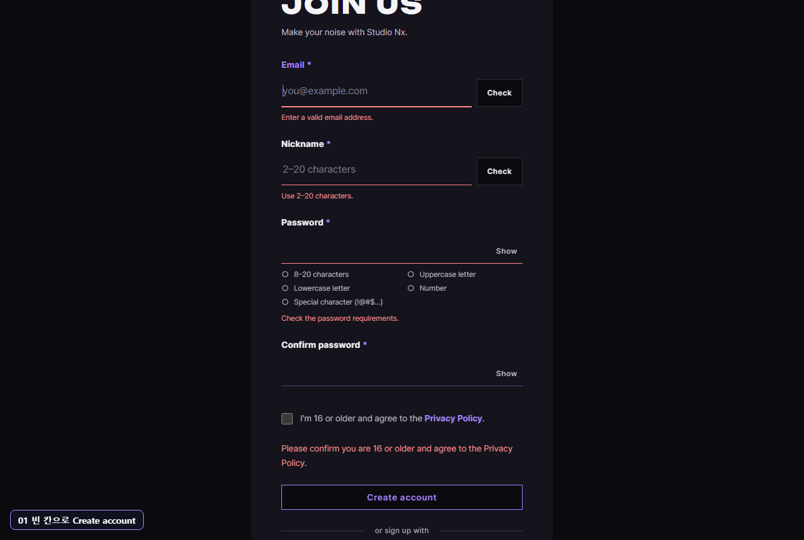
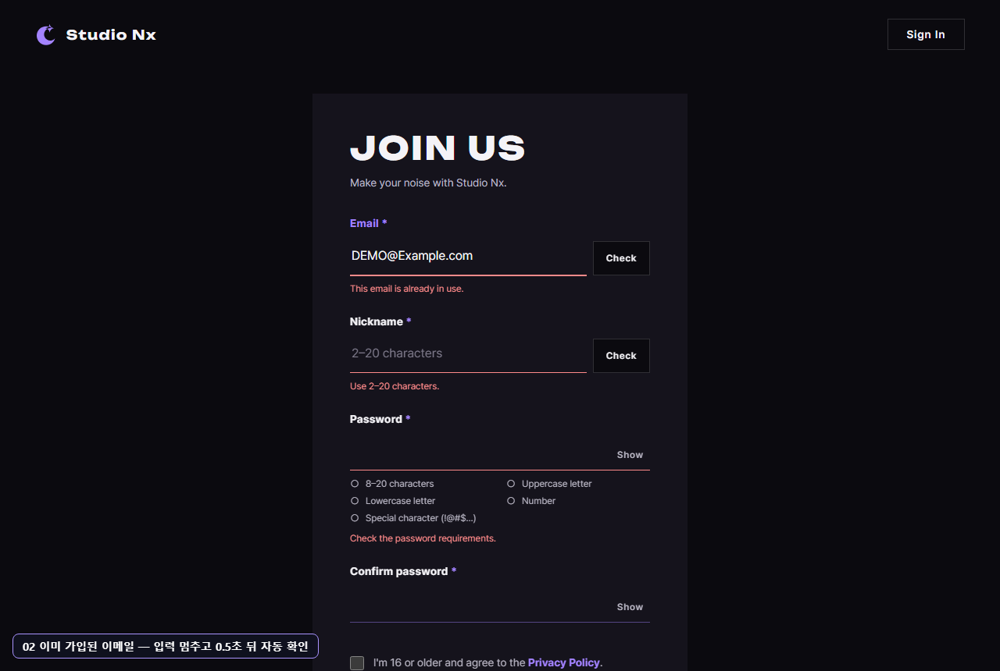
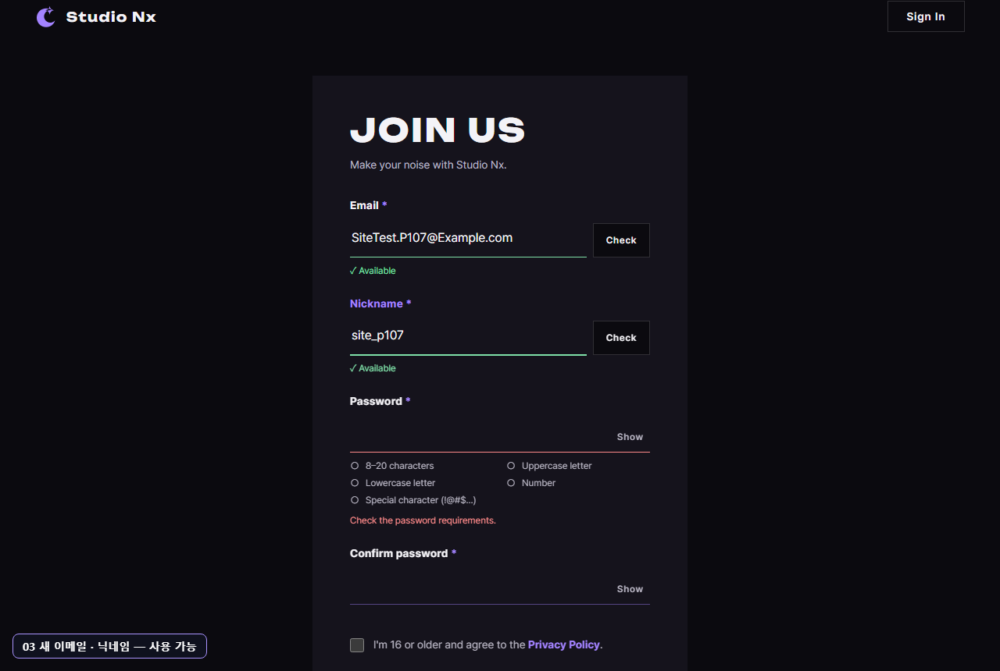
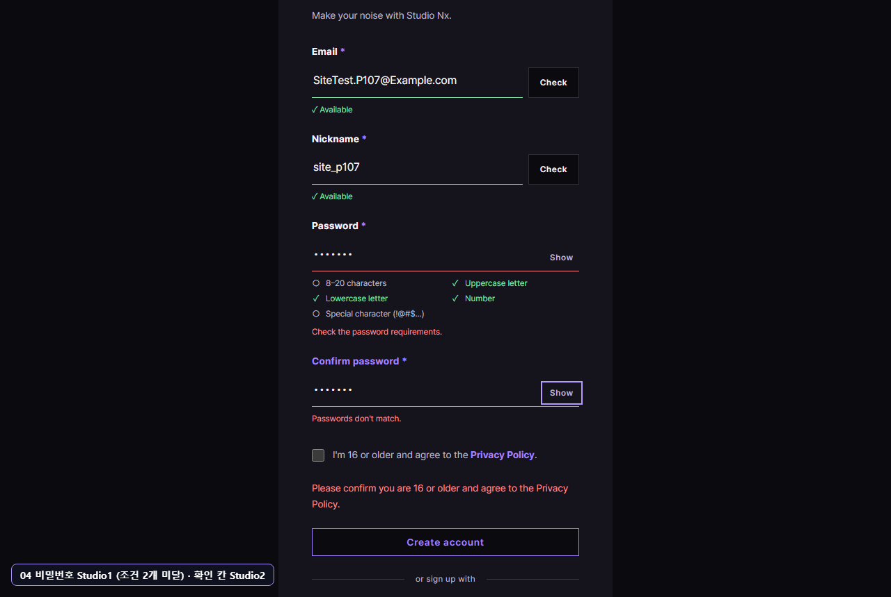
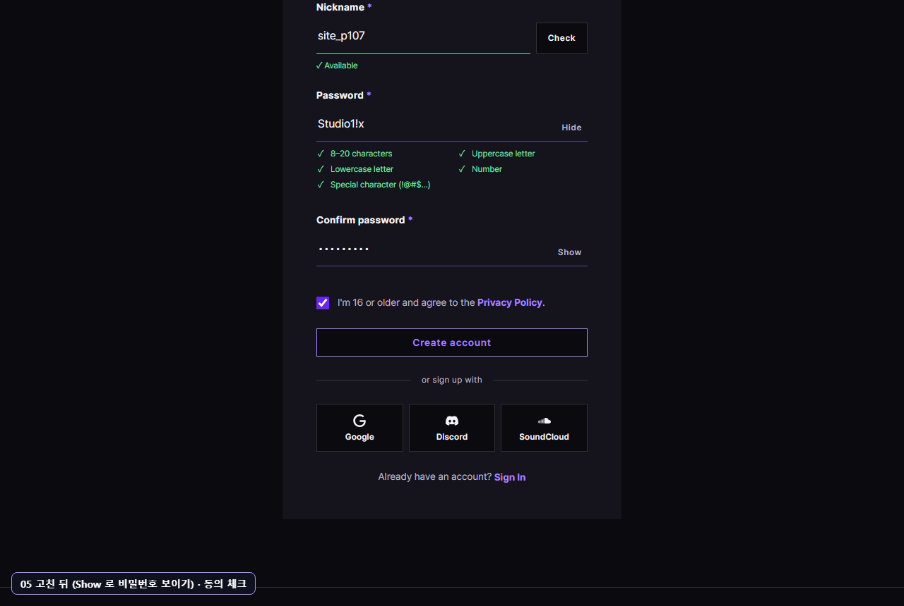
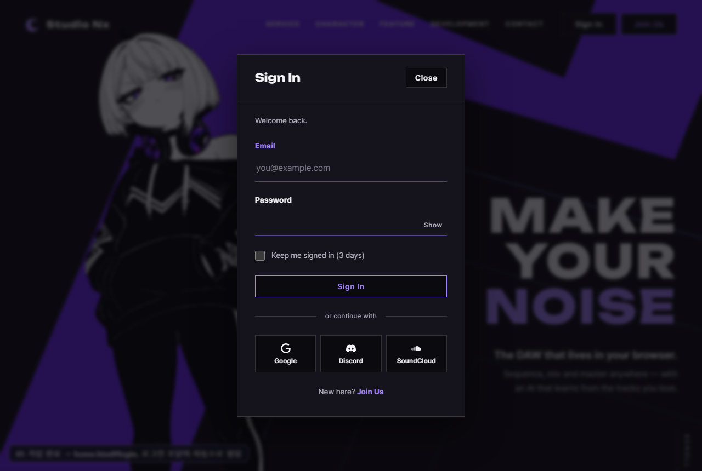
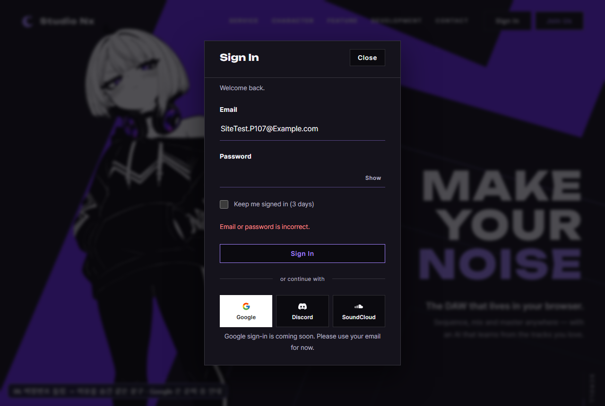
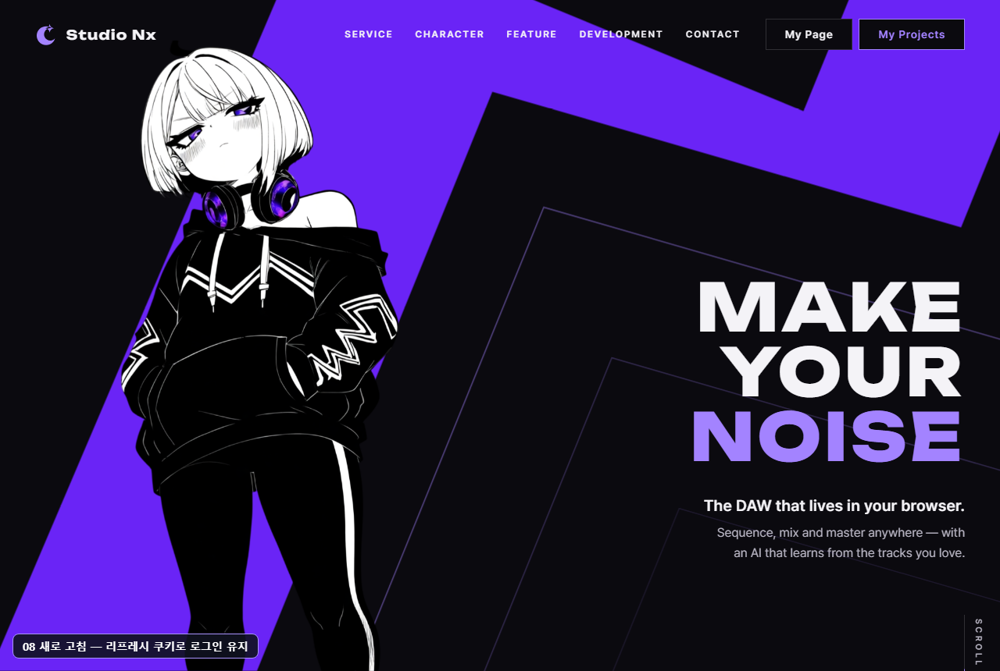
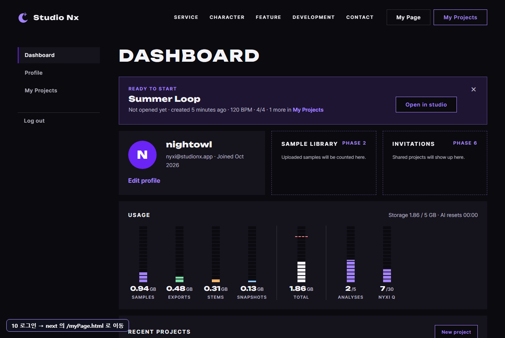

# AI 구현 설명 39 — P1-07 실제 사이트 시험 (사람처럼 클릭 · 타이핑: 가입 → 로그인 → 로그아웃)

| 항목 | 내용 |
|---|---|
| 작성 | Claude (AI), 2026-10-07 |
| 대상 | P1-07 가입, 로그인 JS ([38](38_p1-07_auth_js.md)): P1-02 JS, P1-04, P1-05 서버와 함께 |
| 환경 | 시험용 개발 서버 `http://localhost:8001` (**Sentry 끔**), 실제 MySQL, Chrome (헤드리스, 1280×860) |
| 결과 | **11개 모두 기대한 대로**: 중간에 빈틈 1개를 찾아 고친 뒤 다시 돌림 |
| 캡처 | `docs/ai-notes/images/39_p1-07_site_test/` (PNG 12장, 왼쪽 아래에 단계 이름표) |
| 이전 시험 | [37](37_p1-04_05_site_test.md): 그때는 화면 동작이 없어 JS 함수를 직접 불렀습니다 |

## 1. 시험 방법
- 37 과 달리 **함수를 직접 부르지 않았습니다.** Chrome 개발 도구 기능(CDP)으로 마우스를 칸, 버튼 가운데에 눌렀다 떼고(`Input.dispatchMouseEvent`), 키보드로 **한 글자씩** 쳤다(`Input.insertText`, Tab, Ctrl+A, Backspace 도 키 입력). 사람이 하는 것과 같은 이벤트가 납니다.
- 확인은 화면에 보이는 것(문구, ✓ · 헤더 버튼, 주소)과, JS 로는 볼 수 없는 `HttpOnly` 쿠키(CDP `Network.getAllCookies`)로 했습니다.
- 시험 계정 `SiteTest.P107@Example.com` 은 시험 중 **화면에서 가입해 만들고**, 끝난 뒤 DB 에서 지웠습니다. 데모 계정과 사용자가 직접 만든 계정은 건드리지 않았습니다.
- 사이트 파일은 바꾸지 않았습니다 (캡처용 이름표만 열린 페이지에 잠깐 넣음).

## 2. 결과 한눈에
| # | 사람이 한 일 | 화면 | 결과 |
|---|---|---|---|
| 01 | join.html 에서 아무것도 안 치고 Create account | 칸마다 빨간 문구, 동의 안내, 커서는 Email 칸 | ✔ |
| 02 | Email 에 `DEMO@Example.com` 을 치고 멈춤 | 0.5초 뒤 "This email is already in use." (대소문자가 달라도) | ✔ |
| 03 | 새 이메일, 닉네임을 침 | 둘 다 "✓ Available" | ✔ |
| 04 | 비밀번호 `Studio1` → Tab, 확인 칸 `Studio2` → Tab | 대문자, 소문자, 숫자만 ✓, "Check the password requirements.", "Passwords don't match." | ✔ |
| 05 | 비밀번호 끝에 `!x`, 확인 칸 다시 침, Show, 동의 체크 → Create account | 조건 5개 ✓, 빨간 글 없음 → `home.html#login`, **로그인 모달 자동 열림** | ✔ |
| 06 | 모달에서 틀린 비밀번호로 Sign In, Google 버튼 | "Email or password is incorrect.", 비밀번호 칸 비움, "Google sign-in is coming soon…" | ✔ |
| 07 | 맞는 비밀번호 + Keep me signed in → Sign In | 모달 닫힘, 헤더가 **My Page, My Projects**, 쿠키 HttpOnly, 약 72시간 | ✔ |
| 08 | 새로 고침 | 메모리 토큰은 사라졌지만 쿠키로 로그인 유지 | ✔ |
| 09 | 로그아웃 | 쿠키 삭제, 홈으로, 헤더가 Sign In, Join Us | ✔ |
| 10 | `home.html#login?next=/myPage.html` 에서 로그인 | 모달 자동 열림 → 로그인 → `/myPage.html` 로 이동 | ✔ |

(05 를 두 장면 05a, 05b, 10 을 10a, 10b 로 나눠 확인해 모두 11개.)

**09 로그아웃은 버튼이 아니라 `logout()` 을 불렀습니다.** 마이페이지의 Log out 버튼(`initLogoutButton`)은 P1-17 마이페이지 JS 의 템플릿이라 아직 비어 있습니다. 동작은 P1-02 JS 08 그대로다.

## 3. 시험에서 찾은 빈틈
첫 실행 11/11 통과였지만, **캡처를 눈으로 보니** 05 화면에서 동의를 체크했는데도 빨간 "Please confirm you are 16 or older…" 가 그대로 남아 있었습니다. 다음 전송 때에야 사라졌습니다.

| | 고치기 전 | 고친 뒤 |
|---|---|---|
| 동의 체크 | 빨간 안내가 남음 | **바로 사라짐** (서버 오류 같은 다른 안내는 그대로) |

17 `initJoinForm` 에 `change` 처리 몇 줄을 더했습니다 ([17 §5](<javascript/P1-07 - 가입·로그인 JS/17_join_initJoinForm.md>)). 17 의 함수 시험에 1개를 더해 10/10, 사이트 시험도 다시 돌려 11/11 통과. 아래 05 캡처는 고친 뒤 것입니다.

## 4. 가입 (join.html)

### 01 빈 칸으로 Create account

### 02 이미 가입된 이메일

### 03 새 이메일, 닉네임

### 04 비밀번호 조건, 확인 칸
화면의 비밀번호는 점으로 가려져 있습니다. 친 값은 `Studio1` (7자, 기호 없음)입니다.

### 05 고친 뒤 가입

Create account 를 누르자 홈으로 이동하고 로그인 모달이 자동으로 열렸습니다.

## 5. 로그인, 유지, 로그아웃 (home.html)

### 06 비밀번호 틀림, Google 버튼

### 07 로그인 성공

### 08 새로 고침

### 09 로그아웃

### 10 `next` 로 돌아가기

로그인하자 `next` 의 마이페이지로 이동했습니다. 대시보드 내용은 HTML 목업의 예시 값입니다 (실제 데이터는 P1-16, 17).

## 6. 정리
- **화면에서 가입 → 로그인 → 페이지 이동 → 로그아웃 → 다시 로그인해 원래 페이지로**가 끝까지 동작합니다. 1단계 계정 흐름의 앞부분(P1-02, 03, 04, 05, 07)이 모두 이어졌습니다.
- 모달 캡처에서 이름표가 어둡게 보이는 것은 모달 뒤 배경이 화면 전체를 덮기 때문입니다 (사이트 문제 아님).
- 남은 것: 마이페이지, 내 프로젝트의 `requireLogin()` 연결과 Log out 버튼 (P1-14, P1-17 JS).
