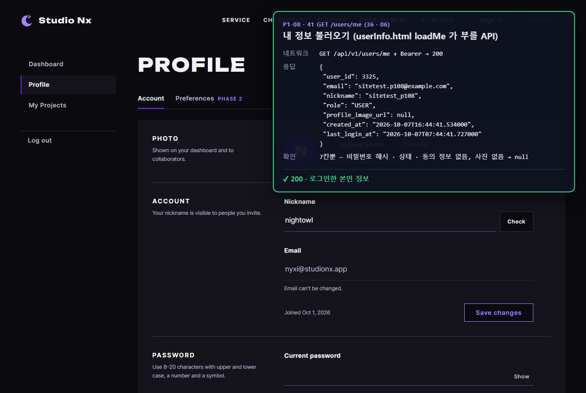
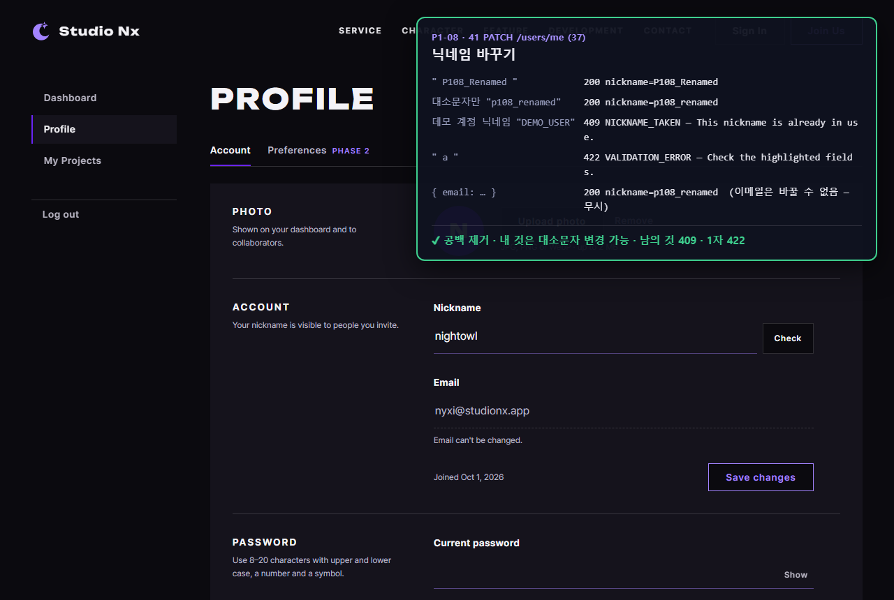
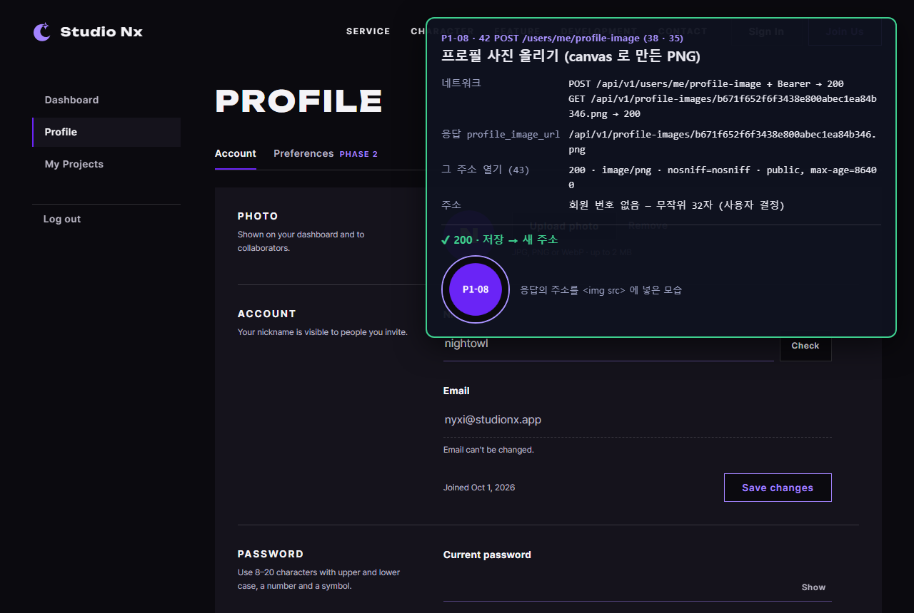
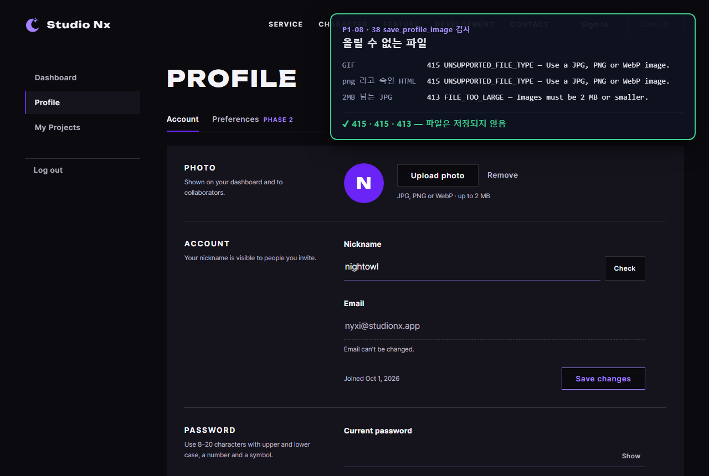
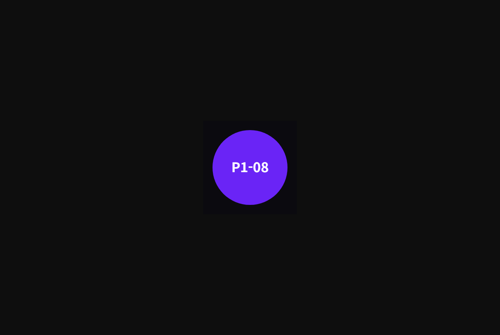
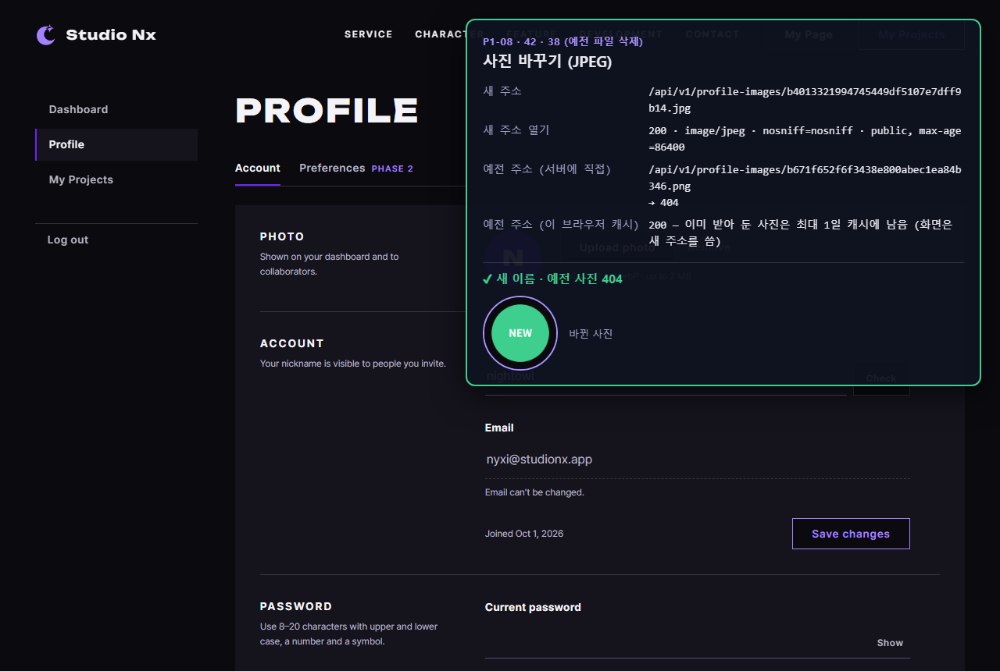
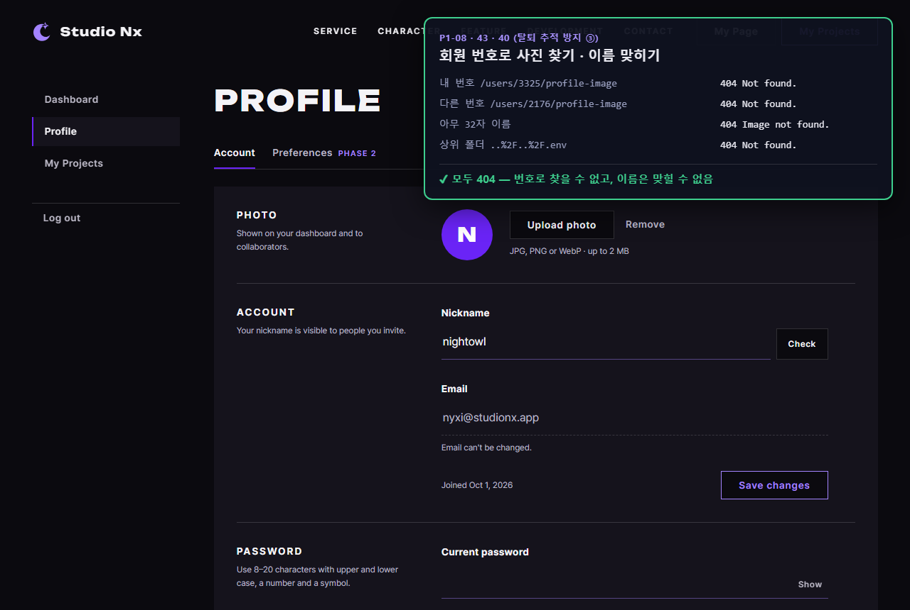
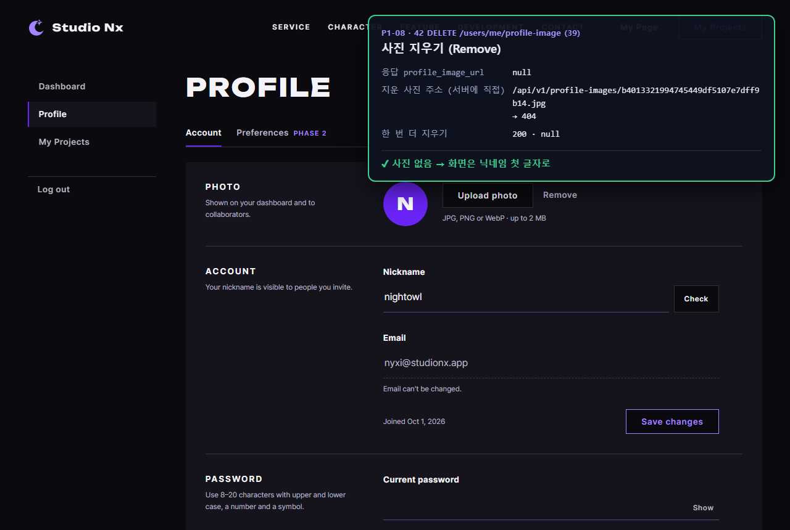

# AI 구현 설명 42 — P1-08 실제 사이트 시험 (내 정보 · 닉네임 · 프로필 사진)

| 항목 | 내용 |
|---|---|
| 작성 | Claude (AI), 2026-10-07 |
| 대상 | P1-08 회원 정보 API ([41](41_p1-08_user_profile_api.md)): P1-02 `api.js` 와 함께 |
| 환경 | 시험용 개발 서버 `http://localhost:8001` (**Sentry 끔**, P1-08 코드로 다시 켬), 실제 MySQL, Chrome (헤드리스, 1280×860) |
| 결과 | **8개 모두 기대한 대로**: 중간에 시험 쪽 문제 1개(브라우저 캐시)를 고쳐 다시 돌림 |
| 캡처 | `docs/ai-notes/images/42_p1-08_site_test/` (PNG 8장) |
| 이전 시험 | [39](39_p1-07_site_test.md) |

## 1. 시험 방법
- 실제 **userInfo.html** 을 열고, 그 페이지 안에서 P1-02 `api.js` 로 API 를 불렀습니다. 회원 정보 화면의 버튼 동작(`userinfo.js`)은 P1-10 이라 아직 없다: 37 과 같은 방식. 결과는 오른쪽 위 패널에 적어 캡처했습니다 (사이트 파일은 바꾸지 않음).
- 사진은 페이지 안에서 **canvas 로 그린 PNG, JPEG** 를 `FormData` 에 넣어 올렸다: 화면이 보낼 방식 그대로.
- 시험 계정 `sitetest.p108@example.com` 은 시험 중 가입 API 로 만들고 끝난 뒤 지웠습니다. 올린 사진은 시험 안에서 모두 지워져 `storage/profiles/` 가 비어 있음을 확인했습니다.

## 2. 결과 한눈에
| # | 시험 | 결과 |
|---|---|---|
| 01 | `GET /users/me` | 200, 7칸뿐, 사진 `null` ✔ |
| 02 | 닉네임 바꾸기 5가지 | `"  P108_Renamed  "` → 200 `P108_Renamed`, 대소문자만 200, 데모 계정 닉네임 409, `"  a  "` 422, 이메일 보냄 → 무시 ✔ |
| 03 | PNG 올리기 | 200, 주소 `/api/v1/profile-images/{32자}.png`, 그 주소 200, `image/png`, `nosniff`, 캐시 1일, `` 로 보임 ✔ |
| 04 | 올릴 수 없는 파일 | GIF 415, png 라고 속인 HTML 415, 2MB 넘는 JPG 413 ✔ |
| 05 | 사진 주소를 브라우저 탭에서 바로 열기 | 240×240 PNG 그대로 보임 (로그인 없이) ✔ |
| 06 | 사진 바꾸기 (JPEG) | 새 이름, `image/jpeg`, 예전 주소는 **서버에 직접 물으면 404** ✔ |
| 07 | 회원 번호로 찾기, 이름 맞히기 | `/users/{내 번호}/profile-image`, 다른 번호, 아무 32자, `..%2F..%2F.env` 모두 404 ✔ |
| 08 | 사진 지우기 | 200 주소 `null`, 지운 주소 404, 한 번 더 지워도 200 ✔ |

## 3. 시험 중 찾은 것: 브라우저 캐시
처음 돌렸을 때 06, 08 이 실패했다: 예전 사진 주소가 **200** 이었습니다. 서버의 `storage/profiles/` 에는 파일이 없었다: **브라우저가 03, 05 에서 받아 둔 사진을 캐시에서 꺼낸 것**입니다 (43 의 `Cache-Control: max-age=86400`).

| 예전 사진 주소 | 결과 |
|---|---|
| 서버에 직접 (`fetch(…, { cache: 'no-store' })`) | **404**: 서버는 바르게 지웠음 |
| 이 브라우저의 캐시 | 200: 이미 받아 둔 사진은 최대 1일 남음 |

서버 문제가 아니므로 시험을 "서버에 직접" 확인하도록 고치고, 캐시 결과도 패널에 함께 적었습니다. 화면은 늘 응답의 **새 주소**를 쓰므로 바꾼 사진이 옛 사진으로 보일 일은 없습니다. 이 1일은 43 에서 캐시 기간을 정할 때 따진 값입니다 (지운 사진이 다른 사람 브라우저에 오래 남지 않게 1년이 아니라 1일).

## 4. 캡처

### 01 내 정보

### 02 닉네임 바꾸기

### 03 사진 올리기

### 04 올릴 수 없는 파일

### 05 사진 주소를 바로 열기 (로그인 없이)

### 06 사진 바꾸기

### 07 회원 번호로 찾을 수 없음

### 08 사진 지우기

뒤 화면의 닉네임, 이메일, 사진(`nightowl`, 보라 `N`)은 HTML 목업의 예시 값이다: 실제 값으로 채우는 것은 P1-10.

## 5. 정리
- 서버 쪽 **내 정보 → 닉네임 → 사진 올리기, 보기, 바꾸기, 지우기** 가 실제 사이트에서 끝까지 동작합니다.
- 사진 주소로 회원 번호를 알 수 없고, 번호로 사진을 찾을 수도 없습니다 (사용자 결정 반영).
- 남은 것: 이 API 를 userInfo.html 버튼, 칸에 연결하는 **P1-10**, 비밀번호 변경, 탈퇴 **P1-09**.
