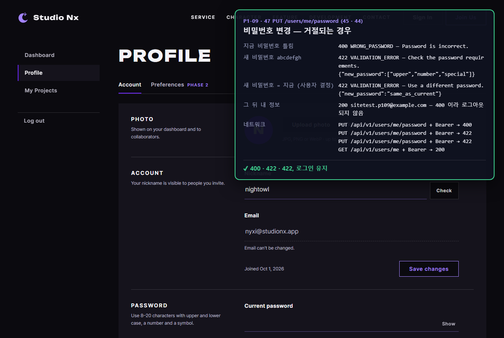
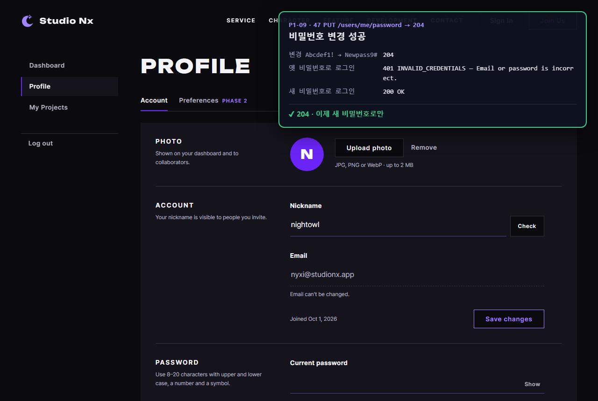
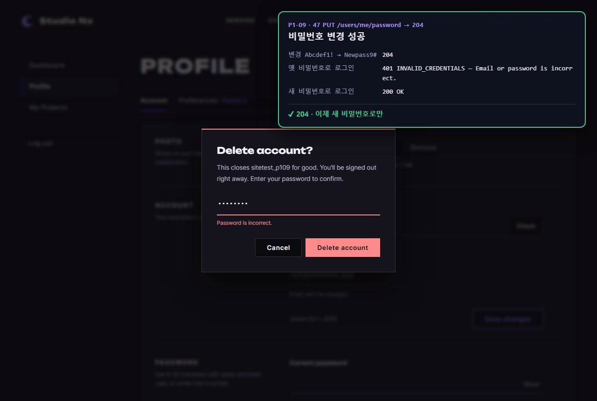
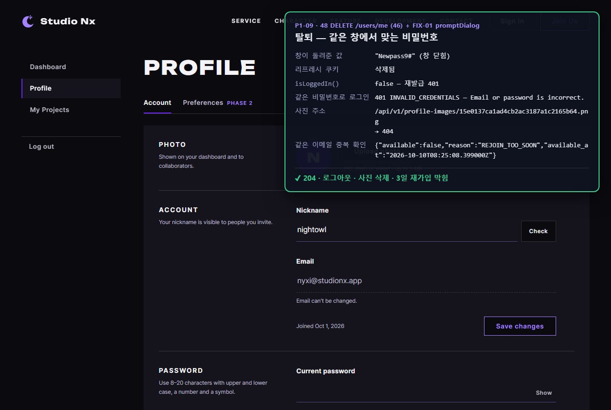
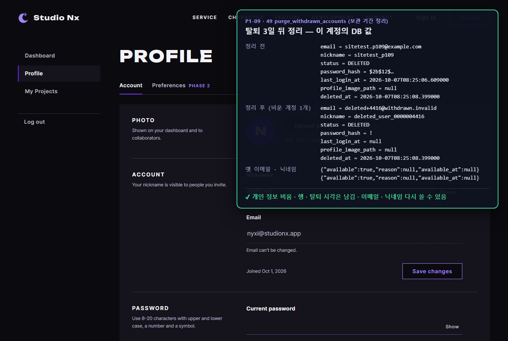

# AI 구현 설명 44 — P1-09 실제 사이트 시험 (비밀번호 변경 · 탈퇴 · 3일 뒤 정리)

| 항목 | 내용 |
|---|---|
| 작성 | Claude (AI) · 2026-10-07 |
| 대상 | P1-09 ([43](43_p1-09_password_withdraw.md)) — P1-02 `api.js` · `auth.js`, FIX-01 `promptDialog` 와 함께 |
| 환경 | 시험용 개발 서버 `http://localhost:8001` (**Sentry 끔**, P1-09 코드로 다시 켬) · 실제 MySQL · Chrome (헤드리스, 1280×860) |
| 결과 | **5개 모두 기대한 대로** |
| 캡처 | `docs/ai-notes/images/44_p1-09_site_test/` (PNG 5장) |
| 이전 시험 | [42](42_p1-08_site_test.md) |

## 1. 시험 방법
- 실제 **userInfo.html** 을 열고 그 안에서 `api.js` 로 API 를 불렀다 (`userinfo.js` 버튼 동작은 P1-10). 결과는 오른쪽 위 패널.
- **탈퇴는 화면이 쓸 방식 그대로** 해 봤다: FIX-01 `promptDialog` 를 띄우고, `check` 안에서 실제 `DELETE /users/me` 를 부르게 했다 (43 §7 · 48 §2 의 연결 방법).
- **3일 뒤 정리(49)** 는 실제로 3일을 기다릴 수 없어서, 이 시험 계정 하나만 대상으로 "탈퇴 시각 + 3일 1분" 을 기준 시각으로 넣어 돌렸다. 진짜 DB 에서 돌리므로, 시험 계정 말고 탈퇴 계정이 하나라도 있으면 멈추게 했다.
- 시험 계정 `sitetest.p109@example.com` 은 시험 중 가입해 만들고, 끝난 뒤 (정리된 `deleted+{번호}` 행까지) 지웠다. 비밀번호 해시는 패널에 앞부분만 적었다.

## 2. 결과 한눈에
| # | 시험 | 결과 |
|---|---|---|
| 01 | 비밀번호 변경 거절 3가지 | 지금 비밀번호 틀림 **400** `WRONG_PASSWORD` · `abcdefgh` 422 + `["upper", "number", "special"]` · 지금과 같음 422 `same_as_current` → 그 뒤 내 정보 200 (**로그아웃되지 않음**) ✔ |
| 02 | 비밀번호 변경 | 204 → 옛 비밀번호 로그인 401, 새 비밀번호 로그인 200 ✔ |
| 03 | 탈퇴 창에 틀린 비밀번호 | 창 안 "Password is incorrect.", **창이 닫히지 않음**, 쿠키 그대로 ✔ |
| 04 | 같은 창에 맞는 비밀번호 | 창이 닫히며 값을 돌려줌 · 리프레시 쿠키 삭제 · `isLoggedIn()` false · 로그인 401 · 사진 404 · 같은 이메일 `REJOIN_TOO_SOON` ✔ |
| 05 | 3일 뒤 정리 | 비운 계정 1 · 이메일 `deleted+{번호}@withdrawn.invalid` · 닉네임 `deleted_user_{10자리}` · 해시 `!` · 로그인 기록 null · 상태 · 탈퇴 시각 그대로 → 옛 이메일 · 닉네임 다시 사용 가능 ✔ |

## 3. 캡처

### 01 비밀번호 변경 — 거절되는 경우

### 02 비밀번호 변경 성공

### 03 탈퇴 창 — 틀린 비밀번호
실제 서버가 400 을 돌려주자 `check` 가 문구를 돌려줘 창 안에 표시됐다 (FIX-01 21). 오른쪽 위 패널은 바로 앞 02 의 결과가 남은 것이다.

### 04 탈퇴 완료

### 05 3일 뒤 정리 — 이 계정의 DB 값

뒤 화면의 닉네임 · 이메일 · 사진 자리(`nightowl`, `N`)는 HTML 목업의 예시 값이다 — 실제 값으로 채우는 것은 P1-10.

## 4. 정리
- **비밀번호 변경 → 탈퇴 → 3일 뒤 정리**가 실제 서버에서 끝까지 동작한다. 1단계 계정 기능의 서버 쪽(P1-03 · 04 · 05 · 08 · 09)이 모두 이어졌다.
- 탈퇴 창은 FIX-01 `promptDialog` + `check` 로 서버와 맞물려 동작한다 — P1-10 은 이 연결을 버튼에 붙이면 된다.
- 남은 것: 회원 정보 화면 JS(P1-10), 정리 작업을 하루 한 번 실행하는 `main()`(P1-12) · 예약 작업(배포).
