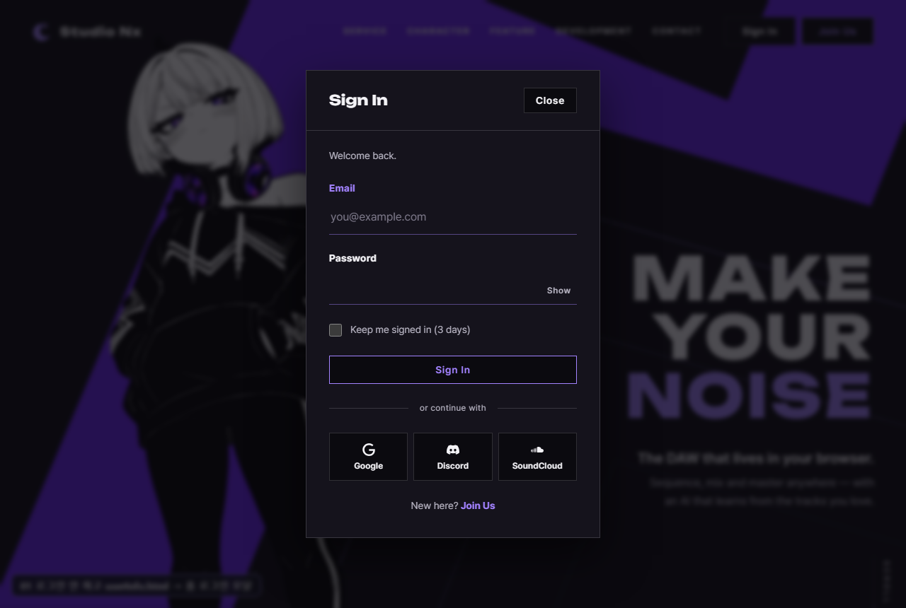
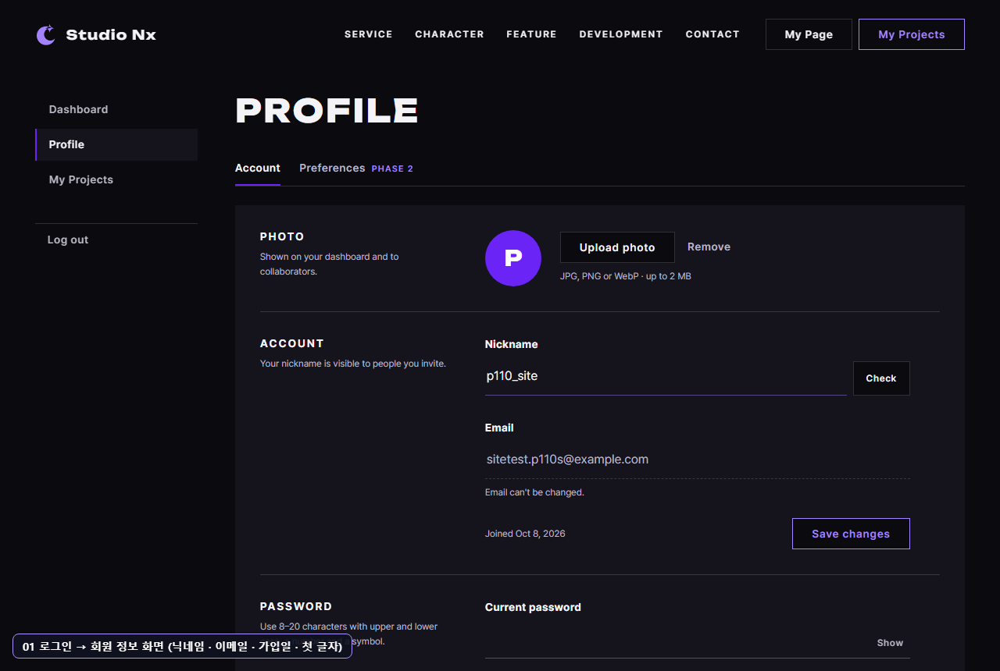
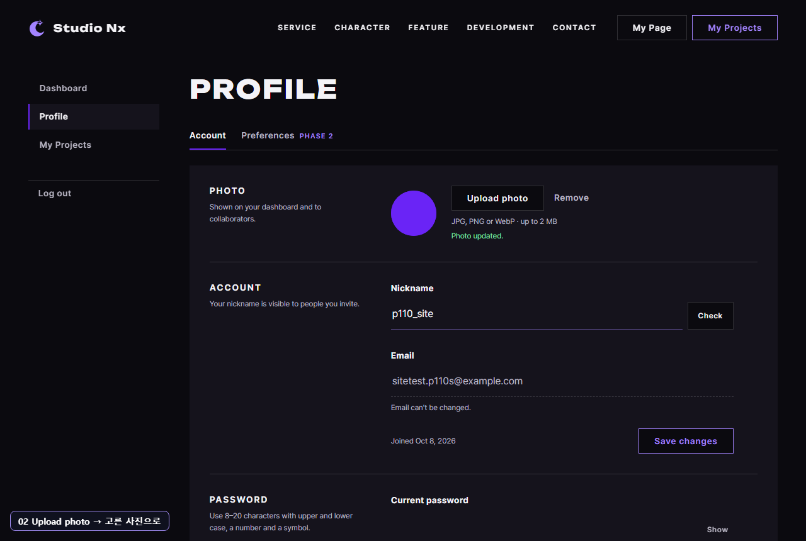
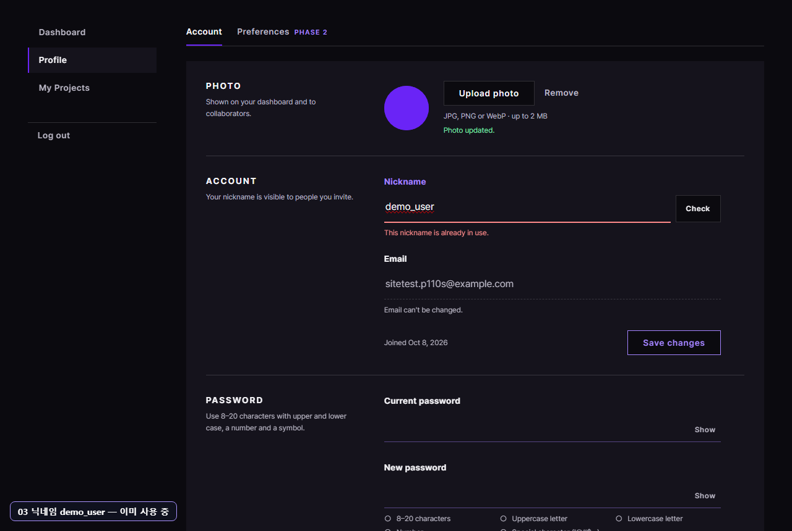
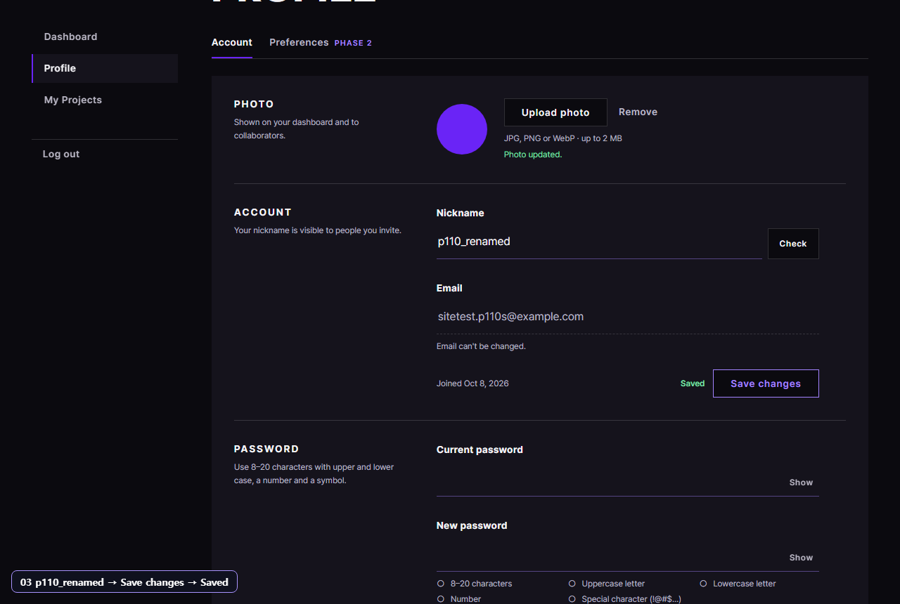
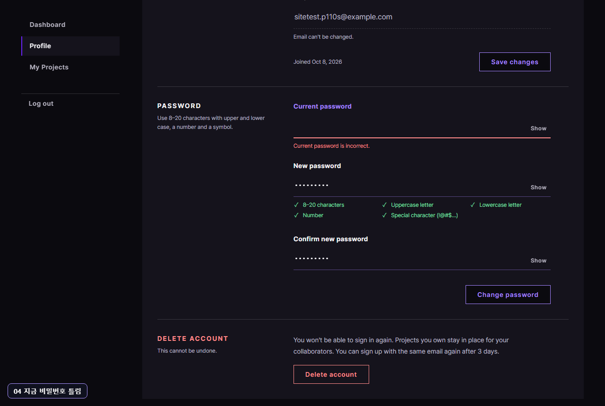
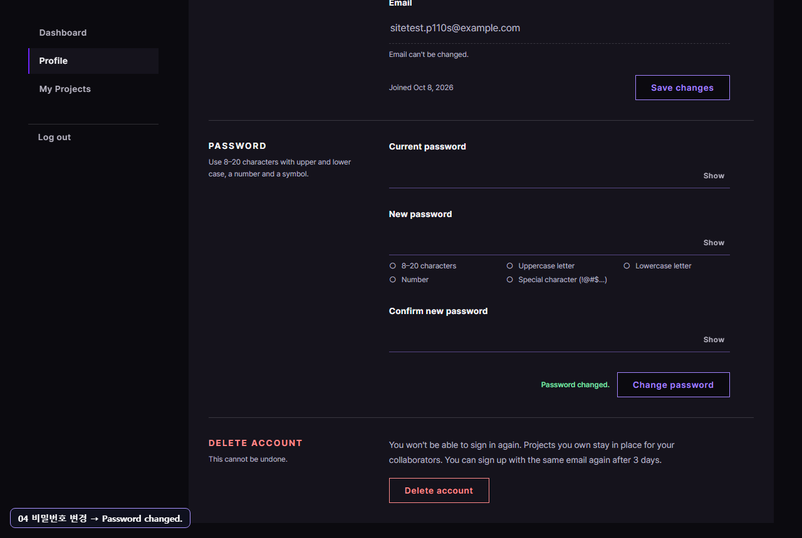
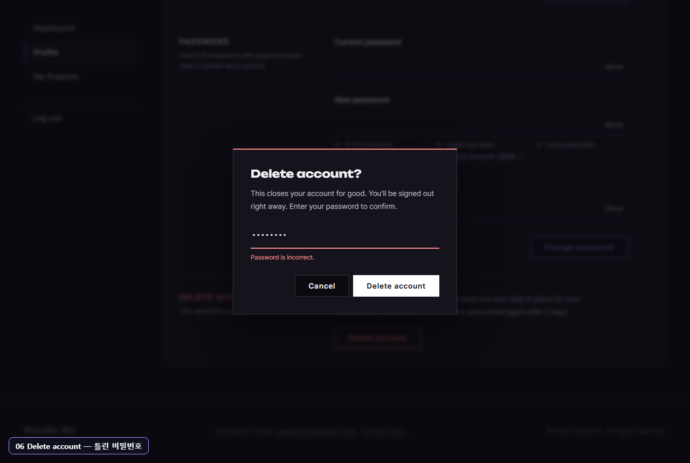
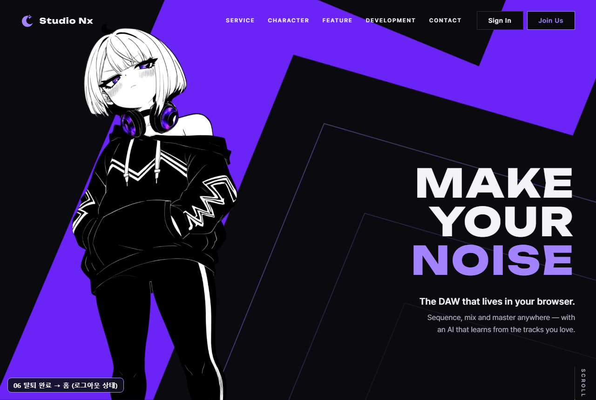

# AI 구현 설명 46 — P1-10 실제 사이트 시험 (회원 정보 화면을 사람처럼)

| 항목 | 내용 |
|---|---|
| 작성 | Claude (AI), 2026-10-08 |
| 대상 | P1-10 회원 정보 화면 JS ([45](45_p1-10_userinfo_js.md)): P1-02, 07, 08, 09, FIX-01 과 함께 |
| 환경 | 시험용 개발 서버 `http://localhost:8001` (**Sentry 끔**), 실제 MySQL, Chrome (헤드리스, 1280×860) |
| 결과 | **11개 모두 기대한 대로** |
| 캡처 | `docs/ai-notes/images/46_p1-10_site_test/` (PNG 11장, 왼쪽 아래에 단계 이름표) |
| 이전 시험 | [44](44_p1-09_site_test.md): 그때는 화면 버튼이 없어 API 를 직접 불렀습니다 |

## 1. 시험 방법
- 39 (P1-07) 와 같은 방식: **함수를 부르지 않고** 마우스로 누르고(`Input.dispatchMouseEvent`) 한 글자씩 쳤다(`Input.insertText`).
- 사진은 **진짜 파일**(160×160 보라 PNG)을 만들어, 파일 고르기 창 대신 Chrome 개발 도구 기능(`DOM.setFileInputFiles`)으로 파일 칸에 넣었다: 사람이 파일을 고른 것과 같은 `change` 가 납니다.
- 시험 계정 `sitetest.p110s@example.com` 은 가입 API 로만 만들고, 나머지는 모두 화면으로 했습니다. 끝에서 탈퇴까지 하고, 시험 뒤 DB 행과 사진 파일을 지웠습니다.

## 2. 결과 한눈에
| # | 사람이 한 일 | 결과 |
|---|---|---|
| 01a | 로그인하지 않고 `userInfo.html` 열기 | `home.html#login?next=%2FuserInfo.html`, 로그인 모달 열림 ✔ |
| 01b | 모달에 이메일, 비밀번호 → Sign In | 회원 정보 화면으로 돌아옴, 닉네임, 이메일, `Joined Oct 8, 2026`, 첫 글자 `P` ✔ |
| 02 | Upload photo 로 사진 고름 | 동그라미가 그 사진(160px), "Photo updated." ✔ |
| 03a | 닉네임을 `demo_user` 로 | 0.5초 뒤 "This nickname is already in use." ✔ |
| 03b | `p110_renamed` → Save changes | Saved, 서버에도 바뀜 ✔ |
| 04a | 지금 비밀번호를 틀리게 → Change password | "Current password is incorrect.", 그 칸 비움 ✔ |
| 04b | 맞게 → Change password | "Password changed.", 세 칸 비움 ✔ |
| 05a | 왼쪽 메뉴 Log out | 홈, 헤더 Sign In, Join Us ✔ |
| 05b | 다시 회원 정보 화면 → **새 비밀번호**로 로그인 | 회원 정보 화면으로 돌아옴, 바뀐 닉네임 ✔ |
| 06a | Delete account → 틀린 비밀번호 | 창 안 "Password is incorrect." ✔ |
| 06b | 같은 창에 맞는 비밀번호 | 탈퇴 → 홈, 그 계정 로그인 401 ✔ |

## 3. 시험 중 찾은 것: 부드러운 스크롤 (시험 도구 문제)
처음엔 06 에서 멈췄습니다. 화면 아래쪽 Delete account 를 누르려고 시험 도구가 그 버튼까지 스크롤한 뒤 좌표를 재는데, 사이트 CSS 의 `scroll-behavior: smooth` 때문에 **스크롤이 아직 움직이는 중**이라 옛 좌표(화면 밖)를 눌렀습니다. 시험 도구의 스크롤을 즉시(`behavior: 'instant'`)로 바꿔 해결했습니다. 사이트 코드는 바꾸지 않았다: 사람이 스크롤해서 누를 때는 문제가 없습니다.

## 4. 캡처

### 01 로그인하지 않고 열기 → 로그인 → 돌아옴

### 02 사진 올리기

### 03 닉네임

### 04 비밀번호

### 05 로그아웃

### 06 탈퇴
틀린 비밀번호 화면에서 Delete account 버튼이 흰색인 것은 마우스가 그 위에 있어서다 (버튼의 hover 모양).

## 5. 정리
- **로그인 → 회원 정보 화면의 모든 기능 → 로그아웃 → 다시 로그인 → 탈퇴** 가 사람이 쓰는 방식 그대로 끝까지 동작합니다.
- 1단계 계정 기능(P1-02, 03, 04, 05, 07, 08, 09, 10, FIX-01)이 화면까지 모두 이어졌습니다.
- 남은 1단계 화면 JS: 내 프로젝트(P1-14), 마이페이지(P1-17): 로그아웃, 확인창, 오류 화면 방식을 이번 것에서 가져다 씁니다.
