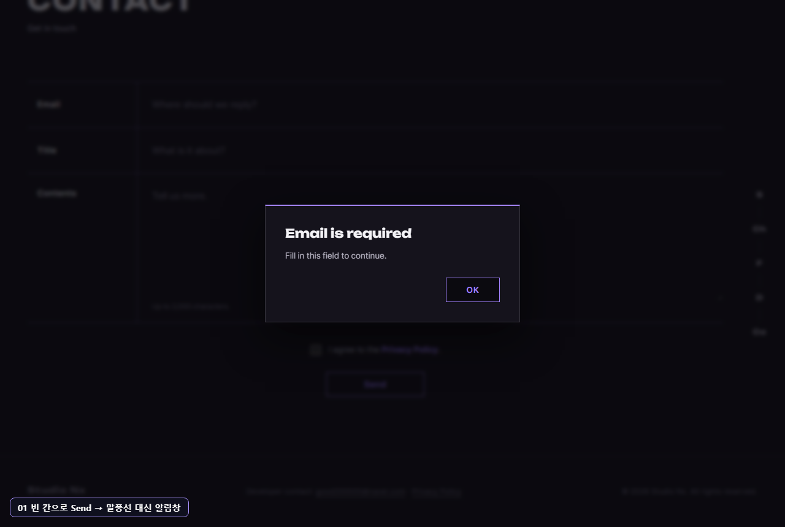
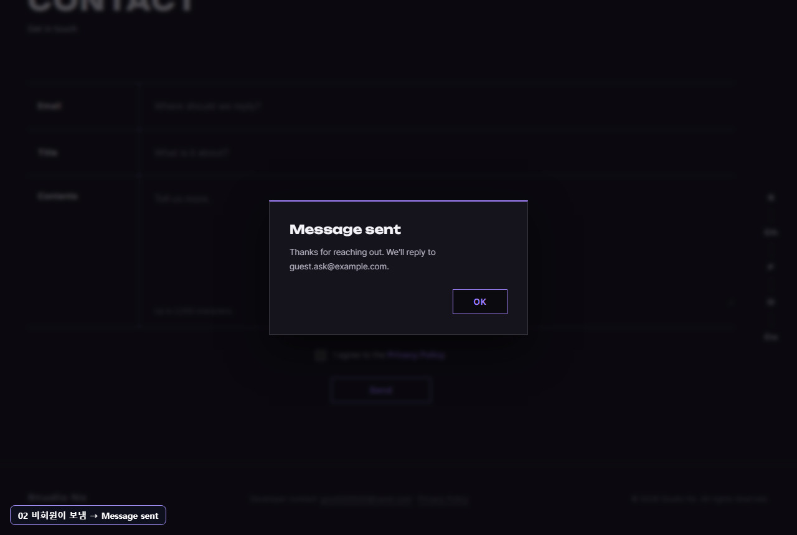
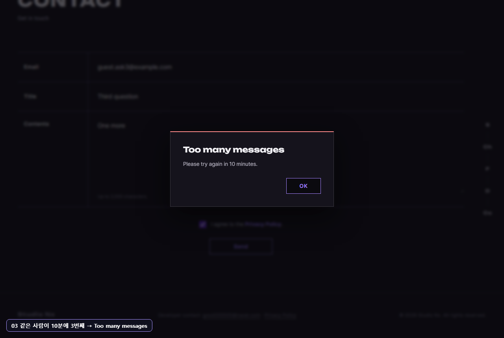
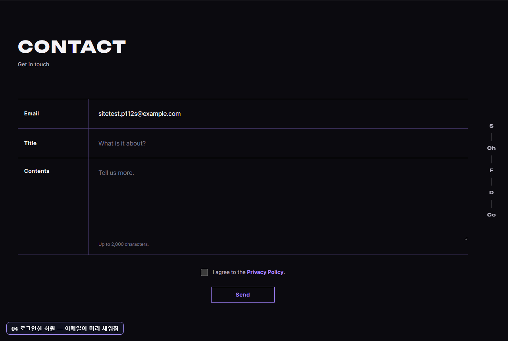
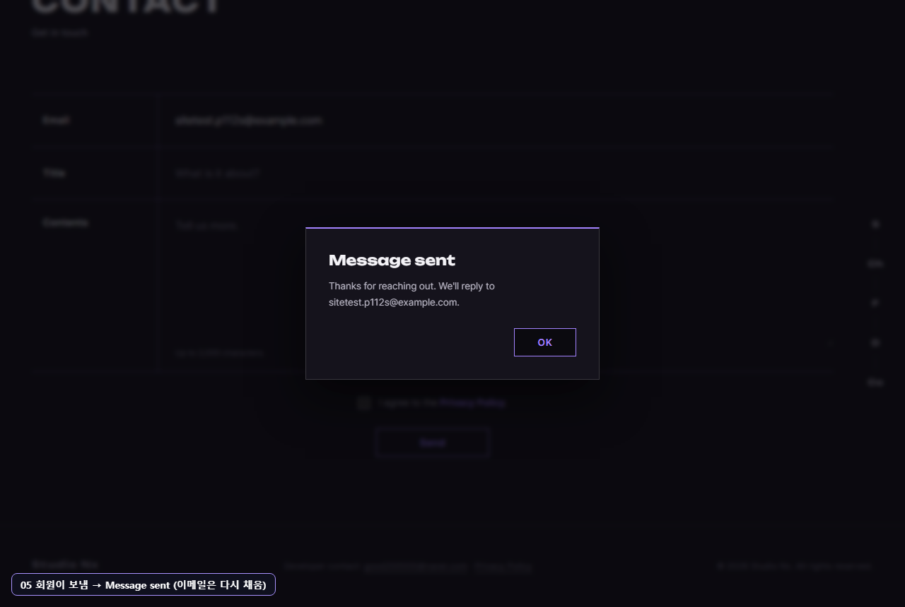

# AI 구현 설명 48 — P1-12 실제 사이트 시험 (홈 Contact 폼을 사람처럼)

| 항목 | 내용 |
|---|---|
| 작성 | Claude (AI) · 2026-10-08 |
| 대상 | P1-12 문의 API + 홈 Contact 폼 JS ([47](47_p1-12_inquiry_api.md)) — P1-07 로그인 · FIX-01 알림창과 함께 |
| 환경 | 시험용 개발 서버 `http://localhost:8001` (**Sentry 끔**) · 실제 MySQL · Chrome (헤드리스, 1280×860) |
| 결과 | **9개 모두 기대한 대로** |
| 캡처 | `docs/ai-notes/images/48_p1-12_site_test/` (PNG 5장, 왼쪽 아래에 단계 이름표) |
| 이전 시험 | [46](46_p1-10_site_test.md) |

## 1. 시험 방법
- 46 과 같은 방식 — **함수를 부르지 않고** 마우스로 누르고(`Input.dispatchMouseEvent`) 한 글자씩 쳤다(`Input.insertText`).
- 반복 전송 기록은 서버 메모리에 있으므로 **두 번에 나눠** 돌렸다: ① 비회원 (서버를 막 켠 상태) → 서버 다시 켬 → ② 회원. 시험 컴퓨터 한 대라 IP 가 같아, 나누지 않으면 회원 시험이 4번째 전송으로 막힌다.
- 시험 회원 `sitetest.p112s@example.com` 은 가입 API 로만 만들고, 로그인은 헤더의 **Sign In → 로그인 모달**로 했다.
- 끝난 뒤 DB 에서 문의가 회원과 연결됐는지 확인하고, 문의 · 시험 계정을 지웠다.

## 2. 결과 한눈에
| # | 사람이 한 일 | 결과 |
|---|---|---|
| 01a | 로그인하지 않고 홈 → Contact | 이메일 칸 빔 ✔ |
| 01 | 아무것도 적지 않고 Send | 알림창 "Email is required" — 보내지 않음 ✔ |
| 02a | 칸을 다 채우고 동의 없이 Send | 알림창 "Please confirm" ✔ |
| 02 | 동의 체크 → Send | "Message sent — We'll reply to guest.ask@example.com." · 폼 비움 ✔ |
| 03a | 두 번째 문의 → Send | Message sent ✔ |
| 03 | 세 번째 문의 → Send | 빨간 "Too many messages — Please try again in 10 minutes." · **적은 내용 그대로** ✔ |
| 04a | (서버 다시 켬) 시험 회원 가입 | 201 ✔ |
| 04 | Sign In 모달로 로그인 → 홈 Contact | 이메일 칸에 **내 이메일**이 미리 채워짐 ✔ |
| 05 | 제목 · 내용 · 동의 → Send | Message sent · 폼을 비워도 내 이메일은 다시 채워짐 ✔ |

**DB 확인 (시험 뒤):** 문의 3개 — 비회원 2개는 `user_id` 비어 있음, 회원 문의 1개는 `user_id` = 시험 회원. 3번째(막힌) 문의는 **저장되지 않음**. 확인 뒤 모두 지웠다 (DB 에는 데모 · 사용자 계정만).

## 3. 캡처

### 01 빈 칸으로 Send → 말풍선 대신 알림창

### 02 비회원이 보냄

### 03 같은 사람이 10분에 3번째

### 04 로그인한 회원 — 이메일이 미리 채워짐

### 05 회원이 보냄 (이메일은 다시 채움)

