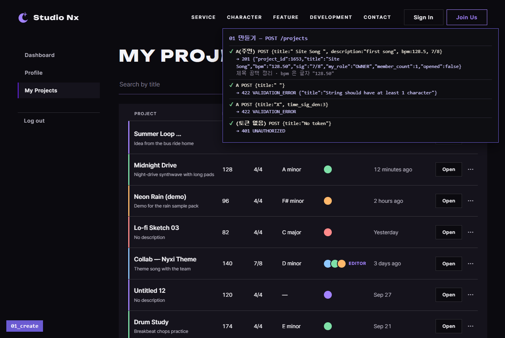
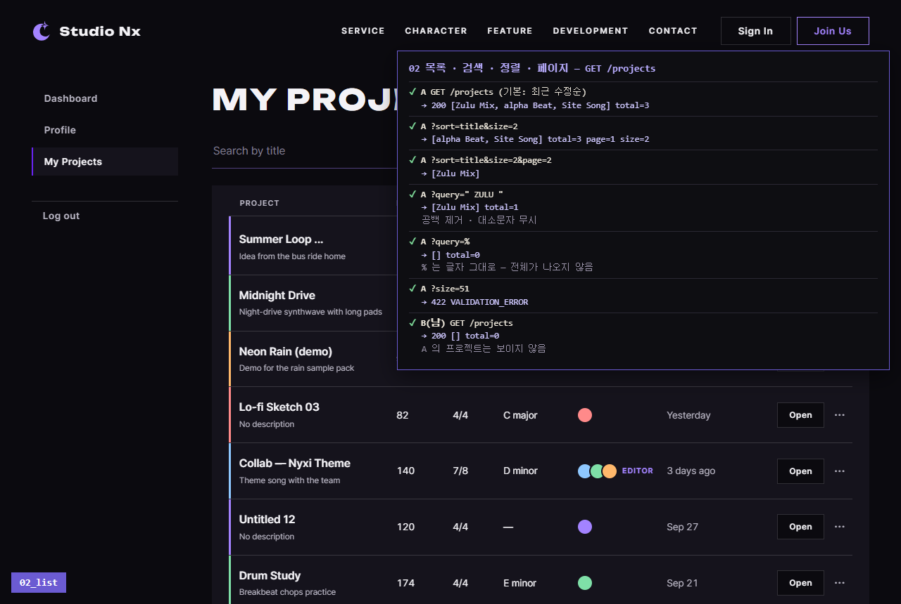
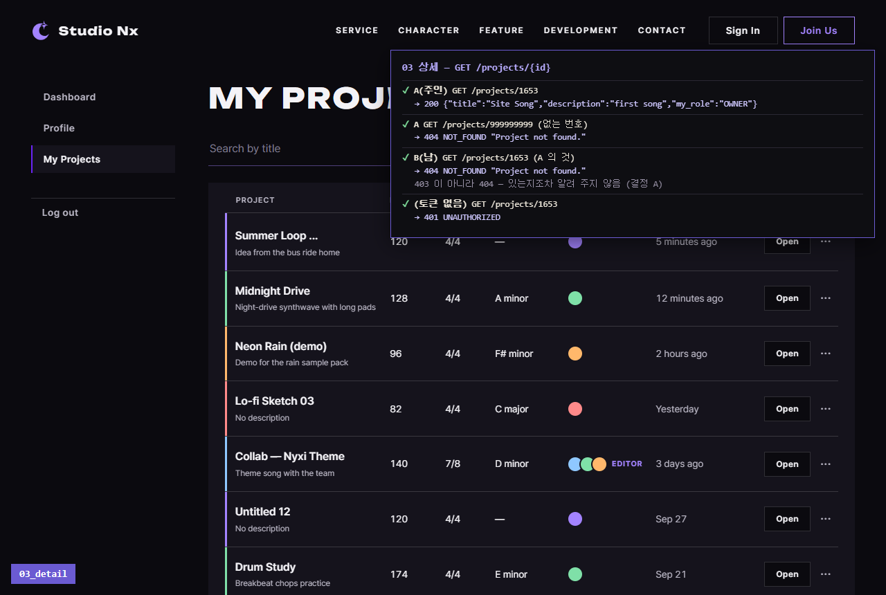
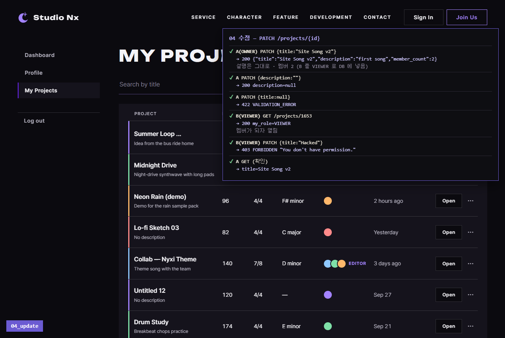
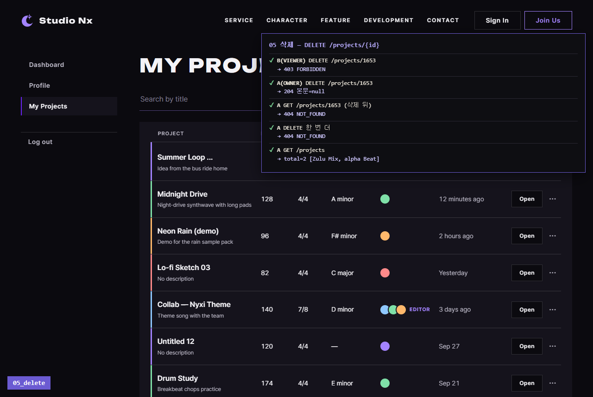

# AI 구현 설명 50 — P1-13 실제 사이트 시험 (프로젝트 API 5개)

| 항목 | 내용 |
|---|---|
| 작성 | Claude (AI) · 2026-10-08 |
| 대상 | P1-13 프로젝트 API ([49](49_p1-13_project_api.md)) — P1-05 로그인 · P1-02 `api.js` 와 함께 |
| 환경 | 시험용 개발 서버 `http://localhost:8001` (**Sentry 끔**) · 실제 MySQL · Chrome (헤드리스, 1280×860) |
| 결과 | **26가지 모두 기대한 대로** |
| 캡처 | `docs/ai-notes/images/50_p1-13_site_test/` (PNG 5장, 왼쪽 아래에 단계 이름표) |
| 이전 시험 | [48](48_p1-12_site_test.md) |

## 1. 시험 방법
- 실제 **myProject.html** 을 열고, 그 안에서 `api.js` 로 로그인한 뒤(`/auth/login` → `setAccessToken`) 프로젝트 API 를 불렀다. 화면 버튼 동작(`myproject.js`)은 P1-14 라 아직 없다. 결과는 오른쪽 위 패널 (✔ = 기대와 같음).
- 상태 코드(201 · 204 등)를 그대로 보려고 요청은 `fetch` 에 `api.js` 의 토큰(`getAccessToken`)을 붙여 보냈다.
- 회원 둘: **A**(`sitetest.p113a@example.com`, 주인) · **B**(`sitetest.p113b@example.com`, 남). 가입 API 로 만들었다.
- 멤버 초대 API 는 Phase 6 이라, 04 앞에서 B 를 A 의 프로젝트에 **VIEWER 로 DB 에 직접** 넣었다.
- 끝난 뒤 DB 를 확인하고, 시험 회원 2명 · 프로젝트 3개(트랙 · 멤버 포함)를 지웠다.

## 2. 결과 한눈에
| # | 시험 | 결과 |
|---|---|---|
| 01 | 만들기 | `"  Site Song "` · 128.5 · 7/8 → **201**, 제목 `Site Song`, bpm `"128.50"`, OWNER · 멤버 1 · opened false ✔ / 공백 제목 · 박자 아래 3 → 422 ✔ / 토큰 없음 → 401 ✔ |
| 02 | 목록 | 기본(최근 수정순) `Zulu Mix, alpha Beat, Site Song` total 3 ✔ / 이름순 2개씩: 1쪽 `alpha Beat, Site Song` · 2쪽 `Zulu Mix` ✔ / `"  ZULU "` → `Zulu Mix` ✔ / `%` → 0개 (글자 그대로) ✔ / size 51 → 422 ✔ / B 의 목록 0개 ✔ |
| 03 | 상세 | A 200 ✔ / 없는 번호 404 ✔ / **B 가 A 의 것 → 404 "Project not found."** (403 아님) ✔ / 토큰 없음 401 ✔ |
| 04 | 수정 | A 제목 → 설명 그대로 · 멤버 2 ✔ / 설명 `""` → null ✔ / 제목 null → 422 ✔ / B(VIEWER) 상세 200 · `my_role` VIEWER ✔ / **B 수정 → 403** ✔ / 제목 그대로 `Site Song v2` ✔ |
| 05 | 삭제 | **B(VIEWER) → 403** ✔ / A → **204** 본문 없음 ✔ / 삭제 뒤 상세 · 다시 삭제 → 404 ✔ / 목록 total 2 ✔ |

**DB 확인 (시험 뒤, 지우기 전):**

| 프로젝트 | `deleted_at` | 트랙 | 멤버 |
|---|---|---|---|
| Site Song v2 | 있음 (소프트 삭제 — 행은 남음) | Master (MASTER) | OWNER · VIEWER |
| alpha Beat | 없음 | Master (MASTER) | OWNER |
| Zulu Mix | 없음 | Master (MASTER) | OWNER |

## 3. 캡처

### 01 만들기

### 02 목록 · 검색 · 정렬 · 페이지

### 03 상세 — 남의 프로젝트는 404

### 04 수정 — VIEWER 는 403

### 05 삭제 — OWNER 만, 204 뒤 404

