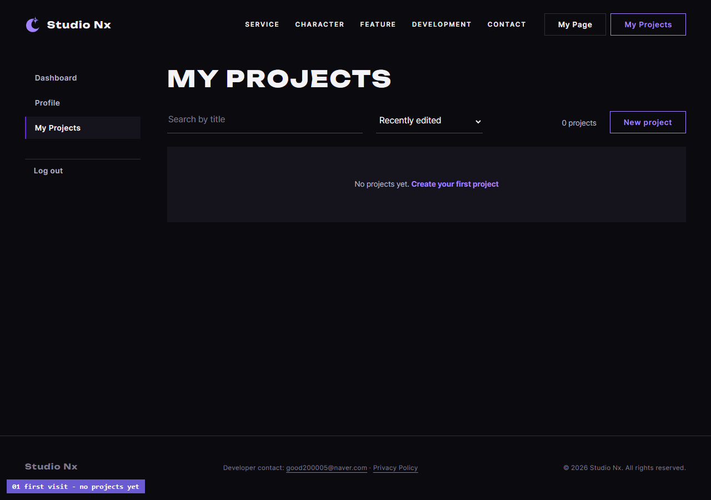
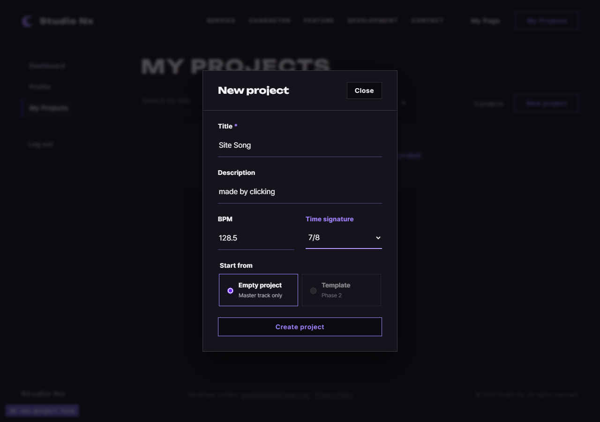
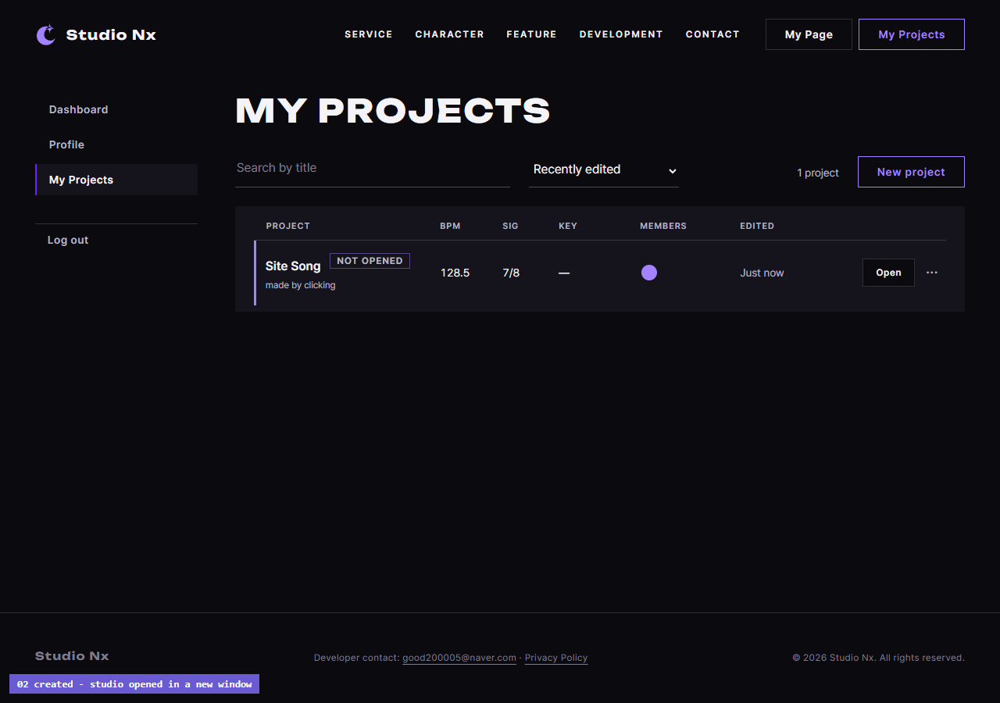
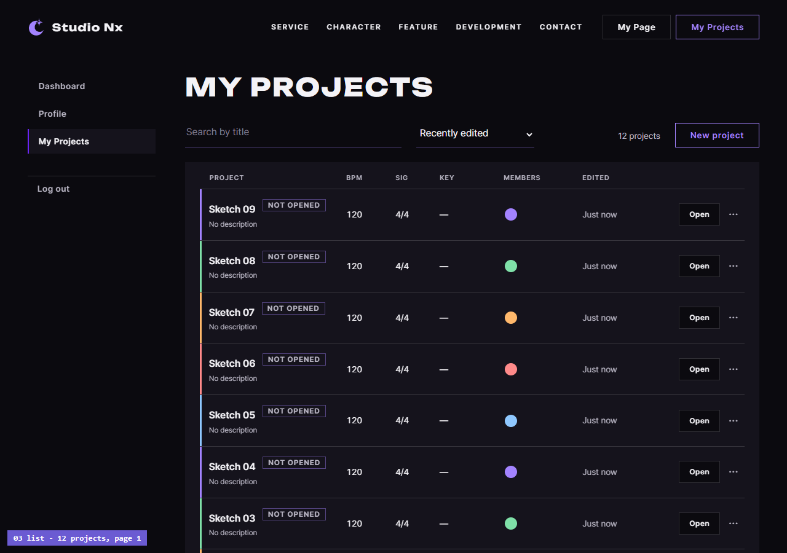
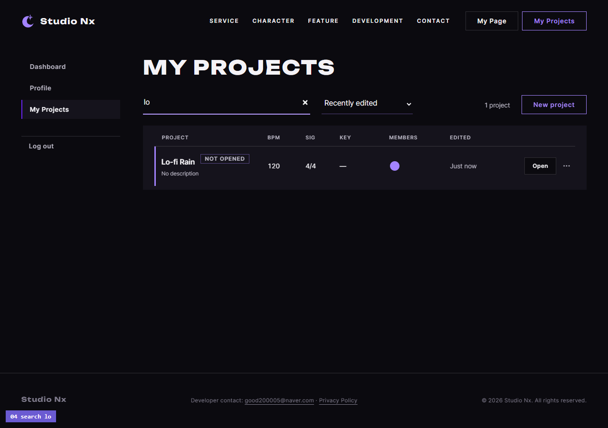
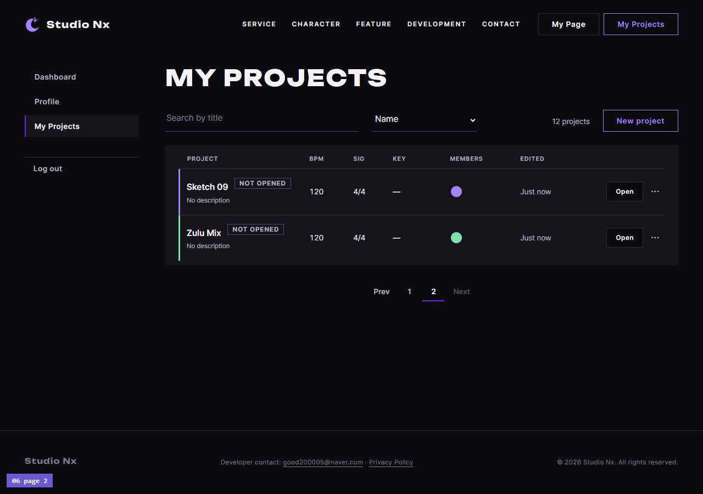
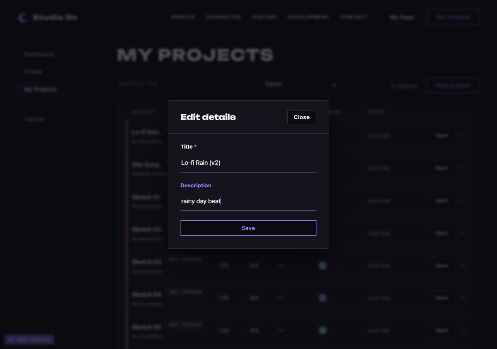
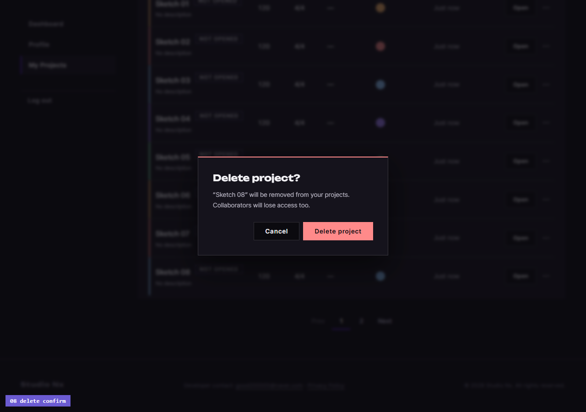
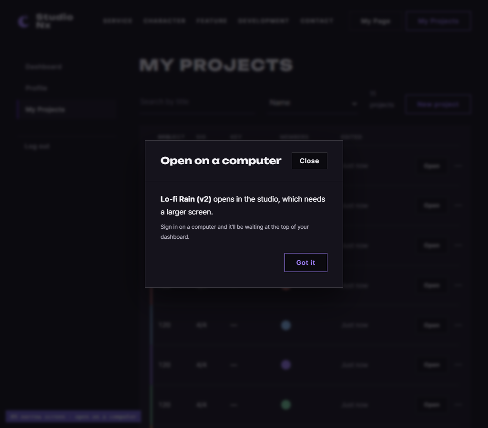

# AI 구현 설명 52 — P1-14 실제 사이트 시험 (내 프로젝트 화면을 사람처럼)

| 항목 | 내용 |
|---|---|
| 작성 | Claude (AI), 2026-10-08 |
| 대상 | P1-14 내 프로젝트 화면 JS ([51](51_p1-14_myproject_js.md)): P1-13 프로젝트 API, P1-07 로그인, FIX-01 확인창과 함께 |
| 환경 | 시험용 개발 서버 `http://localhost:8001` (**Sentry 끔**), 실제 MySQL, Chrome (헤드리스, 1280 × 900, 09 만 1024) |
| 결과 | **11단계 모두 기대한 대로** |
| 캡처 | `docs/ai-notes/images/52_p1-14_site_test/` (PNG 9장, 왼쪽 아래에 단계 이름표) |
| 이전 시험 | [50](50_p1-13_site_test.md) |

## 1. 시험 방법
- **함수를 부르지 않고** 마우스로 누르고(`Input.dispatchMouseEvent`) 한 글자씩 쳤다(`Input.insertText`). 정렬, 박자 칸은 키보드(↓, Enter)로 골랐습니다.
- 시험 회원 `sitetest.p114h@example.com` 은 가입 API 로만 만들고, 로그인은 **로그인 모달**에 쳐서 했습니다.
- 페이지 넘김을 보려고 프로젝트 3개는 화면으로, 9개는 API 로 더 만들었습니다.
- 끝난 뒤 DB 를 확인하고 시험 회원, 프로젝트를 지웠습니다.

**시험 도구에서 고친 것:** 처음에는 06, 07 이 실패했습니다. 사이트의 `html { scroll-behavior: smooth; }` 때문에 요소로 스크롤하는 동안 위치를 재서, 화면 밖 빈 곳을 눌렀던 것입니다. 스크롤을 즉시로 바꾼 뒤 모두 통과했다: **페이지 코드는 고치지 않았습니다.** 08 은 처음에 이름순 2쪽에 있는 줄을 1쪽에서 찾았던 시험 쪽 실수라, 1쪽 줄(`Sketch 08`)로 바꿨습니다.

## 2. 결과 한눈에
| # | 사람이 한 일 | 결과 |
|---|---|---|
| 01a | 로그인하지 않고 `myProject.html` | `home.html#login?next=%2FmyProject.html` ✔ |
| 01 | 로그인 모달에 이메일, 비밀번호 → Sign In | myProject 로 돌아옴, `0 projects`, "No projects yet" ✔ |
| 02 | New project → `Site Song`, 설명, BPM 128.5, 박자 7/8 → Create project | **새 창** `studioNx.html?projectId=…&new=1`, 목록에 `Site Song`, `1 project` ✔ |
| 03 | 2개 더 만들고(화면) + 9개(API) → 다시 열기 | `12 projects`, 최근 수정순 10줄, `Prev 1* 2 Next` ✔ |
| 04 | 검색 칸에 `lo` | `Lo-fi Rain` 하나, 주소 `?query=lo` ✔ |
| 05 | 검색 지우고 정렬을 Name | 이름순, 주소 `?sort=title` ✔ |
| 06 | 페이지 줄 2 | `Sketch 09, Zulu Mix`, `Prev 1 2* Next`, `?sort=title&page=2` ✔ |
| 07 | (1쪽으로) `Lo-fi Rain` ··· → Edit details → `Lo-fi Rain (v2)`, `rainy day beat` → Save | 그 줄만 바뀜, 설명 `rainy day beat` ✔ |
| 08a | `Sketch 08` ··· → Delete → **Cancel** | 그대로 12개 ✔ |
| 08 | 다시 Delete → **Delete project** | `11 projects`, `Sketch 08` 사라지고 `Sketch 09` 가 올라옴 ✔ |
| 09 | 화면 1024, 첫 줄 제목 클릭 | "Open on a computer" 안내, 이름 `Lo-fi Rain (v2)`, 새 창 없음 ✔ |
| 10 | 화면 1280, 첫 줄 Open | 창 수 그대로: 그 프로젝트는 03 에서 만들 때 열린 `studio-번호` 창이 있어 **그 창이 앞으로**, 지금 탭은 myProject ✔ |
| 11 | Log out | `home.html` ✔ |

**DB 확인 (시험 뒤):** 프로젝트 12개: `Sketch 08` 만 `deleted_at` 이 있음(소프트 삭제), `Lo-fi Rain (v2)` 로 이름이 바뀜, 모두 MASTER 트랙 1개, OWNER 멤버. 확인 뒤 모두 지웠습니다.

## 3. 캡처

### 01 처음 열었을 때 (프로젝트 0개)

### 02 새 프로젝트 모달

### 02 만든 뒤 (시퀀서는 새 창)

### 03 12개, 1쪽

### 04 검색 `lo`

### 06 이름순 2쪽

### 07 Edit details

### 08 삭제 확인창

### 09 좁은 화면 안내

