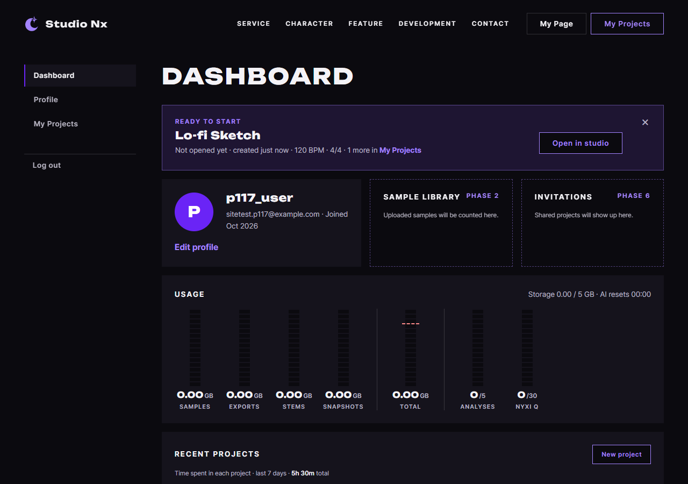

# AI 구현 설명 55 — P1-17 마이페이지 JS (`mypage.js`)

| 항목 | 내용 |
|---|---|
| 작성 | Claude (AI), 2026-10-13 |
| 작업 | P1-17 마이페이지 화면 JS: PRD 01 FR-127~133 (프로필, 사용량, 최근 프로젝트, 이어 하기 배너, 로그아웃) |
| 브랜치 | `feature/phase1/p1-17-mypage` |
| 바꾼 파일 | `static/js/pages/mypage.js`, `core/page-errors.js`(새 파일), `core/time.js`(새 파일), `static/css/pages/mypage.css`(한 줄), `myPage.html`(`#usage-reset` 한 칸) / 백엔드 `app/db/session.py`, 시험 `tests/test_db_timezone.py` |
| 진행 방식 | **함수 하나씩** 구현하고 사용자가 검토한 뒤 다음 함수로 넘어갔습니다 |
| 함수별 설명 | `docs/ai-notes/javascript/P1-17 - 마이페이지 JS/70 ~ 77` (md, PDF), 합본 `P1-17_mypage_js.pdf` |
| 실제 화면 시험 | [56_p1-17_site_test.md](56_p1-17_site_test.md): 마우스와 키보드로 12단계 모두 통과 |
| 이전 문서 | [54_p1-16_site_test.md](54_p1-16_site_test.md) |

## 1. 한 일
템플릿으로 비어 있던 `myPage.html`의 스크립트를 채워서, 화면의 예시 값이 `GET /api/v1/me/dashboard`(P1-16)의 실제 값으로 바뀝니다.

| 화면 영역 | 함수 | 하는 일 |
|---|---|---|
| (데이터 받기) | `loadDashboard()` | API를 부르고, 실패하면 오류 화면으로 보냅니다 |
| 프로필 카드 | `renderProfile()` | 닉네임, 이메일, 가입월, 사진 또는 첫 글자 |
| 사용량 | `renderUsage()` | 저장 용량 막대, 종류별 값, AI 사용량, 80% 이상이면 경고색 |
| 최근 프로젝트 | `renderRecentProjects()` | 프로젝트별 7일 막대와 합계 (`formatDuration()`이 시간 글자를 만듭니다) |
| 이어 하기 배너 | `renderReadyBanner()` | 아직 열지 않은 프로젝트를 안내하고, ×로 닫은 것을 기억합니다 |
| 로그아웃 | `initLogoutButton()` | P1-10에서 만든 공통 함수를 가져다 씁니다 |
| 페이지 시작 | 맨 아래 코드 | 로그인 확인, 대시보드 받기, 네 곳 채우기 순서로 부릅니다 |

## 2. 항목
| # | 함수 | 설명 |
|---|---|---|
| 70 | `loadDashboard()` (+ `core/page-errors.js`) | [70](<javascript/P1-17 - 마이페이지 JS/70_mypage_loadDashboard.md>) |
| 71 | `renderProfile()` | [71](<javascript/P1-17 - 마이페이지 JS/71_mypage_renderProfile.md>) |
| 72 | `renderUsage()` | [72](<javascript/P1-17 - 마이페이지 JS/72_mypage_renderUsage.md>) |
| 73 | `formatDuration()` | [73](<javascript/P1-17 - 마이페이지 JS/73_mypage_formatDuration.md>) |
| 74 | `renderRecentProjects()` (+ `core/time.js`) | [74](<javascript/P1-17 - 마이페이지 JS/74_mypage_renderRecentProjects.md>) |
| 75 | `renderReadyBanner()` | [75](<javascript/P1-17 - 마이페이지 JS/75_mypage_renderReadyBanner.md>) |
| 76 | `initLogoutButton()` 정리 | [76](<javascript/P1-17 - 마이페이지 JS/76_mypage_initLogoutButton.md>) |
| 77 | 페이지 시작 코드 | [77](<javascript/P1-17 - 마이페이지 JS/77_mypage_start.md>) |

## 3. 함께 만든 것과 결정
| 항목 | 내용 | 이유 |
|---|---|---|
| `core/page-errors.js` | `redirectOnLoadError()`: 401은 로그인, 400, 403, 404, 429, 503, 504는 같은 번호의 오류 화면, 서버에 닿지 못하면 503, 그 밖에는 500 | 화면을 처음 받아 올 때 실패하는 경우의 처리를 한 곳에 둡니다 (2026-10-06 결정) |
| `core/time.js` | `formatRelativeTime()`을 myproject.js에서 복사 | 마이페이지도 같은 글자가 필요합니다. `myproject.js`는 건드리지 않았고, 합치는 일은 나중으로 남겼습니다 |
| `mypage.css` 한 줄 | `.lanes__ruler[hidden], .lanes__list[hidden] { display: none; }` | `hidden` 속성이 `display: grid`에 눌려 안 먹던 문제입니다 |
| 배너의 `data-title` | 75번이 프로젝트 제목을 넣습니다 | 작은 화면에서 안내 창에 프로젝트 이름이 나오게 합니다 (P1-16 문서에서 넘겨받은 일) |
| 서버 시각 읽기 | 끝에 `Z`를 붙여 UTC로 읽고 브라우저 시간대로 표시합니다 | 서버는 시간대 표시가 없는 UTC 값을 줍니다 |
| JS 문법 | `?.`, `??` 없이 전통 문법 | 프로젝트 원칙입니다. 문서에 "최신 문법으로 쓰면"을 따로 두었습니다 |

## 4. 작업 중 발견해서 고친 것: DB 시각이 UTC가 아니었습니다
75번을 실제 API로 시험하다가 발견했습니다. `created_at` 같은 기본값 칸에 한국 시각이 저장되고 있었습니다 (연결의 MySQL 시간대가 `SYSTEM`이었기 때문입니다). `docs/DB.md`는 UTC 저장을 정했고 화면은 모두 UTC로 읽으므로, 몇 시간 전에 만든 프로젝트가 `Just now`로만 보였습니다.

| 고친 곳 | 내용 |
|---|---|
| `app/db/session.py` | 연결할 때마다 `SET time_zone = '+00:00'`을 실행합니다 (`connect_args`의 `init_command`) |
| `tests/test_db_timezone.py` | 3개: 연결 시간대, `NOW()`와 `UTC_TIMESTAMP()`의 일치, 기본값으로 저장된 값이 UTC |
| `docs/DB.md` | 시간 규칙에 이 설정을 적었습니다 |
| 결과 | 백엔드 pytest 524개 통과, `ruff` 통과 (자세한 내용은 [75](<javascript/P1-17 - 마이페이지 JS/75_mypage_renderReadyBanner.md>) §6) |

**남은 것**: 고치기 전에 저장된 개발용 데이터는 9시간 앞선 한국 시각 그대로입니다 (새 데이터부터 맞습니다).

## 5. 시험
| 방법 | 대상 | 결과 |
|---|---|---|
| 헤드리스 Chrome, 함수 단위 (실제 myPage.html, 실제 서버) | 70 ~ 77 | 함수마다 5~27개, 모두 통과했습니다 |
| 백엔드 pytest | 시간대 | **524개 통과**, `ruff` 통과 |
| 사람처럼 마우스와 키보드로 ([56](56_p1-17_site_test.md)) | 로그인부터 로그아웃까지 | **12단계 모두 통과** |

## 6. 다음 작업, 남은 것
| 작업 | 내용 |
|---|---|
| 처리함 (2026-10-13) | 화면의 `AI resets 00:00`은 고정 글자여서, 서버의 UTC 0시 초기화를 접속한 컴퓨터의 시간대로 바꿔 보여 주도록 했습니다 (한국 `09:00`). [72](<javascript/P1-17 - 마이페이지 JS/72_mypage_renderUsage.md>) §7 |
| 다음 Phase 1 작업 | `docs/Implementation_Plan.md` §2.1 기준으로 확인합니다 |
| Phase 2 | 시퀀서가 보내는 작업 세션 신호로 `project_sessions`를 채우면 최근 프로젝트 막대에 시간이 쌓입니다 |
| 나중에 | `core/time.js`와 `myproject.js`의 `formatRelativeTime` 합치기, 저장 용량의 종류별 값 (파일 테이블이 생긴 뒤) |
