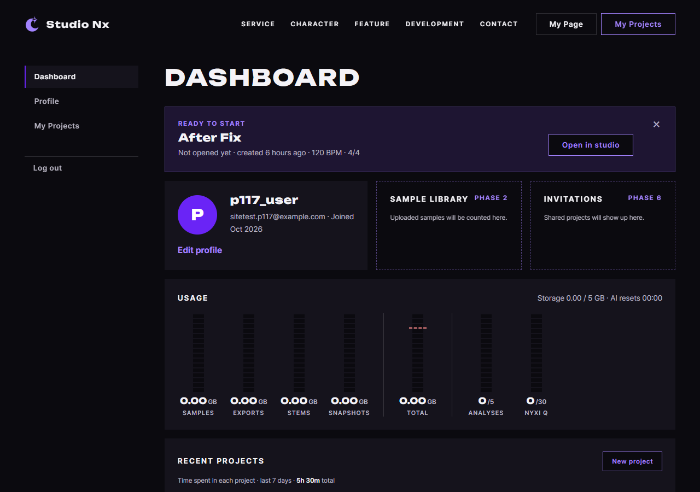
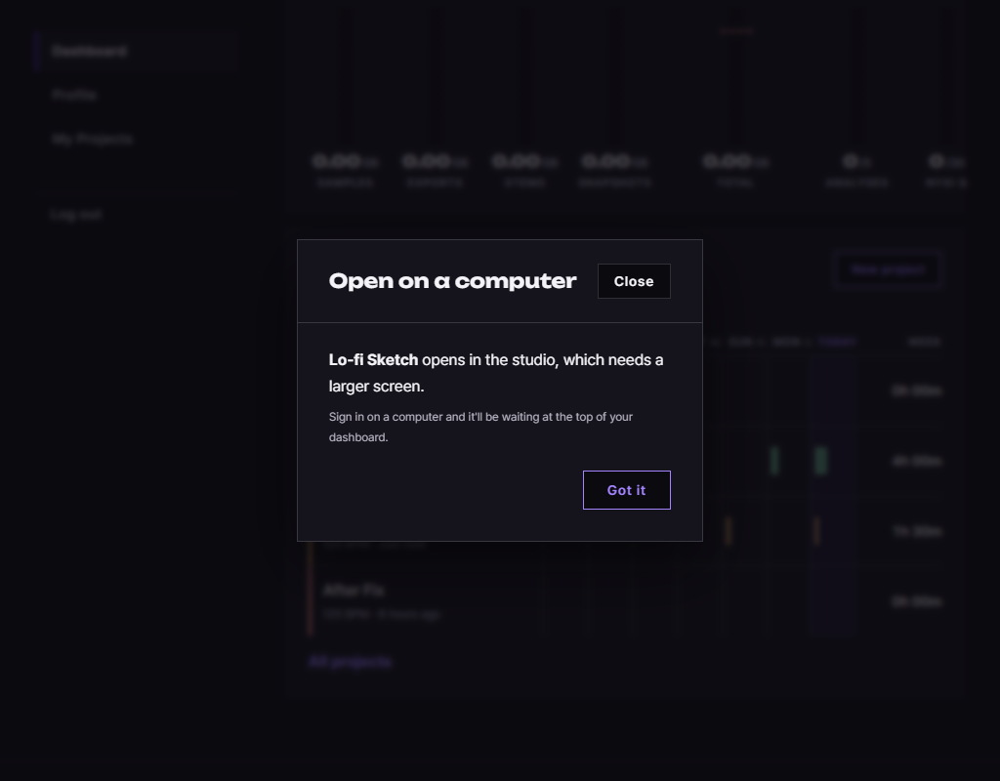

# AI 구현 설명 56 — P1-17 실제 화면 시험 (마이페이지를 사람처럼 클릭해서)

| 항목 | 내용 |
|---|---|
| 작성 | Claude (AI), 2026-10-13 |
| 대상 | P1-17 `mypage.js` ([55](55_p1-17_mypage_js.md)) |
| 환경 | 시험용 개발 서버 `http://localhost:8001` (**Sentry 끔**), 실제 MySQL, 헤드리스 Chrome |
| 방법 | 브라우저에 **마우스 이동, 누름, 뗌과 키보드 입력**을 직접 보냈습니다 (함수 호출이 아닙니다). 시험 계정과 프로젝트 4개는 API로 만들고, 작업 세션 4개만 DB에 직접 넣었습니다 |
| 결과 | **12단계 모두 통과** |
| 이전 시험 | [54](54_p1-16_site_test.md) |

## 1. 결과 한눈에
| # | 한 일 | 결과 |
|---|---|---|
| S01 | 로그인하지 않고 `myPage.html`을 주소로 열기 | 로그인 창이 열린 `home.html#login?next=…`으로 이동합니다 ✔ |
| S02 | 이메일과 비밀번호를 입력하고 Enter | 원래 가려던 `myPage.html`로 돌아옵니다 ✔ |
| S03 | 화면 확인 | 닉네임 `p117_user`, 가입월 `Oct 2026`, 배너 제목 `Lo-fi Sketch` ✔ |
| S04 | 최근 프로젝트 | 4줄이 수정순으로 나옵니다. 합계 `5h 30m`(세션 4개의 합)과 줄별 `4h 00m`, `1h 30m`, `0h 00m`이 나옵니다 ✔ |
| S05 | 배너의 × 클릭 | 배너가 숨겨지고 닫은 번호가 저장됩니다 ✔ |
| S06 | 새로고침 | 닫은 프로젝트는 건너뛰고 다음 프로젝트가 배너에 나옵니다 ✔ |
| S07 | PC 폭(1440)에서 `Open in studio` 클릭 | 이름이 `studio-프로젝트번호`인 새 창을 요청하고, 이 페이지는 그대로입니다 ✔ |
| S08 | 최근 프로젝트 줄의 링크 클릭 | 새 창 요청이 하나 더 생깁니다 ✔ |
| S09 | 폭 1024에서 같은 링크 클릭 | 새 창은 열리지 않고 안내 창에 프로젝트 이름이 나옵니다 ✔ |
| S10 | Esc | 안내 창이 닫힙니다 ✔ |
| S11 | 왼쪽 메뉴의 `Log out` 클릭 | `home.html`로 이동합니다 ✔ |
| S12 | 로그아웃 뒤 `myPage.html`을 다시 열기 | 로그인 창으로 보냅니다 ✔ |

## 2. 시험 중 있었던 일
- 처음에는 S08 이후가 실패했습니다. 창 높이가 900인데 링크가 화면 아래(y=934)에 있어서 클릭이 닿지 않은 것입니다. 앱이 아니라 시험 스크립트의 문제여서, 클릭 전에 그 요소를 화면 가운데로 스크롤하도록 고쳤습니다.
- 이전 함수 단위 시험(70~76)은 페이지가 이제 로그인을 요구해서 로그인 단계를 앞에 넣어 다시 돌렸습니다. 70번과 74번의 각 1개는 시험 계정의 프로젝트가 4개로 늘어서 기대값(3개)이 달라진 것입니다. 앱은 정상이며, 시험 계정을 정리하면서 함께 닫았습니다.
- 시간대 문제(55 §4)는 75번 시험 중에 발견해서 이미 고쳤고, 이 시험에서 새로 만든 프로젝트는 `Just now`로 맞게 나왔습니다.

## 3. 시험으로 알게 된 것
| 항목 | 내용 |
|---|---|
| `AI resets 00:00` | 이 시험에서 HTML의 고정 글자임을 발견했고, 서버의 UTC 0시 초기화를 접속한 컴퓨터의 시간대로 보여 주도록 고쳤습니다. 시간대 8곳으로 시험했습니다 ([72](<javascript/P1-17 - 마이페이지 JS/72_mypage_renderUsage.md>) §7). 위 화면 그림은 고치기 전 글자(`00:00`)입니다 |
| 사용량 줄 | 시험 계정은 파일이 없어 `0.00 / 5 GB`, `0 /5`, `0 /30`입니다 |

## 4. 아직 시험하지 않은 것
| 항목 | 이유 |
|---|---|
| 저장 용량이 80% 이상일 때의 경고색 | 실제 파일이 없어 실제 서버로는 만들 수 없습니다. 72번에서 값을 넣어 시험했습니다 |
| 프로필 사진이 있는 회원 | 사진 올리기는 P1-10에서 시험했고, 사진이 있을 때의 그림은 71번에서 시험했습니다 |
| 모바일 실제 기기 | 폭 1024에서만 시험했습니다 |

## 5. 정리
시험 계정 `sitetest.p117@example.com`, 프로젝트 4개, 작업 세션 4개와 시험용 서버(포트 8001)를 지웠습니다.
