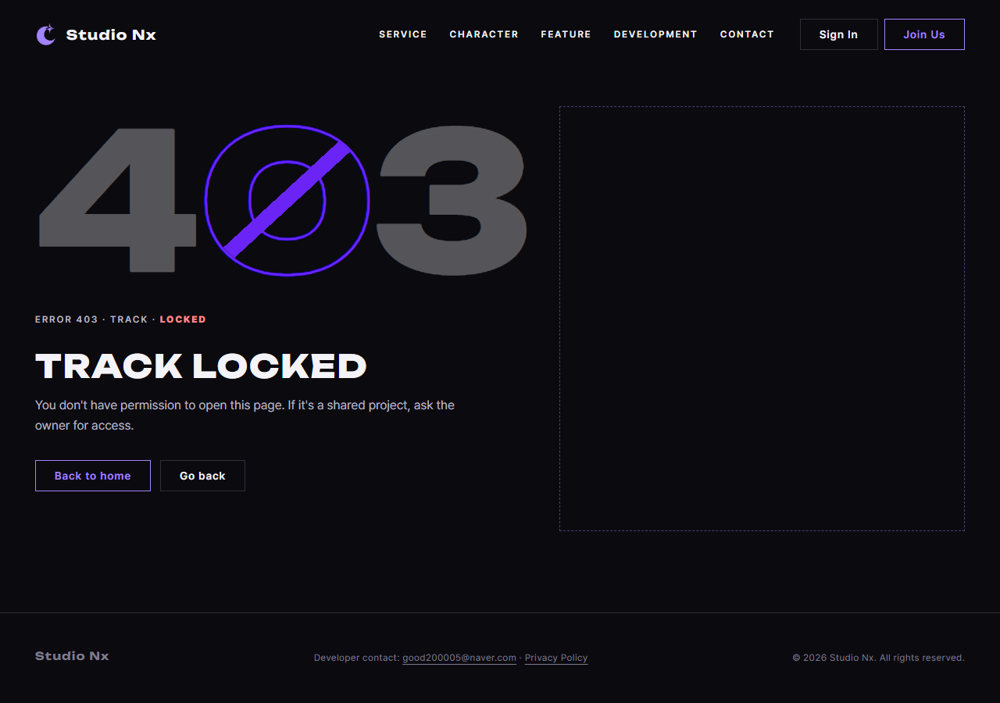

# AI 구현 설명 58 — P1-22 실제 서버 시험 (오류 페이지를 실제 HTTP와 브라우저로)

| 항목 | 내용 |
|---|---|
| 작성 | Claude (AI), 2026-10-13 |
| 대상 | P1-22 오류 페이지 연결 ([57](57_p1-22_error_pages.md)) |
| 환경 | 시험용 개발 서버 `http://localhost:8001` (**Sentry 끔**), 실제 MySQL, 헤드리스 Chrome |
| 방법 | 서버에 `curl`로 요청하고, 브라우저로 주소를 열거나 화면의 JS에서 `fetch`를 불렀습니다. 서버 버그를 흉내 내기 위해 **시험용 경로 `/boom`, `/api/v1/boom`**(항상 오류를 던집니다)을 임시로 붙인 실행 파일을 썼고, 시험 뒤 지웠습니다 |
| 결과 | **모든 단계가 기대한 대로** (마이페이지에서 오류 페이지로 옮겨 가는 모습 포함) |
| 이전 시험 | [56](56_p1-17_site_test.md) |

## 1. 서버에 직접 요청 (curl)
| # | 요청 | 상태 | 응답 형식 | 결과 |
|---|---|---|---|---|
| 01 | `GET /no-such-page` | 404 | HTML (`errors/404.html`) | ✔ |
| 02 | `POST /home.html` | 405 | HTML (`errors/400.html`) | ✔ |
| 03 | `GET /boom` (서버 버그) | 500 | HTML (`errors/500.html`) | ✔ |
| 04 | `GET /api/v1/boom` (서버 버그) | 500 | JSON `INTERNAL_ERROR` | ✔ |
| 05 | `GET /api/v1/no-such` | 404 | JSON `NOT_FOUND` | ✔ |
| 06 | `POST /api/v1/health` | 405 | JSON `METHOD_NOT_ALLOWED` | ✔ |
| 07 | `GET /home.html` | 200 | 정상 화면 | ✔ |

## 2. 브라우저 (헤드리스 Chrome, 4개 모두 통과)
| # | 한 일 | 결과 |
|---|---|---|
| R01 | 주소창으로 `/boom` 열기 | 500 오류 페이지가 보이고, 화면 어디에도 `password_hash` 같은 내부 글자가 없습니다 ✔ |
| R02 | 없는 페이지 열기 | 404 오류 페이지 ✔ |
| R03 | 화면의 JS에서 `fetch('/api/v1/boom')` | 상태 500, `application/json`, `error.code`가 `INTERNAL_ERROR` ✔ |
| R04 | 화면의 JS에서 `fetch('/home.html', {method: 'POST'})` | 상태 405, `text/html`, 오류 페이지 본문 ✔ |

## 3. 화면에서 실제로 오류 페이지로 옮겨 가는지 (마이페이지, 3개 모두 통과)
로그인한 상태에서 마이페이지(`myPage.html`)를 열고, 서버의 `GET /api/v1/me/dashboard`가 오류를 내도록 임시 실행 파일로 바꿨습니다. 브라우저가 스스로 오류 페이지로 이동하는 모습을 확인했습니다.

| # | 서버에서 일어난 일 | 브라우저의 주소가 바뀐 곳 | 결과 |
|---|---|---|---|
| F01 | 대시보드에서 서버 버그(예상 못 한 오류, 500) | `/errors/500.html` | ✔ |
| F02 | 그 화면에 `500`이 보이고, 내부 글자(`password_hash`)는 없음 | | ✔ |
| F03 | 대시보드에서 권한 오류(403) | `/errors/403.html` | ✔ |

흐름은 이렇습니다. `mypage.js`의 `loadDashboard()`가 API 오류를 받으면 `redirectOnLoadError()`(P1-17)가 상태 번호로 `errors/500.html` 등으로 보내고, 그 페이지는 이번 작업의 `error_page()`와 같은 파일입니다.

## 4. 시험 중 있었던 일
- 처음에는 R02가 실패로 나왔습니다. 오류 페이지에도 공통 머리글이 있어서, 본문 앞 80글자에 `404`가 없었던 것입니다. 앱이 아니라 시험의 확인 방식 문제여서, 본문 전체에서 `404`를 찾도록 고쳤습니다.
- 마이페이지가 API 실패 때 오류 화면으로 옮겨 가는 동작은 P1-17의 77번 시험(5)에서 확인했고, 이번에는 그 오류 화면(`errors/…html`)이 서버에서 올바르게 내려오는지를 확인했습니다.

## 5. 알게 된 것
| 항목 | 내용 |
|---|---|
| 405의 `Allow` 헤더 | 실제 서버의 405(`POST /home.html`, `POST /api/v1/health`)에 `Allow`가 붙지 않습니다. 정적 파일 마운트(`/`)가 먼저 잡기 때문이며, P1-22 이전부터의 동작입니다. 상태 코드와 본문은 맞아서 그대로 두었습니다 |

## 6. 아직 시험하지 않은 것
| 항목 | 이유 |
|---|---|
| 429, 503, 504 오류 페이지가 실제로 나오는 경우 | 429는 문의 반복 전송(API라서 JSON), 503과 504는 점검 모드와 프록시가 생겨야 나옵니다. 페이지 파일과 `error_page()`는 서비스 시험으로 확인했습니다 |
| `/admin`(SQLAdmin)에서 나는 오류 | P1-21에서 관리자 화면을 마무리할 때 확인합니다 |

## 7. 정리
임시로 만든 시험용 실행 파일(`/boom`, 대시보드 오류용)과 시험 계정(`sitetest.p117@example.com`, 마이페이지 시험용)을 지웠고, 시험용 서버(포트 8001)를 종료했습니다.
