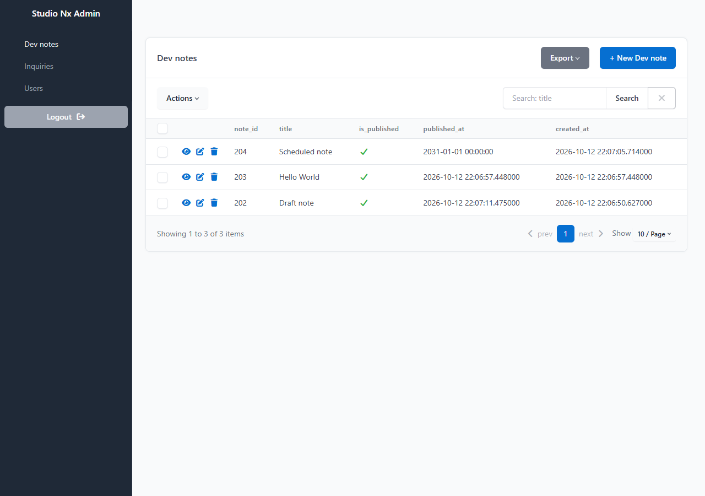
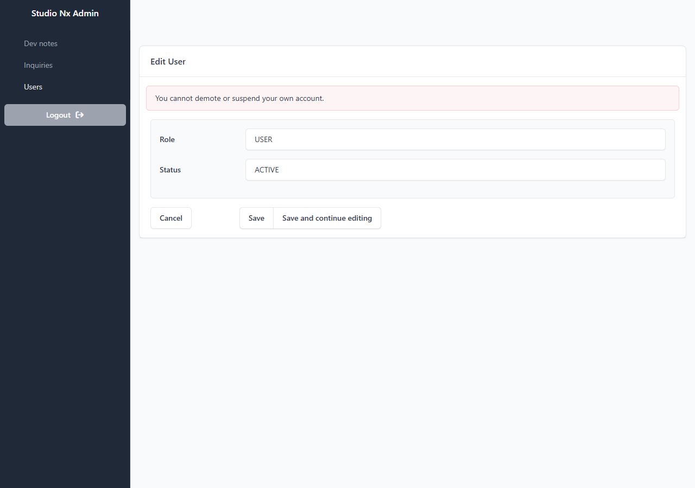
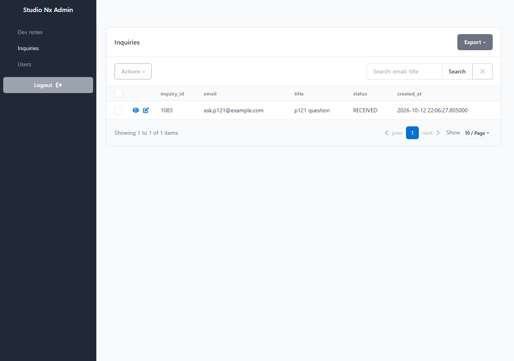

# AI 구현 설명 60 — P1-21 실제 화면 시험 (관리자 화면을 사람처럼 클릭해서)

| 항목 | 내용 |
|---|---|
| 작성 | Claude (AI), 2026-10-13 |
| 대상 | P1-21 공지 API와 관리자 화면 ([59](59_p1-21_dev_notes_admin.md)) |
| 환경 | 시험용 개발 서버 `http://localhost:8001` (**Sentry 끔**), 실제 MySQL, 헤드리스 Chrome |
| 방법 | 브라우저에 **마우스 이동, 누름, 뗌과 키보드 입력**을 직접 보내서 `/admin`을 썼습니다 (폼 값을 코드로 채우지 않고 칸을 눌러 입력). 시험 계정 3개(관리자, 일반 회원, 정지 시험용 회원)는 가입 API로 만들고, 관리자 역할만 DB에서 지정했습니다. 문의는 사이트의 문의 API로 넣었습니다 |
| 결과 | **29단계 모두 통과** |
| 이전 시험 | [58](58_p1-22_site_test.md) |

## 1. 로그인 (A01 ~ A04)
| # | 한 일 | 결과 |
|---|---|---|
| A01 | 로그인 없이 `/admin/` 열기 | `/admin/login`으로 이동 ✔ |
| A02 | **일반 회원**으로, 비밀번호가 맞게 로그인 | 들어가지 못하고 로그인 화면에 머묾 ✔ |
| A03 | 관리자 계정으로 **틀린 비밀번호** | 들어가지 못함 ✔ |
| A04 | 관리자 계정, 맞는 비밀번호 | `/admin/` ✔ |

## 2. 공지 (A05 ~ A19)
| # | 한 일 | 결과 |
|---|---|---|
| A05 | 초안으로 작성(공개 체크 안 함) | 비공개, 작성자는 로그인한 관리자, 공개 시각 없음 ✔ |
| A06 | 메인 페이지 API 목록 확인 | 초안은 없음 ✔ |
| A07 | 공개로 작성(공개 시각 비움) | 공개 시각이 지금(UTC)으로 채워짐 ✔ |
| A08 | 여러 줄 본문(제목 줄, 목록, 한글 포함) | 줄바꿈과 한글이 그대로 저장됨 ✔ |
| A09 | API 목록 | 나타나고 `content`는 없음 ✔ |
| A10 | API 상세 | 본문이 있음 ✔ |
| A11 | 공개 시각을 `2031-01-01 00:00:00`으로 직접 입력 | 그대로 저장됨 ✔ |
| A12 | 그 공지의 API 상세 | 예약 중이므로 404 `NOT_FOUND` ✔ |
| A13 | 초안을 수정해서 공개 체크 | 공개 시각이 채워지고 작성자는 그대로 ✔ |
| A14 | API 목록 | 나타나고 최신순 ✔ |
| A15 | 목록에서 "Hello" 검색 | 한 줄만 ✔ |
| A16 | 휴지통 아이콘, 확인창에서 삭제 | 행은 남고 `deleted_at`이 채워짐 ✔ |
| A17 | 삭제한 공지의 API 상세와 목록 | 404, 목록에서 사라짐 ✔ |
| A18 | 관리자 목록 | 사라지고 다른 공지는 그대로 ✔ |
| A19 | 지운 공지의 수정 주소를 직접 열기 | 404 ✔ |

## 3. 문의와 회원 (A20 ~ A27)
| # | 한 일 | 결과 |
|---|---|---|
| A20 | 문의 수정 폼의 칸 | 답변과 상태 두 칸뿐 ✔ |
| A21 | 답변을 쓰고 저장 | 답변 시각이 채워지고 상태가 `ANSWERED`로 ✔ |
| A22 | 문의 새로 만들기 주소 | 403 (만들 수 없음) ✔ |
| A23 | 회원 상세 | 비밀번호 해시(`$2b$`)와 `password`라는 글자가 없음 ✔ |
| A24 | 회원 수정 폼의 칸 | 역할과 상태 두 칸뿐 ✔ |
| A25 | 회원을 `SUSPENDED`로 바꿔 저장 | 바뀜 ✔ |
| A26 | 그 회원이 사이트에 로그인 | 403 `ACCOUNT_DISABLED` ✔ |
| A27 | 관리자가 **자기 자신**을 `USER`로 바꿔 저장 | 막히고 "You cannot demote or suspend your own account." 문구가 보이며 DB는 그대로 ✔ |

## 4. 로그아웃 (A28 ~ A29)
| # | 한 일 | 결과 |
|---|---|---|
| A28 | 왼쪽 메뉴의 Logout 클릭 | `/admin/login` ✔ |
| A29 | 로그아웃한 뒤 목록 주소를 직접 열기 | 다시 로그인 화면 ✔ |

## 5. 시험 중 있었던 일
- **공지 본문 입력칸이 한 줄짜리**였습니다. 시험 계획을 세우려고 폼을 열어 보다가 발견했습니다. SQLAdmin이 `MEDIUMTEXT`를 한 줄 입력창으로 만들어서, Markdown 본문을 쓸 수 없는 상태였습니다. `form_overrides`로 여러 줄 입력칸으로 고치고 시험(문서 88번)을 더했습니다.
- 처음 시험을 돌렸을 때 A11이 실패했습니다. 공개 시각 입력칸(달력 위젯)에 글자를 쓰면 달력이 열려서 **저장 버튼을 가렸기** 때문입니다. 앱의 문제가 아니라 시험의 문제여서, 입력 뒤에 다른 칸을 눌러 달력을 닫도록 시험을 고쳤습니다. 처음 실패한 시험이 남긴 시험 데이터는 지우고 다시 돌렸습니다.
- 목록 검색칸의 선택자를 잘못 써서(`name=search`) 한 번 멈췄습니다 (실제는 `id=search-input`). 시험을 고쳤습니다.
- 이전 서버가 떠 있는 채로 새 서버를 시작해서 응답이 없던 적이 있었습니다. 서버를 한 번만 띄우도록 정리했습니다.
- 시각은 DB에 UTC로 저장되어 있어서(P1-17에서 고침) 관리자 화면의 만든 시각이 UTC로 보입니다 (한국 시각이 아님). 관리자 화면은 서버가 준 값을 그대로 보여 줍니다.

## 6. 아직 시험하지 않은 것
| 항목 | 이유 |
|---|---|
| 정지 이외의 상태 변경(`DELETED` 막기)을 화면에서 | 서비스 시험(91번)으로 확인했습니다 |
| 공지가 많을 때의 쪽 나누기 | 시험 데이터가 3개뿐이었습니다. SQLAdmin의 기본 기능입니다 |
| 메인 페이지(`home.html`)에서 공지가 보이는 것 | `loadDevNotes()`(JS)가 아직 비어 있습니다. 화면 점검 때 채웁니다 |
| 운영에서 `ADMIN_PATH`를 바꾼 주소 | 서비스 시험(92번)으로 확인했습니다. 실제 서버에서는 배포 때 확인합니다 |

## 7. 정리
시험 계정 3개, 공지, 문의를 지웠고 시험용 서버(포트 8001)를 종료했습니다.
