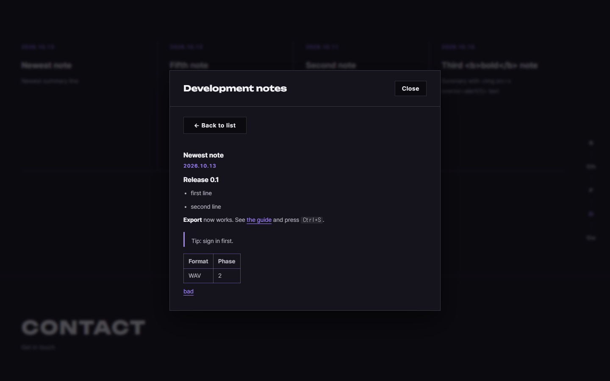

# AI 구현 설명 62 — P1-23 화면 마무리 (오류 페이지 버튼, 홈 공지·로딩·앵커·메뉴, 개인정보 목차)

| 항목 | 내용 |
|---|---|
| 작성 | Claude (AI), 2026-10-13 |
| 작업 | P1-23 (YouTrack StudioNx-73): Phase 1을 `develop`에 병합한 뒤 점검에서 찾은 **비어 있던 JS**를 모두 구현 |
| 브랜치 | `feature/phase1/p1-23-ui-polish` (`develop`에서 만듦, PR의 대상도 `develop`) |
| 바꾼 파일 | `pages/error.js`, `pages/home.js`, `pages/privacy.js`, `core/markdown.js`(새 파일), `home.html`, `css/pages/home.css`, `css/pages/privacy.css`, `core/api.js`, `auth.js`, `auth-ui.js`(주석만), `static/vendor/marked/`, `static/vendor/dompurify/`(새 폴더) |
| 진행 방식 | **함수 하나씩** 구현하고 사용자가 검토한 뒤 다음으로 넘어갔습니다 |
| 함수별 설명 | `docs/ai-notes/javascript/P1-23 - 화면 마무리/96 ~ 101` (md, PDF), 합본 `P1-23_ui_polish.pdf` |
| 실제 화면 시험 | [63_p1-23_site_test.md](63_p1-23_site_test.md): 홈, 처리방침, 오류 페이지를 마우스와 키보드로 17단계 모두 통과 |
| 이전 문서 | [61_p1-18_acceptance_tests.md](61_p1-18_acceptance_tests.md) |

## 1. 한 일
Phase 1 점검(`develop` 병합 직후)에서 JS가 비어 있는 곳을 찾았습니다. 화면은 이미 만들어져 있었지만 동작하지 않거나, 서버에서 받아야 할 값이 HTML에 박힌 예시 글자였던 곳들입니다.

| 화면 | 전 | 후 |
|---|---|---|
| 오류 페이지 | `Go back`, `Try again` 버튼이 눌러도 아무 일도 안 함 | 동작함. `Try again`은 오류 페이지가 열린 방식(서버가 직접 보냄 / 화면 JS가 옮겨 옴)에 맞게 원래 일을 다시 시도 |
| 홈의 Development 카드 | HTML에 박힌 예시 공지 4개 | 관리자가 쓴 실제 공지 4개 (없으면, 불러오지 못하면 안내 문구) |
| 홈의 `+ View More` | "The full archive … will be listed here." 안내 문구뿐 | 공지 목록과 상세(Markdown 본문을 안전하게 변환해서 표시) |
| 홈의 첫 접속 로딩 | 홈에 올 때마다 재생 | 같은 탭에서는 처음에만 (깜빡임 없이) |
| 홈의 세로 앵커 | 현재 섹션 표시 없음 | 지금 보는 섹션 하나가 보라색 |
| 홈의 모바일 메뉴 | 링크를 눌러 이동해도 메뉴가 열린 채 화면을 가림 | 링크나 `Sign In`을 누르면 닫힘 |
| 개인정보 처리방침 목차 | 현재 절 표시 없음 | 읽는 절의 목차가 표시됨 |
| `core/` 주석 | 구현이 끝났는데 "TODO"로 남은 곳 8곳 | `구현 메모`로 정리 (코드는 그대로) |

## 2. 항목 (JS 6)
| # | 파일 | 함수 | 설명 |
|---|---|---|---|
| 96 | `pages/error.js` | `initErrorActions()` | [96](<javascript/P1-23 - 화면 마무리/96_error_initErrorActions.md>) |
| 97 | `pages/home.js` | `loadDevNotes()`, `formatNoteDate()` | [97](<javascript/P1-23 - 화면 마무리/97_home_loadDevNotes.md>) |
| 98 | `pages/home.js` | `initDevNotesModal()` | [98](<javascript/P1-23 - 화면 마무리/98_home_initDevNotesModal.md>) |
| 99 | `core/markdown.js` | `markdownToFragment()` | [99](<javascript/P1-23 - 화면 마무리/99_markdown_markdownToFragment.md>) |
| 100 | `pages/home.js` | `initIntro()`, `initSideNavActiveState()`, `initMobileMenuClose()` | [100](<javascript/P1-23 - 화면 마무리/100_home_intro_sidenav_menu.md>) |
| 101 | `pages/privacy.js` | `initTocActiveState()`와 오래된 TODO 주석 정리 | [101](<javascript/P1-23 - 화면 마무리/101_privacy_initTocActiveState.md>) |

번호는 96부터 101까지 이어지지만 **99번을 98번보다 먼저** 만들었습니다. 보안이 걸린 변환 함수를 먼저 시험한 뒤, 그것을 쓰는 모달을 만들기 위해서입니다.

## 3. 사용자 결정과 달라진 점
| 항목 | 내용 | 이유 |
|---|---|---|
| 공지 본문 표시 방식 (2026-10-13) | **C안: 라이브러리**(marked와 DOMPurify)로 Markdown을 서식대로 보임. A(글자 그대로), B(직접 만든 변환기)와 목업으로 비교해서 정했습니다 (`docs/page_mockups/dev_notes_modal/`) | 인용과 표까지 제대로 보이고, 검증된 도구가 안전 처리를 맡습니다 |
| 새 외부 파일 | `static/vendor/marked/`(18.1.1, MIT), `static/vendor/dompurify/`(3.4.17, MPL-2.0 또는 Apache-2.0) | SweetAlert2(FIX-01)와 **같은 방식**: ES 모듈 파일을 저장소에 넣고, 외부 CDN은 쓰지 않으며 라이선스 파일과 `VERSION.txt`를 함께 둡니다. 전역 변수를 만들지 않아 SweetAlert2에 영향이 없음을 시험으로 확인했습니다 |
| 안전 처리 | 변환 → 안전 처리 → 링크 손질을 `markdownToFragment()` **한 함수에 고정**하고, 글자가 아닌 DOM 조각으로 돌려줍니다. 그림, `script`, `form`, `style`, `on…` 속성, `http`, `https`, `mailto`가 아닌 링크는 막습니다 | 공지 본문을 HTML로 넣는 곳이 이 함수 하나뿐이어서, 부르는 쪽이 안전 처리를 빠뜨릴 수 없습니다 |
| 홈의 로딩 깜빡임 방지 | `home.html`의 `<head>`에 `sessionStorage` 검사를 한 줄 넣었습니다 | `home.js`는 머리글을 끼운 뒤에 실행되어, 거기서만 숨기면 로딩이 잠깐 보였다 사라집니다 |
| 예시 공지 삭제 | `home.html`의 예시 공지 4개를 지웠습니다 | 불러오는 동안이나 실패했을 때 가짜 공지가 진짜처럼 보이지 않게 합니다 |
| 오류 페이지의 `Try again` | 서버가 직접 보낸 오류는 `reload`, 화면 JS가 옮겨 온 오류(`/errors/…`)는 `document.referrer`로 돌아감 | `reload`만 쓰면 마이페이지에서 서버 오류가 난 뒤 `Try again`을 눌러도 오류 페이지만 다시 뜹니다. P1-17의 `page-errors.js`는 고치지 않고 풀었습니다 |
| 늦게 온 응답 | 공지 모달은 요청마다 번호를 올려서 늦게 온 이전 응답을 버립니다 | 빠르게 다른 공지를 누르거나 닫았을 때 느린 응답이 화면을 덮어쓰지 않게 합니다 |

## 4. 시험
| 방법 | 대상 | 결과 |
|---|---|---|
| 함수 단위 (실제 서버, 헤드리스 Chrome) | 96 ~ 101 | 96번 10, 97번 16, 98번 23, 99번 26, 100번 29, 101번 12개: 모두 통과 |
| 실제 화면 전체 ([63](63_p1-23_site_test.md)) | 홈, 처리방침, 오류 페이지, 모바일 | **17단계 모두 통과** |
| 백엔드 | 이번 작업은 프론트만 바꿨고 백엔드는 건드리지 않음 | pytest 684개 통과 상태 그대로 |

## 5. 다음 작업, 남은 것
| 작업 | 내용 |
|---|---|
| **사용자가 말씀하신 홈 화면 등의 작은 수정** | S1-05 시작 전에 처리합니다. 목록을 받아서 먼저 진행합니다 |
| **S1-05** | 오디오 엔진 기초: AudioContext, 트랜스포트, 스케줄러(tick/PPQ 960), 메트로놈, 루프 (`docs/Implementation_Plan.md` §2의 1단계) |
| 배포 준비 때 | `ADMIN_PATH` 바꾸기, `JWT_SECRET`을 `change-me`가 아닌 값으로, 앞단의 IP 제한 여부 |
| 남아 있는 TODO | `core/modal.js`(오래된 브라우저용 대체 코드, 필요 없음), `core/sentry-init.js`(프론트 Sentry, Phase 1 범위 밖), 시퀀서 JS(Phase 2) |
| 알아 둘 점 | 공지 목록은 최대 50개까지만 보입니다. 50개를 넘으면 쪽 나누기가 필요합니다 |
