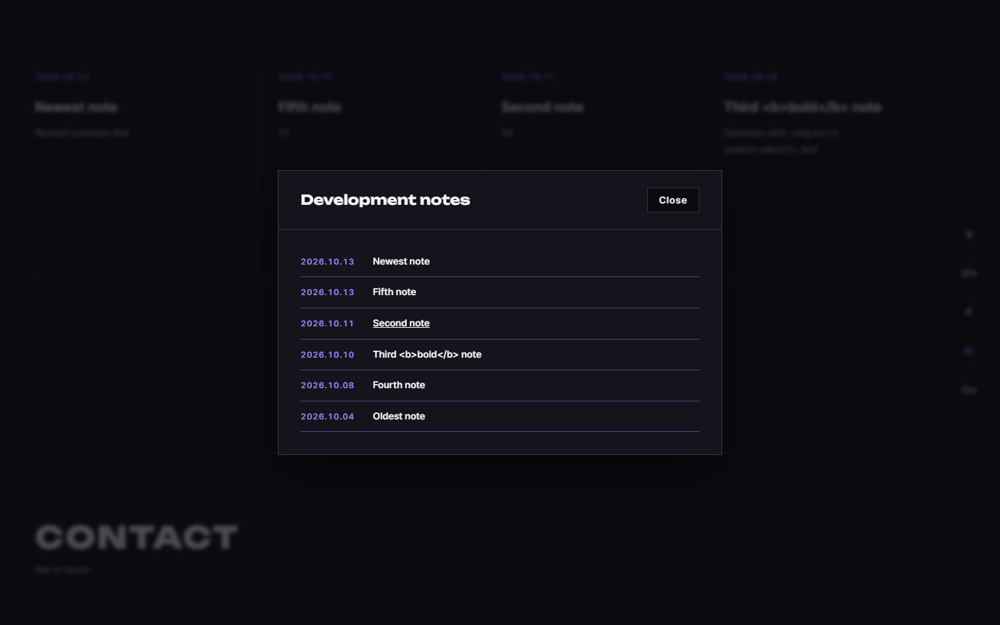
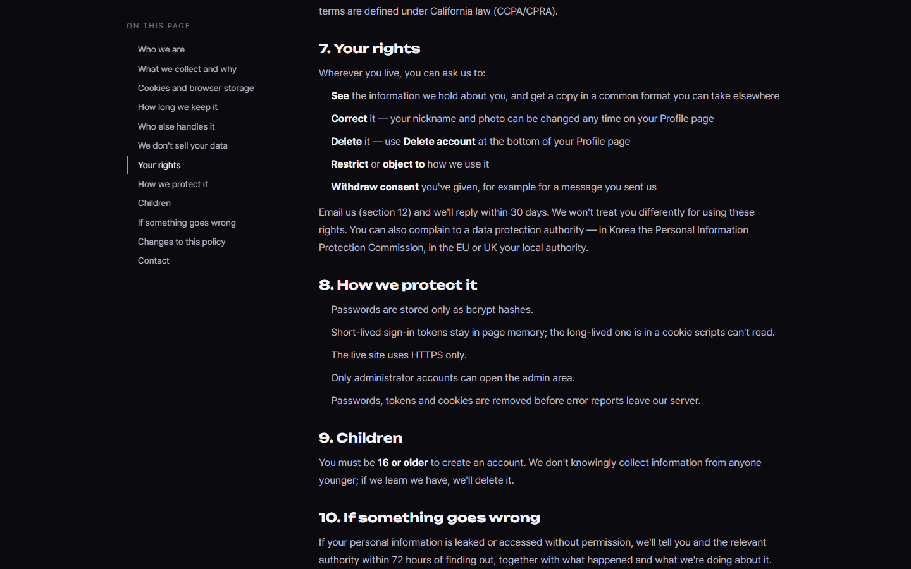
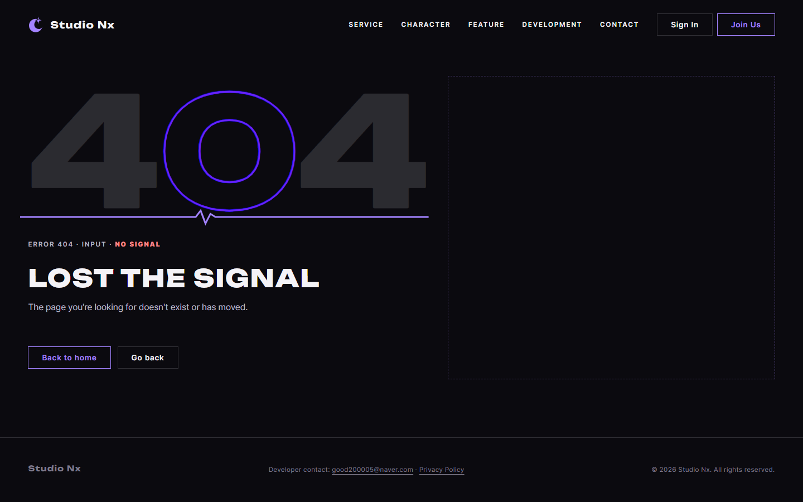
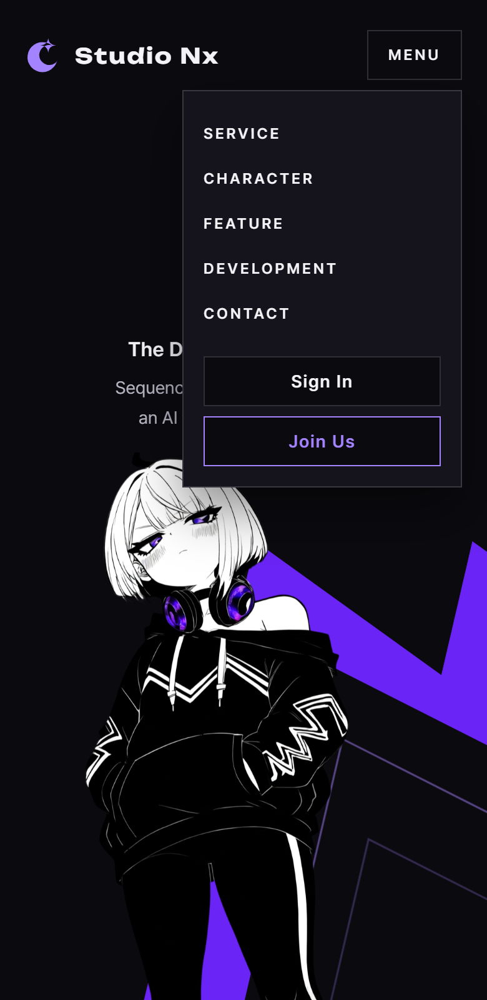
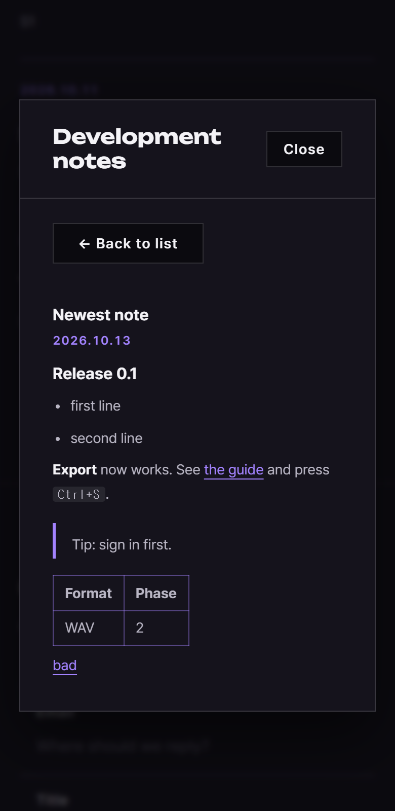

# AI 구현 설명 63 — P1-23 실제 화면 시험 (홈, 처리방침, 오류 페이지를 사람처럼 클릭해서)

| 항목 | 내용 |
|---|---|
| 작성 | Claude (AI), 2026-10-13 |
| 대상 | P1-23 화면 마무리 ([62](62_p1-23_ui_polish.md)) |
| 환경 | 시험용 개발 서버 `http://localhost:8001` (**Sentry 끔**), 실제 MySQL, 헤드리스 Chrome, 시간대는 서울 |
| 방법 | 브라우저에 **마우스 이동, 누름, 뗌과 키보드 입력**을 직접 보냈습니다. PC(폭 1440)와 모바일(폭 390). 시험용 공지 9개(공개 6, 초안, 예약 중, 삭제)를 DB에 넣고, 본문에는 서식과 공격 글(`<script>`, ``, `javascript:` 링크)을 넣었습니다 |
| 결과 | **17단계 모두 통과** (PC 13, 모바일 4) |
| 이전 시험 | [60](60_p1-21_site_test.md) |

## 1. PC (폭 1440, 13단계)
| # | 한 일 | 결과 |
|---|---|---|
| H01 | 새 탭에서 처음 `home.html`을 엶 | 로딩이 보임 ✔ |
| H02 | 로딩이 끝난 뒤 | 첫 화면이 나오고 공지 카드 4개가 **실제 공지**로 채워짐 (`Newest note`가 첫 칸) ✔ |
| H03 | 같은 탭에서 홈을 다시 엶 | 로딩이 보이지 않음 ✔ |
| H04 | Service 섹션에서 세로 앵커의 `D`를 마우스로 누름 | Development로 이동하고 `D`가 표시됨 ✔ |
| H05 | `+ View More`를 누름 | 공지 목록 모달이 열리고 공개된 6개가 보임 ✔ |
| H06 | 첫 공지를 누름 | 제목과 서식 본문(제목, 목록, 굵게, 링크, 인용, 표). 공격 글은 실행되지 않고 `script`도 남지 않음 ✔ |
| H07 | `Back to list` | 목록으로 돌아옴 ✔ |
| H08 | `Esc` | 모달이 닫힘 ✔ |
| H09 | 푸터의 `Privacy Policy`를 누름 | 개인정보 처리방침 페이지로 이동 ✔ |
| H10 | 목차의 `rights`를 누름 | 그 절로 이동하고 목차에 `Your rights`가 표시됨 ✔ |
| H11 | 없는 주소(`/no-such-page`)를 엶 | 404 오류 페이지, `Go back` 버튼이 있음 ✔ |
| H12 | `Go back`을 누름 | 이전 페이지(처리방침)로 돌아감 ✔ |
| H13 | 전체 과정 | 화면 오류(예외)가 한 번도 나지 않음 ✔ |

## 2. 모바일 (폭 390, 4단계)
| # | 한 일 | 결과 |
|---|---|---|
| M01 | `Menu`를 누름 | 메뉴가 열림 ✔ |
| M02 | 메뉴의 `Development`를 누름 | 메뉴가 닫히고 그 섹션으로 이동 ✔ |
| M03 | 공지 카드 | 한 줄로 쌓이고 화면이 가로로 넘치지 않음 ✔ |
| M04 | 공지 모달의 상세(표 포함) | 가로로 넘치지 않음 ✔ |

## 3. 시험 중 있었던 일
- 처음에 H04가 실패했습니다. 세로 앵커는 첫 화면이 화면에서 사라진 뒤에야 나타나게 되어 있는데(CSS), 시험이 맨 위에서 눌러서 보이지 않는 앵커를 눌렀기 때문입니다. 앱의 문제가 아니라 시험의 순서 문제여서, Service 섹션으로 먼저 내려간 뒤에 누르도록 고쳤습니다.
- 모바일 메뉴와 공지 모달의 함수 단위 시험(JS 98, 100번)에서 겪은 시험 쪽 문제(부드러운 스크롤, 스크롤이 남은 상태에서 버튼이 헤더에 가려짐)는 각 문서에 적었습니다. 이 전체 시험에서는 같은 문제가 없도록 클릭 전에 즉시 스크롤하고 단계마다 상태를 확인했습니다.
- 앱 코드는 이 시험에서 고친 곳이 없습니다.

## 4. 아직 시험하지 않은 것
| 항목 | 이유 |
|---|---|
| 공지가 50개를 넘을 때 | 시험 공지가 9개뿐입니다. 목록은 최대 50개만 가져옵니다 |
| 실제 기기(모바일 브라우저) | 헤드리스 Chrome의 모바일 흉내(폭 390)로만 시험했습니다 |
| 움직임 줄이기 설정을 켠 환경의 로딩 | 이 설정이면 로딩 자체가 보이지 않는 것이 CSS의 원래 동작이고 이번에 건드리지 않았습니다 |
| 마이페이지에서 오류 페이지로 갔다 `Try again`으로 돌아오는 흐름 | 함수 단위 시험(JS 96번 E01 ~ E03)에서 실제 서버로 확인했습니다 |

## 5. 정리
시험용 공지 9개와 시험 계정 `sitetest.p117@example.com`(마이페이지 시험용)과 그 프로젝트를 지웠고, 시험용 서버(포트 8001)를 종료했습니다. 임시로 만든 실행 파일은 남아 있지 않습니다.
