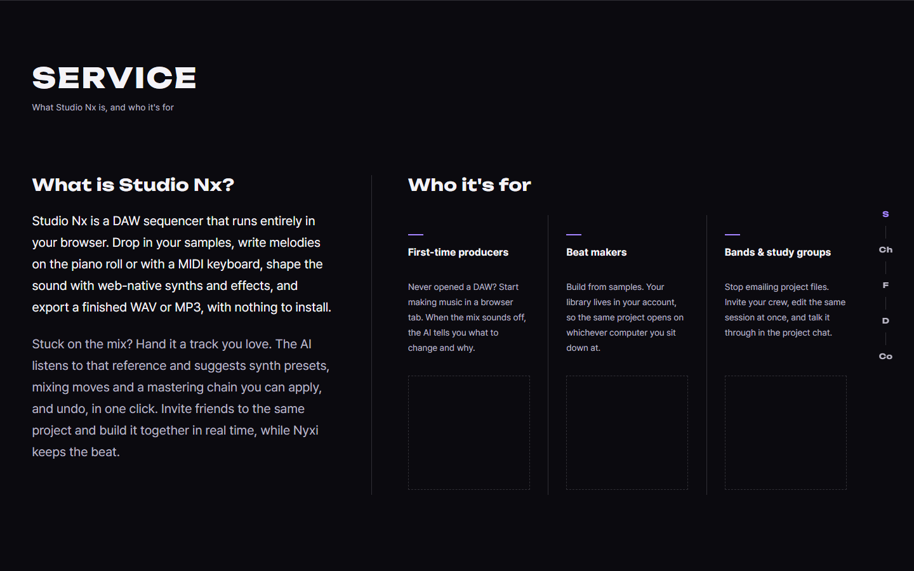
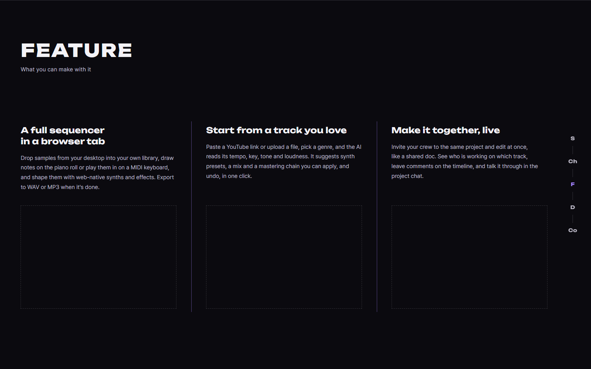
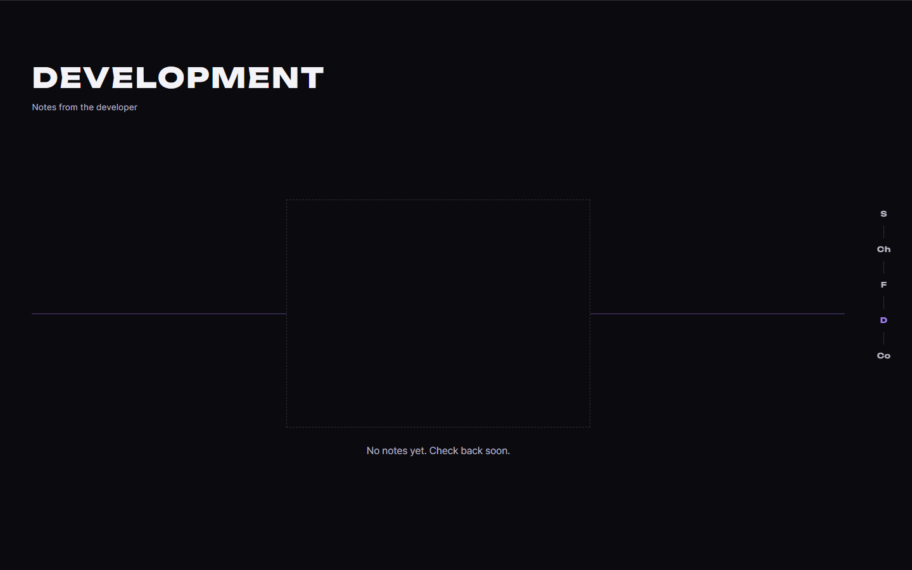
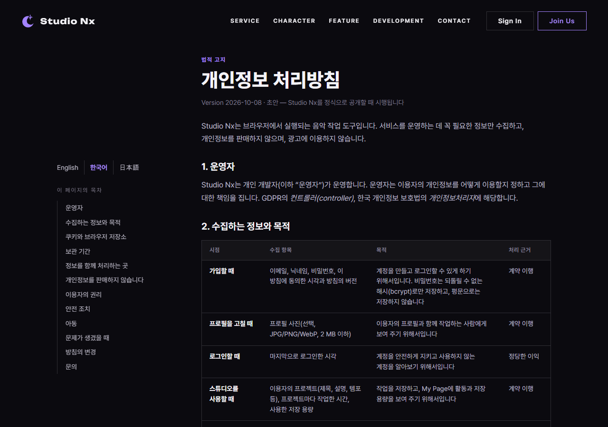
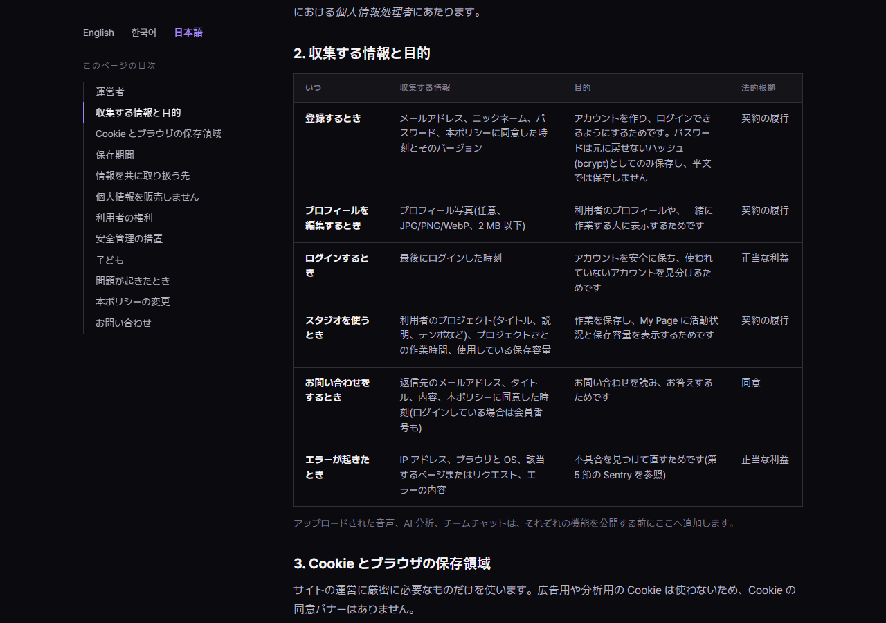

# AI 구현 설명 64 — P1-24 홈 화면 수정(레퍼런스및수정사항5)과 개인정보 처리방침 한국어, 일본어판

| 항목 | 내용 |
|---|---|
| 작성 | Claude (AI), 2026-10-13 |
| 작업 | P1-24 (YouTrack StudioNx-74): 사용자의 수정 요청 두 가지 |
| 요청 1 | `frontend-reference/images/main page reference/레퍼런스및수정사항5.pdf`의 방식대로 `home.html` 수정: Service와 Feature의 세 칸 폭을 같게, Development의 "공지 없음" 화면 바꾸기 |
| 요청 2 | `privacy.html`은 중요한 내용이므로 **일본어와 한국어 버전**도 함께 만들고, 언어 설정은 자연스럽게 배치 |
| 브랜치 | `feature/phase1/p1-24-ui-fixes` (`develop`에서 만듦, PR의 대상도 `develop`) |
| 바꾼 파일 | `home.html`, `css/pages/home.css`, `pages/home.js`(공지 없음 문구), `privacy.html`(언어 전환), `privacy.ko.html`, `privacy.ja.html`(새 파일), `css/pages/privacy.css`, `pages/privacy.js` |
| 함수별 설명 | `docs/ai-notes/javascript/P1-24 - 화면 수정과 처리방침 번역/102` |
| 실제 화면 시험 | [65_p1-24_site_test.md](65_p1-24_site_test.md): 총 52개 시험 통과 |
| 이전 문서 | [63_p1-23_site_test.md](63_p1-23_site_test.md) |

## 1. 요청 1: 홈 화면 수정 (PDF 5쪽)
PDF의 지시는 네 가지였고, 모두 반영했습니다.

| PDF 쪽 | 지시 | 한 일 |
|---|---|---|
| 1쪽 | Service 단 오른쪽(Who it's for)의 폭이 3등분이 아닌 것 같으므로 고칠 것 | **원인을 찾아 고침** (아래) |
| 2쪽 | Feature 단도 3등분인지 확인하고, 안 되어 있으면 고칠 것 | 확인해 보니 **같은 문제**가 있어서 같은 방식으로 고침 |
| 3, 4쪽 | Development의 빈 화면(큰 빈 영역)을 지우고 다음 장의 화면으로 바꿀 것 | 빈 영역을 없애고 5쪽 모양으로 바꿈 |
| 5쪽 | 가운데에 일러스트(PixAI에서 만들 예정)와 문구 "No notes yet. Check back soon." | 일러스트 자리(점선 상자)와 문구를 가운데에 둠 |

### 1-1. 세 칸 폭이 달랐던 원인
칸의 폭(`grid`의 `1fr`)은 사실 같았지만, **칸 안의 글 폭**이 달랐습니다. 첫 칸은 왼쪽 여백이 없고 오른쪽 여백만 있고, 둘째 칸은 양쪽에 여백이 있어서 첫 칸의 글이 더 넓었습니다. 실제로 PDF 1쪽의 글 폭을 재 보니 첫 칸 약 266px, 둘째와 셋째 칸 약 228px이었습니다.

| 전 | 후 |
|---|---|
| 칸은 같은 폭, 칸마다 다른 안쪽 여백(첫 칸은 오른쪽만, 가운데 칸은 양쪽), 구분선은 칸의 왼쪽 테두리 | 칸은 같은 폭, **여백 대신 칸 사이 간격**(`column-gap`)을 두고, 구분선은 **간격의 한가운데**에 그림 |

그러면 세 칸의 글 폭이 완전히 같아지고, 구분선은 두 칸 사이의 한가운데에 놓입니다. Feature는 첫 칸과 끝 칸의 여백이 달라서 **가운데 칸이 가장 좁았고**, 같은 방식으로 고쳤습니다. 같은 구조의 **Development 카드(4칸)**도 같은 문제가 있어서 함께 고쳤습니다 (PDF에는 없지만 같은 원인입니다).

### 1-2. Development의 공지 없음 화면
| 상황 | 화면 |
|---|---|
| 공지 없음 | 가운데에 **일러스트 자리**(점선 상자, 4:3)와 아래에 **"No notes yet. Check back soon."**. 가로 보라선이 일러스트 뒤를 지나감 (PDF 5쪽) |
| 불러오기 실패 | 일러스트 없이 오류 문구만 ("Notes are unavailable right now…") |
| 모바일(폭 760 이하) | 일러스트 자리를 숨기고 문구만 (Service, Feature의 일러스트 자리와 같은 규칙) |
| 공지 있음 | 전과 같은 카드 |

일러스트는 PixAI에서 만들어 오면 `.dev-blank__art` 안에 ``를 넣으면 됩니다 (`home.html`의 주석에 적어 두었습니다). 점선 상자의 비율은 4:3이고 그림이 그 안에 `object-fit: contain`으로 들어갑니다.

JS는 문구를 넣는 한 곳만 바뀌었습니다. `loadDevNotes()`(97번)가 "공지 없음", "불러오기 실패"를 구분해서 상태(`data-state`)를 달고, CSS가 그 상태에 따라 일러스트 자리를 보이거나 숨깁니다.

## 2. 요청 2: 개인정보 처리방침 한국어, 일본어판
| 파일 | 언어 |
|---|---|
| `privacy.html` | 영어 (기존) |
| `privacy.ko.html` | 한국어 (새로 만듦) |
| `privacy.ja.html` | 일본어 (새로 만듦) |

### 2-1. 번역
- 영어판의 **12개 절, 표 3개(수집 항목 6행, 쿠키 3행, 서비스 제공업체 2행), 목록, 연락처**를 모두 옮겼습니다. 구조가 세 판에서 같도록 시험으로 확인했습니다 (§3).
- 법률 용어는 각 언어의 관행에 맞췄습니다. 예를 들어 **처리 근거**(계약 이행, 정당한 이익, 동의 ⇄ 契約の履行, 正当な利益, 同意), **개인정보처리자**(한국 개인정보 보호법), **개인정보 보호위원회**입니다.
- 화면의 버튼과 글자는 사이트가 영어이므로 `Delete account`, `Profile`, `Keep me signed in`, `Deleted user` 같은 **영어 이름을 그대로 쓰고 뜻을 괄호로 덧붙였습니다**. 이용자가 실제 화면에서 보는 글자와 맞기 위해서입니다.
- 버전은 세 판 모두 `Version 2026-10-08`로 같습니다. 번역만 추가한 것이라 가입 동의 버전(`PRIVACY_VERSION`)은 올리지 않았습니다.
- 한국어 제목 "개인정보 처리방침", 일본어 "プライバシーポリシー"를 씁니다.

### 2-2. 언어 설정의 배치 ("자연스럽게")
왼쪽 옆줄의 **목차 바로 위**에 `English | 한국어 | 日本語` 한 줄을 두었습니다.

| 선택 | 이유 |
|---|---|
| 목차와 같은 **스크롤을 따라오는 옆줄**에 둠 | 글을 읽다가 어느 절에서든 언어를 바꿀 수 있습니다. 제목 옆에 두면 7절을 읽다가 바꾸려고 맨 위로 올라가야 합니다 |
| 지금 언어는 보라색 굵은 글자 | 목차에서 현재 절이 보라색인 것과 같은 규칙입니다 |
| 각 언어 이름을 **그 언어 글자**로 | `한국어`, `日本語`는 영어 화면에서도 그 언어를 아는 사람이 바로 알아봅니다 (`lang` 속성도 달아 화면 낭독기가 올바른 발음으로 읽음) |
| 언어를 바꿔도 **읽던 절에서 이어서** (`initLanguageLinks()`, 102번) | `privacy.ko.html#rights`처럼 해시를 붙여 줍니다. 세 판의 절 `id`가 같기 때문에 가능합니다 |
| 브라우저 언어를 보고 **자동으로 이동하지 않음** | 처리방침은 법적 문서라서 읽는 언어를 사용자가 고르는 것이 안전합니다 |
| `<link rel="alternate" hreflang>` 4개 | 검색 엔진에 세 판의 관계를 알려 줍니다 (`x-default`는 영어) |
| 사이트의 공통 머리글과 바닥글은 영어 그대로 | 사이트 전체 화면이 영어이고(2026-10-07 결정), 이번 요청은 처리방침 문서의 번역입니다 |

### 2-3. 글꼴과 줄바꿈
영어 제목 글꼴(Unbounded)에는 한글, 가나, 한자가 없어서, 한국어판과 일본어판은 제목도 본문 글꼴로 바꿨습니다. 일본어는 시스템 글꼴(Hiragino Sans, Yu Gothic, Meiryo)이 이어받습니다. 줄바꿈은 한국어는 어절 단위(`word-break: keep-all`), 일본어는 금칙 처리를 엄격하게(`line-break: strict`) 적용했습니다. 한국어와 일본어는 글자 사이에서도 줄이 바뀌어 표의 좁은 칸(처리 근거, 행 제목)이 한 글자씩 세로로 쌓였는데, 칸의 최소 폭을 두어 고쳤습니다.

## 3. 시험
| 방법 | 대상 | 결과 |
|---|---|---|
| 실제 서버, 헤드리스 Chrome ([65](65_p1-24_site_test.md)) | 홈의 세 칸 폭, 공지 없음 화면, 처리방침 세 판과 언어 전환 | **52개 통과** |

## 4. 알아 둘 점과 다음 일
| 항목 | 내용 |
|---|---|
| **번역의 법률 검토** | 번역은 영어판의 내용을 그대로 옮긴 것이고 법률 자문이 아닙니다. 영어판과 같이 **정식 공개 전에 검토**가 필요합니다. 특히 **일본어판**은 일본 사용자를 대상으로 하려면 일본의 개인정보보호법(APPI)이 요구하는 항목(예: 외국에 있는 제3자 제공에 관한 안내, 일본 감독기관인 個人情報保護委員会 안내)을 영어판 기준에 더하는 것을 권합니다. 지금은 영어판의 범위(GDPR, CCPA/CPRA, 한국 개인정보 보호법)를 그대로 옮겼습니다 |
| **세 판을 함께 고쳐야 함** | 처리방침 내용을 바꾸면 세 파일(`privacy.html`, `.ko.html`, `.ja.html`)과 `PRIVACY_VERSION`을 함께 올려야 합니다. 각 파일 맨 위의 주석에 적어 두었습니다 |
| 다른 곳의 처리방침 글 | 홈의 문의 모달 요약, 가입 화면의 동의 문구, 푸터의 `Privacy Policy` 링크는 영어 그대로이고 `privacy.html`로 연결됩니다. 이 화면들에서 한국어나 일본어 판으로 바로 가는 링크는 아직 없습니다 |
| 일러스트 | Development의 공지 없음 일러스트는 PixAI에서 만들어 오시면 `.dev-blank__art` 안에 넣겠습니다 |
| 다음 | **S1-05**(오디오 엔진 기초) |
