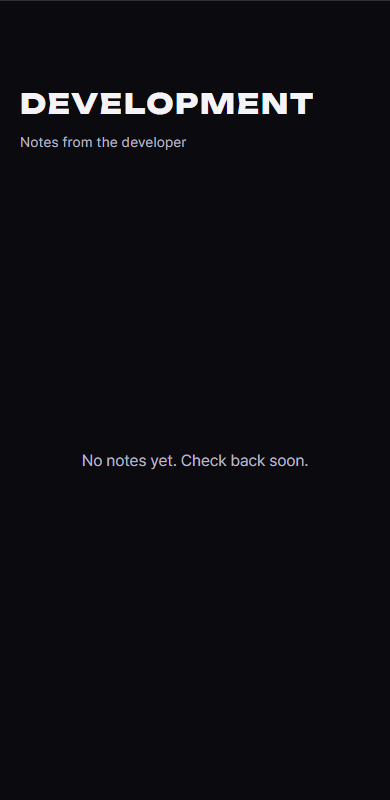
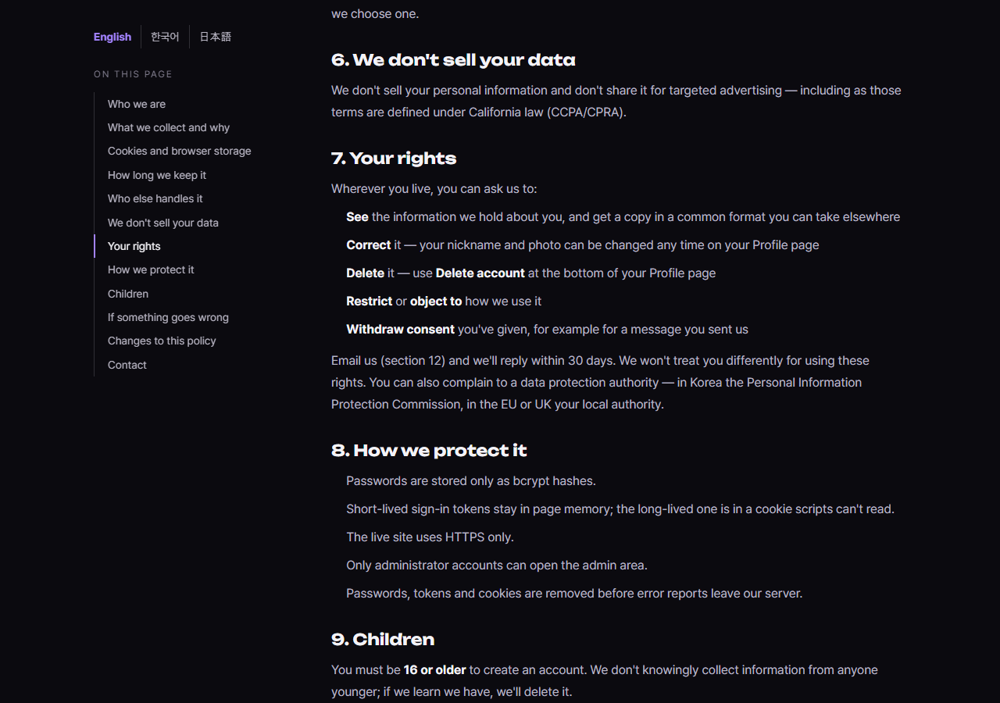
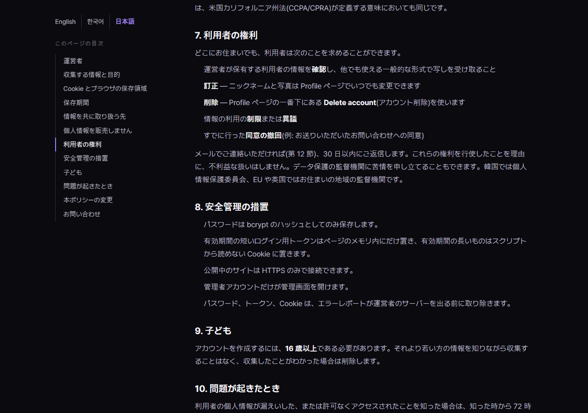
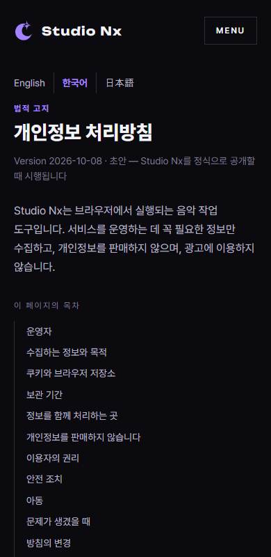
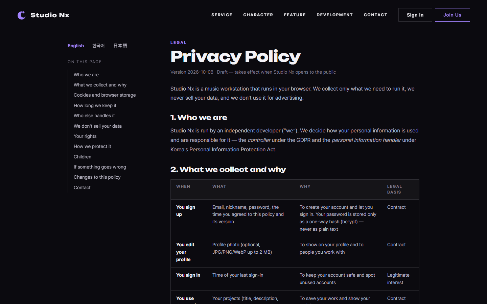
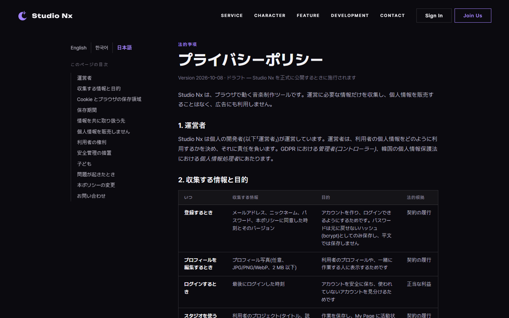

# AI 구현 설명 65 — P1-24 실제 화면 시험 (홈 세 칸 폭, 공지 없음 화면, 처리방침 세 판과 언어 전환)

| 항목 | 내용 |
|---|---|
| 작성 | Claude (AI), 2026-10-13 |
| 대상 | P1-24 ([64](64_p1-24_ui_fixes_privacy_i18n.md)) |
| 환경 | 개발 서버 `http://localhost:8000` (사용자가 켜 두라고 한 서버), 헤드리스 Chrome |
| 방법 | 화면의 글 폭과 위치를 **실제로 재서** 확인하고, 언어 전환은 마우스와 키보드를 직접 보내 확인했습니다. 가짜 공지 응답은 브라우저 안에서만 만들었고 DB는 건드리지 않았습니다 |
| 결과 | **69개 모두 통과** (홈 폭 14, 공지 없음과 카드 10, 처리방침 25, 표 3, 옆줄 위치 17) |
| 이전 시험 | [63](63_p1-23_site_test.md) |

## 1. 홈의 세 칸 폭 (14개)
Service와 Feature의 세 칸에서, 각 칸의 **폭과 글 폭**을 재서 같은지, 구분선이 칸 사이 간격의 **한가운데**에 있는지 확인했습니다.

| 화면 폭 | Service 세 칸 | Feature 세 칸 | 구분선 위치 |
|---|---|---|---|
| 1920 | 같음 ✔ | 같음 ✔ | 한가운데(오차 1px 이내) ✔ |
| 1440 | 같음 ✔ | 같음 ✔ | ✔ |
| 1280 | 같음 ✔ | 같음 ✔ | ✔ |
| 1160 | 같음 ✔ | 같음 ✔ | ✔ |
| 1024(태블릿) | Service, Feature 모두 같음 ✔ | | |
| 390(모바일) | 한 칸으로 쌓이고, 세로 구분선은 없고, 가로로 넘치지 않음 ✔ | | |

"같음"은 칸의 폭과 칸 안의 글(`p`) 폭이 1px 이내로 같다는 뜻입니다. 고치기 전에는 첫 칸의 글이 약 266px, 둘째와 셋째가 약 228px이었습니다.

## 2. Development의 공지 없음 화면과 카드 (10개)
| # | 한 일 | 결과 |
|---|---|---|
| V01 | 실제 서버(공지 없음) | 일러스트 자리와 "No notes yet. Check back soon."이 보이고, 카드와 `+ View More`는 없음 ✔ |
| V02 | 위치 | 일러스트 자리와 문구가 본문의 가운데에 있고, 문구는 일러스트 아래, 일러스트 비율 4:3 ✔ |
| V03 | 가로선 | 일러스트를 가로지르는 선이 없고(`::before` 없음), 공지 없음 화면에 다른 가로선도 없음 ✔ |
| V04 | 서버 오류(500) 흉내 | 일러스트 없이 오류 문구만 (`data-state="error"`) ✔ |
| V05 | 공지 4개가 오는 상태 | 카드 4개, 빈 화면은 숨김, `+ View More`가 보임 ✔ |
| V06 | 카드 4칸 폭 (1440) | 4칸의 폭이 같음 ✔ |
| V07 | 1024px | 2열이고 칸 폭이 같으며 둘째 줄 첫 칸에는 세로선이 없음 ✔ |
| V08 | 390px | 한 열, 세로선 없음, 가로로 넘치지 않음 ✔ |
| V09 | 390px에서 공지 없음 | 일러스트 자리는 숨기고 문구만, 가로로 넘치지 않음 ✔ |
| V10 | 전체 과정 | 화면 오류(예외)가 없음 ✔ |

## 3. 처리방침 세 판과 언어 전환 (25개 + 표 3개)
### 3-1. 세 판이 같은 구조인지
| # | 확인 | 결과 |
|---|---|---|
| L01, L02 | 영어, 한국어, 일본어 각각 열림, `html lang`이 맞음, 제목이 있음, 현재 언어가 표시됨 | ✔ ✔ ✔ |
| L03 | **구조가 같음**: 목차 12개, 절 12개(`id` 순서까지), 번호 1~12, 표 3개, 표의 행 수, 목록 항목 수, 메일 링크 | ✔ |
| L04 | 세 판의 `Version`이 같음 (`2026-10-08`) | ✔ |
| L05 | 각 판의 목차 링크가 **그 판의 파일**을 가리킴 | ✔ |

제목은 `Privacy Policy`, `개인정보 처리방침`, `プライバシーポリシー`입니다.

### 3-2. 언어 전환 (읽던 절에서 이어서)
| # | 한 일 | 결과 |
|---|---|---|
| S00 | 영어판에서 `rights` 절을 읽는 중 | 목차에 `Your rights` 표시 ✔ |
| S01 | 옆줄의 `한국어`를 마우스로 누름 | `/privacy.ko.html#rights`, 한국어판의 같은 절이 표시됨 ✔ |
| S02 | `日本語`를 누름 | `/privacy.ja.html#rights`, 일본어판의 같은 절 ✔ |
| S03 | 목차로 `keep`에 간 뒤 `English` | `/privacy.html#keep` (해시가 겹치지 않음) ✔ |
| S04 | 맨 위에서 누름 | 해시 없이 열림 ✔ |
| S05 | 새 탭으로 열기(누름 직후) | 링크 주소에 현재 절이 붙어 있음 ✔ |
| S06 | 같은 링크에 5번 반복 | `#`가 한 번만 ✔ |
| S07 | 키보드: 링크에 포커스를 주고 Enter | 같은 절을 이어서 열림 ✔ |

### 3-3. 글꼴, 줄바꿈, 표, 모바일
| # | 확인 | 결과 |
|---|---|---|
| F01 | 한국어, 일본어: 가로로 넘치지 않고, 제목이 영문 전용 글꼴(Unbounded)이 아님 | ✔ ✔ |
| F02 | 줄바꿈 규칙: 한국어 `keep-all`, 일본어 `strict` | ✔ ✔ |
| 표 | 한국어, 일본어, 영어 모두 행 제목 칸 ≥ 100px, 마지막 칸 ≥ 80px (한 글자씩 세로로 쌓이지 않음) | ✔ ✔ ✔ |
| M | 390px에서 세 판 모두 가로로 넘치지 않고, 언어 전환이 화면 안에 들어오며 누르기 쉬운 높이(24px 이상) | ✔ ✔ ✔ |
| X01 | 전체 과정에서 화면 오류(예외)가 없음 | ✔ |

### 3-4. 옆줄(언어 전환과 목차)의 위치가 언어마다 같은지 (17개)
사용자가 "언어가 바뀔 때마다 옆줄 위치가 바뀌는 것 같다"고 알려 주셔서 **실제로 재 보았고, 맞았습니다.**

| 확인 | 고치기 전 | 고친 뒤 |
|---|---|---|
| 옆줄의 위쪽 위치 (1440px) | 영어 335px, 한국어와 일본어 342px (7px 차이) | 세 언어 모두 같음 |
| 옆줄의 왼쪽 위치, 폭, 본문의 왼쪽 위치 | 같음 | 같음 |

**원인**: 옆줄이 제목 영역 **아래**(둘째 줄)에서 시작했고, 제목 영역의 높이가 언어마다 달랐습니다(영어 183px, 한국어와 일본어 190px: 제목 아래 설명 줄의 줄 간격 차이). 그래서 옆줄이 7px 오르내렸습니다. **고침**: 옆줄을 두 줄(제목 줄과 본문 줄)에 걸쳐 **맨 위에서 시작**하게 해서 제목 영역의 높이와 무관하게 했습니다.

| # | 확인 | 결과 |
|---|---|---|
| 1~3 | 화면 폭 1440, 1100, 961에서 언어 전환과 목차의 위치(위, 왼쪽)가 세 언어에서 같음 | ✔ ✔ ✔ |
| 4~6 | 옆줄이 제목의 맨 위와 같은 높이에서 시작함 | ✔ ✔ ✔ |
| 7~9 | 본문이 제목 바로 아래에서 시작함 (옆줄이 길어도 간격이 벌어지지 않음, 40px 이하) | ✔ ✔ ✔ |
| 10~12 | 세 폭 모두 가로로 넘치지 않음 | ✔ ✔ ✔ |
| 13, 14 | 900px, 390px: 언어 전환의 위치가 세 언어에서 같음 | ✔ ✔ |
| 15, 16 | 900px, 390px: 순서가 언어 전환 → 제목 → 목차 → 본문이고 가로로 넘치지 않음 | ✔ ✔ |
| 17 | `#rights`로 열어 스크롤된 상태에서 옆줄이 화면의 같은 자리에 붙어 있음 | ✔ |

## 4. 시험 중 있었던 일
- **언어 전환의 위치를 옮겼습니다.** 처음에는 언어 링크를 제목 줄 오른쪽 끝에 두었는데, 시험(S01, S02, S07)이 실패했습니다. 7절을 읽다가 그 링크를 누르려면 맨 위로 올라가야 해서 누르는 순간 "읽던 절"이 사라졌기 때문입니다. 시험 코드의 문제가 아니라 **배치의 문제**여서, 링크를 스크롤을 따라오는 옆줄(목차 위)로 옮기고 시험을 "스크롤하지 않고 그 자리에서 누르기"로 바꿨습니다. 처음 만든 배치가 사용자에게 불편했을 것을 시험이 발견해 준 경우입니다.
- 일본어, 한국어 표의 좁은 칸이 한 글자씩 세로로 쌓였습니다(스크린샷으로 확인). 칸의 최소 폭을 두어 고쳤고 표 시험(3개)을 더했습니다.
- S07은 시험이 주소의 앞쪽 `/`를 빠뜨려서 한 번 실패로 나왔고(앱은 맞게 동작), 시험을 고쳤습니다.
- 화면 폭 시험은 처음부터 14개 모두 통과했습니다.

## 5. 아직 시험하지 않은 것
| 항목 | 이유 |
|---|---|
| 번역의 정확성 | 문장의 의미가 영어판과 같은지는 기계적으로 시험할 수 없습니다. 한국어는 사용자가 읽어 확인하시고, 일본어는 원어민이나 전문가의 검토를 권합니다 |
| 일러스트가 들어간 모습 | PixAI에서 그림이 아직 없습니다. ``가 `object-fit: contain`으로 4:3 상자에 들어가는 것만 CSS로 준비했습니다 |
| 실제 모바일 기기 | 헤드리스 Chrome의 폭 390 흉내로만 확인했습니다 |

## 6. 정리
이번 시험은 DB에 데이터를 만들지 않았습니다. 가짜 공지는 브라우저 안의 응답으로만 만들었습니다. 개발 서버(포트 8000)는 요청하신 대로 켜 둔 채입니다.
