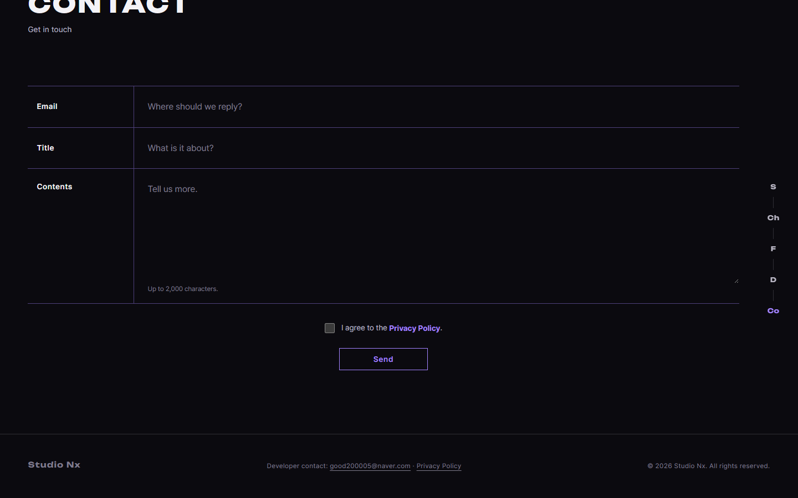
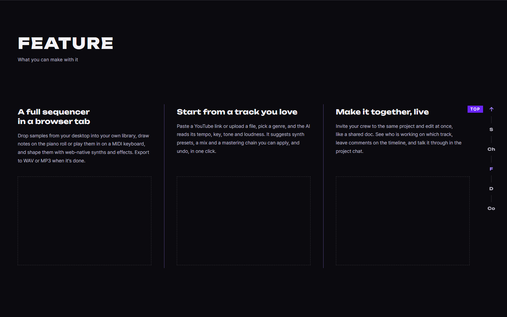

# AI 구현 설명 66 — P1-25 처리방침 링크의 언어 연결, 일본 감독기관 안내, 목차 표시 오류, 알림창 스크롤바, 맨 위로 앵커

| 항목 | 내용 |
|---|---|
| 작성 | Claude (AI), 2026-10-13 |
| 작업 | P1-25 (YouTrack StudioNx-75): P1-24 후속 세 가지, 목차 표시 오류, 알림창 스크롤바, 맨 위로 앵커 |
| 브랜치 | `feature/phase1/p1-25-privacy-links` (`develop`에서 만듦) |
| 함수별 설명 | `docs/ai-notes/javascript/P1-25 - 처리방침 링크 언어 연결/103` |
| 이전 문서 | [64](64_p1-24_ui_fixes_privacy_i18n.md), [65](65_p1-24_site_test.md) |

## 1. 한 일
| # | 내용 | 바꾼 곳 |
|---|---|---|
| 1 | 참고 자료 `레퍼런스및수정사항5.pdf`, `.pptx`를 저장소에 올림 | `studionx/frontend-reference/images/main page reference/` |
| 2 | 푸터, 문의 모달, 가입 동의 문구의 Privacy Policy 링크가 **브라우저 언어에 따라 한국어, 일본어판**으로 연결됨 | `core/privacy-links.js`(새 파일), `core/include.js` ([JS 103](<javascript/P1-25 - 처리방침 링크 언어 연결/103_privacy-links_pickPrivacyPage_localizePrivacyLinks.md>)) |
| 3 | 처리방침 7절(이용자의 권리)에 **일본의 감독기관(個人情報保護委員会)** 안내를 더함. 세 판 모두 | `privacy.html`, `privacy.ko.html`, `privacy.ja.html` |
| 4 | 목차에서 `1. Who we are`를 누르면 **2번이 표시되던 오류**를 고침 | `pages/privacy.js`의 `initTocActiveState()` ([101 §8](<javascript/P1-23 - 화면 마무리/101_privacy_initTocActiveState.md>)) |
| 5 | Contact의 Send를 누르면 **스크롤바가 사라지고 화면이 밀리던 문제**를 고침 | `css/dialog.css` |
| 6 | 오른쪽 세로 앵커 맨 위(S 위)에 **맨 위로 가는 화살표(Top)** 추가 (목업 C안) | `home.html`, `css/pages/home.css`, `pages/home.js` ([100 §개정](<javascript/P1-23 - 화면 마무리/100_home_intro_sidenav_menu.md>)) |

## 2. 동작 방식
링크의 원래 주소는 HTML에서 `privacy.html`(영어판)이고, 조각 파일을 끼워 넣은 직후에 `localizePrivacyLinks()`가 브라우저 언어(`navigator.languages`)를 보고 `privacy.ko.html`, `privacy.ja.html`로 바꿉니다. **페이지를 자동으로 옮기지는 않습니다.** 처리방침은 법적 문서라서 읽는 언어를 사용자가 고르게 둡니다. 처리방침 안의 언어 전환(`English | 한국어 | 日本語`)은 영어 링크가 영어판으로 가야 하므로 바꾸지 않습니다.

## 3. 목차 표시 오류 (4번)
1절이 짧아서 목차로 이동한 뒤 1절의 아래 경계와 2절의 위쪽이 감지 띠에 함께 걸렸고, "경계에서는 아래쪽 절"이라는 규칙이 2절을 골랐습니다. 이제 절의 위쪽 끝이 `scroll-margin-top` 기준선에 닿은 마지막 절을 표시합니다. 맨 아래에 막힌 끝쪽 절은 주소의 `#…`를 보고, 이미 맨 아래라 스크롤이 없는 이동은 `hashchange`로 반영합니다. 자세한 내용은 101번 §8에 있습니다.

## 3-1. 알림창의 스크롤바 (5번)
문의 폼은 모달이 아니라 홈 화면 본문에 있어서, 알림창("Message sent")이 `body`에 붙습니다. 이때 SweetAlert2가 `body`에 `overflow: hidden`을 걸어 일반 스크롤바(Windows)가 사라지고 화면 폭이 넓어져 내용이 밀렸습니다. `dialog.css`에서 `body.swal2-shown`의 `overflow`를 `visible`로 덮어써서 스크롤바와 위치를 그대로 둡니다. 뒤 배경은 어두운 막이 가리고, 알림창이 떠 있는 동안 뒤 화면을 휠로 스크롤할 수 있다는 점이 트레이드오프입니다. 헤드리스 Chrome은 스크롤바가 폭을 차지하지 않아 밀림 자체는 재지 못했고, `overflow` 값과 스크롤 위치가 그대로인 것만 확인했습니다.

## 3-2. 맨 위로 앵커 (6번)
목업 세 안(A 글자 H, B 집 모양, C 위 화살표) 중 사용자가 **C**를 골랐습니다. 첫 화면 `<section id="top">`을 가리키는 링크(`href="#top"`)이고, 마우스를 올리면 `TOP` 라벨이 펼쳐집니다. 앵커 전체가 첫 화면이 사라질 때 나타나는 기존 규칙을 따르며, 부드러운 스크롤은 `html { scroll-behavior: smooth }`가 맡습니다. `initSideNavActiveState()`는 `#top`을 구간 표시 대상에서 제외합니다. 맨 위로 올라가면 첫 화면이 감지 띠에 걸려 화살표가 구간처럼 강조되었기 때문입니다.

## 4. 시험
| 방법 | 대상 | 결과 |
|---|---|---|
| 실제 서버, 헤드리스 Chrome | 링크 연결(en, ko, ja, fr 브라우저, 푸터, 문의 모달, 가입 화면, 클릭 이동, 반복 호출) | 17개 통과 |
| 같은 방법 | 맨 위로 앵커(6개 앵커, 누르면 맨 위, 올라간 뒤 숨음, 구간 표시 없음) | 5개 통과 |
| 같은 방법 | 목차 12개를 실제 마우스로 누르기 (세 판, 부드러운 스크롤 포함) | 3개 통과 |
| 회귀 | 처리방침 25개, 표 3개, 옆줄 17개 | 모두 통과 |
| 백엔드 | pytest 684개, ruff (변경 없음 확인) | 통과 |

## 5. 알아 둘 점과 다음 일
| 항목 | 내용 |
|---|---|
| 일본어판의 법률 검토 | 감독기관 안내는 더했지만, 일본 개인정보보호법(APPI)의 나머지 항목(외국에 있는 제3자 제공에 관한 안내 등)은 **전문가 검토를 권하며 아직 열려 있습니다** |
| 처리방침을 바꿀 때 | 세 파일과 `PRIVACY_VERSION`을 함께 고쳐야 합니다. 이번 7절 문구 추가는 안내 문구이고 가입 동의 버전은 올리지 않았습니다 |
| 사용자의 추가 수정 목록 | 사용자가 PDF로 따로 알려 주기로 했습니다 |
| 다음 | **S1-05**(오디오 엔진 기초) |
