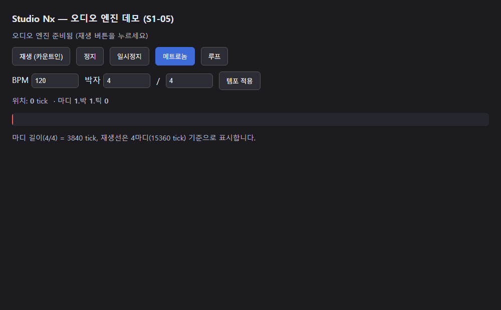

# AI 구현 설명 67 — S1-05 오디오 엔진 기초 (AudioContext, 트랜스포트, 스케줄러, 메트로놈, 루프)

| 항목 | 내용 |
|---|---|
| 작성 | Claude (AI), 2026-10-14, 사용자 검토 |
| 작업 | S1-05 오디오 엔진 기초 (YouTrack StudioNx-40), PRD 02 FR-201, FR-202, FR-202a, FR-203, FR-204, FR-205 |
| 브랜치 | `feature/phase1/s1-05-audio-engine` (`develop`에서 만듦) |
| 바꾼 파일 | `static/js/audio/timing.js` (새 파일), `static/js/audio/scheduler.js` (새 파일), `static/js/audio/metronome.js` (새 파일), `static/js/audio/engine.js` (새 파일), `audio-demo.html` (새 파일) |
| 진행 방식 | **함수 하나씩** 구현 → 사용자 검토 → 다음. 실제 코드는 **전통 문법**(`?.`, `??` 없음), 최신 문법 버전은 함수 문서의 "최신 문법으로 쓰면" 절에 |
| 함수별 설명 | `docs/ai-notes/javascript/S1-05 - 오디오 엔진 기초/104 ~ 114` (md, PDF), 합본 [S1-05_audio_engine.pdf](<javascript/S1-05 - 오디오 엔진 기초/S1-05_audio_engine.pdf>) |
| 이전 문서 | [66_p1-25_privacy_links.md](66_p1-25_privacy_links.md) |

## 1. 실행 결과
데모 페이지에서 재생, 정지, 일시정지, 메트로놈, 루프, BPM과 박자를 직접 눌러 소리와 재생선을 확인할 수 있습니다. 아래는 페이지를 열었을 때의 모습이고, 재생을 누르면 노란 안내가 "재생 중…"으로 바뀌면서 빨간 재생선이 움직입니다.

## 2. 한 일
이 작업은 소리와 시간을 다루는 Phase 2의 첫 단계입니다. 순수 계산(시간 변환, 스케줄 계산, 메트로놈 판정)을 먼저 만들고, 그 위에 실제 소리 시계(AudioContext)를 얹었습니다.

| 파일 | 역할 |
|---|---|
| `audio/timing.js` | tick과 초를 서로 바꿉니다. PPQ는 960입니다 |
| `audio/scheduler.js` | 앞으로 울릴 소리를 미리 계산하고(107), 타이머로 반복해 소리를 예약합니다(108, 109, 110, 113) |
| `audio/metronome.js` | 메트로놈이 어느 tick에서 울릴지 판정하고(111), 켜고 끄며 카운트인을 만듭니다(112) |
| `audio/engine.js` | 위 계산을 실제 `AudioContext`에 연결하고, 페이지가 쓰기 쉬운 하나의 객체로 묶습니다(114) |
| `audio-demo.html` | 엔진을 사람이 직접 눌러 확인하는 시험용 페이지입니다 |

## 3. 함수 11개 (번호는 P1-25의 103에 이어서)
| # | 파일 | 함수 | 하는 일 | 설명 |
|---|---|---|---|---|
| 104 | `timing.js` | `ticksToSeconds(tick, bpm)` | tick을 초로 바꿉니다 | [104](<javascript/S1-05 - 오디오 엔진 기초/104_timing_ticksToSeconds.md>) |
| 105 | `timing.js` | `ticksToSecondsWithChanges(tick, bpm, changes)` | 박자 추가와 변경 지점을 반영해 tick을 초로 바꿉니다 | [105](<javascript/S1-05 - 오디오 엔진 기초/105_timing_ticksToSecondsWithChanges.md>) |
| 106 | `timing.js` | `secondsToTicks(seconds, bpm, changes)` | 초를 tick으로 되돌립니다 | [106](<javascript/S1-05 - 오디오 엔진 기초/106_timing_secondsToTicks.md>) |
| 107 | `scheduler.js` | `planSchedule(...)` | 어떤 시각까지 울릴 소리들을 미리 계산합니다 | [107](<javascript/S1-05 - 오디오 엔진 기초/107_scheduler_planSchedule.md>) |
| 108 | `scheduler.js` | `Transport` | 재생, 정지, 위치를 관리하는 스케줄러 루프입니다 | [108](<javascript/S1-05 - 오디오 엔진 기초/108_scheduler_Transport.md>) |
| 109 | `scheduler.js` | `Transport.pause / resume / seek` | 일시정지, 다시 재생, 위치 이동을 합니다 | [109](<javascript/S1-05 - 오디오 엔진 기초/109_scheduler_Transport_position.md>) |
| 110 | `scheduler.js` | `Transport.setTempo()` | 재생 중에 BPM과 박자 변경을 바꿉니다 | [110](<javascript/S1-05 - 오디오 엔진 기초/110_scheduler_setTempo.md>) |
| 111 | `metronome.js` | `metronomeClick()` | 한 tick이 박의 시작인지, 강박인지 판정합니다 | [111](<javascript/S1-05 - 오디오 엔진 기초/111_metronome_metronomeClick.md>) |
| 112 | `metronome.js` | `Metronome`, `countInTicks()` | 메트로놈을 켜고 끄며 카운트인 길이를 구합니다 | [112](<javascript/S1-05 - 오디오 엔진 기초/112_metronome_Metronome.md>) |
| 113 | `scheduler.js` | `Transport.setLoop()` | 구간을 정해 끝에 닿으면 처음으로 되돌립니다 | [113](<javascript/S1-05 - 오디오 엔진 기초/113_scheduler_loop.md>) |
| 114 | `engine.js` | `AudioEngine`, `createClickPlayer()` | 계산을 실제 `AudioContext`에 연결하고 클릭 소리를 냅니다 | [114](<javascript/S1-05 - 오디오 엔진 기초/114_engine_AudioEngine.md>) |

## 4. 재생이 흐르는 방식
재생 버튼을 한 번 누르면 다음 순서로 소리와 화면이 움직입니다.

| 순서 | 일어나는 일 | 함수 |
|---|---|---|
| ① | 카운트인으로 한 마디 전(-3840 tick)에서 시작합니다 | 112, 114 |
| ② | 타이머가 25ms마다 깨어나 0.1초 앞까지 울릴 소리를 미리 계산합니다 | 108, 107 |
| ③ | 계산된 자리마다 메트로놈이 울리고, 첫 박은 강박(1600Hz)으로 구분합니다 | 111, 114 |
| ④ | 화면은 `requestAnimationFrame`으로 `positionTick()`을 읽어 재생선을 그립니다 | 108, 114 |
| ⑤ | 루프가 켜져 있으면 4/4 한 마디(3840 tick)에서 처음으로 되돌아 반복합니다 | 113 |
| ⑥ | 템포나 박자를 바꾸면 재생 위치를 유지한 채 다시 계산합니다 | 110 |

`clock`(브라우저에서는 `AudioContext.currentTime`)과 타이머를 주입받게 만든 이유는, Node에서 가짜 시계와 가짜 타이머로 소리 없이 계산을 시험하기 위해서입니다. 같은 방식으로 나중에 오프라인 렌더(`OfflineAudioContext`)도 씁니다.

## 5. 처음 설계에서 달라진 점
| 항목 | 처음 계획 | 구현 | 이유 |
|---|---|---|---|
| 루프 | 별도 반복 함수 | `planSchedule`에 `loop` 인자 | 소리 예약 계산을 한 곳에 모읍니다 |
| 템포 변경 | 값만 저장 | 재생 중이면 위치를 읽고 기준점을 다시 잡음 | 바꾼 순간 소리가 밀리지 않습니다 |
| 카운트인 | 음수 전용 타이머 | 트랜스포트를 음수 위치에서 시작 | 111의 음수 격자가 그대로 카운트인 클릭을 만듭니다 |
| AudioContext 연결 | 함수마다 직접 | `engine.js`에서 한 번에 묶음 | 순수 계산(104~113)을 다시 시험할 필요가 없습니다 |
| 기본 타이머 | 전역 `setInterval` 그대로 | 함수로 감싼 래퍼 | `this.setTimer(...)`로 부르면 `this`가 어긋나 "Illegal invocation"이 났습니다 |

## 6. 시험
| 방법 | 대상 | 결과 |
|---|---|---|
| Node에서 직접 실행 (가짜 시계, 가짜 타이머) | 104 ~ 114 함수별 | 함수별 누계 **298개 통과** (106은 105의 23개를 다시 포함) |
| 가짜 `AudioContext` | 114 `AudioEngine` | 예약, 클릭, `resume`, 카운트인, 전달까지 41개 통과 |
| headless Chrome 스모크 | `audio-demo.html` | `data-engine=ready`, 모듈 로드 통과 |
| 오프라인 렌더 | 메트로놈 데모 소리 | 통과 (`audio/metronome-demo.wav`, 8초) |

**시험으로 찾아 고친 빈틈 하나**
| 함수 | 빈틈 | 고친 것 |
|---|---|---|
| 108 `Transport` | 기본 타이머가 `this.setTimer(...)`로 전역 `setInterval`을 부르면 `this`가 Transport가 되어 "Illegal invocation"이 나고, 브라우저에서 재생이 안 됐습니다 | 기본값을 `function (fn, ms) { return setInterval(fn, ms); }`로 감쌌습니다 (`fix(frontend)` 커밋) |

## 7. 남은 일과 다음 작업이 쓰는 곳
| 작업 | 쓰는 것 |
|---|---|
| S1-06 타임라인 | `positionTick()`으로 재생선을 그리고, `setLoop()`으로 구간 반복을 겁니다 |
| S1-07 이후 악기, 미디 | `engine.start({ onStep })`의 `onStep(tick, time)`에 실제 악기 소리를 얹습니다 |
| 오프라인 렌더 (S1-11) | 같은 `clock` 주입 방식으로 `OfflineAudioContext`를 넘겨 파일로 굽습니다 |
| 이 작업에서 미룬 것 | 소리 샘플 로딩, 트랙별 악기, 오디오 녹음은 뒤 작업입니다 |

- 데모에서 쓴 소리 산출물(`audio/metronome-demo.wav`, `audio/metronome-demo.webm`)은 저장소에 커밋하지 않습니다.
