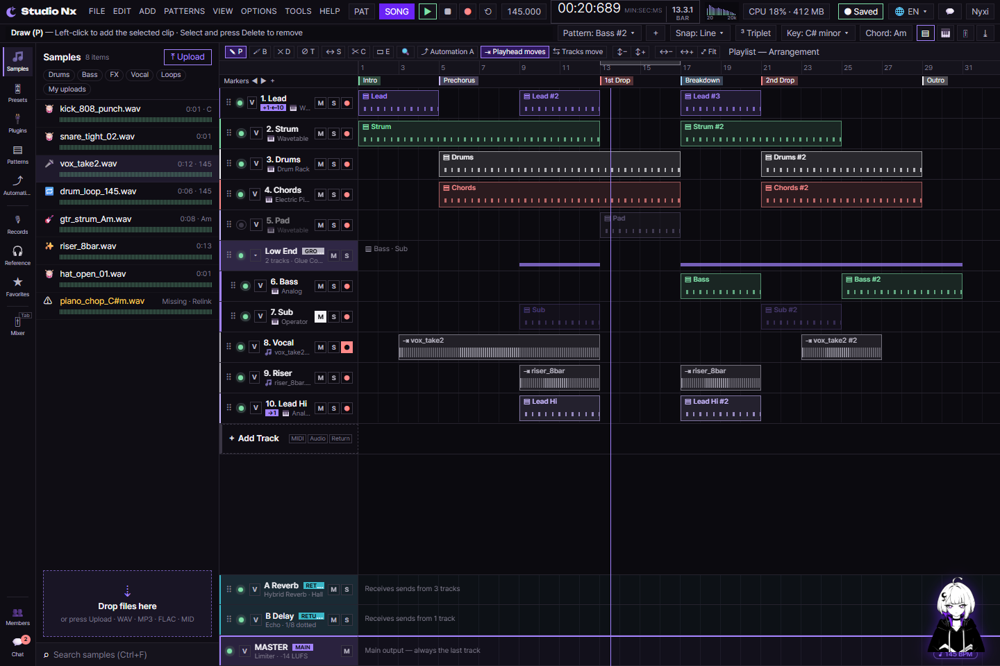

# AI 구현 설명 68 — S1-06 타임라인 (그리드 스냅, 트랙, 클립 편집, 줌, 파형)

| 항목 | 내용 |
|---|---|
| 작성 | Claude (AI), 2026-10-14, 사용자 검토 |
| 작업 | S1-06 타임라인 (YouTrack StudioNx-39), PRD 02 FR-206, FR-207, FR-208, FR-209, FR-210 |
| 브랜치 | `feature/phase1/s1-06-timeline` (`develop`에서 만듦) |
| 바꾼 파일 | `static/js/pages/sequencer-arrange.js` (함수 34개 추가·배선), `studioNx.html` (Snap 메뉴·그립·줌 버튼), `static/css/pages/studio.css` (클립 손잡이·× 버튼·그립·줌 버튼) |
| 진행 방식 | **함수 하나씩** 구현 → 사용자 검토 → 다음. 실제 코드는 **전통 문법**(`?.`, `??` 없음), 최신 문법 버전은 함수 문서의 "최신 문법으로 쓰면" 절에 |
| 함수별 설명 | `docs/ai-notes/javascript/S1-06 - 타임라인/115 ~ 148` (md, PDF) |
| 이전 문서 | [67_s1-05_audio_engine.md](67_s1-05_audio_engine.md) |

## 1. 실행 결과
시퀀서 화면에서 트랙과 클립을 직접 다룰 수 있습니다. 클립을 끌어 옮기고, 양끝을 잡아 길이를 바꾸고(트리밍), Ctrl+D로 복제하고, 가위로 자르고, 트랙을 추가·삭제·순서 바꾸기 합니다. 격자 스냅을 바꿀 수 있고, 가로·세로로 줌도 됩니다. 오디오 클립에는 파형이 보입니다.

## 2. 한 일
S1-05로 만든 시간 계산 위에, 화면에서 클립과 트랙을 편집하는 부분을 올렸습니다.

| 파일 | 역할 |
|---|---|
| `pages/sequencer-arrange.js` | 편곡 화면의 함수 34개를 담습니다. 순수 계산(115~139)과 화면 배선(140~148)이 함께 있습니다 |
| `studioNx.html` | Snap 메뉴(1/1~1/32, 셋잇단), 트랙 그립(⠿), 줌 버튼(↕+, ↕−) 자리를 넣었습니다 |
| `static/css/pages/studio.css` | 클립 양끝 손잡이(`::before`·`::after`), 트랙 × 버튼, 트랙 그립, 줌 버튼 모양을 넣었습니다 |

## 3. 함수 34개 (번호는 S1-05의 114에 이어서)
| # | 함수 | 하는 일 | 설명 |
|---|---|---|---|
| 115 | `TICKS_PER_BAR`, `ticksToBars` | 마디와 tick을 서로 바꿉니다 (1마디 = 3840 tick) | [115](<javascript/S1-06 - 타임라인/115_sequencer-arrange_ticksToBars.md>) |
| 116 | `barsToTicks` | 마디를 tick으로 바꿉니다 | [116](<javascript/S1-06 - 타임라인/116_sequencer-arrange_barsToTicks.md>) |
| 117 | `divisionTicks`, `DIVISION_DEN` | 음표 분할(1/1~1/32)의 tick 길이를 구합니다 | [117](<javascript/S1-06 - 타임라인/117_sequencer-arrange_divisionTicks.md>) |
| 118 | `tripletTicks` | 셋잇단(한 칸을 3등분) 길이를 구합니다 | [118](<javascript/S1-06 - 타임라인/118_sequencer-arrange_tripletTicks.md>) |
| 119 | `snapStepTicks` | 분할과 셋잇단을 합친 한 칸 길이를 구합니다 | [119](<javascript/S1-06 - 타임라인/119_sequencer-arrange_snapStepTicks.md>) |
| 120 | `snapTick` | 어떤 tick을 가장 가까운 격자로 붙입니다 | [120](<javascript/S1-06 - 타임라인/120_sequencer-arrange_snapTick.md>) |
| 121 | `moveClipStart` | 클립 시작을 옮길 때의 새 시작을 구합니다 | [121](<javascript/S1-06 - 타임라인/121_sequencer-arrange_moveClipStart.md>) |
| 122 | `resizeClipLength` | 오른쪽 끝을 끌 때의 새 길이를 구합니다(최소 한 칸) | [122](<javascript/S1-06 - 타임라인/122_sequencer-arrange_resizeClipLength.md>) |
| 123 | `trimClipLeft` | 왼쪽 끝을 끌 때 시작·길이·오프셋을 구합니다 | [123](<javascript/S1-06 - 타임라인/123_sequencer-arrange_trimClipLeft.md>) |
| 124 | `splitClip` | 한 클립을 두 조각으로 가릅니다(오프셋 유지) | [124](<javascript/S1-06 - 타임라인/124_sequencer-arrange_splitClip.md>) |
| 125 | `duplicateClipStart` | 복제본을 놓을 시작을 구합니다 | [125](<javascript/S1-06 - 타임라인/125_sequencer-arrange_duplicateClipStart.md>) |
| 126 | `clampZoom` | 배율을 최소·최대 안으로 맞춥니다 | [126](<javascript/S1-06 - 타임라인/126_sequencer-arrange_clampZoom.md>) |
| 127 | `zoomScrollLeft` | 마우스 아래 마디를 고정할 스크롤 위치를 구합니다 | [127](<javascript/S1-06 - 타임라인/127_sequencer-arrange_zoomScrollLeft.md>) |
| 128 | `stepTrackHeight` | 트랙 높이의 다음 단계 값을 구합니다 | [128](<javascript/S1-06 - 타임라인/128_sequencer-arrange_stepTrackHeight.md>) |
| 129 | `nextTrackNumber` | 새 트랙에 붙일 번호를 구합니다 | [129](<javascript/S1-06 - 타임라인/129_sequencer-arrange_nextTrackNumber.md>) |
| 130 | `renumberMap` | 트랙 번호를 다시 매기는 표를 만듭니다 | [130](<javascript/S1-06 - 타임라인/130_sequencer-arrange_renumberMap.md>) |
| 131 | `reorderItems` | 끌어 놓은 자리에 맞게 목록 순서를 바꿉니다 | [131](<javascript/S1-06 - 타임라인/131_sequencer-arrange_reorderItems.md>) |
| 132 | `trackColor` | 트랙 번호로 색 이름을 고릅니다 | [132](<javascript/S1-06 - 타임라인/132_sequencer-arrange_trackColor.md>) |
| 133 | `waveformColumns` | 파형을 클립 폭 칸에 맞게 접습니다 | [133](<javascript/S1-06 - 타임라인/133_sequencer-arrange_waveformColumns.md>) |
| 134 | `waveformBars` | 진폭을 가운데 기준 위·아래 좌표로 폅니다 | [134](<javascript/S1-06 - 타임라인/134_sequencer-arrange_waveformBars.md>) |
| 135 | `drawWaveform` | 좌표를 캔버스에 세로 선으로 그립니다 | [135](<javascript/S1-06 - 타임라인/135_sequencer-arrange_drawWaveform.md>) |
| 136 | `snapOptions` | Snap 메뉴에 넣을 분할 목록을 만듭니다 | [136](<javascript/S1-06 - 타임라인/136_sequencer-arrange_snapOptions.md>) |
| 137 | `setSnapDivision` / `getSnapDivision` | 스냅 분할을 저장하고 읽습니다 | [137](<javascript/S1-06 - 타임라인/137_sequencer-arrange_snapDivision.md>) |
| 138 | `divisionBars` | 나눈 선을 몇 마디마다 그릴지 정합니다 | [138](<javascript/S1-06 - 타임라인/138_sequencer-arrange_divisionBars.md>) |
| 139 | `snapUnitNow` | 지금 스냅 한 칸(tick)을 돌려줍니다 | [139](<javascript/S1-06 - 타임라인/139_sequencer-arrange_snapUnitNow.md>) |
| 140 | Snap 메뉴 배선 | 버튼 글자를 맞추고 메뉴 줄을 만듭니다 | [140](<javascript/S1-06 - 타임라인/140_sequencer-arrange_snapMenu.md>) |
| 141 | `deleteTrack` | 트랙을 지우고 번호를 정리합니다(MASTER 제외) | [141](<javascript/S1-06 - 타임라인/141_sequencer-arrange_deleteTrack.md>) |
| 142 | 트랙 순서 드래그 | 그립을 끌어 트랙 순서를 바꿉니다 | [142](<javascript/S1-06 - 타임라인/142_sequencer-arrange_trackReorder.md>) |
| 143 | 클립 오른쪽 길이 조절 | 오른쪽 끝을 끌어 길이를 바꿉니다 | [143](<javascript/S1-06 - 타임라인/143_sequencer-arrange_clipResizeRight.md>) |
| 144 | 클립 왼쪽 트리밍 | 왼쪽 끝을 끌어 시작·길이·오프셋을 바꿉니다 | [144](<javascript/S1-06 - 타임라인/144_sequencer-arrange_clipTrimLeft.md>) |
| 145 | 클립 복제 | Ctrl+D로 클립을 뒤에 복사합니다 | [145](<javascript/S1-06 - 타임라인/145_sequencer-arrange_clipDuplicate.md>) |
| 146 | 클립 분할 | 가위로 클립을 자릅니다 | [146](<javascript/S1-06 - 타임라인/146_sequencer-arrange_clipSlice.md>) |
| 147 | 가로·세로 줌 배선 | 확대·축소가 검증된 함수를 쓰도록 바꿉니다 | [147](<javascript/S1-06 - 타임라인/147_sequencer-arrange_zoom.md>) |
| 148 | 오디오 클립 파형 배선 | 파형을 캔버스에 그리고 변화 때 다시 그립니다 | [148](<javascript/S1-06 - 타임라인/148_sequencer-arrange_waveform.md>) |

## 4. 요구사항 대응
| 요구사항 | 내용 | 어디서 |
|---|---|---|
| FR-206 | 그리드 스냅 (1/1~1/32, 셋잇단) | 117~120, 136~140 |
| FR-207 | 트랙 추가·삭제·번호 정리 | 129~132, 141 |
| FR-208 | 클립 이동·좌우 길이(트리밍)·복제·분할 | 121~125, 143~146 |
| FR-209 | 가로·세로 줌 | 126~128, 147 |
| FR-210 | 오디오 클립 파형 | 133~135, 148 |

## 5. 처음 설계에서 달라진 점
| 항목 | 처음 계획 | 구현 | 이유 |
|---|---|---|---|
| 클립 분할 | 프로토타입 `sliceClip` 그대로 | `splitClip`으로 교체 | 프로토타입은 오프셋을 반대로 셌습니다(`o - (at-s)`). 트리밍 규칙(115~125)과 어긋나서 검증된 함수로 바꿨습니다 |
| 파형 데이터 | 샘플의 peaks | 샘플 이름으로 만든 자리표시 peaks | 실제 샘플 로딩·디코딩은 S1-10입니다. 그 전에도 배선을 시험할 수 있게 했습니다 |
| 파형 다시 그리기 | 클립마다 이벤트마다 | `MutationObserver` + `requestGrid` | 클립의 `style`(–s·–l·–o) 변화를 한 곳에서 감지하고, 격자와 같은 시점에 한 번만 그립니다 |
| 트랙 삭제 | 헤더 버튼만 | × 버튼 + `deleteTrack` | 번호를 다시 매기고 마지막 MASTER 줄은 남깁니다 |
| 클립 손잡이 | 클립 전체 드래그 | 끝 6px(`EDGE_PX`)은 길이 조절, 가운데는 이동 | 한 요소에서 끄는 위치로 동작을 가릅니다 |

## 6. 시험
| 방법 | 대상 | 결과 |
|---|---|---|
| Node에서 직접 실행 (가짜 `document`) | 115 ~ 139 함수별 | 모듈 적재 11개 통과, 함수별 시험 통과 |
| headless Chrome + CDP 실제 마우스·휠 | 141~148 배선 | 트랙 삭제(1..10→2번 삭제→1..9), 트랙 순서(Lead→2번 자리), 클립 길이(4→7마디), 트리밍(MIDI·오디오·오프셋), 복제(Ctrl+D 3→4개), 분할(MIDI 2/2·오디오 오프셋), 줌(1→1.16·0.25·12·높이 44↔56), 파형(오디오만 그림·이름별 모양·재그림) 모두 통과 |
| 스크린샷 | 화면 | `images/javascript_s1-06/` (타임라인, 클립 손잡이, Snap 메뉴, 트랙 삭제, 파형) |

**시험으로 찾아 고친 빈틈**
| 함수 | 빈틈 | 고친 것 |
|---|---|---|
| 146 클립 분할 | 프로토타입 `sliceClip`이 오프셋을 반대로 셌습니다 | `splitClip`으로 교체하고, 오디오 조각의 오프셋을 "원본 + 왼쪽 길이"로 맞췄습니다 |

## 7. 남은 일과 다음 작업이 쓰는 곳
| 작업 | 쓰는 것 |
|---|---|
| S1-10 저장·불러오기(`/full`) | `onChange`(지금은 `console.debug`)를 실제 저장 API에 연결합니다. 지금은 클라이언트 상태로만 동작합니다 |
| S1-07 이후 | MIDI 편집기와 악기가 클립 데이터(`start_tick`·`length_tick`·`offset_tick`)를 그대로 씁니다 |
| 실제 파형 | S1-10 이후 샘플 peaks가 오면 `placeholderPeaks` 대신 그 값을 넘깁니다 |
| 이 작업에서 미룬 것 | 클립/트랙을 DB에 저장하는 API, 실제 오디오 파일 로딩은 뒤 작업입니다 |
