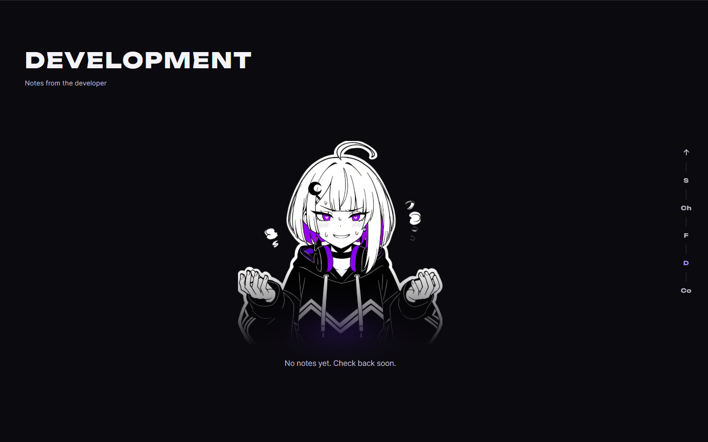
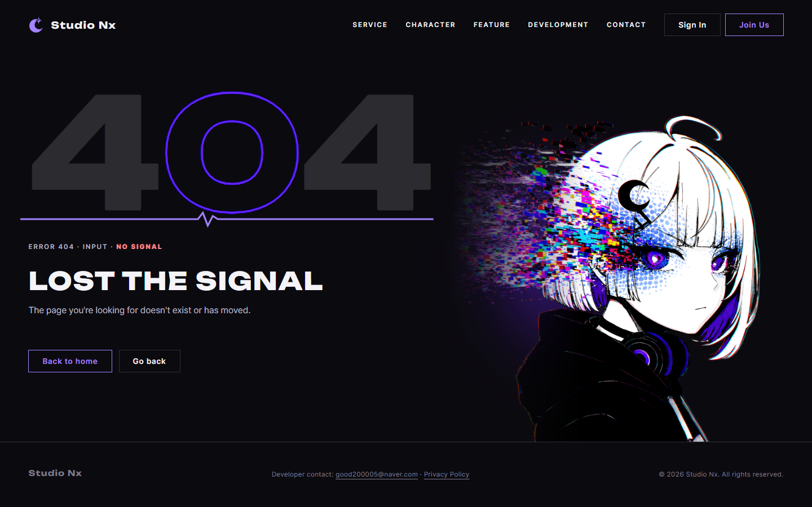

# AI 구현 설명 69 — P1-26 Nyxi 일러스트 삽입 (오류 페이지, 홈 공지 없음 화면)

| 항목 | 내용 |
|---|---|
| 작성 | Claude (AI), 2026-10-14, 사용자 검토 |
| 작업 | P1-26: `일러스트삽입1.pdf`의 지시대로 일러스트를 넣음 |
| 브랜치 | `feature/phase1/p1-26-illustrations` (`develop`에서 만듦) |
| 바꾼 파일 | `errors/400, 403, 404, 429, 500, 503, 504.html`, `css/pages/error.css`, `home.html`, `css/pages/home.css` |
| 새 파일 | `static/characters/nyxi/poses/error.png`, `idk.png` (화면용, 원본은 `studionx/characters/nyxi/poses/`의 `error transparent.png`, `idk transparent.png`) |

## 1. 지시와 결과
| PDF | 지시 | 결과 |
|---|---|---|
| 1쪽 (홈 Development 공지 없음) | 임시 사각형 윤곽을 지우고 `idk` 그림을 넣고, 그림 아래를 흐릿하게 | 점선 상자를 없앴습니다. 윗몸만 정사각형으로 보이고(`aspect-ratio: 1/1`, 위쪽 기준), 아래쪽은 마스크로 서서히 사라지며, 그 아래에 보라색 흐림을 더했습니다 |
| 2쪽 (오류 페이지 전체) | 임시 사각형 윤곽을 지우고 `error` 그림을 넣고, 그림 왼쪽을 흐릿하게 | 7개 오류 페이지에 넣었습니다. 왼쪽 가장자리를 마스크로 서서히 투명하게 하고(14% 지점 35%, 40% 지점에서 원래 농도), 왼쪽 뒤에 보라색 흐림을 깔았습니다 |

## 2. 추가 요청: 그림 아래가 푸터에 닿게
사용자가 "일러스트 밑이 푸터 맨 위까지 닿게" 요청해서, `.err`의 아래 여백을 왼쪽 글 칸(`.err > div:first-child`)으로 옮기고 일러스트 칸은 아래까지 늘렸습니다(`align-self: stretch`, `object-position: right bottom`). 7개 페이지 모두 그림 아래 끝과 푸터 위 끝의 위치가 같음을 확인했습니다(1440×900에서 784px, 1280×720에서 693px, 1920×1080에서 964px).

## 3. 확인한 것과 하지 못한 것
| 확인 | 결과 |
|---|---|
| 헤드리스 Chrome, 7개 오류 페이지와 홈 Development | 그림 표시, 가로 넘침 없음 |
| 폭 시험(홈 세 칸 폭) | 14개 통과 |
| 홈 공지 없음 시험 V02 | 비율이 4:3에서 1:1로 바뀐 요구라 기준을 고쳐야 합니다(중앙 정렬과 문구 위치는 통과) |
| 모바일(760px 이하) | 규칙은 그대로이고 그림은 숨김. 이번 수정 뒤에 다시 보지는 않음 |

## 4. 알아 둘 점
- 일러스트의 흐림 정도는 `error.css`의 마스크(14%, 40%)와 `blur`, `opacity`로 조정합니다.
- 원본 이미지는 크기가 큽니다(오류 그림 1408×1408). 나중에 성능이 문제가 되면 WebP로 줄이는 것을 검토합니다.
