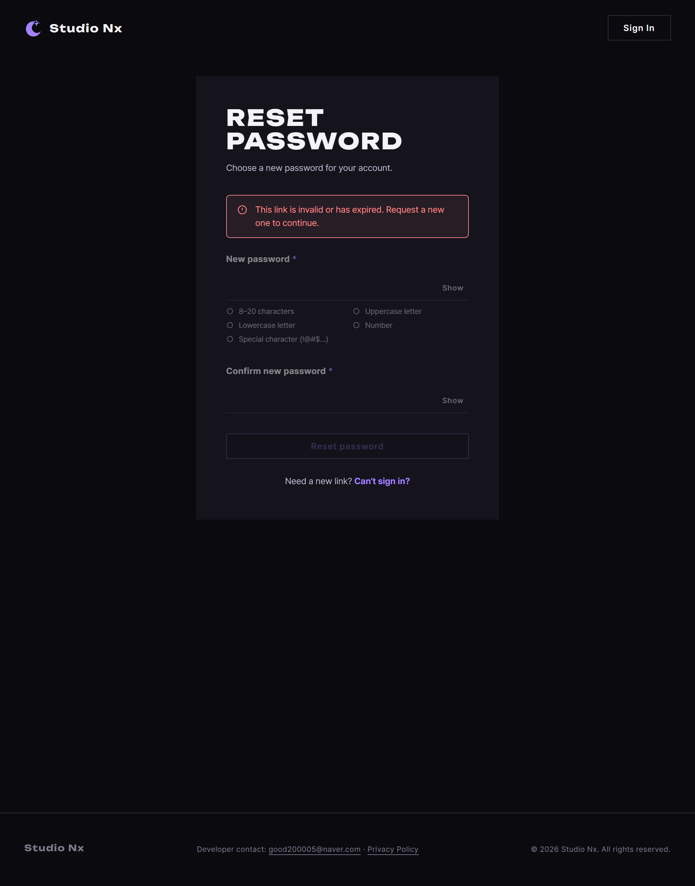

# AI 구현 설명 70 — P1-28 계정 찾기 화면

| 항목 | 내용 |
|---|---|
| 작성 | Claude (AI), 2026-10-15, 사용자 검토 |
| 작업 | P1-28 (YouTrack StudioNx-76): 비밀번호 찾기와 이메일을 잊은 경우의 화면 |
| 브랜치 | `feature/phase1/p1-28-account-recovery` |
| 백엔드 문서 | `docs/ai-notes/backend(fastAPI_Python)/P1-28 - 비밀번호 찾기/150~164` |
| 상태 | 복구 모달의 HTML, CSS, 화면 전환, 폼 전송(JS 165~173)과 페이지 연결 완료(`send again` 포함). `resetPassword.html`은 HTML, CSS, JS(174~176) 완료. 실제 서버와 실제 재설정 링크로 한 흐름을 확인하는 사이트 시험까지 완료([71](71_p1-28_site_test.md)). 남은 것은 커밋과 PR뿐 |

## 1. 화면 구조 (사용자가 정함)
- 로그인 모달 안에서 화면이 바뀝니다. 별도 페이지는 비밀번호를 바꾸는 `resetPassword.html` 하나뿐입니다.
- `New here? Join Us` 아래의 **`Can't sign in?`** 링크(이름은 사용자가 추천안으로 정함)가 복구 화면을 엽니다.
- 복구 화면은 밑줄 탭 둘(**Password**, **Email**)이고, 보낸 뒤 화면은 두 탭이 공유합니다.
- 보낸 뒤 `send again`은 1분 뒤에 켜집니다.

| 화면 | 내용 |
|---|---|
| Sign In | 기존 로그인 화면 (`data-view="login"`) |
| Password 탭 | 이메일 한 칸, `Send reset link` |
| Email 탭 | "쓸 만한 다른 이메일" 한 칸, `Send reminder`, `Contact us` 안내 |
| 보낸 뒤 | `Check your inbox`, `Back to Sign In`, `send again` |


## 2. 1단계에서 한 일 (HTML과 CSS, JS는 아직)
| 파일 | 내용 |
|---|---|
| `static/partials/login-modal.html` | 로그인 화면을 `data-view="login"`으로 감싸고, `data-view="recover"`(처음에는 `hidden`)에 탭, 두 폼, 보낸 뒤 화면을 더했습니다. 제목의 `data-title-login`, `data-title-recover`에 두 화면의 제목을 두었습니다 |
| `static/css/auth.css` | 밑줄 탭(`.tab`), 보낸 뒤 화면(`.recover-sent`), 안내 줄 규칙 |

- 이 조각 파일은 `home.html`과 `join.html`이 함께 쓰므로 두 페이지에 한 번에 반영됩니다.
- 탭은 `role="tablist"`, `role="tab"`, `role="tabpanel"`과 `aria-selected`, `aria-controls`를 달았습니다(화면 낭독기와 키보드 이동을 위한 것이고, 화살표 키로 탭을 옮기는 동작은 JS 단계에서 만듭니다).
- 폼의 `action`은 백엔드 API(`/api/v1/auth/password-reset/request`, `/api/v1/auth/email-reminder/request`)를 가리킵니다. 실제 전송은 JS가 하고, JS가 없어도 폼이 열려 있는 상태로 두기 위해 `action`과 `method`를 적어 두었습니다.
- 로그인 화면은 그대로입니다. 로그인 폼의 `id`와 기존 시험(`#login-form`, `#login-recover` 등)은 바뀌지 않았습니다.

## 3. 시험 (실제 서버, 헤드리스 Chrome)
| 확인 | 결과 |
|---|---|
| 처음에는 로그인 화면이 보이고 복구 화면은 숨음, 로그인 폼과 `Can't sign in?` 버튼이 그대로 있음 | ✔ |
| Password 탭: 입력칸, 탭, 보내기 버튼, 뒤로 버튼이 모달 안에 들어옴, 제목이 `Can't sign in?`로 바뀜, Email 패널은 숨음 | ✔ |
| Email 탭: 패널 전환, 선택 표시(`aria-selected`), Contact 링크(`home.html#contact`) | ✔ |
| 보낸 뒤 화면: 탭과 두 패널이 **실제로** 숨음, `send again`은 잠김, 이메일 표시 | ✔ |
| 모바일 390px: 모달이 화면 안에 들어오고 가로 넘침 없음 | ✔ |
| 기존 로그인 링크 시험 6개(`home.html`, `join.html`), 처리방침 링크 시험 17개 | ✔ |

**시험이 잡은 문제.** 처음 시험에서 "탭 숨김"이 통과했는데, 스크린샷을 보니 보낸 뒤 화면에 **탭이 그대로 보였습니다.** 시험이 `hidden` 속성만 확인했고, 실제로는 `.tabs { display: grid }`가 `hidden` 속성을 이겨서 숨지 않았기 때문입니다. `.tabs[hidden] { display: none; }`을 더했고, 시험도 계산된 스타일(`getComputedStyle().display`)을 보도록 고쳤습니다. 홈 화면의 공지 없음 화면에서 겪었던 것과 같은 종류의 문제(`[hidden]`과 `display`의 충돌)입니다.

## 4. JS 연결 (2026-10-15)
함수 5개를 `static/js/core/recover.js`에 만들고([165](javascript/P1-28%20-%20비밀번호%20찾기/165_recover_showView.md) ~ [169](javascript/P1-28%20-%20비밀번호%20찾기/169_recover_initRecoverFromHash.md)), `home.js`와 `join.js`에서 두 줄씩 불러 실제 화면에 연결했습니다.

```js
initRecover(document.getElementById('login-modal'));          // Can't sign in?, Back to Sign In, 닫으면 초기화, 탭
initRecoverFromHash(document.getElementById('login-modal'));  // home.html#recover 로 열기
```

| 함수 | 하는 일 |
|---|---|
| `showView` | 모달 안에서 로그인 화면 ⇄ 복구 화면 |
| `selectTab` | Password ⇄ Email 탭 |
| `initRecoverTabs` | 탭 클릭과 `← → Home End` |
| `initRecover` | 열기, 돌아오기, 닫으면 로그인 화면으로 초기화(입력값 비움) |
| `initRecoverFromHash` | `#recover`로 열기, 닫으면 주소의 `#recover` 지움 |
| `showSentView` ([170](javascript/P1-28%20-%20비밀번호%20찾기/170_recover_showSentView.md)) | "Check your inbox" 화면 |
| `initRecoverForms` ([171](javascript/P1-28%20-%20비밀번호%20찾기/171_recover_initRecoverForms.md)) | 두 폼 전송, 성공 화면, 실패 문구 |
| `startResendCooldown`, `stopResendCooldown` ([172](javascript/P1-28%20-%20비밀번호%20찾기/172_recover_resendCooldown.md)) | `send again`의 1분 기다림(끝나는 시각 기준으로 셈) |
| `initRecoverResend` ([173](javascript/P1-28%20-%20비밀번호%20찾기/173_recover_initRecoverResend.md)) | `send again`으로 다시 보내기, 429는 서버 시간만큼 다시 잠금 |

### 실제 화면 시험 (헤드리스 Chrome, 24개 통과)
`home.html`, `join.html`에서 **실제 마우스 클릭과 키 입력**으로 시험했습니다.

| 확인 | 결과 |
|---|---|
| 헤더의 `Sign In`으로 모달 열기, `Can't sign in?` 누르기, 복구 화면 | ✔ ✔ |
| Email 탭 클릭, `←`로 Password 탭(커서가 탭으로), `Back to Sign In`, `Esc`로 닫기 | ✔ (8개) |
| 위 흐름에서 자바스크립트 오류 없음 | ✔ ✔ |
| **로그인 폼이 그대로 동작**(틀린 계정은 오류, 모달 유지) | ✔ ✔ |
| `#recover`로 들어오면 복구 화면이 열린 모달 | ✔ ✔ |
| 닫으면 주소의 `#recover`가 사라지고 새로 고침해도 닫힌 채 | ✔ (4개) |
| 전체 흐름에서 자바스크립트 오류 없음 | ✔ ✔ |

기존 시험도 그대로 통과합니다: 로그인 링크 6개, 처리방침 링크 17개, 함수별 시험 27, 40, 39, 28, 31개, 홈 세 칸 폭 14개. 홈 공지 없음 시험 V02는 일러스트가 정사각형으로 바뀐 요구(P1-26)에 맞게 기준을 고쳐야 해서 계속 실패하며 이번 작업과 무관합니다.


## 5. `resetPassword.html` (HTML과 CSS) — 2026-10-15
재설정 메일의 링크로 들어오는 **별도 페이지**입니다. 로그인 모달이 아니라 페이지 하나이고, 카드형은 `join.html`과 같습니다.

| 파일 | 내용 |
|---|---|
| `studionx/frontend/resetPassword.html` | 새 페이지. 제목(`#reset-title`), 안내문, 무효 링크 알림(`#reset-invalid`), 새 비밀번호 폼(`#reset-form`), 다시 요청 줄(`#reset-recover-row`), 성공 화면(`#reset-done`)을 담았습니다 |
| `studionx/frontend/static/css/pages/resetPassword.css` | 페이지 CSS. `join.css`처럼 카드 면, 경고 상자(`.reset__alert`), 잠긴 폼(`.is-locked`), 성공 화면(`.reset__done`)을 정합니다 |

- 폼의 `action`은 백엔드 API(`/api/v1/auth/password-reset/confirm`), 입력칸 이름은 `new_password`와 `new_password_confirm`입니다. 실제 전송은 JS가 하고, JS가 없어도 폼이 열려 있게 두었습니다.
- 비밀번호 규칙 다섯 줄과 `Show` 토글은 가입 화면과 같은 `core/password.js`, `auth.css`를 씁니다.
- 성공 화면은 **자동 로그인을 하지 않습니다**(FR-118). `Sign In` 버튼이 로그인 모달을 열어 새 비밀번호로 직접 로그인하게 합니다.
- `<meta name="referrer" content="no-referrer">` 로 이 페이지에서 다른 곳으로 갈 때 주소를 넘기지 않아, 재설정 링크의 토큰이 Referer로 새지 않게 했습니다.

| 화면 | 내용 |
|---|---|
| 기본 | 새 비밀번호와 확인 두 칸, 규칙 다섯 줄, `Reset password` |
| 무효 링크 | 위쪽에 경고 상자, 폼은 흐리게 잠김, 아래에 `Can't sign in?`(다시 요청) |
| 성공 | 초록 체크, `Password changed`, `Sign In` |





### 시험하며 발견한 것
- `.form-stack { display: flex }` 가 `hidden` 속성을 이겨서, 폼을 숨겨도 보였습니다. §3의 `.tabs[hidden]` 과 같은 함정입니다. `.reset__card .form-stack[hidden]` 과 `.reset__card .auth-sub[hidden]` 에 `display: none` 을 주어 고쳤습니다.
- 성공 화면에서 제목과 체크 사이 간격이 체크와 `Password changed` 사이 간격과 달랐습니다. 둘 다 `--sp-4`(16px)로 맞췄고, 실제 픽셀로 확인했습니다(둘 다 16).

### 실제 화면 시험 (헤드리스 Chrome, 8개 통과)
공통 헤더, 푸터, 로그인 모달이 모두 주입되고 콘솔 예외가 없었습니다. 세 상태(기본, 무효 링크, 성공)에서 `display` 를 계산해 확인했고, 규칙 표시는 JS 175의 시험(`reset_rules.mjs`, 12개)에서 확인합니다.

## 6. `resetPassword.html`의 JS — 2026-10-15
함수 세 개를 `static/js/pages/resetPassword.js`에 만들었습니다.

| 함수 | 하는 일 |
|---|---|
| `readResetToken` ([174](javascript/P1-28%20-%20비밀번호%20찾기/174_reset_readResetToken.md)) | 주소의 `#token=` 을 읽고 곧바로 주소창에서 지움 (이 파일 안에만 둠) |
| `initResetPasswordRules` ([175](javascript/P1-28%20-%20비밀번호%20찾기/175_reset_initResetPasswordRules.md)) | 규칙 다섯 줄 표시, 허용 문자, 확인 칸 일치 (가입 화면과 같은 규칙·문구) |
| `initResetForm` ([176](javascript/P1-28%20-%20비밀번호%20찾기/176_reset_initResetForm.md)) | 전송, 성공 화면, 무효 링크(400), 규칙 오류(422), 연결 실패, 중복 전송 방지 |

### 실제 화면 시험 (헤드리스 Chrome, `fetch`를 가짜로)
- `reset_token.mjs` 8개, `reset_rules.mjs` 12개, `reset_form.mjs` 14개가 모두 통과했습니다.
- 토큰이 없거나 400이면 폼을 잠그고 다시 요청 줄을 보이고, 성공하면 자동 로그인 없이 성공 화면을 보입니다.

## 7. 실제 사이트 시험 — 2026-10-15
함수 시험은 `fetch`를 가짜로 바꿔 응답만 흉내 냈습니다. 이번에는 **진짜 서버, 진짜 DB, 진짜 재설정 토큰**으로 한 흐름을 끝까지 확인했습니다. 준비용 파이썬 스크립트가 시험용 회원을 만들고 `create_reset_token` 경로를 지나 실제 토큰을 뽑았습니다(개발용 메일은 링크를 로그로만 남기므로 그 로그를 가로챘습니다). 자세한 내용과 캡처는 [71](71_p1-28_site_test.md)에 있습니다.
- 메일 링크로 열기(주소창에서 토큰이 곧바로 지워짐), 새 비밀번호 정하기, 성공 화면, 새 비밀번호로 실제 로그인, 옛 비밀번호 차단(401), 재설정 전에 받은 로그인 토큰 차단(401), 무효 링크 화면까지 **8개 모두 통과**했습니다.
- 남은 일: 커밋, PR(`develop`), 사용자 병합, YouTrack StudioNx-76 닫기.
