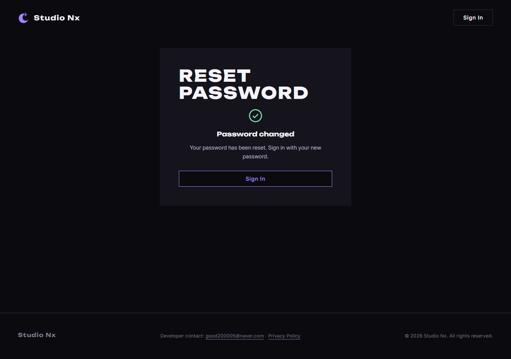
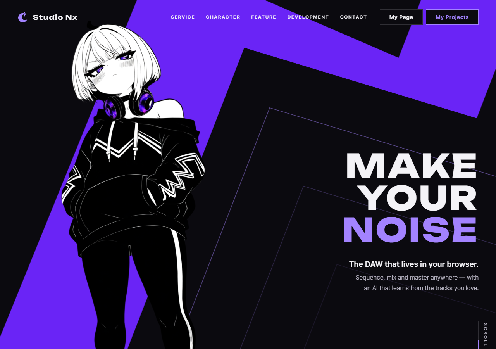
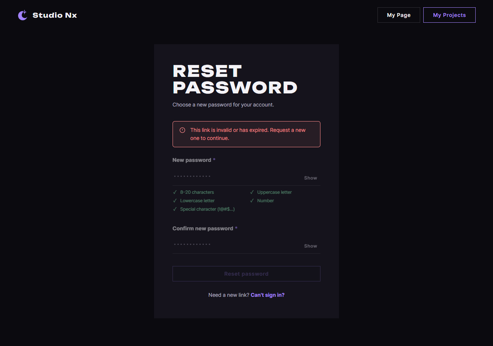

# AI 구현 설명 71 — P1-28 실제 화면 시험 (실제 재설정 링크로 새 비밀번호 정하기)

| 항목 | 내용 |
|---|---|
| 작성 | Claude (AI), 2026-10-15 |
| 대상 | P1-28 ([70](70_p1-28_account_recovery_ui.md)) |
| 환경 | 개발 서버 `http://localhost:8000` (사용자가 켜 둔 서버), MySQL `studionx`, 헤드리스 Chrome |
| 방법 | 시험용 회원을 실제로 만들고 **실제 재설정 토큰**을 뽑아 그 링크로 페이지를 열었습니다. 새 비밀번호는 마우스와 키보드로 직접 입력했고, 마지막에는 그 새 비밀번호로 실제 로그인까지 했습니다 |
| 결과 | **8개 모두 통과** (메일 링크 열기 2, 재설정 성공 2, 새 비밀번호로 로그인 1, 옛 비밀번호 차단 1, 이전 로그인 차단 1, 무효 링크 1) |
| 이전 시험 | [70](70_p1-28_account_recovery_ui.md) §5 HTML/CSS 8개, §6 JS 34개 (8+12+14), 백엔드 [161](<backend(fastAPI_Python)/P1-28 - 비밀번호 찾기/161_auth_password_reset_confirm_route.md>) §5 |

## 1. 이 시험이 보는 것
P1-28의 화면과 함수는 앞에서 각각 따로 시험했습니다. 그 시험들은 `fetch`를 가짜로 바꿔 응답만 흉내 냈습니다. 이 시험은 다릅니다. **진짜 서버, 진짜 DB, 진짜 재설정 토큰**으로, 메일 링크를 받은 사람이 새 비밀번호를 정하고 그 비밀번호로 다시 들어오기까지의 한 흐름을 끝까지 확인했습니다.

## 2. 실제 토큰을 얻은 방법
개발용 메일 설정(`MAIL_BACKEND=log`)은 재설정 링크를 실제로 보내지 않고 서버 로그(`uvicorn.error`)에 `[DEV MAIL] …` 줄로만 남깁니다. 서버 화면에서 그 줄을 읽어 내려받기는 번거로우므로, 준비용 파이썬 스크립트가 서버와 **같은 DB**에 연결해 다음을 했습니다.

1. `auth_service.signup` 으로 시험용 회원을 하나 만듭니다.
2. 재설정 **전에** 받은 로그인을 흉내 내, `auth_service.authenticate` 로 확인한 뒤 `security.create_access_token` 으로 액세스 토큰 하나를 만들어 둡니다(S7용).
3. `password_reset_service.request_password_reset` 을 그대로 부릅니다. 이때 `uvicorn.error` 로거에 임시로 갈고리를 달아, 메일 대신 찍히는 `[DEV MAIL]` 줄에서 링크를 가로챕니다. (이 로거는 uvicorn 밖에서는 기본 수준이 `WARNING` 이라, 부르기 전에 `INFO` 로 올려야 `info` 줄이 잡힙니다.)
4. 링크에서 토큰(`#token=` 뒤 문자열)만 뽑아 JSON 파일에 적습니다.

이렇게 얻은 토큰은 실행 중인 서버의 확인 API가 그대로 받아들입니다. 두 프로그램이 같은 DB를 보고, 토큰을 저장할 때 쓰는 해시 방식도 같기 때문입니다. 회원 만들기와 토큰 만들기는 실제 서비스 코드를 그대로 지나가므로, 요청 제한(10분에 같은 이메일 3번, 같은 IP 10번) 같은 규칙도 함께 지나갑니다.

메일을 보내는 쪽(요청 API)은 이미 `e2e.mjs` 가 봤으므로, 이 시험은 링크를 **받은 뒤**를 봅니다.

## 3. 시험 목록 (8개)
| # | 한 일 | 결과 |
|---|---|---|
| S1 | 실제 링크(`#token=…`)로 열기 | 폼이 열려 있고 잠기지 않음, 무효 링크 경고와 "다시 요청" 줄은 숨겨짐 ✔ |
| S2 | 링크로 연 직후 주소창 보기 | `#token=…` 이 곧바로 지워져 해시가 빔 ✔ |
| S3 | 새 비밀번호와 확인 칸에 같은 값을 입력하고 `Reset password` 누르기 | 성공 화면이 뜨고 폼과 안내문은 숨겨짐, 자동 로그인은 없음 ✔ |
| S4 | 이 흐름 전체의 자바스크립트 오류 | 없음 ✔ |
| S5 | 홈에서 새 비밀번호로 로그인 | 헤더가 로그인 상태가 됨 (실제 비밀번호가 바뀜) ✔ |
| S6 | 옛 비밀번호로 로그인 (API) | 401 로 막힘 ✔ |
| S7 | 재설정 **전에** 받은 로그인 토큰으로 `GET /users/me` (API) | 401 로 막힘 (이전 로그인 무효화) ✔ |
| S8 | 무효 링크(틀린 토큰)로 열고 전송 | 경고 + 잠긴 폼 + "다시 요청" 줄이 보이는 무효 링크 화면 (400) ✔ |

## 4. 화면 캡처

## 5. 시험용 계정 정리
시험이 끝난 뒤 만든 시험용 계정(`p1-28-site-…@example.com`)과 그 재설정 토큰을 DB에서 지웠습니다. 시험 계정이 DB에 남지 않게 하기 위함입니다.

## 6. 남은 것
함수 시험과 이 사이트 시험으로 화면(P1-28)은 끝났습니다. 남은 일은 커밋, PR(`develop`), 사용자 병합, YouTrack StudioNx-76 닫기입니다.
