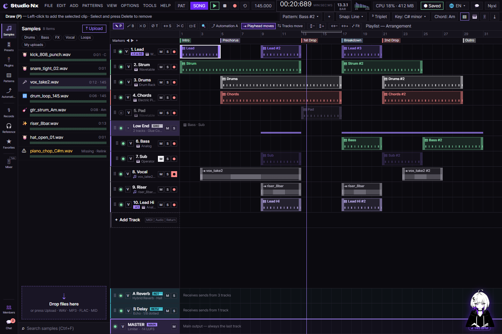
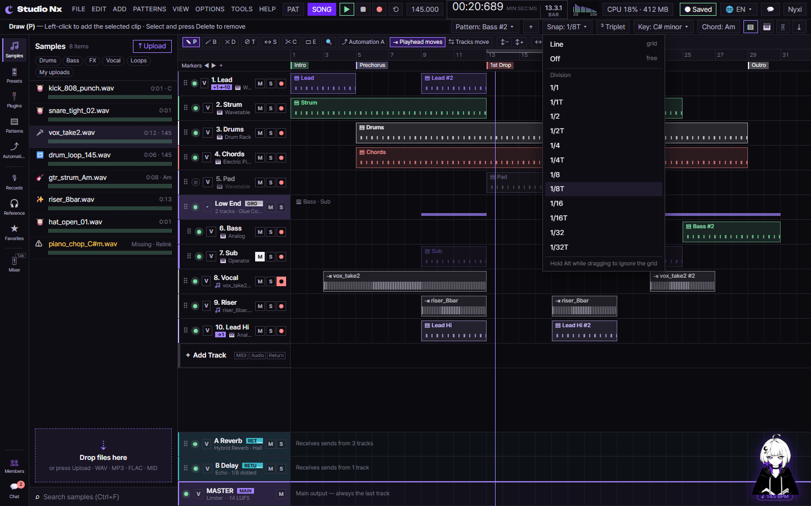
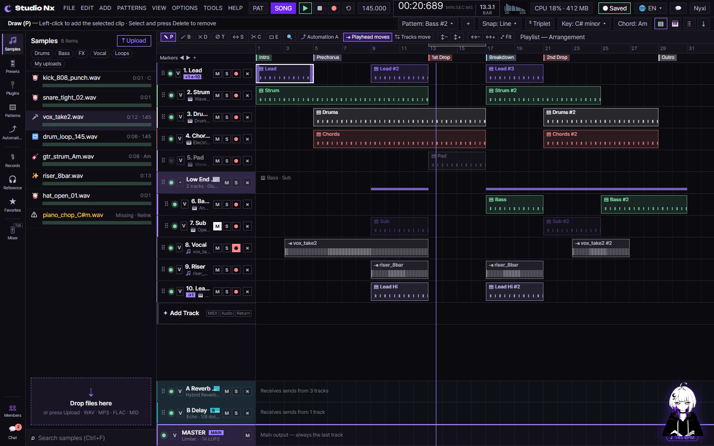
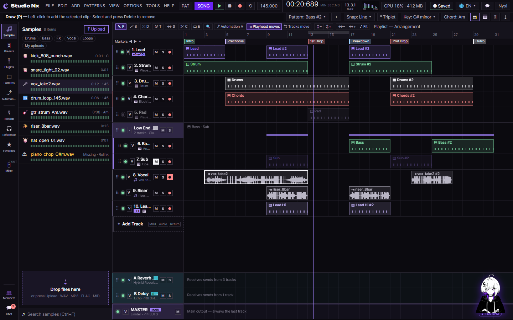

# AI 구현 설명 72 — S1-06 실제 화면 시험 (타임라인을 사람처럼 클릭하고 끌어서)

| 항목 | 내용 |
|---|---|
| 작성 | Claude (AI), 2026-10-15 |
| 대상 | S1-06 ([68](68_s1-06_timeline.md)) |
| 환경 | 개발 서버 `http://localhost:8000`의 시퀀서 화면(`studioNx.html`), 헤드리스 Chrome + CDP |
| 방법 | 순수 계산 함수(115 ~ 139)는 Node에서 가짜 `document`로 돌리고, 화면 조작(140 ~ 148)은 실제 `studioNx.html`을 열어 마우스·휠·키 이벤트를 보내 확인했습니다 |
| 결과 | **화면 조작 9개 모두 통과** (트랙 삭제, 트랙 순서, 클립 길이, 클립 트리밍, 클립 복제, 클립 분할, 줌, 파형, Snap 메뉴). 시험 중 찾은 빈틈 1개(클립 분할 오프셋)를 고쳤습니다 |
| 이전 시험 | 함수 문서 [115 ~ 148](<javascript/S1-06 - 타임라인/>)의 §4 (각 함수의 Node 시험과 브라우저 확인) |

## 1. 이 시험이 보는 것
S1-06은 두 층으로 되어 있습니다. 하나는 마디·tick 변환, 격자 스냅, 클립 이동·길이·트리밍·분할 같은 **순수 계산 함수**(115 ~ 139)이고, 다른 하나는 그 계산을 실제 화면에 붙이는 **배선**(140 ~ 148)입니다.

순수 함수는 브라우저가 없어도 값을 넣어 결과를 볼 수 있어 Node에서 바로 돌렸습니다. 배선은 그렇게 시험한 함수가 실제 화면에서 제대로 불리고 붙는지를 봐야 하므로, 진짜 `studioNx.html`을 열고 사람이 하는 것처럼 마우스를 끌고 휠을 굴리고 Ctrl+D를 눌러 확인했습니다. 이 문서는 그중 **화면 시험을 한 곳에 모은 것**입니다.

## 2. 시험 방법
| 방법 | 대상 | 어떻게 |
|---|---|---|
| Node에서 직접 실행 | 115 ~ 139 순수 함수 | `document`를 가짜로 채워 모듈을 올리고(11개 통과), 함수마다 값을 넣어 결과를 확인했습니다 |
| 헤드리스 Chrome + CDP | 140 ~ 148 배선 | 실제 `studioNx.html`을 열고 `pointerdown`·`pointermove`·`pointerup`, Ctrl+휠, Ctrl+D 같은 실제 입력을 보냈습니다. 파형은 캔버스 픽셀(투명하지 않은 점 수와 서명)을 읽어 확인했습니다 |

검토용 화면은 `docs/ai-notes/images/javascript_s1-06/`에 있습니다.

## 3. 시험 목록 (화면 조작 9개)
| # | 함수 | 한 일 | 결과 |
|---|---|---|---|
| 140 | `snapOptions()`, Snap 메뉴 배선 | 분할 줄 12개가 한 번만 생김(다시 초기화해도 24가 안 됨), 라벨 순서가 1/1 부터 1/32T 까지, 버튼 글자가 `Snap: Line ▾` → `Snap: 1/16T ▾` → `Snap: Line ▾` 로 바뀜, 1/16T 뒤 방식 `division`과 스냅 한 칸 1/48, 체크는 한 줄만 | ✔ |
| 141 | `deleteTrack()` | 처음 번호 1 ~ 10 → 2번 × 클릭 뒤 1 ~ 9(줄 수 11 → 10), MASTER 줄에는 × 가 없고 `deleteTrack(master)` 는 null, 다시 초기화해도 × 가 겹치지 않음, ＋ Add Track 뒤 새 줄에 × 가 있고 평소에는 숨겨짐 | ✔ |
| 142 | 트랙 순서 드래그 | 그립을 끌어 0번 Lead를 2번 자리에 놓으니 순서가 `Lead, Strum, Drums → Strum, Drums, Lead` 가 되고 번호가 자리대로 다시 매겨짐, 그룹 줄은 자리를 지키고, 끄는 동안·놓일 자리 표시가 놓은 뒤 지워짐 | ✔ |
| 143 | 클립 오른쪽 길이 조절 | 오른쪽 끝을 끌어 길이 4 → 7마디(격자에 맞춰 증가), 끄는 동안 `is-resizing` 표시, 왼쪽으로 끝까지 끌어도 최소 한 칸(1마디)에서 멈추고 지워지지 않음, 가운데를 끌면 예전처럼 이동 | ✔ |
| 144 | 클립 왼쪽 트리밍 | MIDI 왼쪽 끝을 오른쪽으로 → 시작 8 → 11, 길이 4 → 1, 오프셋 0 유지. 왼쪽으로 → 시작 0(마디 0 한계), 길이 12. 오디오 왼쪽 끝을 오른쪽으로 → 시작 2 → 7, 길이 10 → 5, 오프셋 0 → 5(원본에서 더 건너뜀) | ✔ |
| 145 | 클립 복제 (Ctrl+D) | 클립(시작 0, 길이 4)을 선택하고 Ctrl+D → 클립 수 3 → 4, 복제본 시작 4(= 0 + 4), 이름과 길이 그대로. 복제본만 선택됨. 다시 Ctrl+D → 5개, 새 복제본 시작 8. 오디오 클립은 오프셋 4를 지키고 시작 8 → 12 | ✔ |
| 146 | 클립 분할 (Slice) | Slice 도구(단축키 C)에서 MIDI(시작 0, 길이 4) 가운데 클릭 → 클립 3 → 4, 왼쪽 0·2 / 오른쪽 2·2. 끝 3px 클릭(한 칸 미만)은 가르지 않음. 오디오(시작 2, 길이 10, 오프셋 2) 가운데 클릭 → 왼쪽 2·5·2 / 오른쪽 7·5·7 | ✔ |
| 147 | 가로·세로 줌 | Ctrl+휠 확대 → 배율 1 → 1.16, 마우스 아래 마디 10.34 → 10.33(제자리). 아주 많이 확대 → 배율 12(`ZOOM_MAX`)에서 멈춤, 아주 많이 축소 → 0.25(`ZOOM_MIN`)에서 멈춤. ↕+ 클릭 → 트랙 높이 44 → 56, ↕− → 56 → 44 | ✔ |
| 148 | 오디오 클립 파형 배선 | 오디오 클립 캔버스에 파형이 그려짐(`vox_take2` 288px → 3430점), 같은 이름 두 클립의 서명이 같음(736431 = 736431), 다른 이름은 서명이 다름, MIDI 클립은 그리지 않음(0점), `--l` 을 10 → 6 으로 바꾸면 다시 그려짐(3430 → 2264점), Ctrl+휠 확대 시 캔버스가 넓어지며 다시 그려짐(3430 → 8380점) | ✔ |

## 4. 화면 캡처

## 5. 시험으로 찾아 고친 빈틈
| 함수 | 빈틈 | 고친 것 |
|---|---|---|
| 146 클립 분할 | 프로토타입 `sliceClip`이 오프셋을 반대로 셌습니다(`o - (at - s)`). 트리밍 규칙(144)과 어긋나서, 자른 오른쪽 조각의 오프셋이 원본보다 작아지는 문제가 있었습니다 | `splitClip`으로 바꾸고, 오디오 조각의 오프셋을 "원본 오프셋 + 왼쪽 길이"로 맞췄습니다 |

## 6. 남은 것
| 항목 | 내용 |
|---|---|
| 클립·트랙 저장 | 지금은 클라이언트 상태로만 동작합니다. `onChange`(지금은 `console.debug`)를 실제 저장 API에 연결하는 일은 뒤 작업(S1-10)입니다 |
| 실제 파형 | 지금 파형은 샘플 이름으로 만든 자리표시 peaks입니다. 실제 샘플의 peaks를 쓰는 일은 샘플 라이브러리(S1-07)와 그 뒤 작업에서 이어집니다 |
| 함수 합본 | 함수 문서 115 ~ 148은 `S1-06_timeline.pdf`(합본)으로 묶어 두었습니다 |
