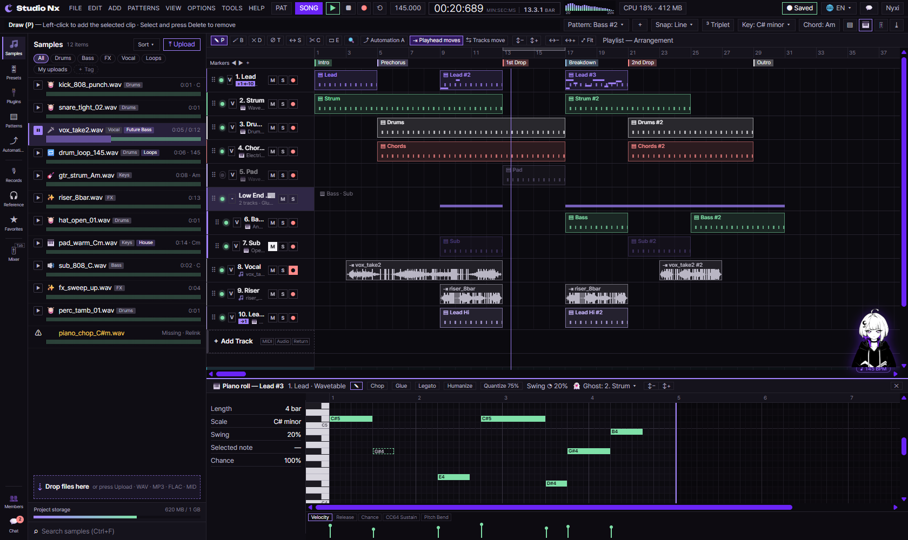
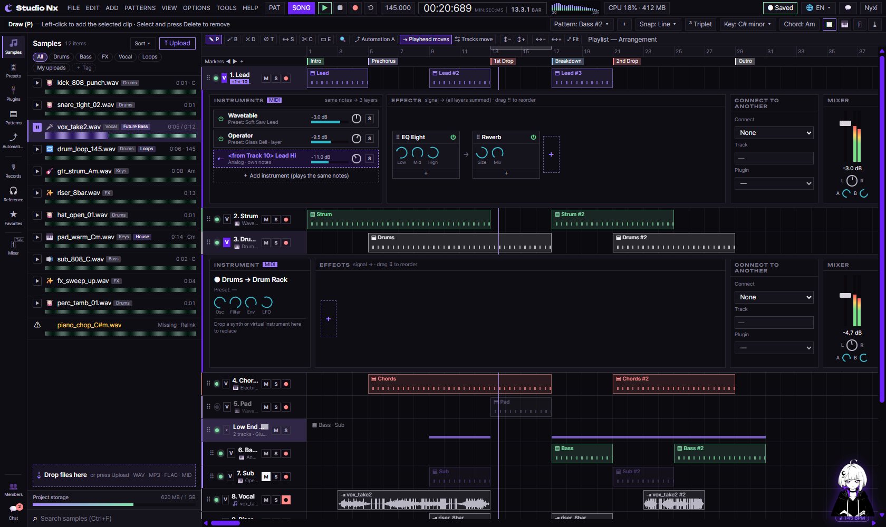

# AI 구현 설명 77 — S1-08 트랙 아코디언 · 피아노롤 (노트 저장, 트랙 그룹, 클립 미리보기)

| 항목 | 내용 |
|---|---|
| 작성 | Claude (AI), 2026-10-17, 사용자 검토 |
| 작업 | S1-08 트랙 아코디언 틀 · [노트] 탭 피아노롤 (YouTrack StudioNx-37), PRD 02 FR-231 ~ FR-233, FR-261, FR-262 |
| 브랜치 | `feature/phase1/s1-08-accordion-pianoroll` (`develop`에서 만듦) |
| 바꾼 파일 | `backend/app/models/pattern.py`, `models/midi_note.py`, `models/__init__.py`, `models/project.py`, `schemas/pattern.py`, `services/pattern_service.py`, `api/v1/patterns.py`, `api/v1/router.py`, `tests/test_pattern_model.py`, `tests/test_pattern_routes.py`, `frontend/static/js/pages/sequencer.js`, `sequencer-arrange.js`, `sequencer-roll.js`, `sequencer-ui.js`, `frontend/static/css/pages/studio.css`, `frontend/studioNx.html` |
| 진행 방식 | **작업 단위로 구현**(함수 단위 중단 없음). 실제 코드는 **전통 문법**(`?.`, `??` 없음) |
| 함수별 설명 | `docs/ai-notes/backend(fastAPI_Python)/S1-08 - 아코디언·피아노롤/211 ~ 218`, `docs/ai-notes/javascript/S1-08 - 아코디언·피아노롤/219 ~ 225` (md, PDF), 합본 [S1-08_patterns_api.pdf](<backend(fastAPI_Python)/S1-08 - 아코디언·피아노롤/S1-08_patterns_api.pdf>) · [S1-08_accordion_pianoroll_ui.pdf](<javascript/S1-08 - 아코디언·피아노롤/S1-08_accordion_pianoroll_ui.pdf>) |
| 이전 문서 | [76_s1-07_sample_library_ui_js.md](76_s1-07_sample_library_ui_js.md) |

## 1. 실행 결과
트랙을 고르고 그룹으로 묶고 펼치는 일, 피아노롤에서 노트를 찍고 겹쳐 찍는 일, 그 노트를 패턴으로 저장하는 백엔드 API 한 벌을 만들었습니다. MIDI 클립은 이제 안에 담긴 노트를 **음높이·길이대로 작은 막대**로 보여 줍니다.

> 화면 캡처는 헤드리스 브라우저(Chrome)로 찍었습니다. 자세한 값은 §6 검증 결과에 적었습니다.

## 2. 무엇을 만들었나
| 파일 | 역할 |
|---|---|
| `backend/app/models/pattern.py` | `patterns` 표 — MIDI 패턴 한 건 (211) |
| `backend/app/models/midi_note.py` | `midi_notes` 표 — 피아노롤 노트 (212) |
| `backend/app/schemas/pattern.py` | 요청·응답 스키마 (213) |
| `backend/app/services/pattern_service.py` | 목록·상세·노트 교체·패턴 수정 (214 ~ 216) |
| `backend/app/api/v1/patterns.py` | 패턴 라우터 4개 (217·218) |
| `backend/app/api/v1/router.py` | `patterns` 라우터 등록 |
| `frontend/static/js/pages/sequencer.js` | MIDI 클립 미리보기 그리기 (225) |
| `frontend/static/js/pages/sequencer-arrange.js` | 마디 눈금 클릭(219) · 트랙 선택·그룹(221) · 펼침 상태 기억 (223) |
| `frontend/static/js/pages/sequencer-roll.js` | 겹쳐 찍기 (220) · 노트 변화 알림 (224) |
| `frontend/static/js/pages/sequencer-ui.js` | 트랙 오른쪽 클릭 메뉴·단축키 (222) |
| `frontend/static/css/pages/studio.css` | 시간 표시 흔들림 방지(`.sq-time` 에 `tabular-nums`) — 사용자 요구 5번 |

## 3. 함수 15개 (번호는 S1-07 의 210 에 이어서)
| # | 함수 | 하는 일 | 설명 |
|---|---|---|---|
| 211 | `Pattern` | MIDI 패턴 표 (이름·길이·스윙) | [211](<backend(fastAPI_Python)/S1-08 - 아코디언·피아노롤/211_models_pattern.md>) |
| 212 | `MidiNote` | 피아노롤 노트 표 | [212](<backend(fastAPI_Python)/S1-08 - 아코디언·피아노롤/212_models_midi_note.md>) |
| 213 | 패턴 스키마 | 요청·응답 모양 | [213](<backend(fastAPI_Python)/S1-08 - 아코디언·피아노롤/213_schemas_pattern.md>) |
| 214 | `list_patterns` · `get_pattern` | 패턴 목록·상세 | [214](<backend(fastAPI_Python)/S1-08 - 아코디언·피아노롤/214_pattern_service_query.md>) |
| 215 | `replace_notes` | 노트 통째 교체 | [215](<backend(fastAPI_Python)/S1-08 - 아코디언·피아노롤/215_pattern_service_replace_notes.md>) |
| 216 | `update_pattern` | 이름·색·길이·스윙 수정 | [216](<backend(fastAPI_Python)/S1-08 - 아코디언·피아노롤/216_pattern_service_update_pattern.md>) |
| 217 | `GET /patterns` · `GET /patterns/{id}` | 목록·상세 라우터 | [217](<backend(fastAPI_Python)/S1-08 - 아코디언·피아노롤/217_api_patterns_list.md>) |
| 218 | `PUT /patterns/{id}/notes` · `PATCH /patterns/{id}` | 노트 교체·패턴 수정 라우터 | [218](<backend(fastAPI_Python)/S1-08 - 아코디언·피아노롤/218_api_patterns_notes.md>) |
| 219 | `rulerBar` · `initPan` | 마디 눈금 클릭 → 플레이헤드 (요구 2) | [219](<javascript/S1-08 - 아코디언·피아노롤/219_sequencer-arrange_ruler_seek.md>) |
| 220 | `initNoteEdit` | Shift+클릭 겹쳐 찍기 (요구 4) | [220](<javascript/S1-08 - 아코디언·피아노롤/220_sequencer-roll_shift_click.md>) |
| 221 | `selectTrack` · `groupSelectedTracks` | 트랙 선택·그룹 (요구 3) | [221](<javascript/S1-08 - 아코디언·피아노롤/221_sequencer-arrange_track_select_group.md>) |
| 222 | `openTrackMenu` · `initTrackMenu` | 트랙 메뉴·단축키 (요구 3) | [222](<javascript/S1-08 - 아코디언·피아노롤/222_sequencer-ui_track_menu.md>) |
| 223 | `saveOpenPanels` · `restoreOpenPanels` | 펼침 상태 기억 (FR-261) | [223](<javascript/S1-08 - 아코디언·피아노롤/223_sequencer-arrange_open_panels.md>) |
| 224 | `rollNotes` · `emitRollNotes` | 노트 변화 알림 (요구 1) | [224](<javascript/S1-08 - 아코디언·피아노롤/224_sequencer-roll_emit_notes.md>) |
| 225 | `setClipNotes` · `drawClipPreview` | MIDI 클립 미리보기 (요구 1) | [225](<javascript/S1-08 - 아코디언·피아노롤/225_sequencer_clip_preview.md>) |

## 4. 요구사항 대응
| 요구사항 | 내용 | 어디서 |
|---|---|---|
| FR-231 | 피아노롤 노트를 패턴에 저장 | 212 표, 215 노트 교체, 218 라우터 |
| FR-232 | 노트 설정(음높이·세기 등) | 212 칸, 213 스키마 |
| FR-233 | 패턴 이름·목록·길이 관리 | 214 목록·상세, 216 수정, 217·218 라우터 |
| FR-261 | 트랙 V 버튼 펼침 (기본 하나, Shift 여러 개) | `toggleTrackPanel` (이미 있음) + 223 펼침 상태 기억 |
| FR-262 | 아코디언 칸 (Instrument · Effects · Connect · Mixer) | 화면 HTML (`sq-acc`) |
| 사용자 요구 1 | MIDI 클립 미리보기 | 224 알림 + 225 그리기 |
| 사용자 요구 2 | 마디 눈금 클릭 → 플레이헤드 | 219 |
| 사용자 요구 3 | 트랙 선택 + 그룹화 | 221 + 222 |
| 사용자 요구 4 | 노트 겹쳐 찍기 | 220 |
| 사용자 요구 5 | 시간 표시 흔들림 | `studio.css` `.sq-time` `tabular-nums` |

## 5. 왜 이렇게
| 결정 | 이유 |
|---|---|
| 노트를 통째로 교체 | 피아노롤의 한 편집으로 여러 노트가 바뀝니다. 목록 전체를 다시 보내는 편이 어긋나지 않습니다 (215) |
| 목록은 노트를 빼고 | 패턴이 많아도 가볍게 받습니다. 노트는 상세(214)로 따로 받습니다 |
| 피아노롤→편곡을 이벤트로 | 두 파일이 서로를 직접 부르지 않게 `'sq:roll-notes'` 이벤트로 알립니다 (224 → 225) |
| 펼침 상태를 번호로 담음 | 화면 순서가 바뀌어도 번호가 같으면 그대로 되살릴 수 있습니다 (223) |
| 프로젝트 전체 로드는 안 함 | `GET /projects/{id}/full` 은 **S1-10** 몫입니다. 이번 작업은 패턴 API 와 화면 배선까지입니다 |

## 6. 검증 결과
| 방법 | 대상 | 결과 |
|---|---|---|
| `pytest -q` (실제 MySQL, 끝나면 rollback) | 전체 | **986개 이상 통과** |
| `ruff check` | 백엔드 전체 | 통과 |
| 함수 시험 | 211 ~ 218 | 모델·스키마·서비스·라우터의 모든 응답 (401·403·404·422) |
| 헤드리스 브라우저(Chrome) | 요구 1·2·3·4·FR-261 | 아래 표, 콘솔 오류 0건 |

| 확인 | 결과 |
|---|---|
| 클립 미리보기 (요구 1) | 빈 캔버스 0픽셀 → 노트 4개 156픽셀, 이벤트 2개 92픽셀, 지우면 0픽셀 · 피아노롤 편집 시 403픽셀 |
| 마디 눈금 클릭 (요구 2) | 4마디 지점 클릭 → 플레이헤드 `--at` 값 `4` |
| 트랙 선택·그룹 (요구 3) | 트랙 2개 선택 후 `Ctrl+G` → 그룹 1개, 안쪽 2개 `data-parent`, 접기/펼치기 동작 |
| Shift+클릭 겹쳐 찍기 (요구 4) | 일반 클릭 노트 수 그대로, Shift+클릭 노트 1개 증가(같은 음·위치) |
| 펼침 상태 기억 (FR-261) | 트랙 1·3 펼침 → 저장 `["1","3"]` → 새로 고침 뒤 둘 다 펼쳐짐 |
| 시간 표시 흔들림 (요구 5) | `.sq-time` 의 `font-variant-numeric` 이 `tabular-nums`, 숫자 폭 네 가지 모두 같음 |

## 7. 남은 일과 다음 작업이 쓰는 곳
| 작업 | 쓰는 것 |
|---|---|
| S1-10 저장·불러오기(`/full`)·자동 저장·Undo | 이번 패턴 API(217·218)를 부르고, 불러온 노트를 225 `setClipNotes` 로 담습니다 |
| 피아노롤 저장 배선 | 224 의 `R.onChange` 자리에 `PUT /patterns/{id}/notes`(215) 를 붙입니다 |
| 오디오 클립 미리보기 | S1-06 의 `drawWaveforms` 가 맡습니다. 225 는 MIDI 만 그립니다 |
| 그룹·트랙 저장 | 221·222 의 `notify` 를 자동 저장(S1-10)에 연결합니다 |
| 이 작업에서 미룬 것 | 프로젝트 전체 로드, 자동 저장, Undo/Redo 는 S1-10 입니다 |

## 8. 자주 받을 질문 대비 (Q/A)
Q. 노트를 왜 통째로 보내나요?

A. 한 번의 편집(겹치기·여러 개 옮기기)으로 여러 노트가 바뀌기 때문입니다. 노트마다 번호를 주고받으면 어긋나기 쉬워, 목록 전체를 다시 보내는 편이 확실합니다(215).

Q. 클립 미리보기가 왜 오디오는 안 그려지나요?

A. 오디오 클립의 파형은 S1-06 의 `drawWaveforms` 가 이미 그립니다. 225 는 MIDI 클립만 맡습니다.

Q. 새로 고침하면 피아노롤 노트가 그대로 남나요?

A. 아직 아닙니다. 노트를 불러오는 일은 `GET /projects/{id}/full`(S1-10)이 붙은 뒤에 됩니다. 지금은 한 번 열어 둔 화면 안에서 편집과 미리보기가 이어집니다.
