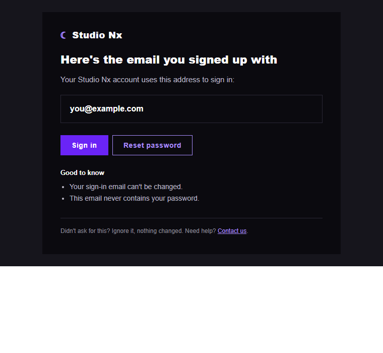

# 백엔드 162 — `build_email_reminder_message()` (이메일 안내 메일 문안)

| 항목 | 내용 |
|---|---|
| 파일 | `studionx/backend/app/services/mail_templates.py` (새 파일) |
| 작업 | P1-28 이메일을 잊은 경우 (FR-119): 열세 번째 함수 |
| 작성 | Claude (AI), 2026-10-15, 사용자 검토 |
| 이전 | [161 `POST …/confirm`](161_auth_password_reset_confirm_route.md) |
| 시험 | `tests/test_mail_templates.py` 16개 |
| 다음 | `request_email_reminder()`: 가입된 `ACTIVE` 계정이면 이 문안으로 메일(로그)을 보내고, 항상 같은 결과를 돌려줌 |

## 1. 하는 일
"가입한 이메일이 무엇인지" 알려 주는 메일의 **문안**(제목, 글자판, HTML)을 만듭니다. 보내는 일(전송)과 분리해서 문안만 만들기 때문에, 나중에 SMTP를 붙여도 이 함수는 바뀌지 않습니다.

모양은 사용자가 정했습니다: **C안(도움말을 곁들인 안내)에 B안의 어두운 카드 색을 입힌 것**이고, D안(가입되지 않은 주소에 "계정이 없다"고 알리는 메일)은 만들지 않습니다.



## 2. 담는 것과 담지 않는 것
| 담는 것 | 담지 않는 것 |
|---|---|
| 로그인 이메일, `Sign in` 버튼, `Reset password` 버튼 | 닉네임, 가입일, 프로젝트 이름 (메일함이 남에게 열려 있을 수 있음) |
| 알아 둘 점 2가지("이메일은 바꿀 수 없다", "이 메일에는 비밀번호가 없다") | 비밀번호 |
| "요청하지 않았다면 무시하세요" | 토큰, `#token=` |
| `Contact us` 링크(사람이 처리하는 서브 안내, E안) | 외부 이미지, 외부 파일 |

링크는 사이트 주소(`APP_BASE_URL`)의 `home.html#login`(로그인 모달), `home.html#recover`(복구 화면), `home.html#contact`(문의)를 가리킵니다. **`#recover`는 화면 작업에서 만들어야 하는 주소입니다**(복구 모달을 여는 해시, `#login`과 같은 방식).

## 3. 코드 (요약)
```python
@dataclass(frozen=True)
class MailMessage:
    subject: str
    text: str
    html: str

def build_email_reminder_message(email: str, base_url: str) -> MailMessage:
    base = base_url.rstrip("/")
    ...
    shown = escape(email, quote=True)          # HTML에 넣기 전에 이스케이프
    return MailMessage(subject=..., text=..., html=...)
```

## 4. 왜 이렇게
| 선택 | 이유 |
|---|---|
| **모든 스타일을 태그에 직접(인라인)** | 메일 프로그램은 `<style>` 태그를 지우는 일이 많고 CSS 변수도 못 씁니다. 색도 `tokens.css`의 값을 그대로 적었습니다(`#0b0a0f`, `#6a24f6`, `#a78bfa` 등) |
| **글자판(text)도 함께 만듦** | HTML을 못 보는 메일 프로그램과 스팸 검사에서 불리하지 않도록 같은 내용의 글자판을 둡니다 |
| **이메일을 HTML에 넣을 때 이스케이프** | 이메일 형식 검사를 통과해도 `a"><script>…@example.com` 같은 값이 마크업으로 해석되는 일을 막습니다. 속성(링크 주소)에도 같은 처리를 합니다 |
| 이미지를 쓰지 않음 | 로고는 글자와 기호(☾)로 대신했습니다. 외부 이미지는 많은 메일 프로그램이 기본으로 막고, 추적 픽셀로 오해받을 수 있습니다 |
| 문안만 만드는 순수 함수 | 시험이 빠르고, 전송 방식(로그, SMTP)이 바뀌어도 영향이 없습니다 |
| 다른 정보를 넣지 않음 | 메일함은 본인 것이 아닐 수도 있고(남이 입력한 주소), 이 메일은 "이 주소가 로그인 ID"라는 사실만 알려야 합니다 |

## 5. 시험 (16개 통과)
| 확인 | 결과 |
|---|---|
| 제목, 글자판, HTML을 가진 `MailMessage`를 돌려줌 | ✔ |
| 로그인 이메일이 글자판과 HTML에 모두 있음 | ✔ |
| 링크 세 개(`#login`, `#recover`, `#contact`)가 HTML과 글자판에 있음 | ✔ |
| 기준 주소 끝의 `/`가 겹치지 않음 | ✔ |
| 토큰, 닉네임, 가입일, 프로젝트가 없음 | ✔ |
| **이메일이 HTML에서 이스케이프됨**(`<script>`가 마크업이 되지 않음), 글자판은 그대로 | ✔ |
| `&`도 이스케이프됨 | ✔ |
| **링크 주소가 속성 밖으로 빠져나가지 못함** | ✔ |
| 사이트의 어두운 카드 색을 씀 | ✔ |
| 스타일이 모두 인라인이고 `<style>`, `<link>`, `<script>`, ``, 외부 주소가 없음 | ✔ |
| HTML이 올바르게 닫혀 있음 | ✔ |
| 목업에서 고른 구성 요소(`Sign in`, `Reset password`, `Contact us`, `Good to know`)가 있음 | ✔ (4개) |
| 안심 문구와 알아 둘 점이 있음 | ✔ |

**시험을 확인하는 시험.** 일부러 틀리게 바꿔 시험이 잡는지 보았습니다.

| 바꾼 것 | 결과 |
|---|---|
| 이메일 이스케이프 제거 | 2개 실패 |
| 링크 주소 이스케이프 제거 | 1개 실패 |
| 기준 주소 끝의 `/` 처리 제거 | 1개 실패 |
| 어두운 배경을 흰색으로 | 1개 실패 |
| `#recover` 링크 제거 | 1개 실패 |
| 본문에 "nickname"을 넣음 | 1개 실패 |

전체 pytest 832개 통과, `ruff` 통과.

## 6. 확인하지 못한 것
실제 메일 프로그램(Gmail, Naver 메일, Outlook)에서의 모습입니다. 헤드리스 Chrome으로 HTML을 그려 본 것(위 그림)만 확인했습니다. 특히 Outlook은 일부 CSS를 무시하므로, 실제 SMTP를 붙일 때 테스트 메일로 확인해야 합니다. 어두운 배경은 메일 프로그램의 다크 모드와 겹치면 다르게 보일 수 있습니다.
