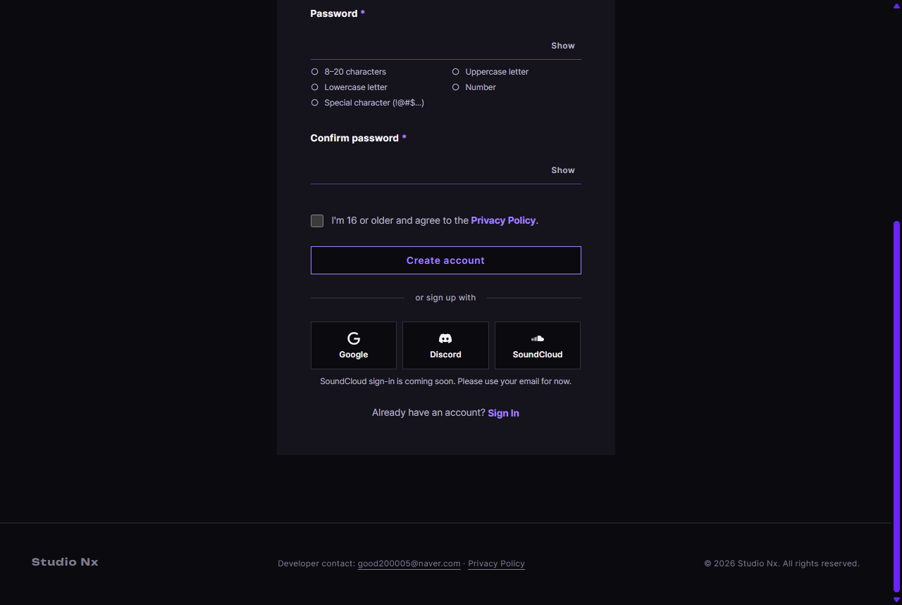

# JS 11 — `initOAuthPlaceholders()`

| 항목 | 내용 |
|---|---|
| 파일 | `studionx/frontend/static/js/core/auth-ui.js` · `studionx/frontend/static/css/auth.css` (한 줄) |
| 작업 | P1-07 가입 · 로그인 JS · PRD 01 FR-110 |
| 작성 | Claude (AI) · 2026-10-07 · 사용자 검토 |
| 이전 · 다음 | [10 `initPasswordToggles()`](10_auth-ui_initPasswordToggles.md) · [12 `initAuthState()`](12_auth-ui_initAuthState.md) |

## 1. 하는 일
소셜 로그인 버튼(**Google · Discord · SoundCloud**)을 누르면, 버튼 줄 바로 아래에 "아직 준비 중" 안내 한 줄을 보여 준다. 연동은 나중이라(FR-110) 지금은 자리만 있다.



| 누른 버튼 | 버튼 아래 안내 |
|---|---|
| Google | Google sign-in is coming soon. Please use your email for now. |
| Discord | Discord sign-in is coming soon. Please use your email for now. |
| SoundCloud | SoundCloud sign-in is coming soon. Please use your email for now. |

다른 버튼을 누르면 **같은 줄의 글만 바뀐다** (줄이 늘어나지 않음).

## 2. 언제 쓰나
페이지가 열릴 때 한 번 부른다.

| 페이지 | 버튼 줄 |
|---|---|
| join.html | 가입 폼 아래 "or sign up with" 줄 + 로그인 모달 안 줄 (버튼 6개) |
| home.html | 로그인 모달 안 줄 (`home.js`, P1-07 뒤 순서) |

**나중에 연동할 때:** 이 함수 안의 "안내 쓰기" 부분을 `location.href = '/api/v1/auth/oauth/<provider>/start'` 로 바꾸면 된다 (템플릿 주석, PRD 01 개정 필요).

## 3. 코드
**import** (파일 맨 위)
```js
// (없음)
```
**이 함수는 import 가 필요 없다** — 브라우저 기본 기능만 쓴다.

**함수**
```js
/** 소셜 로그인 서비스 이름 (안내 문구용) */
const OAUTH_NAMES = { google: 'Google', discord: 'Discord', soundcloud: 'SoundCloud' };

export function initOAuthPlaceholders(root = document) {
  const buttons = root.querySelectorAll('.oauth[data-provider]');
  for (const button of buttons) {
    if (button.dataset.oauthReady === 'on') continue;
    button.dataset.oauthReady = 'on';
    button.addEventListener('click', () => {
      const provider = button.dataset.provider;
      const name = OAUTH_NAMES[provider] || provider;
      const row = button.closest('.oauth-row') || button.parentElement;
      let note = row.nextElementSibling;
      if (!note || !note.classList.contains('oauth-note')) {
        note = document.createElement('p');
        note.className = 'field__msg oauth-note';
        note.setAttribute('role', 'status');
        row.after(note);
      }
      note.textContent = `${name} sign-in is coming soon. Please use your email for now.`;
    });
  }
}
```
**CSS 한 줄 추가** (`auth.css`)
```css
.oauth-note { margin-top: var(--sp-2); text-align: center; }
```
글자 크기 · 색은 기존 `.field__msg`(작은 회색 글)를 함께 써서 따로 정하지 않았다.

**최신 문법으로 쓰면** (공부용 — 실제 코드는 위)
```js
export function initOAuthPlaceholders(root = document) {
  root.querySelectorAll('.oauth[data-provider]:not([data-oauth-ready])').forEach((button) => {
    button.dataset.oauthReady = 'on';
    button.addEventListener('click', () => {
      const { provider } = button.dataset;
      const name = OAUTH_NAMES[provider] ?? provider;
      const row = button.closest('.oauth-row') ?? button.parentElement;
      let note = row.nextElementSibling;
      if (!note?.classList.contains('oauth-note')) {
        note = Object.assign(document.createElement('p'), { className: 'field__msg oauth-note', role: 'status' });
        row.after(note);
      }
      note.textContent = `${name} sign-in is coming soon. Please use your email for now.`;
    });
  });
}
```
| 최신 문법 | 실제 코드 | 뜻 |
|---|---|---|
| `const { provider } = button.dataset` | `const provider = button.dataset.provider` | 구조 분해 — 칸을 같은 이름의 변수로 꺼냄 |
| `OAUTH_NAMES[provider] ?? provider` | `OAUTH_NAMES[provider] \|\| provider` | 없으면 대신 쓸 값 (여기서는 둘의 결과가 같음 — 이름이 빈 글자일 일이 없음) |
| `!note?.classList.contains(…)` | `!note \|\| !note.classList.contains(…)` | `note` 가 없거나, 안내 줄이 아니면 |
| `Object.assign(요소, { … })` | `className = …` · `setAttribute('role', …)` 를 한 줄씩 | 여러 속성을 한 번에 넣기 |

### 문법 풀이
| import 문법 | 뜻 |
|---|---|
| `export function` | `join.js` · `home.js` 가 가져다 씀 (`OAUTH_NAMES` 는 `export` 가 없어 이 파일 안에서만 씀) |

| 식 | 뜻 |
|---|---|
| `'.oauth[data-provider]'` | `oauth` 클래스이면서 `data-provider` 속성이 있는 요소 |
| `button.dataset.provider` | HTML 의 `data-provider="google"` → `'google'` |
| `OAUTH_NAMES[provider] \|\| provider` | 표에 있으면 보기 좋은 이름(`SoundCloud`), 없으면 받은 글자 그대로 |
| `button.closest('.oauth-row')` | 버튼에서 **위로** 올라가며 가장 가까운 버튼 줄 |
| `row.nextElementSibling` | 버튼 줄 **바로 다음** 요소 — 안내 줄이 이미 있으면 그것 |
| `document.createElement('p')` · `row.after(note)` | 새 `<p>` 를 만들어 버튼 줄 바로 뒤에 넣음 |
| `` `${name} sign-in …` `` | 템플릿 문자열 — `${ }` 안의 값을 글자에 끼움 (2015년 문법, 지금은 기본) |

## 4. 흐름
1. 범위 안의 소셜 버튼을 모두 찾는다 (이미 연결한 버튼은 건너뜀).
2. 누르면 — 서비스 이름을 정하고, 버튼 줄 바로 아래에 안내 줄이 없으면 만든다.
3. 안내 줄의 글을 그 서비스 문구로 바꾼다.

## 5. 왜 이렇게
| 선택 | 이유 |
|---|---|
| `alert` 대신 화면 안 안내 한 줄 (템플릿은 둘 다 가능) | `alert` 는 화면을 멈추고 확인 버튼을 눌러야 한다. 안내 한 줄은 하던 일을 방해하지 않는다 |
| 안내 줄을 하나만 두고 글만 바꿈 | 여러 번 눌러도 줄이 쌓이지 않는다 |
| `role="status"` | 화면 읽기 프로그램이 새 안내를 읽어 준다 (방해 없이 — `polite`) |
| "Please use your email for now." | 막혔다는 말만 하지 않고 지금 할 수 있는 일을 알려 준다 |
| 같은 버튼에 두 번 연결하지 않음 (`data-oauth-ready`) | 10 과 같은 이유 |
| 이름 표(`OAUTH_NAMES`) | `soundcloud` → `SoundCloud` 처럼 대소문자를 바르게. 표에 없는 서비스가 추가돼도 오류 없이 그 이름으로 보인다 |
| CSS 는 기존 `.field__msg` 를 함께 씀 | 다른 칸 아래 문구와 같은 크기 · 색이 된다. 추가한 것은 여백 · 가운데 정렬 한 줄뿐 |

## 6. 시험 (실제 join.html 을 헤드리스 Chrome 으로 열고 그 안에서 실행 · 8개)
| 시험 | 확인한 것 |
|---|---|
| 연결 | 버튼 6개(가입 3 + 로그인 모달 3) 모두 연결, 한 번 더 불러도 중복 없음 |
| 누르기 전 | 안내 줄 없음 |
| Google | 줄 바로 아래 `<p class="field__msg oauth-note" role="status">` + Google 문구 |
| Discord | 안내 줄은 그대로 1개, 글만 Discord 로 |
| SoundCloud | "SoundCloud" 표기 |
| 페이지 이동 | 없음 (`/join.html` 그대로) |
| 모양 | 가운데 정렬, 위 여백 8px |
| 표에 없는 서비스 | `github` 그대로 표시, 오류 없음 |

8/8 통과. 위 캡처는 같은 방식으로 SoundCloud 를 누른 뒤 찍었다.
