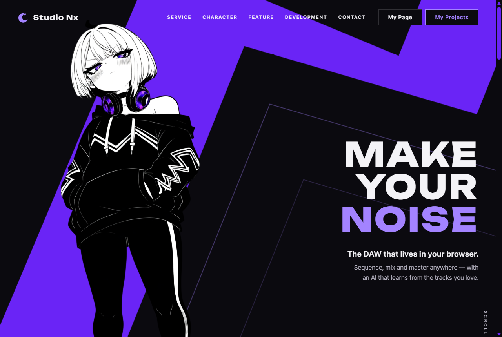

# JS 12 — `initAuthState()`

| 항목 | 내용 |
|---|---|
| 파일 | `studionx/frontend/static/js/core/auth-ui.js` |
| 작업 | P1-07 가입 · 로그인 JS · PRD 01 FR-105 · FR-109 |
| 작성 | Claude (AI) · 2026-10-07 · 사용자 검토 |
| 이전 · 다음 | [11 `initOAuthPlaceholders()`](11_auth-ui_initOAuthPlaceholders.md) · [13 `initLoginForm()`](13_auth-ui_initLoginForm.md) |

## 1. 하는 일
페이지를 열 때 **로그인 상태를 확인**해서 `<html>` 에 표시한다. 그러면 `auth.css` 가 헤더 오른쪽 버튼을 바꾼다.

| 상태 | `<html data-auth>` | 헤더 오른쪽 버튼 |
|---|---|---|
| 확인 중 (서버 답을 기다림, 보통 0.1초 안) | `"pending"` | **비어 있음** (자리만 차지) |
| 로그인 안 함 | 속성 없음 | **Sign In · Join Us** |
| 로그인함 | `"in"` | **My Page · My Projects** |



돌려주는 값: 로그인 상태면 `true`, 아니면 `false` (`Promise`).

## 2. 언제 쓰나
**모든 페이지**가 열릴 때 한 번 부른다 (이미 각 페이지 스크립트에 들어 있음).

| 페이지 | 부르는 곳 |
|---|---|
| home.html | `home.js` |
| myPage.html · myProject.html · userInfo.html | `mypage.js` · `myproject.js` · `userinfo.js` |
| privacy.html | `privacy.js` |

**자동 로그인과의 관계 (FR-109):** "Keep me signed in" 으로 로그인했으면 브라우저를 닫았다 열어도 리프레시 쿠키(3일)가 남아 있다 → 이 함수가 재발급에 성공 → My Page · My Projects.

### 페이지를 열 때 일어나는 일
| 순서 | 일어나는 일 |
|---|---|
| ① | `data-auth="pending"` → 헤더 버튼이 잠깐 안 보임 |
| ② | [`isLoggedIn()`](<../P1-02 - 프론트 공통 JS/06_auth_isLoggedIn.md>) → `POST /api/v1/auth/refresh` ([백엔드 33](<../../backend(fastAPI_Python)/P1-05 - 로그인 API/33_auth_route_refresh.md>)) |
| ③-a | 200 (쿠키 있음) → `data-auth="in"` → My Page · My Projects. 받은 토큰은 메모리에 남아 다음 API 요청에 씀 |
| ③-b | 401 (쿠키 없음) → 속성 지움 → Sign In · Join Us |

## 3. 코드
**import** (파일 맨 위)
```js
import { isLoggedIn } from './auth.js';
```
`auth-ui.js` 의 첫 import 로 **이번에 추가했다**. 이 함수가 쓴다 — P1-02 의 06 `isLoggedIn()`.

**함수**
```js
export async function initAuthState() {
  const root = document.documentElement;
  root.dataset.auth = 'pending';
  const loggedIn = await isLoggedIn();
  if (loggedIn) {
    root.dataset.auth = 'in';
  } else {
    root.removeAttribute('data-auth');
  }
  return loggedIn;
}
```
템플릿은 `export function` 이었고, 서버 답을 기다려야 해서 **`async` 로 바꿨다**. 부르는 쪽(`initAuthState();`)은 그대로 두어도 된다 — 기다리지 않고 다음 줄로 넘어가고, 답이 오면 헤더가 바뀐다.

**CSS (이미 있음, `auth.css`)**
```css
:root:not([data-auth="in"]) [data-auth-show="in"],
:root[data-auth="in"] [data-auth-show="out"] { display: none; }
:root[data-auth="pending"] [data-auth-show] { visibility: hidden; }
```
```html
<!-- header.html -->
<button … data-auth-show="out">Sign In</button>   <a … data-auth-show="out">Join Us</a>
<a href="myPage.html" data-auth-show="in">My Page</a>   <a href="myProject.html" data-auth-show="in">My Projects</a>
```

**최신 문법으로 쓰면** (공부용 — 실제 코드는 위)
```js
export async function initAuthState() {
  const root = document.documentElement;
  root.dataset.auth = 'pending';
  const loggedIn = await isLoggedIn();
  root.toggleAttribute('data-auth', loggedIn);
  if (loggedIn) root.dataset.auth = 'in';
  return loggedIn;
}
```
| 최신 문법 | 실제 코드 | 뜻 |
|---|---|---|
| `root.toggleAttribute('data-auth', loggedIn)` | `if … else root.removeAttribute('data-auth')` | 조건이 거짓이면 속성 지우기 (참이면 빈 속성을 붙이고, 다음 줄이 `'in'` 으로 덮음) |

이 함수는 원래 짧아서 최신 문법과 차이가 작다. 실제 코드의 `if … else` 가 읽기 쉽다.

### 문법 풀이
| import 문법 | 뜻 |
|---|---|
| `import { isLoggedIn } from './auth.js'` | 같은 폴더의 `auth.js` 가 `export` 한 함수를 가져옴 |

| 식 | 뜻 |
|---|---|
| `document.documentElement` | 페이지의 `<html>` 요소 |
| `root.dataset.auth = 'pending'` | `<html data-auth="pending">` 로 만듦 |
| `async function` · `await isLoggedIn()` | 서버 답이 올 때까지 이 함수 안에서만 기다림 (페이지의 다른 동작은 멈추지 않음) — [Promise 설명](<../P1-02 - 프론트 공통 JS/01_api_refreshAccessToken.md>) |
| `root.removeAttribute('data-auth')` | 속성 자체를 지움 → CSS 의 "로그인 안 함" 규칙이 적용 |

## 4. 흐름
1. `<html data-auth="pending">` — 헤더 버튼을 잠깐 숨긴다.
2. 로그인 상태를 확인한다 (메모리 토큰이 없으면 재발급 시도).
3. 로그인이면 `"in"`, 아니면 속성을 지운다.
4. `true` / `false` 를 돌려준다.

## 5. 왜 이렇게
| 선택 | 이유 |
|---|---|
| 먼저 `pending` 으로 숨김 | 바로 "Sign In · Join Us" 를 보여 줬다가 0.1초 뒤 "My Page" 로 바뀌면 **깜빡인다**. 확인하는 동안은 버튼 자리만 비워 둔다 (`visibility: hidden` — 자리는 그대로라 헤더가 흔들리지 않음) |
| 로그아웃이면 속성을 **지움** (`'out'` 이 아님) | CSS 는 "속성이 없으면 로그아웃" 으로 짜여 있다. JS 가 꺼져 있거나 오류가 나도 Sign In · Join Us 는 보인다 |
| 판단은 06 `isLoggedIn()` 에 맡김 | 토큰 · 쿠키 · 재발급 규칙은 P1-02 · P1-05 에 있다. 이 함수는 결과를 화면에 옮기기만 한다 |
| `async` + 결과를 돌려줌 (템플릿은 일반 함수) | 마이페이지처럼 "로그인돼 있어야 다음 일을 하는" 페이지는 `if (await initAuthState())` 로 기다릴 수 있다. 헤더만 바꾸는 페이지는 기다리지 않아도 된다 |

**참고:** 로그인하지 않은 방문자는 페이지를 열 때마다 `/auth/refresh` 가 401 을 받는다. 정상 흐름이지만, 개발자 도구의 네트워크 탭에는 빨간 401 이 한 줄씩 보인다 ([백엔드 33](<../../backend(fastAPI_Python)/P1-05 - 로그인 API/33_auth_route_refresh.md>) "쿠키 없음").

## 6. 시험 (실제 home.html 을 헤드리스 Chrome 으로 열고 그 안에서 실행 · 9개)
실제 서버(Sentry 를 끈 8001 번)에 **가입 · 로그인을 실제로 한 뒤** 확인했다. 시험 계정은 끝난 뒤 DB 에서 지웠다.

| 시험 | 확인한 것 |
|---|---|
| 페이지를 연 뒤 (로그인 안 함) | `data-auth` 없음, 헤더에 보이는 버튼 = Sign In · Join Us |
| 부르자마자 | `data-auth="pending"`, 헤더 버튼이 하나도 안 보임 |
| 답을 받은 뒤 | `false`, 속성 없음 |
| 가입 → 로그인 → 메모리 토큰 지움 → 다시 부름 | `true`, `data-auth="in"`, 헤더 = My Page · My Projects, 재발급으로 메모리 토큰도 생김 |
| 로그아웃 → 다시 부름 | `false`, 속성 없음, 헤더 = Sign In · Join Us |

"보이는 버튼" 은 실제 계산된 스타일(`display` · `visibility`)로 셌다 — `auth.css` 가 실제로 적용되는지까지 확인한 것이다. 9/9 통과. 위 캡처는 시험 끝에 로그인 상태로 찍었다.
