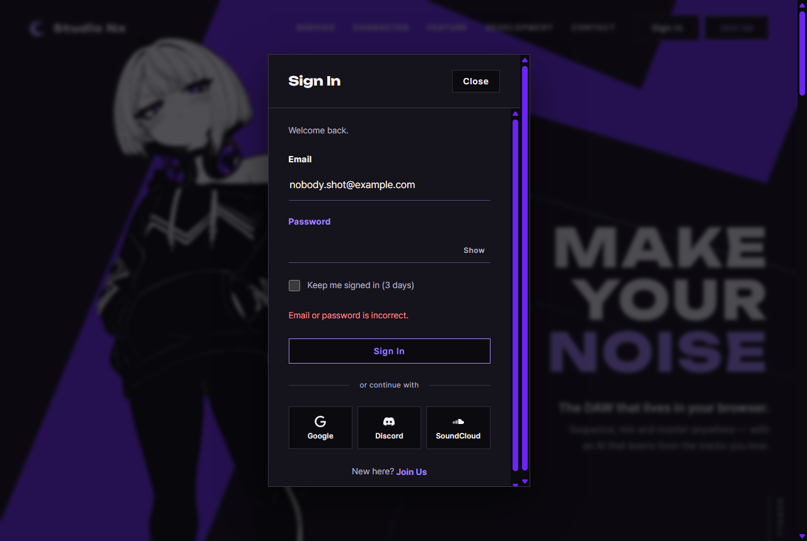

# JS 13 — `initLoginForm()`

| 항목 | 내용 |
|---|---|
| 파일 | `studionx/frontend/static/js/core/auth-ui.js` |
| 작업 | P1-07 가입 · 로그인 JS · PRD 01 FR-103 · FR-109 |
| 작성 | Claude (AI) · 2026-10-07 · 사용자 검토 |
| 이전 · 다음 | [12 `initAuthState()`](12_auth-ui_initAuthState.md) · [14 `initLoginModalFromHash()`](14_home_initLoginModalFromHash.md) |

## 1. 하는 일
로그인 모달의 **Sign In** 버튼을 누르면 서버에 로그인하고, 결과에 따라 화면을 바꾼다. **이 함수로 사람이 화면에서 직접 로그인할 수 있게 됐다.**

| 경우 | 화면 |
|---|---|
| 맞음 · 주소에 `next` 없음 (home.html 에서 Sign In) | 모달이 닫히고 헤더가 **My Page · My Projects** 로 |
| 맞음 · 주소에 `next` 있음 (`home.html#login?next=%2FmyPage.html`) | 그 페이지(`/myPage.html`)로 이동 |
| 틀림 · 없는 이메일 | 모달 안 빨간 글 "Email or password is incorrect.", **비밀번호 칸만 비우고** 거기에 커서 |
| 정지 계정 (비밀번호 맞음) | 빨간 글 "This account is disabled." (서버 문구) |
| 빈 칸 | 브라우저가 "이 입력란을 작성하세요" — 서버로 보내지 않음 |



## 2. 언제 쓰나
로그인 모달이 있는 페이지가 열릴 때 한 번 부른다.

| 페이지 | 부르는 곳 | 성공하면 |
|---|---|---|
| home.html | `home.js` — `initLoginForm({ onSuccess: null })` | 기본 동작 (위 표) |
| join.html | `join.js` — 같음 | 기본 동작. 17 `initJoinForm` 때 `onSuccess` 로 "홈으로" 를 넣을 예정 |

### 누르면 일어나는 일
| 순서 | 일어나는 일 | 관련 |
|---|---|---|
| ① | 빈 칸 · 이메일 모양을 **브라우저가** 먼저 검사 (HTML `required` · `type="email"`) | |
| ② | Sign In 버튼 비활성 (두 번 누르기 방지), 오류 글 숨김 | |
| ③ | `POST /api/v1/auth/login` `{email, password, remember}` | [JS 02](<../P1-02 - 프론트 공통 JS/02_api_apiFetch.md>) · [백엔드 32](<../../backend(fastAPI_Python)/P1-05 - 로그인 API/32_auth_route_login.md>) |
| ④-성공 | `setAccessToken(access_token)` (메모리), 리프레시 쿠키는 서버가 심음 | [JS 01](<../P1-02 - 프론트 공통 JS/01_api_refreshAccessToken.md>) |
| ⑤-성공 | 주소의 `next` 확인 → 이동 또는 모달 닫고 헤더 바꿈 | [JS 05 `parseLoginHash`](<../P1-02 - 프론트 공통 JS/05_auth_parseLoginHash.md>) |
| ④-실패 | 오류 글 표시, 비밀번호 칸 비우고 커서 | |
| ⑥ | 버튼 다시 켬 | |

## 3. 코드
**import** (파일 맨 위)
```js
import { api, setAccessToken } from './api.js';
import { isLoggedIn, parseLoginHash } from './auth.js';
```
**`api` · `setAccessToken` · `parseLoginHash` 를 이번에 추가했다.** 이 함수가 셋 다 쓴다 (`isLoggedIn` 은 12 가 씀).

**함수**
```js
export function initLoginForm(options = {}) {
  const form = document.getElementById('login-form');
  if (!form || form.dataset.loginReady === 'on') return;
  form.dataset.loginReady = 'on';

  const email = document.getElementById('login-email');
  const password = document.getElementById('login-password');
  const remember = document.getElementById('login-remember');
  const error = document.getElementById('login-error');
  const submit = form.querySelector('button[type="submit"]');

  form.addEventListener('submit', async (event) => {
    event.preventDefault();
    error.hidden = true;
    submit.disabled = true;
    try {
      const data = await api.post(
        '/auth/login',
        { email: email.value, password: password.value, remember: remember.checked },
        { auth: false },
      );
      setAccessToken(data.access_token);
      const next = parseLoginHash().next;
      if (options.onSuccess) {
        options.onSuccess(next);
      } else if (next) {
        location.href = next;
      } else {
        const modal = document.getElementById('login-modal');
        if (modal && modal.open) modal.close();
        document.documentElement.dataset.auth = 'in';
        form.reset();
      }
    } catch (err) {
      if (err.status === 401 || err.status === 422) {
        error.textContent = 'Email or password is incorrect.';
      } else {
        error.textContent = err.message || 'Something went wrong. Please try again.';
      }
      error.hidden = false;
      password.value = '';
      password.focus();
    } finally {
      submit.disabled = false;
    }
  });
}
```

**최신 문법으로 쓰면** (공부용 — 실제 코드는 위)
```js
export function initLoginForm({ onSuccess } = {}) {
  const form = document.getElementById('login-form');
  if (!form || form.dataset.loginReady) return;
  form.dataset.loginReady = 'on';
  const [email, password, remember, error] =
    ['login-email', 'login-password', 'login-remember', 'login-error'].map((id) => document.getElementById(id));
  const submit = form.querySelector('[type="submit"]');

  form.addEventListener('submit', async (event) => {
    event.preventDefault();
    error.hidden = true;
    submit.disabled = true;
    try {
      const { access_token } = await api.post('/auth/login',
        { email: email.value, password: password.value, remember: remember.checked }, { auth: false });
      setAccessToken(access_token);
      const { next } = parseLoginHash();
      if (onSuccess) return onSuccess(next);
      if (next) return location.assign(next);
      document.getElementById('login-modal')?.close();
      document.documentElement.dataset.auth = 'in';
      form.reset();
    } catch (err) {
      error.textContent = [401, 422].includes(err.status)
        ? 'Email or password is incorrect.'
        : err.message ?? 'Something went wrong. Please try again.';
      error.hidden = false;
      password.value = '';
      password.focus();
    } finally {
      submit.disabled = false;
    }
  });
}
```
| 최신 문법 | 실제 코드 | 뜻 |
|---|---|---|
| `function f({ onSuccess } = {})` | `function f(options = {})` + `options.onSuccess` | 인자 객체에서 바로 꺼냄 (구조 분해) |
| `const [a, b] = [...].map(…)` | 한 줄에 하나씩 `const a = …` | 여러 변수를 한 번에 |
| `const { access_token } = await …` | `const data = await …` + `data.access_token` | 응답에서 칸 꺼내기 |
| `modal?.close()` | `if (modal && modal.open) modal.close()` | 있을 때만 |
| `[401, 422].includes(err.status)` | `err.status === 401 \|\| err.status === 422` | 둘 중 하나인지 |
| `err.message ?? '…'` | `err.message \|\| '…'` | 없으면 대신 쓸 글 (빈 글자일 때는 결과가 다름 — 실제 코드는 빈 글자도 대신 씀) |

### 문법 풀이
| import 문법 | 뜻 |
|---|---|
| `import { api, setAccessToken } from './api.js'` | 같은 폴더 `api.js` 에서 두 이름을 가져옴 |

| 식 | 뜻 |
|---|---|
| `form.addEventListener('submit', …)` | 폼을 보낼 때(버튼 클릭 · Enter). 브라우저 검사(`required`)를 **통과해야만** 이 일이 일어남 |
| `event.preventDefault()` | 브라우저가 페이지를 새로 여는 원래 전송을 막음 — 대신 JS 가 보냄 |
| `try { … } catch (err) { … } finally { … }` | 실패하면 `catch`, 성공 · 실패와 상관없이 마지막에 `finally` |
| `err.status` | [`ApiError`](<../P1-02 - 프론트 공통 JS/02_api_apiFetch.md>) 의 HTTP 상태 번호 |
| `{ auth: false }` | 로그인 요청에는 토큰을 붙이지도, 재발급하지도 않음 |
| `modal.open` · `modal.close()` | `<dialog>` 가 열려 있는지 · 닫기 |
| `form.reset()` | 폼의 입력을 처음 상태로 |
| `location.href = next` | 그 주소로 이동 |

## 4. 흐름
1. 폼이 없거나 이미 연결했으면 끝.
2. 보낼 때 — 오류 숨김, 버튼 끔.
3. 로그인 요청 → 성공하면 토큰 저장 → `onSuccess` / `next` 로 이동 / 모달 닫고 헤더 바꿈.
4. 실패하면 오류 글 · 비밀번호 비움 · 커서.
5. 버튼 다시 켬.

## 5. 왜 이렇게
| 선택 | 이유 |
|---|---|
| 401 · 422 는 같은 문구로 | 서버(29)와 같은 원칙 — 무엇이 틀렸는지 알려 주지 않는다. 422(형식 틀림)도 화면에서는 같은 문구 |
| 403 · 그 밖은 서버 문구 그대로 | 정지 계정("This account is disabled.")은 비밀번호가 맞은 본인에게만 오는 답이라 그대로 보여 준다. 네트워크 오류도 `api.js` 의 문구로 |
| 실패하면 **비밀번호만** 비움 | 대부분 비밀번호를 잘못 친 것이다. 이메일은 다시 치지 않게 남긴다 |
| 전송 중 버튼 끔 | 두 번 눌러 요청이 두 번 가는 것을 막는다 |
| `onSuccess` 가 없으면 기본 동작 (템플릿은 페이지마다 넘기라고 함) | home.html 의 `onSuccess` 가 `null` 이어도 바로 쓸 수 있다. 다른 동작이 필요한 페이지(join.html)만 넘기면 된다 |
| `next` 는 `parseLoginHash()` 로 | [JS 05](<../P1-02 - 프론트 공통 JS/05_auth_parseLoginHash.md>) 가 `safeNextPath` 로 검사한 값이라, 바깥 사이트로 보내지는 일이 없다 |
| 헤더는 재확인 없이 `data-auth="in"` | 방금 로그인에 성공했으니 `/auth/refresh` 를 다시 부를 필요가 없다 |

## 6. 시험 (실제 home.html 에서 실제 서버로 · 12개)
시험 계정을 실제 가입 API 로 만들고, 끝난 뒤 DB 에서 지웠다.

| 시험 | 확인한 것 |
|---|---|
| 연결 | `home.js` 가 페이지를 열 때 이미 연결함 |
| 틀린 비밀번호 | 전송 중 버튼 꺼짐 → 오류 "Email or password is incorrect.", 이메일 남음 · 비밀번호 빈 칸 · 커서가 비밀번호 칸 · 버튼 다시 켜짐, 토큰 없음 · 모달 열림 |
| 없는 이메일 | 같은 문구 |
| 빈 칸 | `/auth/login` 요청이 하나도 나가지 않음 (브라우저 검사) |
| 성공 (`next` 없음) | 오류 숨김 · 모달 닫힘 · `data-auth="in"` · 폼 비움, 메모리 토큰 있음, 재발급 200 (쿠키도 생김) |
| 성공 (`#login?next=%2FmyPage.html%3Ftab%3Dusage`) | `/myPage.html?tab=usage` 로 이동하려 함 (시험에서는 브라우저의 Navigation API 로 이동만 막고 목적지를 읽음) |
| `onSuccess` 를 준 경우 | `onSuccess('/myPage.html?tab=usage')` 로 불림 |
| 두 번 부름 | 중복 연결 없음 |

12/12 통과. 위 캡처는 없는 이메일 · 틀린 비밀번호로 보낸 뒤 찍었다.
